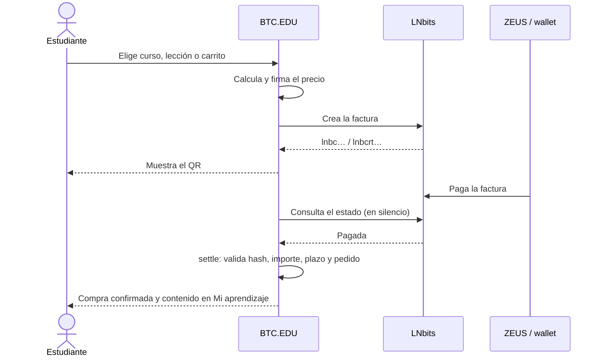

<div align="center">

# BTC.EDU

**Aprende pagando solo lo que necesitas, en sats.**

Plataforma educativa con micropagos Lightning: cursos, lecciones, tutoriales y recursos que se compran por unidad, por curso o en paquete, con acceso concedido en el servidor al confirmarse el pago.

[](https://www.python.org/)
[](https://www.djangoproject.com/)
[](https://lightning.network/)
[](https://lnbits.com/)
[](https://lightningpolar.com/)
[](docs/)
</div>

---

## Qué es

BTC.EDU nace de una pregunta: ¿cómo puede alguien comprar solo el contenido educativo que necesita, sin pagar un curso completo ni mantener una suscripción? Los educadores publican cursos, tutoriales y recursos con precio en sats; los estudiantes pagan una factura Lightning y el contenido queda en su biblioteca de forma permanente.

Es el proyecto del reto *Micropayments for Content* de CUBO+, en El Salvador.

| | |
|---|---|
| 📚 **Catálogo** | 25 cursos y 252 lecciones en seis categorías, 30 tutoriales, 30 recursos y 6 rutas de aprendizaje |
| ⚡ **Pagos** | Facturas Lightning por curso, lección, carrito o paquete; membresía, cupones, regalos, propinas y reembolsos |
| 🔒 **Acceso** | Una sola regla en el servidor decide qué se ve; el navegador nunca fija precios ni desbloquea contenido |
| 🎓 **Aprendizaje** | Progreso, evaluaciones, prácticas con entrega, certificados con huella SHA-256 y sello OpenTimestamps |
| 🧑‍🏫 **Educadores** | Estudio con borradores, revisión antes de publicar, versiones congeladas, ventas y métricas |
| 💬 **Comunidad** | Conversaciones por curso y lección, preguntas privadas, avisos y moderación |
| 🌐 **Idiomas** | Interfaz en español e inglés (`/en/`), modo claro y oscuro, instalable como aplicación |

## Cómo funciona un pago



Si algo no coincide, el pago queda como incidencia para administración y no concede acceso. Una confirmación repetida no duplica compras.

## Inicio rápido

Requiere Windows con PowerShell. Desde la raíz del repositorio:

```powershell
./dev.ps1
```

El script descarga `uv`, Python 3.12, las dependencias y LNbits dentro de `src/.local`, aplica migraciones e inicia LNbits y Django en `http://127.0.0.1:8000/`. La conexión del comercio, la carga del catálogo y el modo regtest con Polar y ZEUS están en la [guía técnica](src/README.md#instalación-y-arranque).

## Estructura del repositorio

```text
.
├── dev.ps1 · dev-platform.ps1   arranque completo o solo plataforma
├── src/                          código Django, scripts, traducciones y documentación técnica
├── strategy/                     investigación, requisitos y decisiones, numerados en orden de lectura
└── docs/                         documentos originales del reto CUBO+
```

## Documentación

| | Documento | Para qué |
|---|---|---|
| 📘 | [Informe](strategy/01-informe.md) | Idea, investigación, objetivos, desarrollo, logros y manual de uso |
| 🗂️ | [Índice de strategy](strategy/README.md) | Requisitos, investigación, producto, arquitectura, catálogo y validación |
| 🛠️ | [Guía técnica](src/README.md) | Instalación, arquitectura, lógica de compra y comprobaciones |
| 📓 | [Operación y bitácora](src/docs/operacion-y-bitacora.md) | Operación local, decisiones, pendientes e historial por día |
