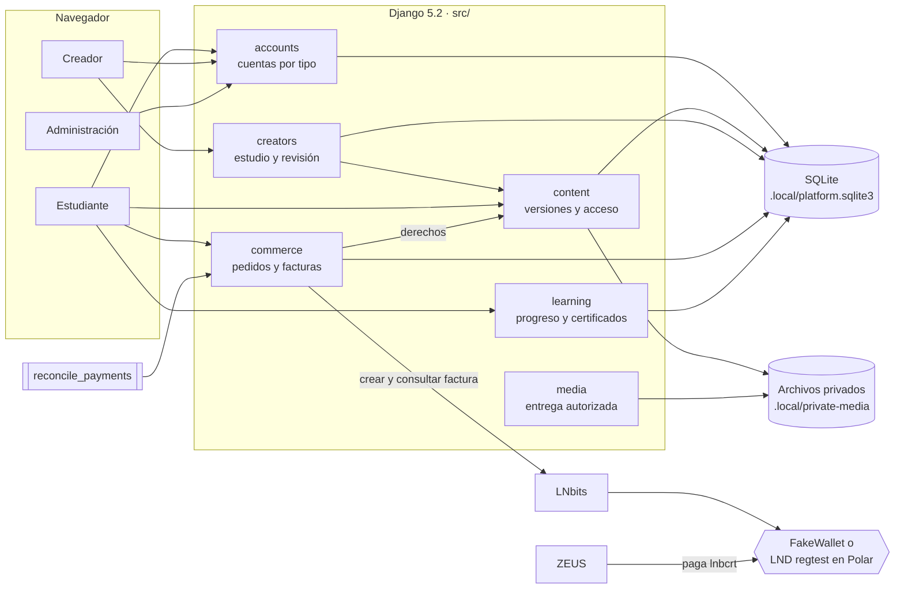

# BTC.EDU

Plataforma educativa en español e inglés donde educadores publican cursos, tutoriales y recursos, y los estudiantes pagan con Lightning solo lo que necesitan: un curso, una lección o un paquete. El acceso se concede en el servidor cuando el proveedor confirma el pago. Funciona en local con LNbits sobre FakeWallet o sobre una red regtest de Polar; no mueve fondos reales.

## Requisitos

- Windows con PowerShell 5.1 o superior.
- Git e internet en el primer arranque: el script descarga `uv`, Python 3.12, las dependencias y LNbits v1.6.2 dentro de `src/.local`.
- Puertos libres: 8000 (plataforma) y 5000 (LNbits con FakeWallet).
- Opcional: Node para los verificadores de JavaScript; Docker y [Polar](https://lightningpolar.com/) con ZEUS para pagar con una wallet en regtest.

## Instalación y arranque

Desde la raíz del repositorio:

```powershell
./dev.ps1
```

El script prepara el entorno, crea `src/.env` con una clave propia, aplica las migraciones e inicia LNbits y Django. Si `src/.local/commerce.env` indica `COMMERCE_PAYMENT_MODE=regtest`, también prepara la red Polar (con Docker y Polar abiertos) e inicia LNbits regtest en el puerto 5001. Para iniciar solo la plataforma, sin pagos, se usa `./dev-platform.ps1`. Si Windows bloquea los scripts: `powershell -ExecutionPolicy Bypass -File .\dev.ps1`.

En otra terminal, con LNbits activo, se conecta el comercio a FakeWallet. Las claves quedan en `src/.local/commerce.env`, fuera de Git:

```powershell
./src/.venv/Scripts/python.exe src/scripts/setup-commerce.py
```

Desde `src`, se crea la cuenta administrativa y se carga el catálogo inicial. Las cargas de contenido respaldan la base antes de escribir y repetirlas no duplica contenido:

```powershell
./.venv/Scripts/python.exe manage.py createsuperuser
./.venv/Scripts/python.exe manage.py load_editorial_catalog
./.venv/Scripts/python.exe manage.py load_complete_courses
./.venv/Scripts/python.exe manage.py load_tutorials_resources
./.venv/Scripts/python.exe manage.py load_learning_paths
```

Después de reiniciar Django:

| Dirección | Uso |
|---|---|
| `http://127.0.0.1:8000/` | Plataforma: catálogo, registro de estudiante o creador |
| `http://127.0.0.1:8000/admin/` | Administración: aprobar creadores, revisar publicaciones, reembolsos e incidencias |
| `http://127.0.0.1:5000/` | LNbits con FakeWallet |

Los registros de estudiante y creador son independientes; una cuenta de creador espera la aprobación de administración. Para pagar con ZEUS en regtest y para la conciliación supervisada, consultar la [guía de operación](docs/operacion-y-bitacora.md#pagos-con-polar-y-zeus).

## Arquitectura



| Aplicación | Responsabilidad |
|---|---|
| `accounts` | Cuentas separadas de estudiante, creador y administración; sesión, recuperación, exportación y avatares. |
| `content` | Cursos, tutoriales y recursos; revisiones congeladas, versiones publicadas, catálogo y la regla única de acceso (`content/access.py`). |
| `creators` | Solicitudes de creador, estudio del educador, envío a revisión y perfiles públicos. |
| `commerce` | Ofertas en sats, carrito, pedidos firmados, facturas Lightning, membresía, cupones, regalos, propinas, reembolsos y conciliación. |
| `learning` | Inscripciones, progreso, evaluaciones, prácticas, certificados con SHA-256, comunidad, rutas y guardados. |
| `media` | Almacenamiento privado y entrega de videos, PDF y subtítulos tras comprobar el acceso. |
| `core` | Inicio, navegación, analítica interna y aplicación instalable. |

Las vistas usan plantillas de Django, Bootstrap y JavaScript propio en `static/js`; estilos, fuentes y dependencias se sirven en local, sin CDN.

## Lógica principal

**Publicación.** El creador edita borradores. Al enviarlos a revisión se congela una copia; la aprobación publica exactamente esa copia como una versión. Editar después no cambia lo publicado ni lo que alguien ya compró.

**Compra.** El recorrido está en `commerce/orders.py` y `commerce/services.py`:

1. El servidor calcula el precio de la selección (carrito, compra directa o paquete de una ruta) y firma una cotización. El navegador no fija precios.
2. Al preparar el pago se reserva un pedido con sus líneas y una factura por el total, que vence a los 15 minutos.
3. `ensure_emitted` pide la factura a LNbits fuera de la transacción de base de datos. Si la respuesta se pierde, recupera la misma factura en lugar de crear otra.
4. La página consulta `facturas/<id>/estado/` en silencio; `reconcile` pregunta a LNbits y llama a `settle`.
5. `settle` compara el hash, el importe en msat, el plazo, la composición del pedido y las compras previas. Si todo coincide, crea la compra, los derechos (`Entitlement`) y la inscripción en una sola transacción. Si algo no coincide, guarda la evidencia como incidencia para administración y no concede acceso.

Una confirmación repetida no duplica compras ni derechos. `manage.py reconcile_payments --watch` revisa las facturas pendientes aunque nadie tenga la página abierta.

**Acceso.** `content_access` en `content/access.py` decide para HTML, JSON y archivos. Concede acceso al creador en vista previa, al contenido gratuito publicado, a la revisión comprada o a la membresía vigente si el curso está incluido. Inscribirse no desbloquea lecciones de pago.

**Idiomas.** El español es el idioma de origen y usa las direcciones sin prefijo; el inglés vive bajo `/en/` (`i18n_patterns` y `LocaleMiddleware`). El botón ES/EN de la cabecera lleva a la misma página en el otro idioma y cada página declara `lang` y sus alternativas `hreflang`. Hay dos catálogos en `locale/en/LC_MESSAGES/`:

- `django.po`: la interfaz. Las plantillas usan `` y `` (con `count` para los plurales), el código Python `gettext` y `gettext_lazy`, y el JavaScript recibe sus mensajes con `btcT()` desde `core/js_text.py`.
- `content.po`: títulos, descripciones, objetivos, requisitos y resultados del catálogo propio de BTC.EDU. El filtro `|tr` y `translate_content` buscan el texto publicado; lo que escribe un educador se muestra tal como lo escribió. Los cuerpos de las lecciones siguen en español y la página los marca con `lang="es"`.

`manage.py translations extract` actualiza ambos `.po` desde plantillas, código y catálogos sin perder lo traducido; `translations compile` genera los `.mo` y `translations status` cuenta lo que falta. Se implementaron en Python porque el entorno no incluye las herramientas de GNU gettext; los `.mo` se versionan para que el servidor no las necesite.

**Aprendizaje.** Las evaluaciones se corrigen en el servidor con preguntas y reglas por versión. El certificado se emite al cumplir los requisitos publicados; su huella SHA-256 permite comprobar los datos y, si se activa, OpenTimestamps sella la fecha en Bitcoin.

## Comprobaciones

Desde la raíz:

```powershell
./src/scripts/check-platform.ps1
```

Ejecuta `manage.py check`, comprueba que no falten migraciones, corre las pruebas de todas las aplicaciones, Ruff y los controles de concurrencia de comercio, evaluaciones, certificados, comunidad y cuentas. `src/scripts/preview-*.py` prepara datos temporales para recorrer cada parte sin tocar la base principal. Los resultados de cada entrega están en la [bitácora](docs/operacion-y-bitacora.md#bitácora).

Tras cambiar textos, `manage.py translations extract`, traducir lo nuevo en `locale/en/LC_MESSAGES/*.po` y `manage.py translations compile`; `core/test_i18n.py` falla si un texto queda sin traducir o si los `.mo` no corresponden a los `.po`.

## Estructura

```text
src/
├── accounts/ content/ creators/ commerce/ learning/ media/ core/   aplicaciones Django
├── platform_config/   settings, urls y wsgi
├── templates/ static/  interfaz
├── locale/             traducción al inglés de la interfaz y del catálogo
├── scripts/            arranque, preparación de pagos, verificadores y vistas previas
├── config/             plantillas de .env para la plataforma y LNbits
├── docs/               operación, bitácora y evidencias seleccionadas
└── .local/             base, archivos, LNbits, credenciales y respaldos (ignorado por Git)
```

## Límites

Es un entorno local: no tiene despliegue con HTTPS, correo con entrega comprobada, supervisión ni respaldo automatizado. Los pagos con FakeWallet y regtest no acreditan cobros reales. No hay liquidación automática a educadores. En inglés, los cuerpos de lecciones y tutoriales, las preguntas de evaluación y los textos guardados al crear avisos o facturas siguen en español. La propuesta, los precios y la utilidad educativa todavía no están validados con participantes.

## Documentación

- [Informe principal](../strategy/01-informe.md): idea, investigación, producto, desarrollo y próximos pasos.
- [Investigación y requisitos](../strategy/README.md): fuentes, costos, validación pendiente, criterios y decisiones.
- [Operación y bitácora](docs/operacion-y-bitacora.md): operación detallada, decisiones, pendientes y registro por día.
- Originales de CUBO+ en `../docs`.
