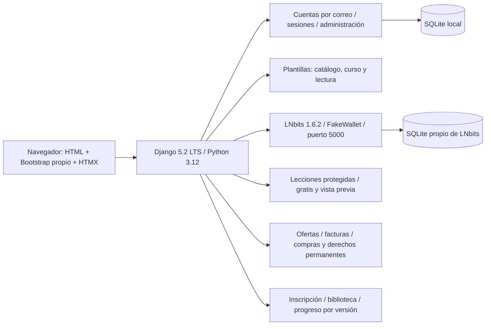
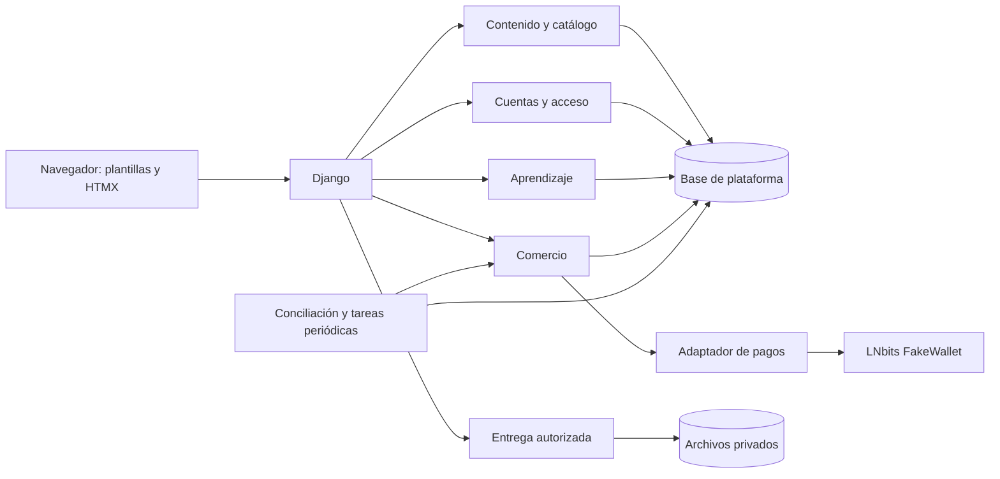

# Operación y bitácora

## Estado documentado

La plataforma local integra cuentas independientes, revisión editorial, contenido versionado, archivos privados, ofertas y facturas, compras y acceso persistente, biblioteca, progreso, evaluaciones, certificados con huella SHA-256, preguntas, avisos, métricas, perfiles y comunidad por curso y lección. El catálogo local contiene seis cursos de Bitcoin y Lightning y 24 lecciones. Incluye modo claro/oscuro y navegación por contexto. El [informe principal](../../strategy/19-recomendacion-y-entrega-final.md) explica el producto y sus límites.

Las verificaciones registradas tienen fechas y alcances distintos. El registro de perfiles informa 227 pruebas; aprendizaje informa seis incidencias en un chequeo conjunto de cambios concurrentes. La consolidación documental del 13 de octubre de 2026 no reejecuta pruebas ni acredita un cierre global de la aplicación. Los registros específicos conservan esa diferencia.

La validación con personas, los precios comerciales, las membresías y la operación pública siguen pendientes. FakeWallet y Polar/regtest son entornos distintos descritos en sus registros; ninguno acredita cobros con fondos reales. El certificado SHA-256 no es una firma digital ni un registro en Bitcoin.

## Consulta por tema

- [Arranque y comandos locales](#guia-local-anterior)
- [arquitectura-btc-edu](#arquitectura-btc-edu)
- [base-tecnica](#base-tecnica)
- [catalogo-editorial-2026-10-12](#catalogo-editorial-2026-10-12)
- [certificados-sha256-2026-10-10](#certificados-sha256-2026-10-10)
- [comercio-y-aprendizaje-2026-10-04](#comercio-y-aprendizaje-2026-10-04)
- [componentes-visuales](#componentes-visuales)
- [comunidad-2026-10-10](#comunidad-2026-10-10)
- [comunidad-en-lecciones-2026-10-12](#comunidad-en-lecciones-2026-10-12)
- [conciliacion-2026-10-10](#conciliacion-2026-10-10)
- [contenido-versiones-y-archivos-2026-10-02](#contenido-versiones-y-archivos-2026-10-02)
- [contenido](#contenido)
- [cuentas-independientes-2026-10-03](#cuentas-independientes-2026-10-03)
- [diseno-plataforma](#diseno-plataforma)
- [esenciales-2026-10-10](#esenciales-2026-10-10)
- [estudio-creadores-2026-10-03](#estudio-creadores-2026-10-03)
- [evaluaciones-2026-10-07](#evaluaciones-2026-10-07)
- [experiencia-aprendizaje-2026-10-12](#experiencia-aprendizaje-2026-10-12)
- [experiencia-compra-2026-10-04](#experiencia-compra-2026-10-04)
- [experiencia-evaluaciones-2026-10-12](#experiencia-evaluaciones-2026-10-12)
- [interfaz-academia-2026-10-02](#interfaz-academia-2026-10-02)
- [lnbits-local](#lnbits-local)
- [lnbits-regtest](#lnbits-regtest)
- [modo-oscuro-2026-10-12](#modo-oscuro-2026-10-12)
- [perfiles-y-comunidad-2026-10-12](#perfiles-y-comunidad-2026-10-12)
- [recorrido-aprendizaje-2026-10-02](#recorrido-aprendizaje-2026-10-02)
- [verificacion-2026-10-01](#verificacion-2026-10-01)

## Guías, decisiones y registros de entrega

Se conservan instrucciones reproducibles, fechas, migraciones, pruebas, referencias y enlaces a evidencias. Los diseños previos describen propuestas; los registros de entrega acreditan únicamente su alcance indicado. Los pendientes anteriores no reemplazan el estado documentado al inicio.

<a id="guia-local-anterior"></a>

## BTC.EDU — plataforma educativa

Origen: `src/README.md`. Registro conservado; sus fechas, cifras y pendientes corresponden a la entrega o propuesta descrita.

Pulido de evaluaciones del **12 de octubre de 2026**: preparación con reglas separadas, una pregunta por pantalla, opciones amplias, avance y revisión antes de entregar; resultado orientado al repaso y editor con preguntas plegables. Formulario completo disponible sin JavaScript. **29 pruebas enfocadas pasan** y recorrido de alumno/creador verificado por HTTP en una base temporal, con revisión de escritorio/móvil y temas claro/oscuro. [Referencias, comportamiento, capturas y límites](operacion-y-bitacora.md#experiencia-evaluaciones-2026-10-12). Validación con participantes pendiente; los registros siguientes conservan su alcance.

Entrega de experiencia de aprendizaje del **12 de octubre de 2026**: ficha con continuación por versión, temario con estados, prácticas y soluciones desplegables, lectura enfocada, biblioteca con búsqueda/estados y presentación de precios por unidad de compra. **39 pruebas enfocadas** y cuatro controles de concurrencia pasan, junto con la comprobación del cliente y revisión de escritorio/móvil con base temporal. El último chequeo conjunto de esta tarea registró seis incidencias en cambios concurrentes de cuentas/creadores; no se declara verificación global. Integración local con respaldo y sin reducción de filas en las 54 tablas anteriores. [Comportamiento, fuentes, evidencias y límites](operacion-y-bitacora.md#experiencia-aprendizaje-2026-10-12). Los registros siguientes conservan sus fechas y alcance.

Estado vigente al **12 de octubre de 2026**: perfiles de estudiante con alias, presentación, intereses y compartición voluntaria; directorio Personas y fichas de creadores integradas con la comunidad. Búsqueda en conversaciones/respuestas visibles, filtros, recuentos, actividad y seguimiento con avisos internos. **227 pruebas pasan**, Ruff, migraciones y cuatro controles de concurrencia; 35 pruebas de perfiles/comunidad repetidas tras los últimos ajustes. Migraciones locales con respaldo y conservación de filas anteriores; revisión del directorio, perfil móvil y edición de alias en navegador con base temporal. [Reglas, uso, evidencia y próximos pasos](operacion-y-bitacora.md#perfiles-y-comunidad-2026-10-12). Operación pública y validación con personas siguen pendientes; los registros siguientes conservan su alcance histórico.

Catálogo local ampliado el **12 de octubre de 2026**: seis cursos introductorios de Bitcoin y Lightning, 24 lecciones de texto con ejercicios y soluciones, seis comprobaciones finales y políticas de certificado. Tres cursos gratuitos; los otros tres ofrecen una lección gratuita y tres de pago. Importador con respaldo e idempotencia, sin modificar cursos existentes. [Contenido, carga, verificación y límites](operacion-y-bitacora.md#catalogo-editorial-2026-10-12). Los resultados fechados siguientes conservan el historial de desarrollo.

Estado vigente al **10 de octubre de 2026**: comunidad por versión para alumnos inscritos y creador aprobado, con conversaciones, respuestas, reportes y moderación auditada. Ocultar/mostrar, cerrar/reabrir y suspender/restablecer escritura requieren motivo; se conservan lectura, compras y progreso. Avisos internos y acceso administrativo con permiso específico. **210 pruebas pasan**, Ruff y migraciones consistentes, cuatro controles de concurrencia. Migración local con respaldo y sin ejemplos; recorrido de alumno en Chrome y móvil. [Reglas, uso y límites](operacion-y-bitacora.md#comunidad-2026-10-10). Membresías, apelaciones por formulario y operación pública siguen pendientes; los registros siguientes conservan sus resultados históricos.

Estado vigente al **10 de octubre de 2026**: conciliación periódica supervisada con `reconcile_payments --watch`, lotes rotativos, reintento del proveedor y parada con Ctrl+C. **192 pruebas pasan**, revisión estática y migraciones consistentes. [Comportamiento, evidencia y límites](operacion-y-bitacora.md#conciliacion-2026-10-10). La instalación como servicio y alertas siguen pendientes; los registros siguientes conservan sus cifras históricas.

Estado vigente al **10 de octubre de 2026**: cada certificado conserva una huella SHA-256 de sus datos; PDF, verificación web y descarga JSON reproducible, sin divulgar notas ni respuestas. Se detectan diferencias y se conserva la revocación. **184 pruebas pasan**, con migraciones, Ruff y tres comprobaciones de concurrencia. Se verificó SHA-256 con Node sobre el archivo descargado y el formulario real en escritorio/móvil. Migración con respaldo, sin ejemplos en la base principal. [Reglas, reproducción y evidencia](operacion-y-bitacora.md#certificados-sha256-2026-10-10). Es una huella de integridad comparada con BTC.EDU, sin firma digital ni registro Bitcoin.

Estado registrado al **10 de octubre de 2026** (El Salvador): certificados históricos con PDF privado, compartición voluntaria y revocación; preguntas privadas por lección; notificaciones internas; paneles de creador y administración con periodos, permisos y denominadores. **179 pruebas pasan**, revisión estática/migraciones y tres controles de concurrencia. Recorridos HTTP en Chrome, formularios con CSRF, escritorio/móvil y PDF comprobados. Base principal migrada con respaldo y 211 registros conservados, sin datos de demostración. [Reglas, uso, evidencia y límites](operacion-y-bitacora.md#esenciales-2026-10-10). Comunidad, membresías y operación pública siguen pendientes; el usuario comprobará posteriormente el pago desde ZEUS. Los párrafos fechados siguientes conservan el historial.

Estado registrado al **7 de octubre de 2026** (El Salvador): evaluaciones de selección única/múltiple por versión, reglas del creador, corrección en servidor, guardado/retoma, límites y espera, resultados privados y autorización de otro intento con motivo. La evaluación obligatoria requiere aprobación para completar la lección. **148 pruebas pasan**, junto con concurrencia comercial y de evaluaciones. Migración aplicada con respaldo, sin datos de demo en la base principal. [Uso, reglas, capturas y límites de verificación](operacion-y-bitacora.md#evaluaciones-2026-10-07). Certificados y preguntas son los próximos módulos; pagos continúan simulados.

Actualización de experiencia del **4 de octubre**: compra con resumen, «Continuar al pago», «Pagar [importe] sats», procesamiento y confirmación con fecha; aviso de saldo de prueba concentrado en el entorno. 60 pruebas relacionadas, integración FakeWallet y recorrido en navegador pasan. [Registro y capturas](operacion-y-bitacora.md#experiencia-compra-2026-10-04).

Estado registrado al **4 de octubre de 2026** (El Salvador): ofertas revisadas con precios en sats de prueba, facturas integradas con LNbits FakeWallet, compras y derechos permanentes sobre revisiones, biblioteca, inscripción y progreso con continuación por versión. **129 pruebas pasan**, junto con concurrencia SQLite en archivo y compra real contra el proveedor ficticio. [Comportamiento, preparación y evidencia](operacion-y-bitacora.md#comercio-y-aprendizaje-2026-10-04). Los registros fechados siguientes conservan los estados anteriores.

Actualización de acceso del **3 de octubre de 2026**: cuentas independientes de creador y estudiante, registros, logins, perfiles y recuperación separados; el mismo correo puede pertenecer a identidades distintas. Estudio con navegación propia y aprobación de creador conservada. **96 pruebas pasan.** [Rutas, migración y límites](operacion-y-bitacora.md#cuentas-independientes-2026-10-03). Este bloque sustituye la cuenta compartida y la ausencia de registro público descritas en los registros anteriores.

Actualización al **3 de octubre de 2026** (El Salvador): estudio de creadores con solicitud/aprobación, perfil público, cursos/tutoriales/recursos propios, edición de temario, biblioteca de archivos, vista previa y revisión editorial. Enviar conserva una copia; aprobar publica exactamente lo revisado. **77 pruebas pasan.** Migración aplicada con respaldo y base real sin ejemplos. Entrar en `/crear/solicitud/` con una cuenta existente; aprobación desde administración. [Recorrido, demostración y pendientes](operacion-y-bitacora.md#estudio-creadores-2026-10-03). Compras, progreso y módulos educativos ampliados siguen pendientes. El párrafo siguiente conserva el estado del bloque anterior.

Estado al **2 de octubre de 2026** (El Salvador): academia industrial con cursos, selector, tutoriales y recursos; publicación de versiones selladas y revisiones reutilizables; archivos privados MP4/PDF/TXT/VTT, reproducción/subtítulos/transcripción y descarga autorizada. Carga/publicación disponibles en administración. Compras, acceso adquirido a versiones anteriores, inscripciones/progreso y panel de creador siguen pendientes. No se cargó contenido en la base real. **54 pruebas pasan.** Ver [contenido/versiones/archivos y límites](operacion-y-bitacora.md#contenido-versiones-y-archivos-2026-10-02) e [interfaz](operacion-y-bitacora.md#interfaz-academia-2026-10-02).

Todo el código, configuración, herramientas y documentación técnica vive en `/src`. Business y requisitos están en `/strategy`; los originales del assignment permanecen en `/docs`, sin modificaciones.

**Dirección de desarrollo definida el 2 de octubre:** academia con cursos, tutoriales y biblioteca de recursos; catálogo por temas/niveles, selector, archivos protegidos, compras simuladas y continuidad de aprendizaje. Eventos educativos después. La [definición de producto y experiencia](../../strategy/investigacion-y-requisitos.md#10-arquitectura-y-experiencia-btc-edu) y la [arquitectura técnica](operacion-y-bitacora.md#arquitectura-btc-edu) son diseños para implementar por fases, no funciones ya disponibles. Conservan Django/HTMX, SQLite local y la identidad visual aprobada.

### Arranque local en Windows

Para desarrollar e inicializar todo desde la raíz, usa **Windows PowerShell 5.1 o PowerShell 7**:

```powershell
./dev.ps1
```

Prepara o actualiza ambos entornos, aplica migraciones pendientes y arranca Django con recarga automática y LNbits con FakeWallet. Conserva las bases de datos y los `.env` existentes. El primer arranque requiere internet y Git para descargar LNbits. Ctrl+C detiene los servicios iniciados por el script. Los puertos 8000 y 5000 deben estar libres; los registros de LNbits quedan en `src/.local/lnbits-dev.*.log`. Para habilitar la integración de facturas, preparar las wallets ficticias con `src/scripts/setup-commerce.py` según el apartado siguiente.

Para preparar y arrancar únicamente la plataforma con recarga automática:

```powershell
./dev-platform.ps1
```

Si Windows bloquea los scripts, puedes invocarlos con `powershell -ExecutionPolicy Bypass -File .\dev.ps1` o `powershell -ExecutionPolicy Bypass -File .\dev-platform.ps1`. El permiso se aplica solo a ese proceso.

También puedes preparar y arrancar cada componente por separado:

Desde la raíz del repositorio, en PowerShell:

```powershell
./src/scripts/setup-platform.ps1
./src/scripts/start-platform.ps1
```

Abrir **http://127.0.0.1:8000/**. Detener con Ctrl+C. El primer setup requiere internet, descarga uv oficial si falta, instala las versiones fijadas en `uv.lock`, genera una clave aleatoria privada en `src/.env` y aplica migraciones. No reemplaza un `.env` existente. El servidor escucha únicamente en la máquina local.

SQLite es el motor elegido por el usuario para esta etapa. La base se conserva en `src/.local/platform.sqlite3`; no requiere servidor ni credenciales de base de datos. Setup reutiliza la base existente y aplica migraciones pendientes. Ver [configuración y límites](operacion-y-bitacora.md#base-tecnica).

Para crear una cuenta de administración, desde `src`:

```powershell
./.venv/Scripts/python.exe manage.py createsuperuser
```

Introducir la contraseña en el terminal. Hay registros públicos separados para estudiante y creador. No hay cuentas de demostración en la base principal. Crear un creador no lo aprueba automáticamente; la administración revisa su solicitud.

### LNbits separado

```powershell
./src/scripts/setup-lnbits.ps1
./src/scripts/start-lnbits.ps1
```

LNbits: http://127.0.0.1:5000/, **FakeWallet, sin fondos reales**. Tiene su propio entorno `.local/lnbits/.venv`, configuración y SQLite. La plataforma usa `.venv`. Compartir uv y su caché no mezcla dependencias. Django crea y consulta facturas mediante un adaptador que solo admite el proveedor local con FakeWallet verificado. Las claves permanecen en el servidor.

Con LNbits activo, su prueba independiente desde la raíz:

```powershell
./src/.local/lnbits/.venv/Scripts/python.exe src/scripts/smoke-lnbits.py
```

La prueba crea wallets y pagos ficticios, no contenido. Preservar `.local/` y `.env`; contienen datos y credenciales privadas. Ver [LNbits local](operacion-y-bitacora.md#lnbits-local).

Con LNbits activo y sus credenciales locales preparadas por la prueba independiente, desde la raíz:

```powershell
./src/.venv/Scripts/python.exe src/scripts/setup-commerce.py
./src/.venv/Scripts/python.exe src/scripts/smoke-commerce.py
```

Setup conserva las wallets, comprueba FakeWallet y escribe `src/.local/commerce.env`, fuera de Git. Smoke usa una base temporal de plataforma y pagos ficticios. Repetir setup renueva la autenticación del proveedor; no activa fondos reales.

Para conciliar pendientes sin abrir el navegador, desde `src`:

```powershell
./.venv/Scripts/python.exe manage.py reconcile_payments --limit 100
```

Para mantener la conciliación periódica en un terminal supervisado, desde `src`:

```powershell
./.venv/Scripts/python.exe manage.py reconcile_payments --watch --interval 30 --limit 100
```

Revisa un lote y espera 30 segundos después de terminarlo. Ctrl+C detiene el proceso; el mismo comando permite reanudarlo. Los errores del proveedor se reintentan en pasadas posteriores, las confirmaciones inválidas se informan en el terminal y los pagos tardíos conservan evidencia sin conceder acceso. No se inicia automáticamente con el servidor. [Funcionamiento, pruebas y límites](operacion-y-bitacora.md#conciliacion-2026-10-10).

### Arquitectura actual

La investigación documental de Business del 5 de octubre está en [modelos/costos](../../strategy/investigacion-y-requisitos.md#13-monetizacion-precios-y-muestras), [instrumentos de validación](../../strategy/investigacion-y-requisitos.md#16-validacion-con-usuarios) y [documento principal](../../strategy/19-recomendacion-y-entrega-final.md). No añade funciones, precios ni proveedores. No hay sesiones externas. Las 129 pruebas aquí citadas corresponden a la entrega registrada, no a esta revisión documental. Antes de operación pública estimar consumo gratuito, acceso permanente y versiones históricas; auditar cobertura analítica. Cada entrega técnica debe actualizar las secciones afectadas del documento del proyecto.



Django mantiene autorización y reglas comerciales en el servidor; LNbits no sustituye catálogo, compras ni cuentas. Sus claves nunca llegan al navegador.

### Estructura

- `accounts/`: cuentas independientes por tipo/correo, registro, recuperación y administración.
- `core/`: páginas, espacio personal, health, eventos y paneles de métricas.
- `creators/`: aprobación, estudio, editor, perfil público y revisión editorial.
- `commerce/`: ofertas, integración FakeWallet, facturas, compras, evidencia y derechos.
- `learning/`: inscripción, biblioteca, progreso, evaluaciones, certificados, preguntas y notificaciones.
- `content/`: cursos, capítulos, lecciones de texto, fichas de videos/materiales, administración y regla de acceso.
- `platform_config/`: configuración, rutas y WSGI.
- `templates/`, `static/`: portada, catálogo, curso, lectura y estados vacíos; NType82, Ndot77 y Space Mono locales e ilustración industrial independiente; Bootstrap 5.3.8 y HTMX 2.0.8 locales.
- `design/`: concepto aprobado conservado.
- `scripts/`, `config/`: preparación, arranque, comprobación y ejemplos sin secretos.
- `docs/`: arquitectura, componentes, pruebas y límites.
- `.local/`, `.venv/`, `.env`: excluidos de Git.

### Verificación y alcance

```powershell
./src/scripts/check-platform.ps1
```

227 pruebas Django pasan, migraciones consistentes y revisión estática sin errores. Incluye comunidad y su control de concurrencia. Incluye concurrencia comercial, de evaluaciones y de certificados/preguntas/notificaciones. La comprobación incluye dos conexiones independientes a SQLite en archivo para reservas, pagos y avance concurrentes. La prueba de integración adicional crea y paga facturas contra LNbits FakeWallet, incluida recuperación de respuesta perdida; no se reejecutó en la ampliación de conciliación. [Recorrido de aprendizaje](operacion-y-bitacora.md#recorrido-aprendizaje-2026-10-02), [resultados de la base visual](operacion-y-bitacora.md#verificacion-2026-10-01), [pruebas de contenido](operacion-y-bitacora.md#contenido), [componentes](operacion-y-bitacora.md#componentes-visuales).

El proyecto completo sigue en desarrollo. Faltan membresías, corrección de credenciales, eventos de reproducción/muestras y operación pública. Evaluaciones, certificados, preguntas, avisos internos y paneles esenciales están implementados. La colección de Bitcoin y Lightning está publicada localmente; faltan revisión educativa externa, producción audiovisual y validación con usuarios. Ver [diseño completo](operacion-y-bitacora.md#diseno-plataforma). Las pruebas locales de concurrencia no son una medición de capacidad para tráfico público; la instalación de la conciliación como servicio, entrega de correo y alertas deben prepararse antes del despliegue.

No se publicó, desplegó ni hizo push. Historial diario GitHub, Google Doc de Business, entrevistas y validación externa siguen pendientes. Las fechas oficiales 3/8 de noviembre y el equipo dos/cuatro integrantes continúan sin aclarar.

### Apariencia

El selector de la cabecera alterna modo claro y oscuro. Sin elección previa sigue `prefers-color-scheme`; la elección explícita se guarda en `localStorage` (`btc-edu-theme`) y se comparte entre pestañas del mismo origen. Se aplica antes de cargar estilos para evitar un destello claro. Si el almacenamiento está bloqueado, el selector funciona durante la página actual. Sin JavaScript se conserva el modo claro y se oculta el selector. El administrador de Django conserva su propia apariencia.

La paleta está en `static/css/theme.css`, la lógica en `static/js/theme.js` y el botón compartido en `templates/_theme_toggle.html`. Mantener las nuevas superficies y textos vinculados a las variables de color. Las imágenes y los códigos QR conservan sus colores originales.

### Conversaciones en las lecciones

Al final del lector publicado se puede comentar y responder sin salir de la lección. Comunidad muestra los mismos mensajes con contexto y enlace de regreso. Requiere inscripción por versión y acceso a la lección; búsqueda, enlaces y avisos no desbloquean conversaciones de contenido de pago. El creador recibe avisos por comentarios nuevos y conserva la moderación. Se mantienen las preguntas privadas.

La migración `learning.0008_communitypost_lesson` añade una referencia opcional y conserva los temas generales anteriores. El lector muestra cinco conversaciones por página y las tres respuestas más recientes; el historial completo se abre en la conversación. Pruebas en `learning/test_lesson_discussion.py` y concurrencia en `scripts/verify-community-concurrency.py`. Vista aislada: `./.venv/Scripts/python.exe scripts/preview-lesson-community.py`, puerto 8021, cuentas ficticias y cookies independientes. [Uso, evidencia y límites](operacion-y-bitacora.md#comunidad-en-lecciones-2026-10-12).

<a id="arquitectura-btc-edu"></a>

## Arquitectura técnica prevista de BTC.EDU

Origen: `src/docs/arquitectura-btc-edu.md`. Registro conservado; sus fechas, cifras y pendientes corresponden a la entrega o propuesta descrita.

**Actualización del 7 de octubre:** [evaluaciones por versión](operacion-y-bitacora.md#evaluaciones-2026-10-07): QuizDraft → VersionQuiz sellada → QuizAttempt por inscripción, con ExtraQuizAttempt para autorizaciones. La corrección y los límites se aplican en servicios transaccionales; la finalización obligatoria depende de aprobación. Certificados y preguntas siguen pendientes.

**Estado registrado al 4 de octubre:** [comercio y aprendizaje](operacion-y-bitacora.md#comercio-y-aprendizaje-2026-10-04) implementa ofertas, LNbits FakeWallet integrado, compras, derechos históricos, biblioteca, inscripción y progreso. Cuentas independientes y estudio/revisión también están implementados. El resto conserva el diseño por fases, incluido trabajo futuro como supervisión periódica, certificados y comunidad.

**Registro histórico del 2 de octubre:** [contenido, versiones y archivos privados](operacion-y-bitacora.md#contenido-versiones-y-archivos-2026-10-02) implementa composición sellada, revisiones reutilizables y entrega autorizada. En esa entrega todavía estaban pendientes compras, derechos adquiridos, inscripciones y progreso; se completaron en el bloque del 4 de octubre.

Diseño original del **2 de octubre de 2026**, El Salvador. Traduce la [definición de producto y experiencia](../../strategy/investigacion-y-requisitos.md#10-arquitectura-y-experiencia-btc-edu). Es un diseño para implementar por fases. Estado de esa fecha: cuentas por correo, administración básica, cursos/capítulos/lecciones de texto, fichas Video/Material, catálogo, detalle y lectura protegida. LNbits funciona aparte. No existen aún compras, archivos entregables, progreso ni módulos ampliados.

### Plataforma y fronteras

La investigación del 5 de octubre en [13](../../strategy/investigacion-y-requisitos.md#13-monetizacion-precios-y-muestras) identifica costos de procesamiento/video como referencias externas; no elige infraestructura. Los [instrumentos](../../strategy/investigacion-y-requisitos.md#16-validacion-con-usuarios) no acreditan demanda o capacidad. Presupuestar muestras gratuitas, reproducciones posteriores y archivos históricos; verificar cobertura de analítica antes de informar KPIs. Estas tareas conservan contratos de acceso y la configuración técnica vigente. El [informe](../../strategy/19-recomendacion-y-entrega-final.md) debe acompañar cada entrega.

Conservar Django 5.2 LTS, Python 3.12, plantillas, HTMX y Bootstrap con estilos propios. Una aplicación Django modular controla cuentas, publicación, comercio y aprendizaje. LNbits es un proveedor separado; no organiza contenido ni autoriza alumnos. HTML generado en servidor es la interfaz principal; JavaScript acotado atiende reproductor, cargas, guardado y componentes interactivos.

SQLite sigue siendo la decisión para desarrollo local. No se cambia el motor en esta etapa. Antes de mayor concurrencia pública evaluar una base de servidor, con propuesta y migración independientes. No confundir esa evaluación futura con configuración implementada.



| Módulo | Propiedad de datos y responsabilidad | Momento |
|---|---|---|
| `accounts` | Cuenta, perfil, solicitud/aprobación de creador, grupos/permisos y recuperación | Ampliar existente |
| `core` | Portada, estructura común y composición del espacio personal | Ampliar existente |
| `content` | Temas, cursos/tutoriales, versiones, capítulos, lecciones, recursos, referencias y catálogo | Ampliar existente |
| `media` | Archivos, validación, almacenamiento, subtítulos, muestras y entrega | Primera academia |
| `commerce` | Ofertas/versiones, facturas, evidencia, compras, permisos y conciliación | Primera academia |
| `learning` | Inscripción, posición, completadas, biblioteca y marcadores | Primera academia |
| `activity` | Eventos, incidencias, tareas persistentes y métricas simuladas | Primera academia |
| `creator` | Panel y revisión usando modelos de contenido | Operación |
| `assessments` | Preguntas versionadas, intentos, respuestas y corrección | Aprendizaje ampliado |
| `certificates` | Requisitos, emisión única, PDF y verificación limitada | Aprendizaje ampliado |
| `community` | Preguntas, espacios, participación y moderación | Aprendizaje/relación |
| `memberships` | Plan/versiones y periodos; usa facturas de comercio | Relación |

Las fronteras no obligan a crear todas las carpetas vacías ahora. `creator` no duplica cursos. Notificaciones pueden comenzar en `activity`. Eventos educativos futuros tienen su modelo al definir operación; no son eventos de actividad del assignment.

Vistas validan sesión, método y formulario; consultas construyen catálogo/biblioteca; servicios ejecutan publicación, compra y progreso. `content.access` conserva una fachada única de autorización usada por HTML, JSON y archivos. Integrar proveedores de compra/membresía con dependencias explícitas, evitando importaciones circulares y reglas duplicadas en plantillas.

### Modelo conceptual

Nombres orientativos que se concretarán en migraciones por fase.

| Entidad | Datos y relaciones |
|---|---|
| `Topic`, `Tag` | Nombre, slug único, padre opcional, orden editorial y visibilidad |
| `Course` | Identidad estable, creador, tipo curso/tutorial y versión pública vigente |
| `CourseVersion` | Número único por curso; título/resumen/objetivos/requisitos, tema, nivel, portada, idioma, estado, fechas y reglas de finalización |
| `Chapter`, `Lesson` | Pertenecen a versión, orden único por padre; lección enlaza contenidos/evaluación y define si es requerida |
| `Resource`, `ResourceVersion` | Identidad reutilizable y revisión de texto/video/material; cuerpo/archivo, acceso, duración, procedencia, estado editorial y disponibilidad |
| `LessonResource` | Lección, versión de recurso, posición y función principal/adjunto; relación pedagógica sin permiso implícito |
| `ExternalReference` | Tema/tipo, título, origen/autor, URL HTTP/HTTPS, idioma, fecha de revisión y asociaciones; no se vende |
| `MediaAsset` | Nombre interno, tamaño/tipo, ubicación, propietario, validación y relación de subtítulo/muestra |
| `Offer`, `OfferVersion`, `OfferItem` | Identidad comercial, importe entero positivo en sats, composición publicada y versiones de recursos incluidas |
| `Invoice` | UUID, comprador, oferta, importe/lista congelados, vencimiento y estado |
| `ProviderAttempt`, `PaymentEvidence` | Solicitud externa, referencia/hash únicos, resultado y tiempos observados, incluso ante incidencia |
| `Purchase`, `Entitlement`, `EntitlementSource` | Compra única por factura, derecho único alumno/revisión de recurso y fuentes de ese derecho |
| `Enrollment`, `LessonProgress`, `SavedResource` | Alumno/versión, última lección, posición, completadas y marcador independiente |
| `ActivityEvent`, `PendingTask` | Tipo, actor/objeto, referencias para deduplicar y tareas reintentables sin secretos |

La lección de texto actual migra a un recurso de texto conservando cuerpo/acceso y asociación. Video/Material migran a recurso propio del tipo correspondiente; se agregan archivos mediante carga validada, sin inventar ofertas o archivos. Tutorial es `Course.kind=tutorial`, compartiendo motor y con vistas propias. No se convierte un curso publicado en tutorial silenciosamente.

Un permiso apunta a una revisión inmutable de recurso. Reutilizarla en otra lección no exige comprarla de nuevo. Cambiar comercialmente el contenido crea revisión/condiciones explícitas. Una oferta de curso referencia su versión y lista recursos, no concede un permiso genérico que se expande según el temario actual.

Al publicar se congela composición, revisiones y requisitos. Correcciones de presentación sin modificar contenidos adquiridos/exigencias pueden registrarse como edición; cambios comerciales o educativos crean versión. Inscripciones conservan la anterior. Migrar avance requiere correspondencia explícita y elección del alumno. La nueva versión no invalida credenciales.

Proteger con `PROTECT` o política equivalente versiones referenciadas por compras, progreso, intentos y certificados. La cascada actual Course → Chapter → Lesson no puede borrar historial comprado. Conservar IDs/rutas actuales y agregar rutas para versiones históricas. Si se añaden slugs, redirigir cambios sin romper enlaces.

### Publicación y autorización

Estados: Draft, InReview, ChangesRequested, Published, Archived. Separar disponibilidad excepcional de recursos bloqueados, con motivo/auditoría. Versión archivada no equivale a borrador.

Orden de entrega:

1. Comprobar existencia, versión y disponibilidad. Borrador/revisión → 404 para terceros; propietario activo o permiso explícito de inspección permite vista previa.
2. Recurso bloqueado por disponibilidad → denegar y explicar donde corresponda; compra/rol no omiten ese control.
3. Publicado gratuito → lectura anónima. Archivado → contenidos gratuitos disponibles para inscritos de esa versión; adquiridos disponibles para titulares, sin volver a listarlos.
4. De pago → permiso permanente o periodo vigente que incluya esa revisión. Devolver motivo/vigencia; presentar primero la propiedad permanente.
5. Sin permiso → bloqueo y oferta, sin cuerpo, archivo ni subtítulo privado. Inscripción, marcador y progreso no autorizan pago.

Metadatos públicos y entrega son operaciones distintas. HTML, JSON y fragmentos bloqueados no incluyen contenido protegido. Respuestas personalizadas no van a caché compartida. Página archivada exige inscripción/compra de esa versión. Staff no equivale a comprador; inspección administrativa tiene permiso y registro propio.

Compra parcial compara propiedad permanente. Acceso temporal no bloquea comprar. Paquete totalmente adquirido → Abrir; parcialmente → ofertas individuales faltantes; sin propiedad → paquete. Validar alternativas individuales antes de publicar, sin cálculo de descuento personalizado.

### Comercio y conciliación

Mantener Pending, Paid, Expired y Failed del documento 03. Separar estado comercial de evidencia del proveedor y conciliación. Precio/composición quedan congelados y vigencia es 15 minutos.

1. Validar cuenta/oferta, expirar pendientes y reservar factura local atómicamente; una pendiente por comprador/oferta lógica incluso si cambia precio vigente.
2. Crear/recuperar intento externo fuera de transacción de escritura. Timeout es resultado desconocido; seguir la misma factura, sin emitir otra a ciegas.
3. Consultar pago desde servidor usando referencia almacenada. Si existe notificación, autenticarla y usarla para consultar; no confiar en una afirmación del navegador.
4. Transacción corta: revalidar factura/tiempo/propiedad, conservar evidencia, crear compra/derechos/fuentes/evento una sola vez. Repetición devuelve lo existente. No esperar red bajo bloqueo.
5. Registrar tareas de notificación en la misma transacción y procesar después. Fallo de aviso no revierte compra ni pierde tarea.

Restricciones únicas: pendiente por comprador/oferta, referencia externa, compra por factura, derecho por alumno/revisión, fuente por derecho/compra, periodo por factura y evento de pago por factura. Transiciones condicionales y restricciones, no solo `if` antes de `save`.

SQLite no ofrece bloqueo de filas con `select_for_update()`. Estrategia local prevista: transacciones cortas de escritura serializadas con modo `IMMEDIATE`, relectura dentro del bloqueo, restricciones y reintentos acotados. Debe implementarse y probarse; hoy se usa modo por defecto. [Django documenta los modos y la limitación](https://docs.djangoproject.com/en/5.2/ref/databases/#sqlite-notes).

Probar con archivo SQLite y conexiones/procesos distintos: misma oferta, ofertas solapadas, vencer/confirmar, reinicio y bloqueos. `atomic()` por sí solo no demuestra concurrencia. No incluir red/correo en transacciones ni presentar un error de bloqueo como éxito.

Evidencia tardía o solapada se preserva como incidencia administrativa. En simulación: vencida conserva Expired y compra inelegible termina Failed, sin permisos nuevos, aunque el proveedor registre pago. No borrar ese hecho. Fondos reales requerirían otra política para resolver cobros confirmados.

Comando de gestión periódico: conciliar pendientes, vencer y procesar tareas tras reinicio; consulta también al volver a factura. Supervisor independiente del navegador. Al implementar, comprobar capacidades de búsqueda/reintento de LNbits instalado; no asumir idempotencia externa. Solicitud desconocida sin recuperación segura requiere incidencia antes de otra emisión.

Usar tareas persistidas para avisos fiables. `on_commit` ayuda a iniciar acciones después del commit, pero no es una cola durable: [Django, acciones después de commit](https://docs.djangoproject.com/en/5.2/topics/db/transactions/#performing-actions-after-commit).

### Archivos y reproducción

Portadas/muestras públicas separadas de archivos privados. Validar extensión, MIME/contenido, tamaño, propietario y estado; nombres internos. Sin HTML arbitrario ni ejecutables como material normal. Enlaces externos validan esquema y no necesitan descarga desde el servidor.

Contenido privado fuera de `static` y sin MEDIA público. Endpoint consulta la autorización antes de texto, video, VTT y descarga. MP4 inicial con Range/206/416 correctos, controles del navegador, subtítulos y transcripción cuando exista. Muestra es otro archivo público, no el video entero oculto. Descargas con nombre/cabeceras seguros.

Interfaz de almacenamiento permite reemplazar disco por almacenamiento privado y transferencia autorizada en despliegue. Proveedor/CDN no elegido. Proxy puede transferir después de autorización sin abrir el directorio privado. Archivo ausente muestra incidencia útil, no ruta interna. Cargas incompletas no se publican; reemplazo conserva revisión comprada. Primera fase sin promesa de transcodificación multicalidad ni protección contra copia autorizada.

### Aprendizaje y ampliaciones

Inscripción única alumno/versión. Compra de curso puede inscribir; compra de video/material añade recurso a biblioteca y ofrece inscripción voluntaria al curso relacionado. Inscripción no compra extras.

Guardar progreso exige sesión, propiedad, lección de esa inscripción y acceso. Posición acotada a duración conocida; revisión de guardado evita que petición antigua sobrescriba la nueva. Permitir volver deliberadamente hacia atrás. Operaciones repetidas son seguras; completadas persisten salvo desmarcado explícito permitido. Denominador: lecciones requeridas de la versión, sin extras opcionales. Progreso permanece al vencer membresía.

Evaluaciones ligadas a preguntas versionadas, límites de intentos y corrección en servidor, sin soluciones antes de cerrar. Certificado único por alumno/versión, requisitos comprobados, identificador no predecible y datos mínimos compartidos. Comprar no certifica.

Membresía: plan versionado con recursos/espacios, periodos de 30 días, renovación desde el mayor entre confirmación y fin vigente y unicidad por factura. Cancelar conserva periodo; vencimiento se comprueba por fecha en cada acceso. No insertar permisos permanentes por membresía. Progreso y certificados permanecen.

Preguntas/comunidad: permiso propio por espacio; video individual no concede comunidad de curso automáticamente. Reportes/moderación con motivo, actor y fecha, paginación y límites. Sin chat privado ni adjuntos en comentarios inicialmente.

### Contratos previstos y presentación

Preservar rutas actuales; estas son propuestas por fase, no endpoints existentes:

| Acción | Contrato orientativo |
|---|---|
| Catálogo/selector | GET `/cursos/`, `/cursos/selector/`; contexto en URL |
| Tutoriales/recursos | GET `/tutoriales/`, `/recursos/`, fichas por ID estable |
| Cuenta | GET formulario; POST registro, solicitud y cambio de contraseña |
| Inscripción/marcador | POST alta/baja autorizada; sin mutaciones GET |
| Biblioteca | GET `/mi-aprendizaje/` y versión inscrita |
| Factura | POST `/facturas/`, GET `/facturas/<uuid>/` propio |
| Archivo | GET revisión autorizada, Range en video |
| Progreso | POST `/inscripciones/<id>/progreso/` con revisión/respuesta de guardado |
| Creación | POST edición/revisión/publicación con propiedad y versión |
| Evaluación/certificado | POST inicio/cierre/emisión, GET verificación pública limitada |
| Membresía | POST renovar/cancelar desde cuenta propia |

CSRF en todas las mutaciones de navegador, actor derivado de sesión y métodos/campos validados. Simulación de pagos/fallos solo en modo de prueba con permisos explícitos. Retorno de registro/login restringido a destino local. Fragmento y página completa comparten consulta/autorización.

Catálogo filtra/pagina en base, usa metadatos y agregados sin cuerpos o todos los temarios. Selector usa los mismos resúmenes/ofertas. Ficha carga su temario con consultas acotadas. Biblioteca consulta inscripciones/permisos; no historial de navegación. Plantillas de estructura pública, academia y estudio con componentes compartidos. Filtros/navegación funcionan sin HTMX; reproductor/guardado tienen estados de error honestos.

### Operación, migración y verificación

Registro/recuperación con límites de abuso, mensajes no enumerables, tokens vencibles y correo probado. Propiedad validada en cada operación de creador. No mostrar correos de alumnos en métricas públicas ni guardar secretos en eventos/logs.

Producción: servidor WSGI/ASGI apropiado, HTTPS/proxy probado, DEBUG desactivado, hosts/cookies, estáticos, correo, almacenamiento, supervisor de conciliación, respaldos consistentes base/media y restauración. Observar errores, facturas antiguas, discrepancias y tareas/archivos fallidos. `runserver` no es el servicio final.

Implementar versión/composición antes de compras. Respaldar antes de migraciones, preservar IDs/datos y crear versión inicial de registros existentes, sin añadir cursos de ejemplo. Migraciones incrementales, sin reinicializar SQLite ni LNbits.

Pruebas de cierre por fase:

- Catálogo/selector/tutoriales/recursos: filtros, paginación, oferta/resumen consistente, retorno y vacíos.
- Acceso: anónimo, comprado, inscripción, propietario, otro creador, staff sin inspección, archivado y bloqueado.
- Entrega: texto, Range, VTT, descarga y muestra sin fuga privada.
- Comercio: duplicados, snapshot, parcial, solapamiento, proveedor desconocido, vencimiento/reinicio/conciliación en conexiones distintas.
- Aprendizaje: dispositivos, guardados desordenados, sesión perdida, versión nueva y extras.
- Creación: aislamiento, faltantes, carga fallida, revisión y protección de versiones adquiridas.
- Ampliaciones: AC-21…35 del documento 08.
- Interfaz: móvil, teclado, lector de pantalla, foco, contraste, subtítulos y rendimiento; [objetivo WCAG 2.2 AA](https://www.w3.org/WAI/WCAG22/quickref/).
- Operación: restauración, correo, LNbits caído, supervisor y archivos ausentes.

Las 24 pruebas existentes cubren la base anterior, no estos módulos futuros. Datos temporales para pruebas/diseño; no poblar la base del usuario con el catálogo ficticio sin autorización. README y registros de verificación describen implementación real por separado.

<a id="base-tecnica"></a>

## Decisiones, configuración y seguridad

Origen: `src/docs/base-tecnica.md`. Registro conservado; sus fechas, cifras y pendientes corresponden a la entrega o propuesta descrita.

Python 3.12.14, Django 5.2.17 LTS y uv 0.12.21 verificados localmente. `uv.lock` fija dependencias y setup usa `sync --locked`. Django aporta sesiones, CSRF, administración, ORM y plantillas en una aplicación modular. HTMX 2.0.8 actualiza el bloque del catálogo. Bootstrap 5.3.8 aporta retícula, botones y formularios; site.css define el diseño propio. Distribuciones locales en static/vendor, sin consultas a CDN durante las visitas; se conservan sus avisos de licencia.

### Configuración actual: SQLite

Decisión vigente del usuario, 1 de octubre de 2026: SQLite para esta etapa local. Archivo `src/.local/platform.sqlite3`, timeout de espera de escritura de 20 segundos. No requiere servidor ni credenciales. Se retiraron mysqlclient, variables MYSQL y comprobaciones MySQL de los scripts. No se usa PostgreSQL.

Las variables activas de la plataforma son DJANGO_DEBUG, DJANGO_SECRET_KEY y DJANGO_ALLOWED_HOSTS. Setup conserva `.env` y la base existente; aplica migraciones sin cargar contenidos. La base y los respaldos permanecen ignorados en Git. LNbits sigue separado, con FakeWallet y sus propios datos.

SQLite permite comprobar persistencia, restricciones y recorridos locales. Sus escrituras se serializan y select_for_update no ofrece bloqueo de filas equivalente a un servidor relacional. El timeout no garantiza escalabilidad ni resuelve carreras de compra. La concurrencia comercial sigue pendiente porque no hay comercio implementado; diseñar y probar explícitamente esos escenarios antes de ampliar el uso.

### Seguridad actual y límites

Usuario por correo con migración inicial anterior a admin; manager normaliza correos al crear cuentas y restricción Lower(email) evita duplicados por mayúsculas. Hash y validadores de contraseñas Django. Espacio privado exige sesión; admin exige staff. LoginView rechaza redirecciones externas. Logout solo POST con CSRF.

CSRF, validación de hosts, escape HTML, cookies de sesión HttpOnly, protección contra frames y detección de tipos habilitados. No hay ruta pública MEDIA ni archivos de pago. Health consulta la base y devuelve solo ok/unavailable. Recuperación de contraseña, registro, límites de intentos de login y roles de creador todavía no existen.

Servidor ligado a 127.0.0.1; DEBUG true solo para revisar localmente. Check de despliegue local informó cinco avisos: DEBUG, HTTPS, cookies Secure de sesión y CSRF, y HSTS sin configurar. Fuera de DEBUG se activan redirección HTTPS y cookies Secure. Antes de publicación definir/probar certificado, proxy, HSTS, correo, rate limiting, copias de seguridad y observabilidad. Runserver y esta configuración local no son una entrega de producción.

### Contratos implementados

| Método y ruta | Resultado |
|---|---|
| GET / | Portada pública |
| GET /explorar/?tipo=todos,cursos,videos,materiales | Catálogo vacío; valor inválido vuelve a todos |
| GET /explorar/ con HX-Request: true | Fragmento HTML de filtros y catálogo |
| GET /para-creadores/ | Información; herramientas pendientes |
| GET, POST /cuenta/entrar/ | Login por correo; POST exige CSRF |
| POST /cuenta/salir/ | Logout con CSRF; GET devuelve 405 |
| GET /mi-espacio/ | Privado; visitante redirigido a login |
| /admin/ | Administración de cuentas, exige staff |
| GET /health/ | JSON 200 status ok; fallo de base 503 status unavailable |

No hay API de cursos, compras o facturas. Los contratos en diseno-plataforma.md siguen siendo propuestas.

### Evolución real del 1 de octubre

Se completó instalación, migración de cuentas, interfaz y pruebas. Durante preparación se aplicó admin antes de existir accounts. Se verificó ausencia de cuentas, grupos, registros admin y sesiones; se conservó la base vacía anterior en `.local/platform-before-account-migration.sqlite3` y se migró una nueva base correctamente. Los datos de LNbits se preservaron. No se inventó ni reescribió historial GitHub.

<a id="catalogo-editorial-2026-10-12"></a>

## Catálogo de Bitcoin y Lightning

Origen: `src/docs/catalogo-editorial-2026-10-12.md`. Registro conservado; sus fechas, cifras y pendientes corresponden a la entrega o propuesta descrita.

### Entrega

El 12 de octubre de 2026 se publicaron en la base local seis cursos introductorios, dos capítulos y cuatro lecciones por curso. La base consultada antes de la carga no contenía cursos ni perfiles de creadores. No se alteraron cuentas o cursos preexistentes. Desarrollo en `main`, sin commit ni push en esta entrega.

| Curso | Acceso | Duración estimada de actividades |
|---|---|---|
| Bitcoin desde cero: unidades, red y transacciones | Gratis | 60 minutos |
| Wallets y autocustodia: claves, respaldo y recepción | Gratis | 60 minutos |
| Lightning desde cero: canales, rutas y liquidez | Gratis | 75 minutos |
| Facturas Lightning: del QR a la confirmación | Primera lección gratis; curso 120 sats; cada lección restante 50 sats | 75 minutos |
| LNbits: organiza un laboratorio de micropagos | Primera lección gratis; curso 120 sats; cada lección restante 50 sats | 90 minutos |
| Contenido con micropagos: compra, acceso y versiones | Primera lección gratis; curso 120 sats; cada lección restante 50 sats | 90 minutos |

Cada texto incluye explicación, ejemplo, práctica y solución. Las referencias para profundizar se incluyen al final de cada lección. Los ejercicios no requieren fondos reales; los cursos avanzan desde lectura y cálculos hasta diseño de pruebas. No hay videos, archivos adjuntos ni afirmaciones de sesiones ejecutadas. Precios y tiempos son hipótesis iniciales, sin validación comercial ni medición con alumnos.

### Publicación y aprendizaje

El importador utiliza los servicios existentes de envío y decisión editorial y de ofertas, conservando sus versiones selladas. Las nueve lecciones pagadas tienen ofertas individuales y los tres cursos tienen oferta conjunta, doce ofertas activas en total. El catálogo reúne quince lecciones gratuitas y nueve pagadas.

El perfil público BTC.EDU identifica la colección institucional. Su cuenta técnica no tiene contraseña utilizable. La identidad técnica de revisión tiene permisos mínimos durante la transacción; termina inactiva, sin staff, sin permisos ni contraseña utilizable. El registro de publicación indica carga editorial solicitada y revisión educativa externa pendiente; no representa una revisión humana independiente.

Cada curso tiene una pregunta final obligatoria, tres intentos y nota mínima de 100 para esa pregunta. La política de certificado exige completar las cuatro lecciones y aprobar la comprobación. Una pregunta comprueba un concepto y no evalúa dominio completo. No se emiten certificados durante la carga.

### Carga y respaldo

Desde `src`, con el entorno virtual preparado:

```powershell
./.venv/Scripts/python.exe manage.py load_editorial_catalog --dry-run
./.venv/Scripts/python.exe manage.py load_editorial_catalog
./.venv/Scripts/python.exe scripts/verify-editorial-catalog.py
```

La vista previa solo lista títulos e inventario. La carga crea un respaldo SQLite consistente en `.local` con marca de tiempo y usa una transacción para el catálogo. Reconoce cursos existentes por perfil editorial y título y los omite; no actualiza textos ya publicados, compras ni progreso. Cambiar el archivo de contenido no actualiza automáticamente una versión existente: los cambios posteriores deben seguir el editor y revisión habituales. No se ejecuta automáticamente al arrancar ni aplica migraciones.

El respaldo de la primera carga fue `src/.local/platform-before-editorial-20261012-150754-710455.sqlite3`. La colección está en `content/editorial_catalog.py` y el comando en `content/management/commands/load_editorial_catalog.py`.

### Verificación

El script verifica una copia temporal de la base, por lo que no registra visitas de comprobación en la base principal. Dos recargas consecutivas conservaron los recuentos de cursos, versiones, lecciones, revisiones, ofertas y decisiones. Catálogo, exploración, selector y las seis fichas respondieron correctamente. Las quince lecciones gratuitas entregaron sus soluciones; las nueve pagadas devolvieron 403 sin exponer soluciones a una visita anónima. Se comprobaron ofertas individuales y conjuntas, preguntas válidas y las seis políticas de certificado. La cuenta técnica de revisión quedó sin acceso de login. Ruff pasó para los archivos añadidos.

Esta comprobación no reejecuta pagos contra LNbits, no completa los cursos como alumno ni verifica una nueva emisión de certificado. No se atribuyen resultados de la batería histórica de 210 pruebas a esta entrega. Hay cambios paralelos en perfiles y comunidad que quedan fuera de este catálogo.

### Límites y próximos pasos

Revisar el contenido con una persona experta, ampliar evaluaciones y medir duración y comprensión con alumnos. Verificar una compra y finalización de estos cursos desde navegador con el proveedor configurado. Añadir videos o materiales solo cuando estén producidos y revisados. La ampliación deja contenido recorrible en el sitio local; no acredita operación pública, demanda ni disponibilidad de atención por el perfil editorial. Las preguntas dirigidas a ese perfil requieren asignar un responsable operativo antes de abrir al público.

Las referencias técnicas consultadas son la [guía Bitcoin](https://developer.bitcoin.org/devguide/), las [especificaciones BOLT](https://github.com/lightning/bolts), el [formato BOLT 11](https://github.com/lightning/bolts/blob/master/11-payment-encoding.md) y la [guía de LNbits](https://docs.lnbits.org/). Los textos de la colección son explicaciones originales y no copias de esos manuales.

<a id="certificados-sha256-2026-10-10"></a>

## Huella SHA-256 de los certificados

Origen: `src/docs/certificados-sha256-2026-10-10.md`. Registro conservado; sus fechas, cifras y pendientes corresponden a la entrega o propuesta descrita.

Ampliación de la entrega esencial del 10 de octubre, por petición del usuario. Cada certificado conserva una huella SHA-256 de sus datos al emitirlo. Se muestra en el PDF, en la vista privada y en la verificación compartida. «Huella» es el término usado en la interfaz: no se trata de una clave secreta, firma digital ni transacción Bitcoin.

### Qué permite comprobar

La página de BTC.EDU recalcula la huella del registro y la compara con la guardada. Si no coincide, no anuncia validez y bloquea la generación del PDF y la exportación de datos con respuesta 409. El visitante puede introducir los 64 caracteres del certificado recibido; se aceptan mayúsculas/minúsculas y se distingue coincidencia, diferencia y formato inválido. Coincidir nunca elimina el estado de revocación.

Una huella verifica la coincidencia de datos con una referencia confiable. La emisión y vigencia se consultan en la página auténtica de BTC.EDU. Alguien que controle la base y sustituya simultáneamente datos y huella puede producir otra referencia coherente: esto no es verificación independiente del emisor. Las firmas digitales añaden autenticación del origen; no se incorporaron claves o firmas en esta entrega. [NIST: hash functions](https://csrc.nist.gov/Projects/Hash-Functions), [NIST: digital signature](https://csrc.nist.gov/glossary/term/digital_signature).

No se afirmó registro en Bitcoin ni prueba de existencia en blockchain. Tampoco es el hash de los bytes del PDF: cambiar su presentación o metadatos no modifica los datos de la credencial. Para comprobar íntegramente un PDF externo habría que verificar también sus campos visibles o introducir una firma del documento, en otro alcance.

### Datos reproducibles

`learning/certificate_integrity.py` define `btc.edu.certificate.v1`. El registro incluye UUID de certificado, nombre confirmado, título, creador, número de versión, fecha UTC con seis dígitos de microsegundos y `Z`, y SHA-256 de la evidencia histórica. La evidencia detallada continúa privada: no se exportan respuestas, notas, identificadores de alumno o correo.

La evidencia y el registro usan JSON con claves ordenadas, UTF-8, caracteres Unicode sin escape ASCII, separadores coma/dos puntos sin espacios, sin NaN y sin salto final. Se respetan los textos almacenados, sin normalización Unicode adicional. Las claves se ordenan; el orden de las listas es significativo. El archivo descargado contiene exactamente esos bytes y omite el campo de la propia huella para evitar autorreferencia.

La huella se guarda al crear la credencial, antes de validarla y persistirla. `issued_at` usa un valor inicial explícito que se conserva, en vez de un segundo tiempo calculado al guardar. El modelo inmutable impide cambios posteriores por la API ordinaria. La migración `learning.0005` añade la huella a certificados anteriores según sus datos existentes, sin modificar fecha, nombre, versión ni evidencia; este cálculo no certifica por sí solo que esos datos nunca hayan sido alterados antes de migrar.

### Recorrido y privacidad

El titular descarga datos desde `/aprendizaje/certificados/<uuid>/datos/`. Solo su cuenta tiene permiso. La ruta `/aprendizaje/verificar/<uuid>/datos/` permite descarga pública únicamente cuando habilita compartir; desactivar vuelve a producir 404. Ambas respuestas evitan caché e indexación y no envían referencias. La huella no habilita acceso ni sirve como contraseña.

Para comparar en la web, abrir la URL de verificación del certificado y pegar la huella del PDF. Para una comprobación independiente, descargar el JSON y calcular SHA-256 sobre el archivo sin editarlo. En PowerShell:

```powershell
Get-FileHash -Algorithm SHA256 -LiteralPath './certificado-IDENTIFICADOR.json'
```

El resultado, sin importar mayúsculas/minúsculas, debe coincidir con los 64 caracteres mostrados. La página sigue mostrando cualquier revocación aunque la huella coincida. El PDF se mantiene privado y las notas/respuestas no se publican.

### Verificación y migración

La comprobación integrada pasó 184 pruebas en 100,191 segundos, Ruff, migraciones y los tres controles de concurrencia. Después del ajuste para huellas dañadas y legibilidad se reejecutaron las 23 pruebas de funciones esenciales y la comprobación del navegador. [Salida completa](evidence/certificados-sha256-check-2026-10-10.txt).

Se añadieron cinco pruebas: persistencia y sensibilidad a cambios en identidad/evidencia; exportación reproducible y permisos; formulario válido/inválido/distinto y revocación; alteración fuera de la API inmutable; cálculo histórico sin cambiar los datos originales. También se comprueba que una huella dañada con caracteres no hexadecimales devuelve fallo de integridad. La concurrencia valida que la credencial única emitida conserva una huella correcta.

Se recalculó el archivo descargado con `crypto.createHash('sha256')` de Node, independiente del código Python, y coincidió con la huella publicada. El navegador real envió el formulario para una coincidencia y una diferencia. Escritorio y móvil no presentaron errores JavaScript ni desbordamiento horizontal. Se renderizaron los PDF normal y con textos largos: ambos conservaron una página A4 horizontal. [Verificación web](evidence/certificado-sha256-verificacion.png), [móvil](evidence/certificado-sha256-movil.png), [PDF](evidence/certificado-sha256-pdf.png).

La base principal se respaldó en `.local/backups/platform-before-certificate-sha256-20261010-095629.sqlite3` y se aplicó `learning.0005`. Se conservaron los 258 registros existentes en 50 tablas, con integridad y claves foráneas correctas. La base principal no tenía certificados que completar y no recibió ejemplos; la conservación de certificados históricos se verificó con la prueba de migración. Las filas adicionales respecto del respaldo anterior corresponden a migraciones y permisos del bloque esencial.

<a id="comercio-y-aprendizaje-2026-10-04"></a>

## Comercio y continuidad de aprendizaje

Origen: `src/docs/comercio-y-aprendizaje-2026-10-04.md`. Registro conservado; sus fechas, cifras y pendientes corresponden a la entrega o propuesta descrita.

Estado verificado el **4 de octubre de 2026**, El Salvador. Este bloque cierra en desarrollo el recorrido creador → publicación revisada → oferta → compra simulada → biblioteca → aprendizaje. Conserva el alcance de plataforma completa. No constituye un despliegue público ni una entrega de todos los módulos previstos.

Commits funcionales: `1e470de` (ofertas, pagos y derechos) y `aa70fca` (progreso, continuación y comprobaciones adicionales). La documentación y las capturas se versionan en un commit separado.

### Ofertas del creador y revisión

El creador aprobado configura una oferta sobre su contenido publicado: curso, capítulo, texto de lección o revisión de video/material. El precio debe ser entero entre 1 y 100 000 sats de prueba. El servidor comprueba propiedad y publicación, y construye la lista exacta de revisiones incluidas.

La oferta individual de lección incluye su texto y adjuntos gratuitos; los archivos de pago tienen oferta propia. Curso/capítulo incluyen su composición completa. Para activar un paquete deben existir alternativas individuales activas para todos sus componentes de pago. El contenido enteramente gratuito no requiere oferta.

Borrador → revisión → activa o cambios solicitados. El revisor necesita permiso administrativo de ofertas; dispone de una pantalla para revisar inventario y devolver observaciones. No se edita una oferta existente para cambiar su precio/composición: se prepara otra. Activarla archiva la anterior para ese mismo destino. Las facturas pendientes conservan su precio e inventario originales, incluso después de ese cambio.

Sellar un envío editorial no lo convierte en publicación. `CourseVersion.published_at` distingue la versión aprobada de una copia pendiente de revisión, que no puede venderse ni abrirse como compra histórica.

### Factura, confirmación y derechos

Cada factura identifica comprador, destino lógico, título, precio y revisiones congeladas; vence a los 15 minutos. Reservas repetidas para el mismo comprador/destino reutilizan la pendiente. Importe, comprador y acceso se derivan del servidor; una petición del navegador no puede afirmar que pagó ni sustituir el precio.

La emisión se registra antes de contactar LNbits. Ante respuesta perdida, se busca la factura original mediante `external_id` igual al UUID de plataforma, sin emitir otra a ciegas. La confirmación consulta el estado del proveedor y exige evidencia de la wallet receptora, hash e importe correctos.

Una confirmación aceptada crea una sola compra, derechos únicos por alumno/revisión y fuentes de esos derechos. Confirmaciones repetidas no duplican compras. Un curso adquirido incorpora una inscripción sobre esa versión; un archivo individual aparece en la biblioteca de recursos.

Pagos tardíos o solapados conservan evidencia e incidencia, sin crear derechos adicionales. Contenido adquirido total o parcialmente bloquea nuevas compras del paquete y presenta alternativas faltantes. También se bloquea la simulación de una factura previamente reservada si el alumno adquirió entretanto parte de su contenido. Una confirmación externa concurrente en conflicto queda registrada para resolución administrativa; no hay reembolso automático.

Archivar una oferta o contenido retira nuevas ventas/descubrimiento, conservando las revisiones compradas. La entrega de archivos y lectura histórica comprueban derechos sobre esa revisión; una publicación nueva no expande ni reemplaza silenciosamente compras anteriores. Los datos de compras, evidencia y derechos son de consulta en administración, sin edición manual de estados pagados.

Los eventos comerciales persisten en plataforma. No equivalen a una cola de correo, avisos externos ni métricas completas de ventas del creador.

### Biblioteca, inscripción y progreso

El espacio del alumno muestra cursos/tutoriales inscritos, versiones, completadas/total, continuación y archivos adquiridos. Inscribirse gratuitamente permite estudiar contenido gratuito, sin desbloquear lecciones de pago. Una inscripción y sus derechos históricos conservan acceso a la versión correspondiente cuando se archiva o publica otra.

Abrir una lección guarda el punto de continuación; completarla requiere una acción explícita. Se puede volver a marcar pendiente. El porcentaje cuenta lecciones de la versión, excluyendo adjuntos. La inscripción conserva revisión de actualización: un guardado antiguo desde otra sesión recibe un conflicto y pide recargar, sin sobrescribir el avance nuevo.

Continuar elige una lección accesible pendiente; si la última se completó, busca la siguiente. Si solo quedan pendientes bloqueadas, muestra «Ver acceso»; al completar todo permite repasar. No se copia progreso automáticamente entre versiones. La posición es por lección: todavía no se guarda segundo de reproducción de video.

El formulario funciona sin JavaScript. Con JavaScript se guarda el punto al abrir, se serializan acciones y se informa éxito, error o conflicto. Se corrigió y verificó en navegador una colisión entre el atributo de destino del formulario y un control llamado `action`.

### Rutas principales

| Ruta | Uso |
|---|---|
| `/crear/ofertas/` | Crear y consultar ofertas propias |
| `/crear/ofertas/<id>/revision/` | Revisión administrativa con observaciones |
| `/ofertas/<id>/` | Inventario, importe y condiciones de acceso |
| `/ofertas/<id>/comprar/` | Reservar factura mediante POST de estudiante |
| `/facturas/` | Historial privado del estudiante |
| `/facturas/<uuid>/` | Estado, vencimiento y compra confirmada |
| `/facturas/<uuid>/comprobar/` | Comprobar o simular mediante POST con CSRF |
| `/mi-espacio/` | Biblioteca y continuación |
| `/aprendizaje/inscribir/<version>/` | Inscribirse mediante POST |
| `/aprendizaje/inscripciones/<id>/avance/` | Guardado de posición/completadas |
| `/aprendizaje/recursos/<revision>/` | Recurso adquirido en su revisión |

Sesión, tipo de cuenta, propiedad y permisos se comprueban en el servidor. Las cuentas de creador, estudiante y administración siguen independientes.

### Preparación y operación local

LNbits 1.6.2 corre en `127.0.0.1:5000` con FakeWallet. El adaptador requiere modo simulación y rechaza proveedores externos o un backend distinto de FakeWallet, que verifica en ejecución. Las claves de recepción, pago ficticio y autenticación administrativa permanecen en configuración privada; no se muestran en HTML. No se presenta factura Lightning/QR para fondos externos.

Con LNbits arrancado y sus credenciales locales preparadas según [LNbits local](operacion-y-bitacora.md#lnbits-local), desde la raíz:

```powershell
./src/.venv/Scripts/python.exe src/scripts/setup-commerce.py
./src/.venv/Scripts/python.exe src/scripts/smoke-commerce.py
./src/.venv/Scripts/python.exe src/scripts/preview-commerce.py
```

Setup reutiliza wallets ficticias y escribe `.local/commerce.env`, excluido de Git. Repetirlo refresca la autenticación administrativa si vence. Smoke y preview usan SQLite y archivos temporales de plataforma, sin poblar la base principal. Los pagos ficticios realizados permanecen en LNbits. Preview escucha solo en `127.0.0.1:8014`; sus accesos `?vista=estudiante`, `pendiente`, `creador`, `revisor` o `publico` existen exclusivamente en ese script de demostración. Las cuentas temporales no tienen contraseña utilizable; ese mecanismo no se instala en las rutas normales.

Conciliar sin navegador, desde `src`:

```powershell
./.venv/Scripts/python.exe manage.py reconcile_payments --limit 100
```

El comando comprueba pendientes y registra vencimientos aun si el proveedor no responde. **No se instaló un supervisor ni un calendario automático para ejecutarlo.** La consulta de una factura también reconcilia su estado. La operación pública debe resolver supervisión, incidencias, respaldos/restauración y correo antes de desplegar.

### Migraciones y verificación

Se aplicaron `content.0004`, `commerce.0001/0002` y `learning.0001/0002`. Respaldos privados: `.local/backups/platform-before-commerce-20261004-200659.sqlite3` y `.local/backups/platform-before-progress-20261004-202949.sqlite3`. Se compararon cantidades de las tablas de cuentas, contenido, comercio y aprendizaje; los registros originales se conservaron. La base principal permanece sin cuentas/contenido de ejemplo.

`scripts/check-platform.ps1` pasó: **129 pruebas Django**, consistencia de migraciones, Ruff y prueba de concurrencia con dos conexiones independientes sobre SQLite en archivo. Esta última comprueba reserva única, paquetes/pagos solapados con evidencia conservada, confirmaciones repetidas y avance simultáneo con una actualización aceptada y otra obsoleta. No es una prueba de capacidad bajo tráfico público.

`scripts/smoke-commerce.py` pasó contra LNbits FakeWallet real: pendiente → pagada, compra única, derechos/biblioteca, reconciliación repetida, recuperación de una respuesta perdida por `external_id` y pago a través de la vista Django autenticada con CSRF. No se probó reiniciar el proceso LNbits durante la transacción.

Navegador: guardado automático separado de completadas, actualización a 2/3 y continuación hacia la lección pendiente; historial y recibo pagado, factura pendiente y ofertas del creador. Se inspeccionaron escritorio y ancho móvil, sin desbordamiento horizontal en las pantallas comprobadas. Las dimensiones de contenido observadas fueron aproximadamente 1200 y 325 px bajo escalado del sistema; no sustituye una auditoría de accesibilidad ni pruebas en dispositivos físicos.

#### Capturas de la demostración temporal

- [Biblioteca, compra y avance en escritorio](evidence/biblioteca-compras-escritorio.jpg)
- [Lección con avance guardado](evidence/leccion-avance-escritorio.jpg)
- [Compra confirmada en escritorio](evidence/compra-confirmada-escritorio.jpg)
- [Compra confirmada en móvil](evidence/compra-confirmada-movil.jpg)
- [Factura pendiente en móvil](evidence/factura-pendiente-movil.jpg)
- [Ofertas del creador en móvil](evidence/ofertas-creador-movil.jpg)

### Próxima fase y alcance pendiente

Evaluaciones versionadas, intentos/corrección y requisitos de finalización; después certificados verificables y preguntas por lección. Comunidad/moderación, membresías, métricas completas y acompañamiento del creador siguen en el plan. Marcadores de recursos y notificaciones externas tampoco están implementados.

Faltan operación periódica supervisada, entrega de correo real, validación con usuarios, contenido editorial y despliegue. No se incorporaron fondos reales, liquidaciones a creadores ni retiros. No se hizo push ni publicación; el trabajo quedó en commits locales.

<a id="componentes-visuales"></a>

## Componentes visuales de BTC.EDU

Origen: `src/docs/componentes-visuales.md`. Registro conservado; sus fechas, cifras y pendientes corresponden a la entrega o propuesta descrita.

**2 de octubre:** la estructura de academia adopta una estética industrial más marcada, elegida por el usuario. Cursos, selector, tutoriales, recursos, fichas, lectura, login y Mi aprendizaje vacío usan plantilla común y componentes en `academy.css`. Ver [pantallas, comportamiento y verificación](operacion-y-bitacora.md#interfaz-academia-2026-10-02). Los apartados siguientes documentan la base visual previa que se conserva; no representan toda la navegación vigente.

Referencia inspeccionada: design/btc-edu-concepto-aprobado.png, aprobada el 1 de octubre de 2026. Se conserva nombre de puntos, encabezado, dos columnas, título grande, botones negros/con borde y objetos industriales. En móvil las columnas se apilan. Las tarjetas de ejemplo no son datos.

| Componente | Fuente | Comportamiento |
|---|---|---|
| Encabezado y pie | templates/base.html | Inicio, Explorar, Para creadores y Entrar/Mi espacio |
| Nombre de puntos | Ndot77 JP Extended / .brand-wordmark | Texto BTC.EDU con Ndot77 local; enlace accesible al inicio |
| Portada | core/home.html | Texto y enlaces HTML; numeración decorativa, no carrusel |
| Ilustración | static/images/industrial-hero.png | Imagen independiente decorativa, sin interfaz ni textos |
| Etiquetas | .eyebrow / .mono | Monoespaciadas, línea naranja y texto oscuro |
| Botones | .btn + site.css | Primario negro, secundario con borde; foco visible |
| Catálogo, búsqueda y filtros | core/_catalog.html | Formulario con etiquetas, filtros combinados, actualización HTMX y envío normal sin JS |
| Creadores | core/creators.html | Bloques explicativos y aviso de publicación pendiente |
| Login | registration/login.html | Labels, autocompletado, email/password, CSRF y error visible |
| Mi espacio | core/workspace.html | Correo escapado, biblioteca vacía y cierre POST |

Paleta: papel #FAFAF7, texto #141414, secundario #636363, borde #DCDCD7, naranja #ED9655, fondo suave #FBEADD. Naranja de filtros con texto oscuro; no párrafos naranja sobre blanco. NType82 Regular para lectura, NType82 Headline para títulos, Space Mono Regular para etiquetas y Ndot77 JP Extended para el nombre. Archivos encontrados en el sistema del usuario y servidos localmente desde static/fonts; sin CDN. Foco #A75921 de 3px; salto al contenido, headings, idioma es, aria-live en catálogo. La revisión visual no equivale a una auditoría completa con lector de pantalla.

### Procedencia y prompt de la ilustración

Generada con herramienta integrada de imágenes, usando como referencia el concepto aprobado. Concepto original conservado; resultado en static/images/industrial-hero.png. No se reutilizaron fotografías ni logos de las referencias comerciales.

Prompt utilizado:

> Use case: product-mockup. Reference image: approved BTC.EDU website concept. Generate only the industrial sculpture from the upper-right hero as a separate landscape website asset: four offset stacked brushed aluminum and off-white concrete rectangular equipment modules, perforated dot vents, screws, one translucent soft orange acrylic middle module. Preserve the reference shape, perspective, materials and quiet premium studio lighting. Plain warm white #fafaf7 background with gentle contact shadow. Entire sculpture centered and fully visible, minimal margins. No website, no logo, no lettering, no text, no UI, no cards. Output a realistic high-quality product photograph matching the approved reference.

Toda información y acción vive en HTML. No se cargó contenido educativo, precios, ventas ni testimonios.

### Fuentes incorporadas el 1 de octubre de 2026

Encontradas en la carpeta de fuentes de Windows del usuario; también existen copias en Documents/Design Assets/Fonts/August 2026/nothingfont. Archivos copiados a static/fonts: NType82-Regular.otf, NType82-Headline.otf, SpaceMono-Regular.otf y Ndot77JPExtended.ttf. La variante encontrada de Ndot77 es JP Extended, cuyo nombre interno es Ndot77JPExtended. Se preservaron los originales sin modificación ni conversión. font-display: swap conserva lectura mientras cargan; Ndot77 se usa únicamente en la marca. Ndot77 JP Extended pesa aproximadamente 14.9 MB y es el archivo completo. No se publicó ni verificó licencia de distribución web; la incorporación corresponde a esta revisión local.

### Cursos y lectura

La entrega del 12 de octubre amplía la identidad aprobada con temario por capítulos, estados expresados en texto, medidor de avance, preparación del curso, biblioteca con continuación, prácticas y soluciones desplegables. Las superficies están en `learning-experience.css` y reutilizan la paleta de la academia, incluida la adaptación al tema compartido. El modo enfocado y el guardado se gestionan en `learning.js`; la altura real del encabezado determina la posición del menú móvil. [Reglas, evidencia y límites](operacion-y-bitacora.md#experiencia-aprendizaje-2026-10-12).


### Barra lateral contextual

La configuración de navegación está en `core/navigation.py` y se entrega mediante un procesador de contexto. Usa el nombre de la ruta resuelta, no el parámetro `active` de las vistas, porque un curso y su catálogo comparten ese parámetro pero necesitan opciones distintas. Academia y estudio incluyen `_context_navigation.html`; revisión editorial conserva su acceso administrativo.

Los grupos son catálogo, aprendizaje, compras, comunidad, cuenta, acceso, curso, contenido del creador y acompañamiento de alumnos. Los detalles conservan el enlace activo de su sección. Los visitantes no reciben enlaces del espacio privado de estudiantes. Los creadores vuelven a su estudio desde las páginas compartidas; una solicitud pendiente conduce al perfil de creador. En cursos se conserva la URL de la versión consultada y el retorno al recorrido previo. Las lecciones enlazan al temario existente para evitar duplicarlo.

El menú móvil conserva el control de apertura, Escape y fondo; al elegir un enlace se cierra, incluso para el ancla del temario. La navegación no modifica permisos ni concede acceso a contenido.

Verificación: `core.test_navigation` comprueba grupos, detalles activos, visitantes, creadores, solicitud pendiente, recuperación de acceso y versión del curso. Se ejecutan también `learning.test_experience` y `accounts.test_destinations` para revisar continuidad del aprendizaje y destino de acceso. La comprobación visual en navegador y la validación con participantes quedan pendientes; las pruebas automatizadas no demuestran comprensión de la interfaz.


Registro de verificación del 12 de octubre de 2026: la primera ejecución ampliada completó 21 pruebas y detectó la pérdida del parámetro `next` en el enlace lateral de registro. Se corrigió conservando el destino en los enlaces de acceso y registro y se añadió una prueba específica. La siguiente ejecución de aprendizaje y destinos quedó impedida por una modificación concurrente del modelo de usuario: `accounts_user` no contiene la columna `avatar` en la base de pruebas creada a partir de las migraciones actuales. No se modificaron las migraciones de perfiles desde esta entrega. La comprobación de Django informa además la advertencia existente sobre el correo no único.
Resultado final de la comprobación aislada: las siete pruebas de core.test_navigation pasaron, incluida la conservación del destino de compra durante el acceso y registro.

### Evaluaciones

`assessments.css` organiza preparación, mapa de preguntas, opciones amplias, revisión previa, resultados y editor plegable. Conserva paleta, marca y fuentes locales de títulos/etiquetas; el texto funcional usa Arial del sistema. `quizzes.js` añade navegación, resumen y estado de cambios sin guardar; el formulario nativo conserva guardado y entrega sin JavaScript. Las reglas, corrección y privacidad siguen en el servidor. [Diagnóstico, referencias, evidencia y límites](operacion-y-bitacora.md#experiencia-evaluaciones-2026-10-12).

<a id="comunidad-2026-10-10"></a>

## Comunidad y moderación

Origen: `src/docs/comunidad-2026-10-10.md`. Registro conservado; sus fechas, cifras y pendientes corresponden a la entrega o propuesta descrita.

Entrega del 10 de octubre de 2026 sobre `main`. Añade conversaciones compartidas, separadas de las preguntas privadas por lección. Los ejemplos y recorridos de verificación utilizan datos temporales.

Implementación guardada en el commit local `3a465c3`. La documentación y evidencia se guardan en otro commit de cierre; no se realizó push.

### Acceso y participación

Cada versión publicada y sellada de curso o tutorial tiene un espacio. Leer y escribir requiere cuenta activa de alumno e inscripción en esa misma versión. Inscribirse no compra contenido: la comunidad no sirve archivos ni textos de las lecciones protegidas. Una nueva publicación tiene otro espacio; los alumnos conservan su comunidad histórica, incluso si el curso se archiva.

El creador aprobado participa y modera únicamente sus cursos. La administración requiere cuenta activa, acceso staff y el permiso `learning.moderate_community` para intervenir en cualquier espacio. Ese permiso permite moderar y leer; no autoriza publicar como alumno ni como creador ajeno. El enlace desde la administración de mensajes lleva a la comunidad y sus controles.

Los nombres se muestran a los participantes; los correos no se incluyen en los mensajes. El texto se escapa en HTML. No se admiten archivos, HTML activo, chat privado ni respuestas anidadas. Cada conversación admite respuestas de un solo nivel. Conversaciones y respuestas se paginan de 20 en 20. Cada cuenta puede publicar hasta 30 mensajes por hora en el conjunto de comunidades. Cada envío usa UUID; un reintento idéntico recupera el mensaje y otra carga con esa clave se rechaza.

### Reportes y decisiones

Los participantes pueden reportar mensajes visibles con un motivo de hasta 500 caracteres. Cada cuenta puede reportar un mensaje una sola vez; repetirlo recupera el reporte. Se limita a 30 reportes nuevos por cuenta y hora. Un reporte no oculta automáticamente el mensaje. Solo los moderadores autorizados consultan la cola y sus motivos.

El creador y la administración pueden ocultar o mostrar mensajes, cerrar o reabrir conversaciones y descartar reportes. Toda decisión que cambia el estado conserva actor, fecha, destino, acción y motivo. Ocultar un mensaje raíz impide a los alumnos abrirlo y consultar sus respuestas; ocultar una respuesta la retira de su conversación. Los moderadores mantienen acceso para revisar. Cerrar conserva lectura y bloquea respuestas nuevas. Ocultar resuelve los reportes pendientes de ese mensaje; descartar conserva el mensaje visible y registra el motivo. Resolver afecta todos los reportes pendientes de ese mensaje en ese momento.

Suspender escritura se aplica a un alumno inscrito en una versión concreta. Mantiene lectura, inscripción, compras y progreso. La suspensión no vence automáticamente; el moderador puede restablecer escritura con un nuevo motivo. El historial enviado no se edita ni elimina: una corrección se publica como aclaración. La administración ofrece consulta del historial, sin edición directa de decisiones o estados mediante formularios de modelo.

Los avisos internos informan al autor de una respuesta, al creador de un reporte y al participante afectado por ocultación o suspensión y su recuperación. Cada aviso conserva una clave única. No hay envío de correo, avisos a todos los inscritos ni notificaciones push.

### Recorrido

Alumno: entrar con su cuenta → Comunidad → elegir versión inscrita → iniciar conversación o responder → reportar si corresponde. El enlace Comunidad está en la navegación del alumno y del estudio.

Creador: entrar al estudio → Comunidad → elegir versión propia → abrir mensaje y desplegar Moderar mensaje → elegir acción y explicar motivo. Desde Reportes y moderación puede resolver reportes, revisar suspensiones, restablecer escritura y consultar las decisiones.

Administración: entrar con cuenta administrativa y permiso de moderación → listado de mensajes en `/admin/learning/communitypost/` → Abrir comunidad. La cola y el historial comprueban el mismo permiso en servidor. Cada modificación requiere POST y protección CSRF.

### Verificación

La ejecución final del verificador integrado terminó con código 0: **210 pruebas Django en 126,634 segundos**, Ruff aprobado, sin migraciones pendientes de generar y cuatro comprobaciones de concurrencia aprobadas. Se mantiene el aviso conocido auth.W004 por cuentas independientes con correo reutilizable; sus pruebas de separación pasan.

En Chrome se recorrieron login de alumno, listado, espacio y conversación. Tras los ajustes finales se envió una respuesta por formulario y se comprobó su persistencia. La vista móvil se revisó con viewport de 390 × 844; el documento medido tuvo 375 píxeles de ancho útil y scrollWidth de 375, sin desbordamiento horizontal. La revisión visual no constituye una auditoría completa de accesibilidad. El recorrido de moderación por formularios se verifica en las pruebas Django; esta entrega no acredita su ensayo manual completo en navegador.

La migración `learning.0006` se aplicó a la base configurada después de crear respaldo SQLite privado. Se compararon cantidades y huellas del contenido de 47 tablas previas de negocio; en esta ejecución esas tablas no tenían filas. No se deduce de ello que sigan presentes los 211 registros citados en entregas anteriores. Integridad y claves foráneas correctas; las cuatro tablas comunitarias permanecen vacías. [Salida de migración](evidence/comunidad-migracion-2026-10-10.txt).

Pruebas específicas en `learning/test_community.py`: aislamiento por cuenta/versión, acceso histórico, reintentos, límites y paginación, cierre/reapertura, ocultación de raíces/respuestas, reportes y decisiones, suspensión reversible, permisos de creador/administración, cuentas inactivas, escape, privacidad del correo, CSRF, formularios y avisos internos idempotentes.

`scripts/verify-community-concurrency.py` comprueba publicaciones y reportes únicos, decisiones repetidas sin duplicar y suspensión frente a escritura con conexiones SQLite independientes a una base temporal en archivo. Se incorpora al verificador integrado. La evidencia de la ejecución final se conserva en [comunidad-check-2026-10-10.txt](evidence/comunidad-check-2026-10-10.txt).

La vista aislada se inicia con `./.venv/Scripts/python.exe scripts/preview-community.py` desde `src`. Usa el puerto 8019 y crea una base temporal con cuentas ficticias. Los identificadores y la ruta temporal quedan en `.local/community-preview.json`; la base principal no recibe esos ejemplos. Las credenciales de prueba están exclusivamente en el script de vista temporal.

### Límites y próximos pasos

La política adoptada es inscripción por versión, sin acceso público ni espacios por creador independientes del curso. No hay membresías, permisos temporales ni traslado de conversaciones entre versiones. Las preguntas privadas por lección conservan sus reglas propias. La suspensión comunitaria no suspende la cuenta ni los mensajes privados.

El creador atiende los reportes; la administración puede intervenir globalmente. No se garantiza un plazo de respuesta, no hay escalamiento automático ni apelación mediante formulario: una solicitud de revisión requiere contactar al responsable. Moderar sigue siendo una tarea humana; los controles y pruebas no acreditan capacidad operativa pública, entrevistas ni validación educativa. Antes de abrir al público deben acordarse responsables, normas editoriales, atención de incidencias, conservación de datos y capacidad de moderación.

<a id="comunidad-en-lecciones-2026-10-12"></a>

## Comunidad en cada lección

Origen: `src/docs/comunidad-en-lecciones-2026-10-12.md`. Registro conservado; sus fechas, cifras y pendientes corresponden a la entrega o propuesta descrita.

### Estado de la feature

El lector de lecciones publicadas incorpora «Conversación de esta lección» al final, después de contenido, progreso, consulta privada y navegación. Los estudiantes inscritos con acceso pueden comentar y responder. El creador aprobado responde en sus cursos y conserva la moderación. Las preguntas privadas no se convierten en comentarios públicos y participar no es requisito de progreso.

Comunidad y el lector muestran los mismos `CommunityPost`. La nueva referencia opcional `lesson` identifica una `VersionLesson`; las respuestas heredan la lección de su raíz y el modelo comprueba que lección, versión y raíz coincidan. Los temas generales anteriores tienen `lesson = NULL`; no se reclasifican ni trasladan al publicar otra versión.

### Acceso y avisos

La inscripción de la misma versión es necesaria para leer, escribir y seguir. Las conversaciones de una lección de pago también requieren acceso a su texto. Comprar un video o material asociado no concede automáticamente ese acceso. Los visitantes y estudiantes no inscritos ven una invitación, sin mensajes.

Los permisos se aplican en lectura directa, publicaciones, respuestas, seguimiento, reportes, búsqueda y recuentos. El filtrado precede a la búsqueda y paginación; se excluyen las respuestas ocultas de resultados y actividad para estudiantes. El creador de ese curso y la administración con permiso específico conservan su acceso de moderación.

Un comentario inicial de lección genera un aviso interno al creador, salvo cuando él es el emisor. Las respuestas avisan al autor inicial y a seguidores autorizados, excluyendo al emisor y comprobando nuevamente acceso a la lección. Las claves únicas de mensajes y avisos conservan idempotencia. No se envían mensajes por correo ni se avisa a todos los inscritos.

Los avisos utilizan el servicio común `notify`; las preferencias de comunidad incorporadas en la entrega paralela de cuentas se aplican también a las claves `community-lesson:` y `community-reply:`. El envío de comentarios no depende de aceptar avisos.

### Interfaz y recorrido

Se muestran cinco conversaciones por página, de más reciente a más antigua, y hasta tres respuestas recientes por conversación, ordenadas cronológicamente dentro de ese extracto. El historial completo permanece paginado de veinte en veinte en la vista de conversación. El envío y el seguimiento regresan al comentario y su página. Los reportes iniciados desde el lector también regresan allí; las decisiones de moderación conservan su página de historial.

Las validaciones conservan el texto y el UUID del envío. Un formulario de respuesta tiene identificadores propios; los controles de avance no reciben los envíos comunitarios. Los mensajes se escapan y solo se aceptan cambios mediante POST con CSRF. Se conservan límites por hora, cierre, ocultación y suspensiones. Las redirecciones construyen rutas internas a partir del registro, sin aceptar una URL arbitraria enviada por el usuario.

Alumno: abrir una lección accesible de su inscripción → leer → comentar o desplegar Responder → enviar → consultar el mismo hilo desde Comunidad o seguirlo para recibir avisos. La acción «Preguntar al creador» explica que la consulta es privada.

Creador: consultar el aviso de comentario nuevo o entrar a Comunidad → abrir conversación con el contexto de lección → responder → volver a la lección. Los filtros existentes permiten localizar conversaciones sin respuestas de ningún participante; no indican solución confirmada ni atención pendiente exclusiva del creador.

### Verificación

El 12 de octubre de 2026 pasaron inicialmente 38 pruebas de comunidad y conversaciones en el espacio compartido. Tras añadir preservación de migración y comprobar paginación de errores y redirecciones, pasaron 57 pruebas en una copia aislada: `learning.test_lesson_discussion`, `learning.test_community`, `learning.test_experience`, `content.test_public_coherence.ResourceTopicMigrationTests` y `content.test_journey.LearningJourneyTests`. La copia evita que ediciones concurrentes cambien el código a mitad de una ejecución; sus datos son ficticios.

La copia incluía modelos de cuentas en desarrollo cuya migración todavía no existía. Se generó esa migración únicamente dentro de la copia para hacer comprobables sus dependencias; no se trasladó al espacio compartido. Esta prueba acredita la integración de conversaciones con ese código aislado, no la conclusión del trabajo paralelo de cuentas. La salida se conserva en `.local/lesson-community-verification-path.txt` y `verification-tests.txt` dentro de la copia.

Al estar disponibles las migraciones paralelas, se repitieron las mismas 57 pruebas en el espacio compartido: todas pasaron en 22,063 segundos. También pasó `makemigrations --check --dry-run`, sin cambios detectados. Diez archivos centrales de conversaciones coincidieron por SHA-256 con la copia verificada; el informe privado está en `.local/lesson-community-source-verification.json`. La evidencia resumida se conserva en [comunidad-lecciones-check-2026-10-12.txt](evidence/comunidad-lecciones-check-2026-10-12.txt).

La comprobación de concurrencia con conexiones SQLite independientes pasó: publicaciones y reportes únicos, decisiones y seguimiento sin duplicados, suspensión frente a escritura, dos envíos simultáneos del mismo comentario de lección y dos respuestas simultáneas del creador. Cada operación idempotente produjo un mensaje y un aviso únicos. Ruff pasó para los archivos funcionales de esta feature.

La revisión de navegador integrado, antes de las modificaciones concurrentes de acceso a cuentas, confirmó login de estudiante, publicación de comentario, respuesta por formulario y seguimiento con regreso al lector y cambio a «Dejar de seguir». Posteriormente se completó login de creador y envío de una respuesta desde el lector en la copia aislada, con la configuración de cuentas actualizada; se confirmó la persistencia y la etiqueta «Creador». Se revisó el modo oscuro en escritorio y viewport de 390 × 844: ancho útil 375 y ancho desplazable 375, sin desbordamiento horizontal. Capturas: [escritorio](evidence/comunidad-leccion-escritorio.jpg), [móvil](evidence/comunidad-leccion-movil.jpg) y [respuesta del creador](evidence/comunidad-leccion-creador.jpg).

La primera revisión general ejecutó 262 pruebas y terminó con una aserción de texto anterior al cambio paralelo del lector y un error en una prueba de migración al introducir una dependencia innecesaria a `content.0005`. La dependencia de esta feature se corrigió a `content.0004`, donde existe `VersionLesson`; las 57 pruebas aisladas incluyen ambos recorridos afectados y pasan. Los intentos posteriores de verificación compartida encontraron nuevos campos de cuentas y creadores aún sin migraciones. La revisión general del conjunto compartido necesita repetirse cuando esas entregas paralelas estén terminadas; no se presenta como aprobada.

### Migración local

Se aplicó únicamente `learning.0008_communitypost_lesson`, con respaldo mediante la API de backup de SQLite. La comparación posterior conservó los 227 registros previos y sus columnas originales en 52 tablas, excluyendo tablas internas de migraciones, permisos y tipos de contenido. Integridad `ok` y cero errores de claves foráneas. No se insertaron comentarios sintéticos en la base principal; el recuento de comentarios ligados a lecciones era cero al terminar la migración.

El informe privado `.local/lesson-community-migration-verification.json` identifica el respaldo y la comparación. La verificación automatizada adicional crea una raíz general cerrada y una respuesta oculta en el esquema anterior; después de migrar conserva todas sus columnas y mantiene nula la referencia a lección.

### Límites y próximos pasos

Esta entrega no incorpora soluciones marcadas, respuestas destacadas, traslado entre versiones, edición de mensajes, archivos, correo ni plazos de atención. Los reportes y decisiones mantienen la política existente. No demuestra utilidad educativa, demanda ni capacidad operativa de moderación. Las tareas con usuarios se añaden a `strategy/16-validacion-con-usuarios.md` y están pendientes de ejecución.

Se deben completar los cambios concurrentes de cuentas y navegación, repetir el verificador integrado y comprobar el recorrido de ambas cuentas sobre la versión efectivamente presentada. El script `scripts/preview-lesson-community.py` usa base temporal, cookies propias y cuentas sintéticas en el puerto 8021; requiere modelos y migraciones consistentes.

### Registro de la entrega

Fecha de ejecución: 12 de octubre de 2026, contexto de El Salvador. Rama observada: `main`; base Git `4000ed5`; cambios locales sin commit. Se conservaron cambios anteriores y concurrentes, sin cambiar de rama ni atribuirlos a esta entrega. Se consultaron los documentos originales de CUBO+: comunidad complementa el aprendizaje y no sustituye el recorrido de pago, la protección de contenido o la validación con usuarios.

La decisión y sus referencias están en [strategy/20-comunidad-en-lecciones.md](../../strategy/investigacion-y-requisitos.md#20-comunidad-en-lecciones). Se actualizó la sección «Comunidad y moderación» del documento principal y su exportación de texto, junto a producto, decisiones, trazabilidad, instrumentos y README.

<a id="conciliacion-2026-10-10"></a>

## Conciliación periódica de pagos

Origen: `src/docs/conciliacion-2026-10-10.md`. Registro conservado; sus fechas, cifras y pendientes corresponden a la entrega o propuesta descrita.

Ampliación técnica del 10 de octubre de 2026 en `main`, sobre la entrega de certificados con huellas SHA-256. El estado actual añade un proceso supervisado; los registros anteriores conservan sus resultados originales.

### Funcionamiento

Desde `src`, ejecutar:

```powershell
./.venv/Scripts/python.exe manage.py reconcile_payments --watch --interval 30 --limit 100
```

El proceso revisa hasta 100 facturas por lote y espera 30 segundos después de completar cada lote. El intervalo admite de 1 a 3600 segundos; el límite, de 1 a 1000 facturas. Valores fuera de esos rangos detienen el comando antes de procesar. Sin `--watch` se ejecuta un solo lote. Ctrl+C permite detenerlo y repetir el comando para reanudar desde la base persistida.

No requiere una página de pago abierta ni una sesión del alumno. Utiliza la configuración privada del proveedor existente y los mismos servicios de confirmación que el navegador. Puede recuperar una emisión cuya respuesta se perdió. Una reserva vigente sin emitir puede generar su factura; el comando no ejecuta pagos ni mueve fondos.

Selecciona facturas no pagadas y sin evidencia de pago resuelta, ordenadas por última comprobación, creación e identificador. Materializa un lote acotado antes de actualizarlo. Cada intento guarda su fecha de revisión, incluso si el proveedor no responde o una factura vencida nunca llegó a emitirse; así no bloquea los siguientes lotes. Las facturas vencidas emitidas siguen consultándose para conservar evidencia tardía.

El vencimiento utiliza el servicio transaccional existente, evitando reescribir el estado pagado desde una copia antigua. Confirmar de nuevo no duplica compras ni permisos. Un pago observado después del vencimiento conserva su incidencia y no concede acceso. Se mantiene la regla vigente basada en el momento de observación: un pago confirmado por primera vez después del plazo se considera tardío, aunque el usuario indique que lo envió antes.

Los errores de disponibilidad del proveedor permiten continuar el lote y reintentar después. Una confirmación inválida informa el identificador de factura en la salida de errores y continúa con las otras. No se imprimen claves, facturas Lightning, datos de cuenta ni respuestas del proveedor. Los errores inesperados o de base de datos terminan el proceso para su revisión.

Cada lote informa fecha local de El Salvador, consultas terminadas, proveedor sin respuesta confirmada y confirmaciones inválidas. «Facturas conciliadas» cuenta consultas terminadas, incluidas pendientes y reservas sin factura emitida; no significa cantidad de compras aprobadas. Los resultados definitivos permanecen en facturas, compras y evidencias. Las conexiones caducadas se cierran entre lotes.

### Verificación

Las ocho pruebas nuevas cubren compra sin navegador e idempotencia, caída y recuperación del proveedor entre pasadas, rotación de reservas vencidas sin emitir, pago tardío sin permisos, aislamiento de confirmaciones inválidas, lotes vacíos, validación de argumentos y parada con Ctrl+C. Utilizan la base de pruebas y un proveedor controlado; no modifican la base principal ni acreditan una ejecución nueva contra LNbits o ZEUS.

La comprobación integrada terminó correctamente: 192 pruebas Django en 99,791 segundos, Ruff sin errores, migraciones consistentes y los tres controles de concurrencia comercial, evaluaciones y certificados/preguntas aprobados. La salida se conserva en [evidencia de verificación](evidence/conciliacion-check-2026-10-10.txt). No hay cambios de esquema ni migraciones nuevas. Se mantiene el aviso conocido `auth.W004` por correos reutilizables entre tipos de cuenta y backend propio.

### Operación y próximos pasos

Mantener un terminal dedicado mientras se supervisa el entorno local y revisar las incidencias en la administración. El proceso no se inicia con Django ni instala una tarea de Windows. Al cerrar el terminal deja de comprobar; al arrancarlo de nuevo retoma las facturas pendientes. El navegador conserva su consulta silenciosa existente.

La puesta en marcha como servicio, reinicio automático, alertas, retención de registros y una política para detener consultas históricas siguen pendientes. Ejecutar un único proceso supervisado evita consultas redundantes; la idempotencia de los servicios protege las compras frente a consultas concurrentes. No se realizó una medición de capacidad ni una prueba nueva de reinicio transaccional de LNbits. Correo, respaldos/restauración, comunidad y membresías conservan sus pendientes propios.

<a id="contenido-versiones-y-archivos-2026-10-02"></a>

## Contenido, versiones y archivos — 2 de octubre de 2026

Origen: `src/docs/contenido-versiones-y-archivos-2026-10-02.md`. Registro conservado; sus fechas, cifras y pendientes corresponden a la entrega o propuesta descrita.

Entrega local autorizada para cerrar el día, sobre la interfaz de academia industrial. Compras, inscripciones y progreso no se incorporan en este bloque.

### Comportamiento implementado

- `Course`, `Chapter` y `Lesson` conservan IDs y rutas, y funcionan como espacio de edición. Una acción de administración publica una composición completa.
- `CourseVersion`, `VersionChapter` y `VersionLesson` conservan metadatos, orden y revisiones de texto. Se sella la composición dentro de una transacción. La versión pública vigente se apunta explícitamente desde el curso.
- `ResourceVersion` conserva título, descripción, acceso, texto/transcripción y archivos exactos. Los textos sin cambios reutilizan revisión; los cambios de texto/acceso crean otra. Video/Material mantienen identidad y apuntan a su revisión vigente.
- `LessonResource` organiza adjuntos de la edición. `VersionAttachment` congela esas asociaciones. Reemplazar un video/material no cambia el archivo enlazado por una versión de curso anterior.
- Los registros de revisión rechazan modificación/eliminación mediante los modelos y gestores públicos. Los hijos rechazan adiciones a composiciones selladas, también a anteriores. `PROTECT` conserva referencias. La administración permite consultar revisiones, sin editarlas o eliminarlas.
- Las fichas, catálogo y selector usan los valores publicados; editar un borrador no cambia silenciosamente texto, acceso o temario del alumno. Los enlaces numéricos de lección siguen resolviendo la composición vigente incluso si se elimina la lección de edición.

La inmutabilidad es una regla de aplicación, no una protección contra SQL directo o cambios manuales del disco. El servicio interno de publicación tiene acceso para sellar la composición. Respaldar juntos base y almacenamiento privado; no eliminar archivos antiguos por reemplazar una revisión.

### Carga y entrega privada

Nueva aplicación `media`: `Asset` almacena propietario, nombre original seguro, nombre interno aleatorio, tamaño, MIME derivado y SHA-256. Archivos en `src/.local/private-media`, fuera de `static`, sin ruta pública `/media/`. El almacenamiento rechaza generar URL directa.

Primera lista de formatos: **MP4, PDF, TXT UTF-8 y WebVTT**. Límite por archivo: **256 MiB**, configurable en `CONTENT_MAX_UPLOAD_BYTES`. Se comprueban extensión, firma/tipo declarado y tamaño; MP4 requiere contenedor completo con `ftyp`, `moov` y `mdat`; TXT/VTT comprueban UTF-8 y caracteres de control. Los adjuntos y subtítulos deben corresponder al formato y propietario. No se admite HTML, ejecutables, ZIP ni fragmentos MP4 sueltos.

No es un antivirus, decodificador ni verificador semántico completo de PDF/VTT. No hay transcodificación: el codec MP4 debe ser compatible con el navegador. Las cargas ocurren en administración, no en un panel público de creador. La base puede revertir una transacción sin revertir el disco; una carga fallida después de escribir puede dejar un archivo sin referencia. No hay limpieza automática de huérfanos ni cuotas por creador en este bloque.

Cada entrega valida acceso antes de abrir el archivo, incluso al solicitar subtítulos, una porción, HEAD o respuesta condicional. Video MP4 con controles nativos, subtítulos españoles cuando se asocian y transcripción cuando existe. PDF/TXT se descargan con nombre seguro. Respuestas `private, no-store` y `nosniff`; ETag identifica el archivo inmutable. Range único admite `206`, extremos abiertos/sufijos, `416` y HEAD, con If-Range. Los archivos ausentes no revelan rutas internas; la interfaz muestra incidencia o fallo de reproducción.

### Acceso y versiones históricas

Gratis publicado: acceso anónimo. De pago: bloqueo, excepto inspección del propietario activo. Staff por sí solo no equivale al alumno propietario. Una lección gratuita no desbloquea un adjunto de pago; entregar un adjunto requiere autorización tanto de la lección como de su recurso. La misma revisión puede reutilizarse sin duplicar archivos.

Las versiones anteriores se conservan y tienen rutas estables; por ahora solo el propietario puede inspeccionarlas. La versión vigente se descubre públicamente cuando el curso está publicado. Retirar publicación o sustituir versión la oculta para terceros. El acceso adquirido/inscrito a versiones anteriores **se conectará con comercio/aprendizaje**; todavía no existen compradores ni derechos persistentes. No se afirma que la conservación ya implemente acceso poscompra.

| Ruta | Función |
|---|---|
| `/cursos/<id>/` | Ficha vigente; conserva ruta anterior |
| `/cursos/<id>/versiones/<n>/` | Ficha de una composición sellada |
| `/cursos/<id>/versiones/<n>/lecciones/<id>/` | Lectura y adjuntos de esa versión |
| `/lecciones/<id>/`, `/lecciones/<id>/contenido/` | Compatibilidad HTML/JSON con versión vigente |
| `/adjuntos/<id>/archivo/`, `/adjuntos/<id>/subtitulos/` | Entrega con contexto de lección y revisión |
| `/recursos/<tipo>/<id>/revisiones/<n>/archivo/` | Entrega desde recurso independiente vigente |
| Misma ruta terminada en `/subtitulos/` | Subtítulos con la misma autorización |

Los registros previos sin versión conservan el comportamiento anterior hasta su primera publicación versionada. No se convierten temarios vacíos en versiones artificiales. El catálogo sigue componiendo/paginando metadatos en memoria; optimización para un catálogo grande y revisión editorial más amplia siguen pendientes.

### Cómo publicar desde administración

1. Crear una cuenta administrativa por el procedimiento existente; no se agregan contraseñas de demo a la base real.
2. En **Archivos privados**, cargar MP4/PDF/TXT/VTT y seleccionar el propietario creador. Se valida antes de guardarlo; después se conserva, no se reemplaza en el mismo registro.
3. Crear/editar Video o Material. Elegir **archivo de la próxima revisión**, opcionalmente VTT/transcripción para video, título, descripción y acceso.
4. En la lista del recurso, ejecutar **Validar archivo y publicar una nueva revisión**. Los errores impiden crear una revisión incompleta.
5. Preparar curso, capítulos y lecciones. Marcar los capítulos/lecciones listos como Publicado. Cada lección necesita texto, aunque incorpore video. En la edición de lección, seleccionar las revisiones de recursos y su orden.
6. En la lista de cursos, ejecutar **Publicar una nueva versión del curso**. La acción requiere permiso administrativo de cambio; rechaza capítulos vacíos, texto faltante y adjuntos incompatibles.
7. Para cambios posteriores, editar y repetir publicación. Las revisiones/composiciones anteriores no se sobrescriben. No borrar sus archivos privados.

La cuenta del creador puede consultar su edición con `?borrador=1` en la ficha original. El panel de creación completo y los estados de revisión adicionales siguen siendo una entrega posterior.

### Verificación y demostración

**54 pruebas Django pasan**: las 32 previas y 22 nuevas. Incluyen preservación del historial, inmutabilidad, publicación atómica/revisada, texto/archivos reutilizados, edición sin cambios públicos, permisos de archivos/subtítulos/adjuntos, cabeceras, rangos y HEAD, archivos ausentes, cargas inválidas, acciones de administración y migración de múltiples registros existentes con UUID distintos. Configuración, migraciones y revisión estática pasan.

Navegador: curso → versión → lección, reproducción real del clip (10 segundos, `readyState=4`), subtítulos cargados (`track.readyState=2`), transcripción, descarga desde la lección y adjunto adicional bloqueado. Revisión móvil/escritorio sin desbordamiento horizontal. Capturas: [lección](evidence/leccion-archivos-versionados-movil.jpg) y [ficha de video](evidence/video-protegido-movil.jpg). No equivale a auditoría WCAG o prueba de todos los codecs/navegadores.

SQLite real respaldada antes de las dos migraciones. Se compararon cantidades de cuentas/cursos/capítulos/lecciones/videos/materiales; permanecen iguales. Las tablas nuevas no contienen ejemplos en la base real.

`scripts/preview-academy.py` crea SQLite y carpeta de archivos temporales separadas, usuarios sin contraseña utilizable y cursos versionados con video, VTT, transcripción y materiales gratis/de pago. Puerto **8012**. Al cerrar normalmente limpia solo esos temporales; una interrupción forzada puede dejar archivos ignorados en `.local`. El clip de pantalla blanca es un fixture de [Web Platform Tests](https://github.com/web-platform-tests/wpt/blob/master/media/white.mp4), con licencia/procedencia en `media/fixtures`; no es una clase. Sin nuevas dependencias de ejecución.

### Siguiente bloque

Ofertas/versiones, facturas simuladas LNbits y derechos por `ResourceVersion`; incluir acceso histórico adquirido y conciliación. Después inscripciones/progreso y Mi aprendizaje. Antes de desplegar, cerrar cuotas, tratamiento de incidentes/huérfanos, almacenamiento/transferencia de producción y verificación adicional de archivos.

<a id="contenido"></a>

## Base de contenido — 1 de octubre de 2026

Origen: `src/docs/contenido.md`. Registro conservado; sus fechas, cifras y pendientes corresponden a la entrega o propuesta descrita.

**Entrega posterior del 2 de octubre:** [versiones y archivos privados](operacion-y-bitacora.md#contenido-versiones-y-archivos-2026-10-02) amplía esta base con publicación sellada y entrega autorizada. Los apartados siguientes registran la implementación inicial.

Primera etapa del backend de BTC.EDU. Implementación local con SQLite; no se crean datos educativos ni cuentas de ejemplo.

### Estructura implementada

- Curso: creador, título, descripción, objetivo, requisitos y estado.
- Capítulo: curso, título, descripción, estado y orden único dentro del curso.
- Lección de texto: capítulo, título, descripción, estado, orden único, acceso gratis/de pago y cuerpo.
- Video y material: fichas independientes con creador, título, descripción, estado y acceso. Todavía sin archivos, reproductor ni descarga.

Los registros nacen como borradores. Curso, capítulo y lección deben estar publicados para entregar una lección a un visitante. La publicación se gestiona en la administración por usuarios con los permisos correspondientes. No hay todavía panel de creador ni flujo de revisión de versiones. El creador puede previsualizar su propio contenido a través de la regla de acceso, pero eso no concede permisos de administración.

Los capítulos y lecciones se ordenan por posición; el administrador debe asignar posiciones distintas dentro de cada padre. No hay reordenamiento automático. La eliminación de un curso elimina sus capítulos y lecciones; la eliminación de una cuenta con contenido asociado queda protegida.

### Acceso y entrega

`content/access.py` centraliza la decisión. Permite una lección publicada gratuita sin cuenta y una vista previa al creador activo, incluso si es borrador o de pago. Otro creador o un usuario staff no recibe acceso especial por su rol. Los permisos de la administración son independientes.

`GET /lecciones/<id>/contenido/` entrega JSON con título, cuerpo y motivo del acceso autorizado. Devuelve 404 para contenido inexistente o no publicado, y 403 para contenido de pago sin permiso. Incluye instrucciones de no almacenar la respuesta en caché. El cuerpo es texto, no HTML aprobado para renderizar sin escape.

Una lección gratuita no exige comprar otras lecciones. Los cursos y capítulos representan estructura pública; su acceso no concede acceso a todas sus lecciones. Precios, ofertas, compras, permisos permanentes y membresías todavía no existen. El contenido de pago permanece bloqueado para alumnos.

No hay URLs públicas de archivos ni campos para introducir enlaces a videos protegidos. La carga, validación, almacenamiento y entrega autorizada de archivos se implementarán juntos en una etapa posterior. Tampoco hay asociación de materiales adicionales a lecciones todavía.

### Comprobaciones

La comprobación del proyecto incluye `core` y `content`: 17 pruebas pasan (7 anteriores y 10 nuevas). Se verifican acceso anónimo gratuito, pago bloqueado sin filtración del texto, ancestros no publicados, vista previa propia, aislamiento entre creadores, creador inactivo, lecciones mixtas, fichas independientes, posiciones únicas, método HTTP y permisos de administración. Migraciones consistentes y revisión estática sin errores.

Los datos de prueba viven en una base temporal y se destruyen al terminar. No se verificaron todavía reproducción, descargas, pagos ni concurrencia comercial.

### Próxima etapa

El 2 de octubre se conectaron catálogo, detalle de curso y pantalla de lección a los modelos publicados y a la misma decisión de acceso. Ver [recorrido de aprendizaje](operacion-y-bitacora.md#recorrido-aprendizaje-2026-10-02). El catálogo real permanece vacío hasta que el usuario autorice crear contenido. La próxima etapa es implementar ofertas, precios, facturas simuladas y acceso comprado persistente.

<a id="cuentas-independientes-2026-10-03"></a>

## Cuentas independientes — 3 de octubre de 2026

Origen: `src/docs/cuentas-independientes-2026-10-03.md`. Registro conservado; sus fechas, cifras y pendientes corresponden a la entrega o propuesta descrita.

El usuario confirmó cuentas independientes de creador y estudiante. Sustituye la propuesta anterior de una cuenta compartida con roles. Se conserva un sistema técnico de autenticación, con identidades diferentes y sin reutilizar datos de un perfil en el otro.

### Comportamiento

| Espacio | Registro | Entrada | Perfil | Recuperación |
|---|---|---|---|---|
| Estudiante | `/cuenta/registro/` | `/cuenta/entrar/` | `/cuenta/perfil/` | `/cuenta/recuperar/` |
| Creador | `/crear/registro/` | `/crear/entrar/` | `/crear/solicitud/` | `/crear/recuperar/` |
| Administración | Alta administrativa | `/admin/login/` | Administración | Gestionada por administración |

Cada registro crea otra fila de usuario y otro hash de contraseña. Es posible usar el mismo correo en espacios distintos; unicidad sin distinguir mayúsculas dentro de cada espacio. La autenticación usa correo + tipo de cuenta + contraseña y solo consulta la identidad del acceso elegido. Los formularios no aceptan el tipo de cuenta, permisos administrativos ni aprobación desde datos enviados por el usuario.

El creador nuevo entra a preparar su perfil y solicitud. Tener cuenta no concede aprobación. Pendientes y solicitudes con observaciones vuelven al perfil; aprobados llegan al estudio. Inactivos y suspendidos no pueden entrar como creadores. Una sesión de estudiante no habilita el estudio ni permite crear un perfil docente en esa identidad; una cuenta de creador no abre Mi aprendizaje o el perfil de estudiante.

El estudio tiene encabezado, menú y cierre de sesión propios. Cursos del catálogo, tutoriales, recursos y Mi aprendizaje no forman parte de su navegación de trabajo. Los enlaces hacia la academia o acceso de estudiantes son salidas explícitas. Para creadores se convierte en la entrada pública a registro/login, sin depender de la sesión de aprendizaje.

Los destinos de login se limitan al espacio correspondiente y rechazan enlaces externos. Cambiar de acceso autentica otra identidad y reemplaza la sesión de ese navegador. No hay dos sesiones simultáneas en una misma cookie del sitio; para usarlas simultáneamente, emplear navegadores o perfiles de navegador distintos. Cerrar sesión desde el endpoint de un espacio no termina una sesión de otro tipo. Las cuentas permanecen independientes aunque la persona elija la misma contraseña.

### Recuperación

Solicitud y correo separados por tipo de cuenta. Aunque el correo coincida, la recuperación de creador solo genera un enlace para esa identidad. Los enlaces incluyen el identificador de usuario y token de Django; vencen conforme a la configuración de Django y dejan de servir después de cambiar la contraseña. Un token de creador no se acepta en confirmación de estudiante.

La respuesta de solicitud no distingue correo inexistente. No se cambia la aprobación o suspensión al recuperar acceso. En desarrollo se usa el backend de correo local existente; antes de ofrecerlo públicamente es necesario configurar SMTP y verificar entrega real. No se enviaron correos reales en este bloque.

### Migración y conservación

`accounts.0002_remove_user_unique_email_case_insensitive_and_more` agrega tipo de cuenta, reemplaza unicidad global de correo por unicidad dentro del espacio y clasifica identidades anteriores: creadores con perfil/contenido propio no administrativos → creador; staff/superuser → administración; restantes → estudiante. Se preservan IDs, hashes, perfiles y vínculos a contenidos. Un administrador anterior con contenido conserva sus referencias y opera por administración; si también quiere un estudio de creador, debe tener su cuenta independiente y resolver explícitamente la propiedad del contenido.

La base real se respaldó mediante la API de SQLite antes de migrar. Cantidades antes/después de usuarios, cursos, capítulos, lecciones, videos, materiales, perfiles y envíos iguales: todas cero. No se añadieron cuentas reales ni ejemplos. Después de permitir correos iguales en distintos espacios, restaurar un esquema anterior requiere restaurar su respaldo o una migración específica; no revertir automáticamente a unicidad global sobre esas identidades.

### Verificación y límites

96 pruebas Django pasan: las 77 anteriores y 19 de cuentas/separación. Incluyen mismas direcciones con identidades distintas, credenciales cruzadas rechazadas, destinos de login, solicitudes pendientes/suspensión, permisos, CSRF, registro sin privilegios, edición independiente de perfil, recuperación por espacio, token cruzado/reutilizado, administración, cierre por espacio y preservación de datos de una base histórica. Migraciones consistentes y revisión estática pasan.

Django emite `auth.W004` porque el correo ya no es globalmente único. Es una advertencia esperada: el backend `AccountBackend` sustituye al backend estándar y consulta la combinación correo/tipo; los casos de duplicidad y autenticación por espacio están probados. No se silenció la advertencia.

Navegador: portada de creadores, login, registro, recuperación y estudio con navegación propia; revisión en escritorio/móvil de las pantallas inspeccionadas, sin desbordamiento global. [Login escritorio](evidence/login-creador-escritorio.jpg), [login móvil](evidence/login-creador-movil.jpg). Registro/contraseñas y entrega de correos se probaron con pruebas de integración; no se crearon credenciales mediante navegador ni se hizo una auditoría WCAG.

La vista temporal usa cookies propias para no interferir con el servidor de desarrollo real. `/para-creadores/` ya no inicia sesión automáticamente. La entrada rápida con `?vista=creador` o `?vista=revisor` existe solo en el script de demostración y únicamente cuando se pide explícitamente; las demás visitas permiten probar login/logout normales. Las cuentas iniciales de ejemplo no tienen contraseña utilizable.

Compras, progreso, evaluaciones, comunidad y membresías siguen pendientes. Verificación de correo al registrarse, límites de intentos/abuso y MFA quedan como trabajo de operación antes de abrir el sitio al público. Al cierre del 3 de octubre no hubo despliegue, commit ni push.

Actualización del 4 de octubre: implementación guardada en el commit `8792c98`, junto al estudio por sus dependencias de acceso. Se repitió la verificación completa: 96 pruebas, migraciones consistentes y revisión estática pasan. Documentación y capturas se guardan en un commit separado. No hubo despliegue ni push.

<a id="diseno-plataforma"></a>

## Diseño de la plataforma

Origen: `src/docs/diseno-plataforma.md`. Registro conservado; sus fechas, cifras y pendientes corresponden a la entrega o propuesta descrita.

La arquitectura vigente se define en [Arquitectura técnica de BTC.EDU](operacion-y-bitacora.md#arquitectura-btc-edu), actualizada el 2 de octubre de 2026, y en [Arquitectura de producto y experiencia](../../strategy/investigacion-y-requisitos.md#10-arquitectura-y-experiencia-btc-edu).

La definición incluye cursos, tutoriales y biblioteca de recursos en la primera academia funcional; eventos educativos después. Conserva compras simuladas, aprendizaje y las ampliaciones del documento 08, con entregas por dependencias.

El diseño anterior se conserva en el historial Git. La actualización aclara versiones, recursos reutilizables, acceso a contenido comprado archivado y estrategia de integridad para SQLite; no acredita funciones implementadas.

Consultar [README](operacion-y-bitacora.md#guia-local-anterior) para el estado real y [base técnica](operacion-y-bitacora.md#base-tecnica) para la configuración actual. No se ha cambiado el motor de base de datos, instalado nuevos servicios ni creado contenido por definir esta arquitectura.

La investigación de [monetización/costos](../../strategy/investigacion-y-requisitos.md#13-monetizacion-precios-y-muestras) y los [instrumentos](../../strategy/investigacion-y-requisitos.md#16-validacion-con-usuarios) del 5 de octubre no cambian contratos ni introducen proveedores, publicidad, cobros reales o equivalencia USD. Traducir hallazgos reales a decisiones y aceptación antes de implementar. Auditar eventos y presupuestar acceso permanente; resultados externos y presupuesto completo pendientes. Actualizar el [informe](../../strategy/19-recomendacion-y-entrega-final.md) con cada entrega.

<a id="esenciales-2026-10-10"></a>

## Certificados, preguntas, notificaciones y paneles

Origen: `src/docs/esenciales-2026-10-10.md`. Registro conservado; sus fechas, cifras y pendientes corresponden a la entrega o propuesta descrita.

Entrega del 10 de octubre de 2026, desarrollada en `main`, commit funcional `bb3745c`, sobre el recorrido de publicación, compra y aprendizaje existente. Esta entrega cierra los cuatro bloques esenciales solicitados. Comunidad, membresías y operación pública conservan su alcance pendiente. La documentación y el ajuste de textos del pie de página se guardan en el commit de cierre.

### Certificados

El creador abre su curso en el estudio y selecciona «Certificado». Puede habilitarlo y elegir al menos una lección incluida en la publicación. El formulario controla revisiones para impedir que otra pestaña sobrescriba requisitos recientes. El envío editorial conserva la política junto a la composición revisada; modificar el borrador no altera publicaciones anteriores.

El alumno ve los requisitos en el curso y en Mi aprendizaje. Debe completar las lecciones seleccionadas y aprobar todas las evaluaciones obligatorias de esa versión, incluso si pertenecen a una lección no seleccionada. Comprar contenido o inscribirse no satisface estos requisitos. Una versión antigua sin política no recibe certificados retroactivamente.

Cuando cumple las condiciones, confirma el nombre antes de emitir. Se guarda una credencial por inscripción, con UUID, nombre, curso, creador, fecha y evidencia de lecciones e intentos aprobados. Repetir o enviar solicitudes concurrentes devuelve la misma credencial. Desmarcar progreso después no reescribe la evidencia de emisión.

El titular descarga un PDF privado. La verificación pública comienza desactivada y solo se habilita desde su cuenta. Puede volver a ocultarla; la URL devuelve 404 cuando no está compartida. La página pública muestra los datos de la credencial y su estado, sin correo, respuestas, notas ni identificador de cuenta. Envía directivas de no indexación, sin referencia y sin caché; compartir implica divulgar el nombre mostrado.

La administración necesita el permiso `learning.add_certificaterevocation` para revocar con motivo. Se conserva actor, fecha y motivo; la credencial continúa en el historial, su estado público indica revocación si sigue compartida y ya no permite descargar el PDF. No hay corrección o reemplazo automático de credenciales: el nombre se confirma antes de emitir y una incidencia requiere revisión administrativa. Una descarga anterior no puede retirarse del dispositivo del titular. Es un certificado de finalización, sin acreditación oficial.

### Preguntas y notificaciones

La lección accesible de un curso inscrito permite preguntar. El alumno consulta sus conversaciones; el creador aprobado consulta únicamente las de sus cursos y responde desde su bandeja. Los demás alumnos, creadores y cuentas de administración no pueden abrir la conversación por estas rutas. Las cuentas suspendidas no escriben. El alumno conserva lectura de su historial, pero necesita acceso a la lección para añadir mensajes.

Los mensajes son texto escapado, de hasta 2.000 caracteres, sin archivos adjuntos. No se editan ni eliminan: una corrección se añade como aclaración. Hay paginación y un límite combinado de 30 preguntas/respuestas por cuenta y hora. Cada formulario tiene una clave de envío; un reintento idéntico no duplica el mensaje y reutilizarla con otro contenido se rechaza.

Las preguntas y respuestas generan avisos internos al otro participante. También se notifican decisiones editoriales, autorización de otro intento, emisión y revocación del certificado. La bandeja y el contador son propios de cada cuenta. Abrir y marcar leído requiere POST con CSRF; repetirlo conserva la fecha original. No se envía correo ni se garantiza un tiempo de respuesta.

### Métricas y paneles

El estudio incluye `/crear/estadisticas/`, limitado al contenido del creador. La administración dispone de `/administracion/estadisticas/`, con enlace desde su inicio, y exige permisos de lectura de facturas, inscripciones y actividad. El intervalo se presenta según `America/El_Salvador`; ambos días son inclusivos y se rechazan fechas inválidas, invertidas o intervalos mayores de 366 días.

Las compras confirmadas usan `Purchase` como fuente de verdad. Se muestran finalización de pago, volumen en sats, pendientes/vencidas/fallidas, conversión desde oferta, apertura después de adquirir permisos, regreso a Mi aprendizaje y compra repetida. Una compra conjunta cuenta una transacción y varios permisos. Los cocientes muestran numerador y denominador; cero se presenta como «Sin datos».

Conversión usa la intersección de pares sesión-oferta con vista y factura nueva en el intervalo. Las facturas reutilizadas no generan otro evento. Regreso exige una apertura de biblioteca en otra sesión después de confirmar la compra, y utiliza solo compradores con sesión de compra registrada; los no observables se informan aparte. Apertura considera cada par alumno-recurso una vez, con acceso ocurrido después de adquirirlo. Estas cohortes reflejan resultados posteriores hasta el momento de consulta, no una foto histórica del cierre del periodo.

Los paneles agregan inscripciones, finalización de todo el temario, aprobación por intento y por inscripción con al menos un aprobado, certificados emitidos, preguntas respondidas, tiempo hasta la primera respuesta del creador, envíos editoriales y desglose por versión. Completar temario y cumplir un subconjunto para certificado son condiciones distintas. Los certificados contados incluyen emisiones posteriormente revocadas.

`ActivityEvent` registra vistas de ofertas, nuevas facturas, aperturas autorizadas gratuitas/compradas y biblioteca, con fecha UTC, sesión aleatoria y referencias internas pertinentes. No incluye IP, correo ni contenido de mensajes. Se excluyen navegación de creadores y administradores; un error de telemetría no bloquea la lectura. Los estados comerciales mantienen su historial existente. No se reconstruyeron visitas anteriores, no se instrumentaron reproducción o muestras como eventos separados y no hay una política automática de eliminación/retención. Aperturas y marcas de progreso no demuestran aprendizaje.

### Verificación

La ejecución final integrada terminó correctamente: 179 pruebas en 95,773 segundos, Ruff sin errores, ninguna migración pendiente y los tres scripts de concurrencia aprobados. [Salida completa de la comprobación](evidence/esenciales-check-2026-10-10.txt).

La comprobación integrada `scripts/check-platform.ps1` ejecuta 179 pruebas Django, migraciones, Ruff y tres scripts de concurrencia con conexiones SQLite independientes. La ampliación aporta 28 pruebas sobre elegibilidad, historia, privacidad, revocación, permisos, idempotencia, CSRF, límites, notificaciones, cohortes, denominadores, fechas y fallos de telemetría. Se verificó específicamente que entrar a biblioteca antes de confirmar un pago no cuenta como regreso posterior.

Se navegó por HTTP real en Chrome con una base temporal: acceso por tipo de cuenta, 10 vistas de escritorio/móvil, sin errores JavaScript ni desbordamiento del documento. Se enviaron formularios reales con CSRF para ocultar y compartir el certificado, responder y marcar avisos leídos; se descargó el PDF autenticado y se comprobó su formato. El PDF normal y otro con nombres/títulos largos se renderizaron e inspeccionaron: una página A4 horizontal, acentos legibles y sin texto cortado.

La migración principal aplicó `core.0001` y `learning.0004`, con respaldo SQLite previo en `.local/backups/platform-before-essential-20261010-094200.sqlite3`. Se preservaron las 211 filas originales de 40 tablas; integridad y claves foráneas correctas. Las nueve tablas nuevas quedaron vacías. Los datos de demostración viven exclusivamente en la base temporal.

El aviso existente `auth.W004` responde a cuentas independientes por tipo con correo reutilizable y backend propio; no cambió el esquema de autenticación. Las verificaciones locales no acreditan capacidad para tráfico público, validación comercial ni resultados con usuarios.

### Evidencias y reproducción

Las capturas están en [evidence](evidence): certificado y verificación, configuración del creador, preguntas, avisos, paneles y [PDF renderizado](evidence/certificado-pdf.png). [Respuesta por HTTP](evidence/pregunta-respuesta-http.png) y [lectura persistente](evidence/aviso-leido-http.png) documentan los formularios reales. Las cifras corresponden a ejemplos temporales, sin usuarios externos ni fondos reales.

Desde `src`, `./.venv/Scripts/python.exe scripts/preview-essential.py` prepara una base y archivos temporales y sirve la demostración en `http://127.0.0.1:8018/`. Usa las cuentas ficticias `lucia@demo.invalid`, `ana@demo.invalid` y `revision@demo.invalid` con contraseña temporal `EssentialQA_42!`. Ctrl+C termina y limpia el directorio temporal. No requiere LNbits ni modifica la base principal. Para comprobar el producto con datos propios, iniciar normalmente y configurar/publicar una nueva versión con sus requisitos.

### Próximos pasos

El usuario comprobará posteriormente el pago completo desde ZEUS dentro de BTC.EDU; esta entrega no reejecuta esa integración ni acredita fondos reales. Para terminar la preparación esencial de una demostración quedan catálogo y derechos comprobados, manuales y ensayo del recorrido. Para operación pública: entrega de correo, conciliación supervisada, procedimientos de respaldo/restauración, presupuesto, capacidad y seguimiento de incidencias. Comunidad, membresías, corrección de credenciales y eventos de reproducción siguen como ampliaciones explícitas.

### Ampliación posterior de esta entrega

El mismo 10 de octubre se añadieron huellas SHA-256 persistentes, visibles en PDF/web, comparación y datos reproducibles para comprobación independiente. El registro anterior conserva sus 179 pruebas y migración originales; la ampliación pasa 184 pruebas y tiene [evidencia, respaldo y límites propios](operacion-y-bitacora.md#certificados-sha256-2026-10-10).

<a id="estudio-creadores-2026-10-03"></a>

## Estudio de creadores — 3 de octubre de 2026

Origen: `src/docs/estudio-creadores-2026-10-03.md`. Registro conservado; sus fechas, cifras y pendientes corresponden a la entrega o propuesta descrita.

Primer bloque de implementación del [enfoque integral](../../strategy/investigacion-y-requisitos.md#11-enfoque-creadores). Cierra preparación → revisión → publicación. Las áreas de alumnos, comercio, evaluaciones, certificados, comunidad y membresías siguen dentro del proyecto y se integrarán por dependencias; no se presentan como disponibles.

### Funciones disponibles

- Solicitud de creador con nombre público, biografía, especialidad, sitio y declaración de derechos. La administración aprueba, solicita cambios o suspende. El usuario no puede asignarse aprobación. Reenviar después de observaciones devuelve la solicitud a pendiente.
- Perfil público de creadores aprobados y activos, con contenido publicado; sin correo de cuenta ni borradores. Actualizar perfil aprobado conserva su aprobación.
- Estudio en `/crear/`: cursos/tutoriales, videos/materiales, envíos recientes y conteos reales de revisión/observaciones. Navegación desde la academia y la página Para creadores.
- Editor de información de curso/tutorial, capítulos, lecciones de texto, acceso gratis/de pago y adjuntos propios. Orden numérico con validación de conflictos. Capítulos/lecciones pueden incluirse en la próxima composición o reservarse como borradores.
- Biblioteca privada de MP4/PDF/TXT/VTT con validación existente, carga con progreso/reintento y entrega autorizada, incluidos HEAD y Range. Los archivos no se sobrescriben ni se vuelven públicos por cargarlos.
- Editor de videos/materiales con archivo, subtítulos y transcripción. Las lecciones adjuntan revisiones aprobadas; conservar una revisión ya adjunta permite mantener archivos anteriores.
- Vista previa de borrador con texto, reproducción y descarga como propietario. No representa acceso comprado ni registra aprendizaje.
- Envío que congela una composición sellada o revisión de recurso sin activarla públicamente. Un envío pendiente por contenido; retirada y reenvío conservan historial. Editar después de enviar no altera la copia revisada.
- Página editorial con texto, adjuntos, observaciones y decisión. Requiere staff y permisos explícitos de revisión y cambio del tipo de contenido. Aprobar activa exactamente la copia enviada; devolver exige observaciones. Las decisiones no se repiten ni se revierten desde este recorrido.
- Una publicación administrativa posterior impide aprobar un envío antiguo que la reemplazaría. Cambiar borradores conserva las versiones publicadas.
- Guardado normal sin JavaScript; con JavaScript, fallos de red/sesión conservan los campos en la página para reintentar. Aviso antes de abandonar cambios pendientes, errores por campo y confirmación después de guardar. No hay guardado automático ni recuperación después de cerrar el navegador.

### Administración y permisos

En administración, **Creator profiles** gestiona las solicitudes y **Submissions** enlaza a las revisiones. Cambiar el estado del perfil registra administrador y fecha; las observaciones permanecen visibles al creador. Los envíos registran composición, autor, fecha, estado, observaciones y responsable/fecha de decisión.

Una cuenta existente entra a `/crear/solicitud/`; tras aprobación abre `/crear/`. La base real sigue sin cuentas: crear la cuenta administrativa por el procedimiento del README. Registro público y recuperación todavía no se incorporan en este bloque.

La propiedad se comprueba en las rutas de edición, carga, lectura y envío. Los campos de propietario/estado comercial no se aceptan desde formularios. Los selectores de archivos y revisiones se restringen al creador. Un revisor solo puede entregar archivos pertenecientes a la composición concreta que revisa. Suspensión deshabilita el estudio y publicación de envíos; no elimina datos ni sustituye una política de continuidad de acceso adquirido.

Para publicaciones anteriores sin composición congelada, se bloquea edición desde el estudio hasta que administración publique su primera versión/revisión. Esto evita modificar directamente contenido público antiguo. La herramienta administrativa existente de publicación directa sigue disponible para personal autorizado.

### Verificación

77 pruebas Django pasan: 54 existentes y 23 del recorrido de creadores. Comprueban aprobación y suspensión, propiedad, CSRF, archivos ajenos, historial, edición posterior al envío, publicación exacta, conservación de publicación anterior, decisiones repetidas, envío antiguo, campos obligatorios, conflictos de orden, adjuntos y permisos de entrega. Configuración, migraciones y revisión estática pasan.

Navegador sobre base y archivos temporales: creación de tutorial → capítulo → lección con material aprobado → envío; guardado con confirmación; vista previa con video/subtítulos; decisión administrativa registrada y composición publicada. Se verificó además que un cambio posterior de descripción no altera el envío. Se corrigió el cambio de rol del simulador de vista previa, sin modificar el mecanismo de autenticación de la plataforma.

Revisión en móvil y escritorio, sin desplazamiento horizontal global en las pantallas inspeccionadas. Las pestañas tienen desplazamiento propio. Evidencia: [panel](evidence/creador-panel-escritorio.jpg) y [publicación revisada](evidence/creador-revision-movil.jpg). No equivale a auditoría de accesibilidad, concurrencia o todos los navegadores. La recuperación de errores de red/sesión está implementada, pero no se simularon todos esos fallos en navegador.

Migración `creators.0001_initial` aplicada después de respaldo SQLite mediante su API de backup. Cantidades de cuentas/cursos/capítulos/lecciones/videos/materiales antes/después iguales: todas cero. Nuevas tablas de perfiles y envíos también vacías; no se añadieron cuentas ni catálogo de ejemplo a la base real.

### Vista temporal

Desde `src`, ejecutar `./.venv/Scripts/python.exe scripts/preview-creators.py`. Abre `http://127.0.0.1:8013/crear/` con una cuenta temporal aprobada; `?vista=revisor` o `?vista=creador` cambia rol únicamente en este servidor de demostración. Sin contraseñas utilizables ni acceso a la base real; autenticación automática definida solo en ese script. Escucha en localhost, usa una carpeta temporal propia y la limpia al cerrar normalmente. El clip blanco procede del fixture existente de Web Platform Tests.

### Pendientes del producto completo

Ofertas/precios y compras simuladas, derechos históricos adquiridos, registro/recuperación, inscripción/progreso y alumnos, evaluaciones/certificados, preguntas/notificaciones, comunidad, membresías y métricas comerciales/educativas. Archivar desde el estudio requiere conectar la continuidad de acceso con comercio; no se añade un botón que retire compras inexistentes.

El editor actual usa texto simple, selección múltiple de adjuntos y orden numérico; portadas personalizadas, orden por arrastre, paginación del estudio y guardado automático quedan pendientes. No hay limpieza automática de huérfanos, cuotas por creador, antivirus, transcodificación ni incidentes operativos completos. Los límites de validación y almacenamiento del documento de archivos continúan vigentes. Al cierre del 3 de octubre no hubo despliegue, commit ni push.

Actualización del 4 de octubre: estudio y cuentas independientes guardados en el commit `8792c98`; documentación y capturas se guardan en un commit separado. Verificación completa del estado integrado: 96 pruebas, migraciones consistentes y revisión estática pasan. No hubo despliegue ni push.

<a id="evaluaciones-2026-10-07"></a>

## Evaluaciones por versión

Origen: `src/docs/evaluaciones-2026-10-07.md`. Registro conservado; sus fechas, cifras y pendientes corresponden a la entrega o propuesta descrita.

La interfaz vigente se describe en [la entrega de UI/UX del 12 de octubre](operacion-y-bitacora.md#experiencia-evaluaciones-2026-10-12). Este documento conserva las reglas y evidencias de la entrega original; sus capturas son históricas.

Entrega del 7 de octubre de 2026, El Salvador. Añade el recorrido creador → borrador → revisión → evaluación del alumno → resultado y autorización de otro intento. Conserva compras, inscripción y progreso existentes. Certificados y preguntas por lección continúan como próximos módulos.

### Reglas implementadas

Cada lección puede tener una evaluación de 1 a 20 preguntas, con 2 a 6 opciones diferentes por pregunta. Admite selección única y múltiple. Todas las preguntas tienen el mismo peso; selección múltiple exige coincidencia exacta, sin crédito parcial ni penalización adicional. La nota mínima admite 0…100. El servidor compara `aciertos × 100` con `nota mínima × preguntas`; redondear a dos decimales es solo presentación.

El creador configura 1…10 intentos iniciales, espera de 0…10 080 minutos, obligatoriedad y soluciones al entregar o solo al aprobar ese intento. No hay ponderaciones, orden aleatorio, ensayos, vigilancia ni temporizador.

Iniciar consume un intento. Solo existe uno abierto por inscripción/evaluación. Repetir inicio recupera el existente. Se pueden guardar respuestas parciales y retomar con otra sesión; no hay vencimiento automático. Salir sin guardar pierde las modificaciones locales. Entregar exige responder todas las preguntas y cierra el intento. No se acepta nota ni aprobación del navegador.

Una entrega repetida devuelve el resultado conservado. Un guardado con revisión obsoleta se rechaza, sin sobrescribir respuestas más recientes. Si hay espera, empieza al entregar el intento anterior y termina antes de iniciar otro; no impide retomar uno abierto.

Una evaluación obligatoria bloquea «Marcar lección completada» hasta que exista un intento aprobado. Leer, guardar continuación y estudiar otras lecciones accesibles siguen disponibles. Aprobar no marca automáticamente la lección: el alumno conserva la acción explícita. Una nota posterior menor no revoca una aprobación anterior. La evaluación opcional no bloquea el completado.

El creador puede autorizar un intento adicional cuando los anteriores están agotados, indicando motivo de hasta 500 caracteres. No borra resultados ni reinicia el contador o la espera. La autorización conserva responsable, fecha, evaluación, inscripción y límite anterior; repetir la solicitud no añade dos intentos.

### Publicación e historia

`QuizDraft` pertenece a la lección editable. Guardarlo reserva el mismo bloqueo de escritura del curso que la publicación; rechaza borradores obsoletos. Al preparar el envío, se copia a `VersionQuiz`, unido a la lección de esa composición antes de sellarla. La revisión editorial muestra preguntas, soluciones y reglas de la copia enviada.

Las ediciones posteriores no cambian lo enviado ni lo publicado. Una nueva publicación conserva sus propias reglas. Desactivar la evaluación solo la excluye de la siguiente composición. Intentos, aprobaciones y autorizaciones siguen asociados a inscripción/evaluación históricas; no se copian a otra versión.

`QuizAttempt` conserva respuestas, número, revisión, fechas, aciertos, nota y aprobación. Una restricción garantiza un intento abierto por inscripción/evaluación y otra impide repetir su número. `ExtraQuizAttempt` conserva las autorizaciones. La administración ofrece consulta de evaluaciones, intentos y autorizaciones, sin acciones de creación, eliminación o edición de esos registros desde sus formularios.

### Permisos y privacidad

El alumno necesita cuenta activa de estudiante, inscripción en esa versión y acceso a la lección. Inscribirse no desbloquea una evaluación de una lección de pago. Ni conocer un identificador ni aprobar una evaluación concede contenido comprado. Las versiones enviadas pero no publicadas no son evaluables por estudiantes.

El creador aprobado solo edita evaluaciones y consulta resultados de sus cursos. Ve nombre/correo del alumno relacionado, versión, número de intento, fecha y resultado; los resultados están paginados. No se expone una lista global de estudiantes. El revisor autorizado ve el contenido del envío mediante los permisos editoriales existentes.

Todas las escrituras requieren POST con CSRF. Las soluciones no se incluyen en el HTML del intento abierto. Si se eligió mostrarlas solo al aprobar, una entrega fallida muestra la nota y las respuestas propias, sin soluciones ni explicaciones.

### Recorridos de uso

#### Creador

Abrir Mi contenido, entrar al curso y elegir «Evaluación» en la lección. Configurar reglas y preguntas; cada opción va en una línea y las correctas se indican con números desde 1, separados por comas. Guardar conserva el borrador. «Añadir pregunta» agrega campos; sin JavaScript se puede guardar y aprovechar la pregunta vacía que aparece al volver. Marcar «Eliminar» quita una pregunta del borrador al guardar. Para publicar, volver al curso y enviar la versión a revisión.

El enlace «Ver resultados de evaluaciones» del curso reúne sus versiones. Tras agotar el límite, el último intento presenta el formulario de autorización con motivo. Los intentos anteriores y las últimas autorizaciones permanecen visibles.

#### Alumno

Añadir el curso a Mi aprendizaje y abrir una lección accesible con evaluación. Elegir «Ver evaluación e intentos», leer las reglas y empezar. Guardar respuestas antes de salir; continuar desde el intento en curso. Entregar cuando todas las preguntas estén respondidas. Tras aprobar una evaluación obligatoria, volver a la lección y marcarla como completada.

#### Demostración aislada

Desde `src`, ejecutar `./.venv/Scripts/python.exe scripts/preview-assessments.py`. Crea SQLite/archivos temporales dentro de `.local` y escucha en `127.0.0.1:8015`. Imprime enlaces de estudiante, editor y revisión. Las cuentas temporales no tienen contraseña utilizable. El cambio de identidad `?vista=...` existe exclusivamente en ese script; no forma parte de las rutas normales. No necesita emitir facturas ni realizar pagos. Detener la demostración libera su base temporal.

### Verificación

La comprobación completa aprobó **148 pruebas Django**, consistencia de migraciones, Ruff y concurrencia comercial. Incluye **19 pruebas nuevas de evaluaciones**: publicación/historia, inmutabilidad, reglas inválidas, guardado/retoma, selección exacta, cálculo, límites/espera, autorizaciones, permisos, CSRF, privacidad y completado obligatorio/opcional. Después de corregir el bloqueo de autorización concurrente, las 19 pruebas se reejecutaron y aprobaron.

`scripts/verify-assessment-concurrency.py` aprobó con conexiones SQLite independientes sobre archivo temporal: inicio único, guardados simultáneos con uno rechazado por obsoleto, entregas conflictivas con un único resultado, autorización adicional idempotente y nuevo inicio único. Se incorpora a `scripts/check-platform.ps1`. No es una prueba de capacidad pública.

Navegador Chromium sin interfaz visible, conectado mediante un puente de prueba al cliente Django con CSRF: guardar/recuperar respuestas, selección múltiple parcial con nota 50, nuevo intento con nota 100, completado tras aprobar, editor dinámico y revisión congelada. Se inspeccionaron capturas a 1366×900 y 390×844 y no hubo desbordamiento horizontal en las pantallas comprobadas. Las peticiones y respuestas proceden de Django; el puente adapta las redirecciones para el navegador y entrega archivos estáticos locales. La conexión HTTP directa al servidor local no pudo verificarse por un fallo de acceso en este entorno. No sustituye dispositivos físicos, auditoría completa de accesibilidad ni sesiones externas.

#### Capturas

- [Reglas en escritorio](evidence/evaluacion-reglas-escritorio.png)
- [Intento guardado en móvil](evidence/evaluacion-intento-movil.png)
- [Resultado aprobado en móvil](evidence/evaluacion-aprobada-movil.png)
- [Editor en móvil](evidence/evaluacion-editor-movil.png)
- [Editor en escritorio](evidence/evaluacion-editor-escritorio.png)
- [Resultados del creador](evidence/evaluacion-resultados-escritorio.png)

### Migración y límites

Aplicada `learning.0003_quizdraft_versionquiz_quizattempt_extraquizattempt` con respaldo SQLite en `.local/backups/platform-before-assessments-20261007-184932.sqlite3`. Se compararon todas las filas originales de 35 tablas: ninguna fue modificada o eliminada. Django añadió cuatro tipos de contenido y 16 permisos, además del registro de migración. Las cuatro tablas de evaluaciones permanecen vacías en la base principal. Integridad SQLite y claves foráneas verificadas. No se cargaron cuentas, cursos ni resultados de demostración allí.

Persiste la advertencia conocida de correo no único: el backend distingue correo y tipo de cuenta. Este bloque no cambia pagos, proveedor ni condiciones de acceso. Las pruebas verifican comportamiento técnico; no acreditan aprendizaje, demanda ni voluntad de pago.

Próximo bloque: requisitos versionados de finalización y certificados verificables, aprovechando las aprobaciones conservadas. Después, preguntas por lección. Operación pública, correo real, métricas completas, comunidad y membresías permanecen pendientes.

<a id="experiencia-aprendizaje-2026-10-12"></a>

## Cursos, lectura y continuidad del aprendizaje

Origen: `src/docs/experiencia-aprendizaje-2026-10-12.md`. Registro conservado; sus fechas, cifras y pendientes corresponden a la entrega o propuesta descrita.

Revisión y entrega del 12 de octubre de 2026, en El Salvador. Trabajo sobre `main`, base `4000ed5`, con cambios locales anteriores conservados. Este registro documenta cambios sin commit propio; no atribuye actividad retrospectiva ni validación externa.

### Qué encontramos

La ficha del curso abría la primera lección accesible sin considerar la posición guardada. La biblioteca sí tenía continuación, pero no compartía esa decisión con la ficha. El temario no distinguía lecciones completadas ni evaluaciones; el lector mostraba explicación, práctica y solución como párrafos similares. El avance, las compras, las preguntas y la navegación se repartían entre paneles con acciones de peso parecido. En móvil el temario aparecía después del texto, dificultando orientarse antes de estudiar.

Son hallazgos de inspección del código y de las pantallas locales. No se midieron abandono, tiempo de tarea o satisfacción con participantes.

### Referencias y decisiones

Se consultaron fuentes primarias el 12 de octubre de 2026. [Las heurísticas de NN/g](https://www.nngroup.com/articles/ten-usability-heuristics/) respaldan visibilidad del estado, control del usuario y reconocimiento. Se aplican mediante progreso visible, estados expresados con palabras y acciones reversibles. [La divulgación progresiva de NN/g](https://www.nngroup.com/articles/progressive-disclosure/) orienta a presentar las acciones principales y desplegar opciones secundarias cuando se necesitan; se aplica al acceso, requisitos detallados y soluciones. [W3C sobre estructura de página](https://www.w3.org/WAI/tutorials/page-structure/) respalda regiones, títulos y navegación comprensible. [La ayuda de Udemy sobre finalización](https://support.udemy.com/hc/en-us/articles/229607188-How-to-Mark-or-Unmark-Lectures-as-Complete-on-a-Browser) ofrece una referencia de estados visibles junto a la lección y reversión de la marca.

Estas fuentes orientan decisiones de diseño; no prueban que BTC.EDU aumente retención, finalización o aprendizaje. Se conserva la regla propia: abrir una lección guarda la continuación, pero completarla requiere una acción del estudiante y la aprobación de una evaluación obligatoria cuando exista.

### Comportamiento vigente

La ficha ordena descripción, nivel, duración estimada del curso, objetivos y requisitos. Ofrece navegación directa al temario y al certificado. La acción principal distingue empezar, continuar, repasar o revisar acceso. Un estudiante que empieza añade la versión a su biblioteca y abre una lección accesible mediante un formulario con CSRF. Leer contenido gratuito sin cuenta sigue siendo posible.

Ficha y biblioteca comparten una función de continuación. Retoma la última lección accesible si está pendiente; después busca una pendiente accesible posterior y, si hace falta, vuelve a una anterior. Con todas las lecciones completadas permite repasar. Si solo queda contenido inaccesible, muestra opciones de acceso. La inscripción y los derechos existentes siguen asociados a su versión. La presentación consulta la regla de autorización existente y no concede permisos.

El temario muestra capítulos plegables, numeración, lectura, evaluaciones, finalización y acceso. Los estados incluyen texto: no dependen únicamente del color o del símbolo. Las tarjetas del catálogo muestran la cantidad de lecciones y el precio de la oferta de curso completo cuando existe; si solo hay ofertas parciales, identifican capítulo o lección individual. El precio se expresa como cantidad y sats, separado de la unidad que incluye. Para la cuenta inscrita en esa versión publicada, muestran su propio progreso.

El lector mantiene el temario junto al contenido en escritorio. En tamaños compactos lo coloca antes del texto y lo pliega cuando hay JavaScript; sin JavaScript permanece disponible. El modo de lectura enfocada oculta la navegación general y conserva el recorrido del curso. Escape devuelve la vista y el foco al control.

El texto editorial se presenta como explicación, ejemplo, práctica, solución desplegable y referencias. Solo se reconocen títulos editoriales explícitos; el texto genérico permanece legible. El contenido se escapa y los enlaces se generan con los filtros de Django. No se añaden soluciones ni se modifica el texto sellado. Desplegar una solución no completa la lección ni reemplaza su evaluación.

La finalización reúne evaluación, marca de avance y continuación. Tras confirmación del servidor, se actualizan recuento, porcentaje, estado del temario y acción siguiente. Puede desmarcarse una lección. Durante el guardado se evita un envío repetido. La posición se guarda sin mensajes sucesivos de éxito; los errores muestran reintento y los conflictos entre sesiones requieren recargar, preservando la revisión más reciente. Sin JavaScript siguen funcionando formularios, guardado manual y navegación.

Mi aprendizaje muestra totales de cursos, lecciones completadas y cursos completados. Destaca un recorrido accesible ya iniciado antes que uno sin empezar dentro de la página de resultados; los cursos se ordenan por actividad reciente. Permite buscar por título y filtrar por estado. La paginación conserva búsqueda, estado y página de recursos. La finalización de todas las lecciones no emite un certificado automáticamente: su pantalla sigue comprobando los requisitos.

El encabezado compacto conserva sus acciones. La posición del menú móvil se calcula a partir de su altura real, incluida cualquier segunda fila. Se conserva el tema claro/oscuro incorporado mediante cambios concurrentes y su paleta compartida.

### Verificación

Pasaron 39 pruebas enfocadas de aprendizaje, texto, catálogo, navegación, destinos de acceso, coherencia pública y presentación de compras. Se repitieron después de los últimos ajustes. Cubren continuidad coherente, muestras parcialmente completadas, inscripción idempotente, rechazo de destinos inaccesibles, privacidad del catálogo, versiones históricas, búsqueda/estados, precios y escape del texto. Pasaron también los cuatro controles de concurrencia con conexiones SQLite independientes: comercio/progreso, evaluaciones, certificados/preguntas y comunidad. La comprobación del cliente con respuestas controladas verificó guardado silencioso, finalización confirmada, prevención de envíos duplicados, conflicto de revisiones y recuperación; las comprobaciones de sintaxis JavaScript pasaron.

La última suite conjunta ejecutada por esta tarea registró 271 pruebas, cinco fallos y un error en cuentas y creadores: recuperación de correo/token y expectativas de acceso de creadores pendientes o suspendidos. Esos módulos están cambiando en paralelo. Este registro no declara la aplicación completa verificada. Ruff de los archivos de esta entrega pasó. La consistencia global de migraciones pasó en una revisión intermedia; durante el cierre se estaba añadiendo Guardados en paralelo, con SavedItem y su migración pendiente. El estado global de ese módulo pertenece a su entrega y no se considera verificado aquí. Los resultados anteriores fallidos se conservaron en registros locales y no se presentan como pruebas exitosas.

Los cambios de cursos y lectura no requieren esquema nuevo. La integración requirió generar los archivos de migración pendientes de los cambios concurrentes de cuentas y creadores. Antes de aplicar el esquema local se creó `platform-before-learning-20261012-214817.sqlite3`; se aplicaron accounts.0004, creators.0002/0003 y learning.0009. Las 54 tablas anteriores no redujeron sus filas; el conteo agregado pasó de 478 a 518, incluida la incorporación de permisos del esquema. La ficha local respondió 200 con el nuevo temario. Las cuentas y los avances sintéticos se crearon exclusivamente en bases temporales, no en la base principal.

La revisión en navegador utiliza `scripts/preview-learning.py`, una base SQLite temporal y cuentas sintéticas. El catálogo de prueba se carga exclusivamente allí. Se comprueban continuación, finalización y cambio de porcentaje, siguiente acción, soluciones desplegables, lectura enfocada, salida con Escape, filtros y variantes adaptables. Los datos de prueba no representan alumnos reales ni validación educativa. El ensayo de cliente se ejecuta con `node scripts/verify-learning-client.mjs`; no sustituye la prueba del navegador. La vista temporal usa cookies de sesión y CSRF propias para evitar interferencias con otros servidores locales.

Capturas de la versión revisada: [finalización](evidence/aprendizaje-completada-2026-10-12.jpg), [lectura enfocada](evidence/aprendizaje-lectura-enfocada-2026-10-12.jpg), [lector móvil](evidence/aprendizaje-lectura-movil-2026-10-12.jpg). Se añadieron la [ficha con continuación](evidence/aprendizaje-curso-2026-10-12.jpg) y la [biblioteca con curso iniciado prioritario](evidence/aprendizaje-biblioteca-2026-10-12.jpg). Se comprobó el filtro Completados sin cambiar los totales del resumen. En móvil se comprobó una anchura de 390 px y que el menú comenzara debajo del encabezado (76 px); no hubo desbordamiento horizontal. Durante la revisión compartida también se observó una anchura compacta de 325 px y se ajustó la disposición del encabezado para esos tamaños. No se afirma una comprobación visual final a 325 px tras ese último ajuste.

### Límites y próximos pasos

No se afirma conformidad integral con WCAG: falta una auditoría con tecnologías de asistencia. La comprobación de pantallas y formularios es técnica. No demuestra comprensión, satisfacción, aprendizaje ni mejora de conversión. La duración publicada pertenece al curso; no se inventan tiempos por lección, rachas, experiencia, valoraciones o logros.

La continuación destacada se elige entre los resultados de la página actual, no constituye una recomendación pedagógica global. Los filtros clasifican como iniciado un curso que ya tiene una posición guardada o alguna lección completada. La solución desplegable usa el contenido editorial existente; la comprobación obligatoria conserva su corrección en servidor.

Próximos pasos: ejecutar tareas de continuidad, comprensión de acceso, ejercicios y evaluación con participantes; registrar ayudas y errores; comparar dificultades con una versión identificada. Después ajustar el recorrido con esas evidencias. Las preguntas, comunidad y certificados conservan sus permisos; esta entrega no vuelve a verificar pagos desde ZEUS ni operación pública.

### Corrección del marcador del temario

El 12 de octubre se corrigió una regresión visual reportada con captura: la regla heredada `.lesson-list a>span:first-child { flex: 1 }` hacía crecer el marcador hasta formar una elipse. Se limitó esa regla a listas anteriores y se fijó el marcador del temario con `flex: 0 0 auto` y relación de aspecto 1:1. Se renovó la referencia de caché de las hojas de estilo afectadas.

Se comprobó en navegador el curso abierto a 1280 px y en móvil a 390 px: los cuatro marcadores conservaron aproximadamente 34 × 34 px, con crecimiento flex igual a cero. En el lector conservaron aproximadamente 24 × 24 px. [Captura de la corrección](evidence/marcadores-circulares-2026-10-12.jpg). Es un ajuste de presentación; el documento principal y su exportación mantienen el mismo comportamiento descrito. No requiere migración ni cambia acceso o avance.

<a id="experiencia-compra-2026-10-04"></a>

## Experiencia de compra

Origen: `src/docs/experiencia-compra-2026-10-04.md`. Registro conservado; sus fechas, cifras y pendientes corresponden a la entrega o propuesta descrita.

Actualización del **4 de octubre de 2026**, El Salvador, solicitada por el usuario: desarrollar una experiencia de producto con lenguaje y estados propios de una compra. Commit funcional: `d36b152`.

### Recorrido entregado

Revisar contenido y resumen → **Continuar al pago** → factura con importe, referencia y vencimiento → **Pagar [importe] sats** → **Tu compra está confirmada** → abrir contenido o biblioteca.

Catálogo, opciones de acceso, historial, estudio y revisión comercial muestran precios en sats. Se retiraron «Simular pago», «Crear factura de prueba», «compra de prueba» y avisos antiguos que afirmaban que las compras no estaban disponibles. Los ejemplos temporales usan descripciones educativas sin repetir el lenguaje de demostración.

Al enviar un formulario se deshabilita su botón y se muestra «Preparando tu pago», «Procesando tu pago» o «Comprobando el pago», durante la petición real. Volver mediante el historial restaura el botón. No se simulan porcentajes de avance ni resultados exitosos. La acción de pago viaja en un campo oculto para conservarla aunque el botón esté deshabilitado. El formulario también funciona sin JavaScript.

La confirmación muestra la fecha registrada de compra y acceso permanente; el vencimiento solo se presenta mientras el pago está pendiente. Ante respuesta incierta se indica consultar la misma factura antes de pagar otra vez. Una incidencia informa que el pago requiere revisión y que no se activó acceso nuevo, sin exponer claves ni detalles de infraestructura.

### Entorno y operación

Cuando `COMMERCE_SIMULATION` está activo, la plantilla común muestra una sola indicación: **«ENTORNO DE DESARROLLO · Pagos con saldo de prueba.»** Sustituye el aviso de vista previa en este entorno. No se repite en los precios ni en cada acción comercial. Depende de configuración del servidor, no de parámetros del navegador.

Los pagos siguen usando exclusivamente LNbits local con FakeWallet verificado. Se mantienen comprobación del proveedor, importe e inventario congelados, permisos, CSRF, idempotencia y registro de incidencias. La nueva acción de formulario es `pay`; se acepta `simulate` por compatibilidad con formularios abiertos previamente. Los nombres técnicos de simulación permanecen en el adaptador, pruebas y documentación donde describen su comportamiento real.

No se habilitaron fondos reales, QR Lightning ni una wallet externa del estudiante. El método actual paga con la wallet ficticia del entorno. Eliminar el aviso o cambiar una variable no convierte este adaptador en un proveedor para producción. Integrar el método de pago del cliente, supervisión periódica y operación comercial sigue pendiente. La base principal no recibió cuentas ni contenido de demostración; el navegador usó la base temporal de preview.

### Verificación

- **60 pruebas relacionadas aprobadas:** comercio, base/páginas, descubrimiento y archivos/versiones. Se adaptaron las pruebas existentes al formulario y precios nuevos; no se repitió la suite completa de 129 del bloque previo.
- Ruff y comprobación de migraciones pasan. No hay migraciones nuevas.
- Smoke contra LNbits FakeWallet pasa con `action=pay`, sesión y CSRF; conserva comprobaciones de respuesta perdida, derechos y compra única.
- Navegador: resumen → continuar reutilizando factura → pagar 150 sats → compra confirmada con acceso. Se comprobó móvil/escritorio sin desbordamiento horizontal de la confirmación, con anchos efectivos de 325/1200 px. El formulario con JavaScript habilitado pagó y confirmó correctamente.
- Capturas del resultado visible: [escritorio](evidence/checkout-confirmado-escritorio.jpg) y [móvil](evidence/checkout-confirmado-movil.jpg).

Las capturas anteriores de comercio conservan el aspecto histórico del bloque inicial. Este registro actualiza su lenguaje y presentación. No se hizo push ni despliegue.

<a id="experiencia-evaluaciones-2026-10-12"></a>

## Experiencia de evaluaciones

Origen: `src/docs/experiencia-evaluaciones-2026-10-12.md`. Registro conservado; sus fechas, cifras y pendientes corresponden a la entrega o propuesta descrita.

### Diagnóstico

Revisión del 12 de octubre de 2026 en la rama `main`, base Git `4000ed5`, sobre cambios locales previos conservados y sin commit propio en esta entrega. La pantalla inicial acumulaba reglas en párrafos largos; el intento mostraba todas las preguntas seguidas, opciones pequeñas y acciones al final sin avance ni revisión previa. El editor desplegaba todos los campos; el resultado mezclaba nota, respuestas y explicaciones. Se inspeccionó la implementación y la pantalla real mediante HTTP en una base temporal. Las capturas del 7 de octubre conservan el aspecto histórico y no representan esta entrega.

### Referencias y decisiones

[LatitudeLearning, Assessment Student UI](https://www.latitudelearning.com/ai-lms/portfolio/assessment-student-user-interface/) documenta resumen inicial, una pregunta por pantalla, opciones seleccionables desde toda su superficie, navegación numerada y revisión del resultado. Se adopta ese recorrido, sin incorporar marcado de preguntas ni nuevas reglas de evaluación.

[GOV.UK, Question pages](https://design-system.service.gov.uk/patterns/question-pages/) aporta una estructura de pregunta, regreso y continuación. [Radios](https://design-system.service.gov.uk/components/radios/) orienta la selección única y sus etiquetas. Se conservan controles nativos, `fieldset`/`legend`, etiquetas completas, instrucciones de selección y errores del servidor. La navegación es libre y cambiar de pregunta no selecciona una opción ni guarda automáticamente.

[Duolingo, Core tabs redesign](https://blog.duolingo.com/core-tabs-redesign/) muestra una revisión de jerarquía, espaciado y consistencia entre superficies. Se mantiene la marca, títulos NType82, etiquetas Space Mono y paleta de papel, tinta y naranja de BTC.EDU; el texto funcional de estas pantallas usa Arial del sistema, sin añadir fuentes remotas. Verde identifica respuestas contestadas y aprobaciones junto con texto o símbolos. Una respuesta contestada no significa que sea correcta.

Estas referencias sustentan decisiones de diseño; no prueban que la nueva experiencia mejore comprensión, tiempo o aprendizaje en BTC.EDU. Esa comprobación requiere participantes.

### Recorrido vigente

La preparación separa cantidad de preguntas, nota mínima, ausencia de límite de tiempo, reglas y disponibilidad de intentos. El inicio y la continuación tienen un área propia. Se conservan los estados de espera, agotamiento, intento activo y aprobación anterior. El historial presenta fecha, número, estado y nota en filas enlazadas.

Con JavaScript el intento presenta una pregunta a la vez. El mapa permite saltar entre preguntas; los botones Anterior y Siguiente no realizan peticiones ni guardan respuestas. El avance cuenta preguntas con alguna selección, incluidas las de selección múltiple aún incompletas. Las opciones son etiquetas amplias con radio o casilla nativos, selección visible y foco. Al retomar se abre la primera pregunta sin responder, o la primera si todas tienen respuesta. No se exponen claves ni explicaciones en el intento abierto.

Guardar conserva el envío normal con CSRF y revisión del intento. Se identifica cuando existen cambios locales sin guardar y el navegador puede advertir al salir. El guardado no cierra el intento. La revisión previa muestra las respuestas elegidas y permite volver a cada pregunta. La entrega se habilita cuando todas tienen alguna selección; el servidor sigue comprobando validez, autorización, revisión y puntuación. No se informa corrección antes de entregar. Sin JavaScript, todas las preguntas y los botones Guardar/Entregar permanecen disponibles en un formulario completo.

El resultado distingue nota, estado, fecha y siguiente paso. Las respuestas se consultan en bloques desplegables; las incorrectas se abren para facilitar el repaso. Si las soluciones requieren aprobar ese intento, solo se presentan las respuestas propias hasta cumplir la regla. Aprobar sigue sin marcar la lección automáticamente.

El editor agrupa reglas y permite plegar cada pregunta. La primera se abre inicialmente; las preguntas con errores se abren al volver del servidor. Añadir pregunta abre y enfoca los nuevos campos. Los errores nativos de campos requeridos abren su bloque antes de recibir foco. La pregunta vacía adicional permanece disponible para el recorrido sin JavaScript. Opciones por línea, claves numéricas, eliminación y publicación conservan el modelo existente. Los resultados del creador separan estudiante, versión, fecha y nota, con autorización adicional desplegable y motivo obligatorio.

### Verificación de esta entrega

Pasaron 29 pruebas existentes: `learning.test_assessments` y `learning.test_experience`. Incluyen guardado y retoma, selección exacta, privacidad de soluciones, revisión obsoleta, intentos, espera, permisos y efecto sobre el completado. Tras los últimos ajustes de plantillas se repitieron y aprobaron las 19 pruebas de evaluaciones. También pasaron la comprobación de sintaxis de `quizzes.js` y Ruff de `assessment_forms.py`; no se declara verificación global del repositorio.

En el navegador se comprobó HTTP real contra `scripts/preview-assessments.py`, con cuentas ficticias, cookies propias y SQLite temporal. Se recorrió la revisión con preguntas pendientes y botón Entregar deshabilitado; selección única, guardado parcial, retoma en la pregunta pendiente, navegación, resumen, entrega de selección múltiple parcial con 50/100, nuevo intento completo con 100/100, alta y guardado de una pregunta desde el editor, y autorización adicional con motivo conservando ambas notas.

Se inspeccionaron pantallas de escritorio y móvil a 390×844 en modo claro y oscuro. En las pantallas medidas, el contenido no excedió el ancho del viewport. Las capturas corresponden a cuentas temporales. Las pruebas no equivalen a una auditoría con lector de pantalla, a dispositivos físicos ni a sesiones con alumnos o creadores externos.

### Evidencia

- [Preparación en escritorio](evidence/evaluaciones-preparacion-2026-10-12.jpg).
- [Intento en escritorio](evidence/evaluaciones-intento-escritorio-2026-10-12.jpg).
- [Intento en móvil](evidence/evaluaciones-intento-movil-2026-10-12.jpg).
- [Revisión previa](evidence/evaluaciones-revision-escritorio-2026-10-12.jpg).
- [Resultado en móvil](evidence/evaluaciones-resultado-movil-2026-10-12.jpg).
- [Editor en escritorio](evidence/evaluaciones-editor-2026-10-12.jpg).
- [Editor en móvil](evidence/evaluaciones-editor-movil-2026-10-12.jpg).
- [Resultados del creador](evidence/evaluaciones-creador-resultados-2026-10-12.jpg).

### Límites y próximos pasos

No hay guardado automático de respuestas ni conservación de cambios locales tras un fallo de navegación o recarga. La advertencia al salir depende del navegador; guardar sigue siendo necesario. El avance indica respuestas presentes, no aciertos. No se añadieron temporizadores, orden aleatorio, ponderaciones ni crédito parcial. No se modificaron esquemas, pagos, reglas de acceso ni datos de la base principal.

Observar con participantes cómo interpretan el avance, guardan y retoman, revisan pendientes, entregan y explican el resultado. Evaluar también la carga cognitiva del editor y su uso con teclado y lector de pantalla. Registrar versión, ayudas y errores antes de afirmar mejoras de usabilidad o educativas. Los requisitos originales de CUBO+ siguen centrados en el recorrido de micropago y acceso; este pulido acompaña la experiencia de aprendizaje sin sustituir su verificación.

<a id="interfaz-academia-2026-10-02"></a>

## Interfaz de academia — 2 de octubre de 2026

Origen: `src/docs/interfaz-academia-2026-10-02.md`. Registro conservado; sus fechas, cifras y pendientes corresponden a la entrega o propuesta descrita.

**Actualización posterior:** [versiones y archivos](operacion-y-bitacora.md#contenido-versiones-y-archivos-2026-10-02) conecta reproducción, subtítulos, transcripción y descarga cuando existe revisión publicada. Este registro describe el bloque visual previo; sus avisos de archivos/versiones pendientes son el estado de esa entrega.

Dirección confirmada por el usuario: **estética industrial más marcada**, conservando nombre y fuentes aprobadas. Primera implementación de la [arquitectura de producto](../../strategy/investigacion-y-requisitos.md#10-arquitectura-y-experiencia-btc-edu); las siguientes funciones se distinguen de las pantallas construidas.

### Sistema visual y componentes

Blanco cálido, superficies blancas, líneas finas, retícula y naranja en selección/foco; botones negros. Numeración y marcas de registro organizan la interfaz. La lectura tiene ancho limitado y menos decoración. Se conservan Ndot77 para marca, NType82 para lectura, NType82 Headline para títulos y Space Mono para etiquetas.

Descripciones de tarjetas y controles de 14 px, lectura de 16 px y títulos adaptables. Los códigos pequeños son secundarios. Tokens/componentes en `static/css/academy.css`, sobre `site.css`. Portadas esquemáticas originales en SVG por tipo, decorativas: no son portadas editoriales específicas ni archivos subidos. No se copiaron ilustraciones, precios, estadísticas o reseñas de la referencia.

Plantilla compartida de academia, menú móvil, pestañas, tarjeta, fila de tutorial, filtros, temario, resumen de especificaciones y vacíos. Mi aprendizaje, login y página para creadores adoptan esa estructura. La portada conserva el concepto anterior aprobado.

### Pantallas funcionales

| Ruta | Comportamiento |
|---|---|
| `/cursos/` | Temas, tarjetas, búsqueda, tema/nivel/acceso y 12 resultados por página |
| `/cursos/selector/` | Tema → cursos por nivel → resumen; mismos datos que el catálogo |
| `/tutoriales/` | Filas por tema, búsqueda/filtros y motor de lectura compartido |
| `/recursos/` | Todo/Videos/Materiales/Enlaces externos, búsqueda/filtros y fichas |
| `/cursos/<id>/` | Ficha de curso o tutorial, objetivos, requisitos, metadatos opcionales, acceso y temario |
| `/lecciones/<id>/` | Lectura o bloqueo, anterior/siguiente y temario plegable |
| `/referencias/<id>/` | Descripción/fuente, aviso de salida y enlace HTTP/HTTPS validado |
| `/recursos/videos/<id>/`, `/recursos/materiales/<id>/` | Fichas con aviso de reproducción/descarga pendiente |
| `/mi-espacio/` | Mi aprendizaje vacío, sin fingir biblioteca o progreso existentes |
| `/cuenta/entrar/`, `/para-creadores/` | Login actual e información de creación con la misma estructura visual |

`/explorar/` conserva el catálogo combinado y filtros anteriores. Las rutas numéricas existentes no se rompen.

### Reglas de interacción

- Menú con sección activa y enlaces reales; sin enlaces a eventos, comunidad, certificados o compras aún sin función.
- En móvil: menú plegable, `aria-expanded`, foco al primer enlace, cierre con Escape/fondo. Sin JS se conserva navegación. Al volver a escritorio se cierra el estado móvil.
- Selector apilado: elegir tema conduce a cursos; elegir curso al resumen, mediante anclas. Mantiene filtros y descarta selección incompatible. Niveles ordenados.
- Filtros en URL y regreso local validado desde ficha/lección. El selector conserva la búsqueda después de actualizar por HTMX; se recupera foco del buscador. El regreso nunca acepta destino externo.
- Formulario usable sin HTMX. Error de conexión conserva filtros y permite reintentar; no anuncia éxito. Vacío inicial y búsqueda sin coincidencias tienen acciones distintas.
- Cursos mixtos indican lecciones gratis/de pago. Precios y compra no se simulan visualmente como funciones disponibles.
- Una referencia externa no se considera gratuita por conocer su URL; filtros gratis/pago solo describen acceso propio. Fuente externa informa sus condiciones.
- El cuerpo pagado no llega a la pantalla bloqueada. Borradores ajenos siguen ocultos. Compras archivadas/versiones se implementarán después.

### Datos incorporados y límites

Tema configurable, tipo curso/tutorial, nivel y duración estimada opcionales; tema en video/material; referencia externa con fuente/enlace. Administración permite clasificar registros. Migración agrega estructura sin contenido; aún no agrega versiones, ofertas, archivos, inscripciones ni progreso.

Conteos publicados se consultan sin cargar todos los temarios/cuerpos. Filtros en base; la composición/orden y paginación de presentación aún reúnen metadatos en memoria. Para catálogo grande falta acotar también esa composición y el inventario del selector. Las portadas específicas, almacenamiento y entrega se implementarán juntos.

### Contratos visuales de las siguientes entregas

Son diseños pendientes, no interfaces funcionales en este bloque.

| Pantalla | Composición y estados |
|---|---|
| Mi aprendizaje con datos | Continuar primero; última lección, porcentaje, acceso permanente/temporal; inscritos/completados y recursos. Acceso vencido conserva avance; video individual no equivale a curso comprado |
| Oferta/pago | Resumen lateral de importe/incluidos/extras y área de estado. Pending consulta la misma factura; Paid abre; Failed/Expired explica y permite reintento elegible; error de conexión no crea factura nueva. Controles de prueba separados |
| Registro/recuperación | Campos/errores asociados y destino conservado; solicitud sin revelar existencia de correo, token usado/vencido y regreso al contenido |
| Recurso entregable | Archivo, tipo/tamaño/procedencia, acceso y acción; reproducción/descarga solo con archivo válido; incidencia sin revelar ruta privada |
| Editor de creador | Lista y pestañas Datos/Temario/Archivos/Ofertas. Guardado, vista previa, faltantes, revisión, carga y cambios sin guardar; estado editorial real |
| Evaluación | Instrucciones e intentos antes de preguntas; corrección en servidor, nota/reintento y explicación al cerrar; recuperación de errores |
| Certificado | Requisitos pendientes o credencial completada, descarga/compartir y verificación mínima; compra no emite |
| Preguntas/comunidad | Conversaciones contextualizadas y bandeja de creador; permisos, reportes, moderación y avisos pertinentes |
| Membresías | Planes con incluidos/vigencia y periodo actual; renovación manual, cancelación y compras permanentes diferenciadas |

Cada componente se conecta a datos comprobados antes de aparecer como disponible. Los eventos educativos son posteriores.

### Verificación

32 pruebas Django pasan: 24 existentes y 8 nuevas. Cubren separación de secciones, filtros, paginación, selector, acceso mixto, referencias, HTMX/métodos y regreso seguro. Migraciones consistentes y revisión estática sin errores.

Navegador: catálogo/selector, búsqueda HTMX con foco y pestañas conservadas, ficha, tutorial/lectura móvil, bloqueo de pago, recursos y menú móvil. Las vistas móviles revisadas no desbordaron horizontalmente. No equivale a auditoría WCAG completa ni a validación con alumnos.

Capturas de revisión: [selector móvil](evidence/academia-selector-movil.jpg) y [lectura móvil](evidence/academia-lectura-movil.jpg).

Respaldo SQLite antes de migrar; cantidades de registros de cuenta/contenido comparadas antes/después. No se añadieron temas, referencias ni contenidos de ejemplo a la base principal. Vista previa con SQLite temporal aparte y aviso visible en todas las pantallas; archivo eliminado al cerrar normalmente.

### Vista local

Plataforma real: desde la raíz ejecutar `./dev-platform.ps1`; abrir `/cursos/`, `/tutoriales/` o `/recursos/` en puerto 8000.

Demostración temporal: `./src/.venv/Scripts/python.exe src/scripts/preview-academy.py`; abrir **http://127.0.0.1:8012/cursos/**. Ctrl+C detiene. Si se interrumpe forzosamente puede quedar un archivo temporal ignorado en `.local`, sin datos de la base principal. Cambios Python requieren reiniciar; plantillas/estilos se revisan recargando.

No hubo publicación, push ni pagos. Quedan versiones/archivos, compra y continuidad de aprendizaje. La base visual puede revisarse antes de producir contenidos y portadas definitivos.

<a id="lnbits-local"></a>

## LNbits local para Micropayments

Origen: `src/docs/lnbits-local.md`. Registro conservado; sus fechas, cifras y pendientes corresponden a la entrega o propuesta descrita.

Entorno de desarrollo Windows: LNbits 1.6.2, uv 0.12.21 y Python 3.12 gestionado por uv. LNbits se descarga del repositorio oficial, fijado al commit `9349da153c223b008f7d80453b53a54e09c8ed3d`.

### Preparar y arrancar

Desde la carpeta src del proyecto, en PowerShell:

```powershell
./scripts/setup-lnbits.ps1
./scripts/start-lnbits.ps1
```

Abrir http://127.0.0.1:5000. El servidor escucha exclusivamente en la máquina local. Detenerlo con Ctrl+C.

La preparación necesita internet, Git y PowerShell. Herramientas, Python, dependencias, credenciales y base de datos quedan dentro de `.local/`, excluida de Git. No se modifica LNbits ni se instala uv globalmente.

Windows no admite uvloop. Se omite ese paquete durante la instalación y se inicia la aplicación LNbits mediante uvicorn con asyncio. Por esa razón no usamos directamente el lanzador `uv run lnbits` en Windows.

### Prueba de factura y pago

Con el servidor activo, desde otra terminal:

```powershell
./.local/lnbits/.venv/Scripts/python.exe scripts/smoke-lnbits.py
```

En el primer uso configura el administrador local con una contraseña aleatoria y la conserva en `.local/demo-credentials.json`. Si ya configuraste manualmente el administrador, el archivo debe contener su `username` y `password`. No compartir ese archivo.

Cada ejecución crea dos wallets de prueba, acredita 1000 sats ficticios al comprador, crea una factura de 100 sats con vencimiento de 900 segundos, comprueba que está pendiente, la paga internamente y verifica `paid=true` por la API. Las ejecuciones dejan registros reales de prueba en la base de datos.

Resultado verificado el 1 de octubre de 2026: factura pendiente → pagada y confirmación por API, sin fondos reales.

### Configuración y límites

La plantilla `config/lnbits.env.example` se copia únicamente si no existe `.local/lnbits/.env`. Fuente de fondos: FakeWallet. No conectar una wallet real ni utilizar estas facturas fuera del entorno local. HTTP está permitido exclusivamente para esta instancia local.

Con el panel de administración activo, LNbits conserva muchas opciones en la base de datos: editar `.env` después del primer arranque puede no cambiar la fuente de fondos. Mantener FakeWallet en el panel.

SQLite conserva usuarios, wallets y registros de pagos. FakeWallet mantiene parte de sus datos en memoria; la recuperación de facturas pendientes tras un reinicio requiere pruebas adicionales. Este entorno no es testnet ni regtest.

Las consultas externas de precios y extensiones pueden emitir avisos si la red está restringida; la prueba en sats no depende de ellas.

La plataforma ahora tiene portada, navegación, catálogo vacío y cuentas por correo en un entorno separado. Faltan contenidos, compras, permisos, integración Django y simulación controlada de fallos y expiraciones. El administrador y las wallets de esta prueba son de infraestructura y no representan cuentas compradoras del producto. Las claves LNbits se usarán solo desde el servidor.

### Fuentes

- https://github.com/lnbits/lnbits/tree/v1.6.2
- https://docs.lnbits.org/guide/installation.html
- https://docs.lnbits.org/guide/wallets.html

<a id="lnbits-regtest"></a>

## LNbits con Polar en regtest

Origen: `src/docs/lnbits-regtest.md`. Registro conservado; sus fechas, cifras y pendientes corresponden a la entrega o propuesta descrita.

### Estado verificado

El 7 de octubre de 2026, en la rama `codex/evaluaciones-versionadas`, se verificó por REST autenticado y TLS que el nodo bob de Polar opera en Bitcoin regtest y tiene un canal activo. El usuario reportó haber creado el canal desde alice, comprador, hacia bob, comercio. No se realizó un pago durante esta preparación.

Se inició LNbits 1.6.2 en http://127.0.0.1:5001, usando LndRestWallet con bob en https://127.0.0.1:8082. El arranque informó conexión al backend y saldo de 0 msat; la página respondió HTTP 200 tras la redirección. El saldo cero del comercio no impide recibir por un canal con liquidez del lado del comprador.

### Arranque

Mantener Docker y la red Polar activos. Desde `src`, ejecutar:

```powershell
./scripts/start-lnbits-regtest.ps1
```

El lanzador comprueba la red antes de iniciar LNbits, verifica el certificado TLS y lee el macaroon directamente del archivo local. Los valores predeterminados corresponden a la red 1 y al nodo bob bajo `.polar` del usuario. Se pueden ajustar con `--endpoint` y `--node-folder`. `--check-only` comprueba la conexión sin iniciar LNbits.

Se reutiliza la instalación local de LNbits, con datos y autenticación separados en `.local/lnbits-regtest/data`. Los archivos privados y los registros permanecen excluidos de Git. La instancia FakeWallet conserva sus datos y puerto 5000. La nueva instancia solo escucha en la computadora; el teléfono se conectará al nodo comprador, no necesita acceso directo a LNbits.

El administrador inicial debe configurarse en la pantalla de LNbits. Mantener LndRestWallet y regtest; la comprobación del lanzador ocurre al arrancar, no supervisa cambios posteriores del administrador.

### Integración del checkout

El usuario confirmó conexión de ZEUS Android a alice y un pago de prueba a LNbits. Es un resultado reportado por el usuario; no se dispone de una captura de ese pago. La API base de LNbits es suficiente: no se requieren extensiones.

Desde `src`, ejecutar `.venv/Scripts/python.exe scripts/setup-commerce-regtest.py`; solicita la contraseña del administrador y obtiene la clave de recepción de la wallet existente. Guarda modo, URL y credenciales en `.local/commerce.env`, con respaldo inicial de la configuración anterior en `.local/commerce-fake.env.backup`. Este archivo tiene prioridad sobre `.env`. Reiniciar Django. Repetir la preparación si caduca el token de administración. No se guarda la contraseña ni se asigna clave de pago al comercio regtest.

El modo `regtest` requiere LndRestWallet y facturas con prefijo `lnbcrt`. El QR se genera localmente mediante qrcode, sin servicio externo. La ruta exige sesión de alumno y pertenencia de la factura; rechaza facturas vencidas, pagadas, con incidente o cuyo contenido ya fue adquirido. La pantalla permite escanear, abrir la wallet o copiar la factura. El pago simulado está bloqueado en servidor y oculto en este modo.

La página consulta el estado cada cinco segundos, con solicitudes secuenciales y pausa mientras está oculta. Al finalizar el pago o aparecer un incidente, recarga para mostrar el resultado. Un fallo de conexión detiene la consulta automática y conserva el botón manual. La concesión de derechos utiliza la conciliación existente, con comprobación de hash, importe, plazo y solapamiento. Cambiar de proveedor no migra facturas pendientes anteriores; verificar o cerrar su ciclo en el entorno original antes de cambiar.

La interfaz presenta el precio únicamente en sats y el QR sin indicaciones técnicas sobre regtest, ZEUS o el entorno de desarrollo. La comprobación automática es silenciosa; su mensaje aparece únicamente si falla y requiere actualización manual. Los detalles del entorno permanecen en esta documentación.

### Verificación del 7 de octubre de 2026

Se aprobaron las 151 pruebas de la plataforma, incluidas 26 pruebas de comercio con privacidad y vencimiento del QR, rechazo de facturas mainnet en modo regtest y bloqueo del pago simulado. La revisión estática y la comprobación de migraciones no detectaron cambios pendientes de esquema. Django conserva el aviso existente sobre el correo no único y el backend de autenticación personalizado. Se emitió una factura de prueba de 100 sats por la API real de LNbits y se verificó pendiente con 100000 msat. Esa factura no corresponde a una compra ni fue pagada.

La demostración `scripts/preview-regtest.py` crea una base temporal con un curso de muestra y una factura de 150 sats en el puerto 8016. Permite entrar como alumno con `?vista=estudiante` únicamente en esta demostración vinculada a loopback; no es una autenticación de producción. El checkout y SVG respondieron HTTP 200, la consulta devolvió pendiente sin incidente y el QR sin sesión redirigió al acceso. El archivo `.local/regtest-preview-url.txt` conserva el enlace de la sesión de demostración. Reiniciarla crea una nueva base y factura.

Falta pagar desde ZEUS la factura del checkout y verificar confirmación y acceso. No se considera realizado ese recorrido por la emisión o las pruebas automatizadas.

<a id="modo-oscuro-2026-10-12"></a>

## Modo oscuro

Origen: `src/docs/modo-oscuro-2026-10-12.md`. Registro conservado; sus fechas, cifras y pendientes corresponden a la entrega o propuesta descrita.

### Comportamiento

La cabecera permite alternar entre modo claro y oscuro. La primera visita sigue la preferencia del sistema. La elección explícita se conserva en el navegador y se aplica antes de cargar las hojas de estilo. Se incorpora al sitio público, academia y cabeceras del espacio de creadores.

### Verificación realizada

El 12 de octubre de 2026 se comprobó en el navegador local la apariencia de inicio y catálogo, la alternancia claro/oscuro, la persistencia tras recargar y al navegar hacia cursos, y la cabecera del catálogo con un ancho de 390 píxeles. Se revisó visualmente el contraste del catálogo y sus filtros. Las cuatro plantillas de cabecera compilan. La revisión de Django no reporta errores; mantiene el aviso existente sobre email no único y autenticación personalizada.

### Límites y próximos pasos

La preferencia no se sincroniza con la cuenta. Si el navegador bloquea el almacenamiento, la elección funciona durante la página actual. Sin JavaScript se mantiene el tema claro. La administración de Django utiliza su propia apariencia. No se realizó una auditoría completa de accesibilidad ni una revisión visual de todos los recorridos autenticados. Revisar estos recorridos en la siguiente presentación y usar las variables de la paleta al agregar componentes.

Esta comprobación técnica no constituye validación educativa ni comercial con usuarios.

<a id="perfiles-y-comunidad-2026-10-12"></a>

## Perfiles y comunidad

Origen: `src/docs/perfiles-y-comunidad-2026-10-12.md`. Registro conservado; sus fechas, cifras y pendientes corresponden a la entrega o propuesta descrita.

### Estado actual

Los estudiantes editan su nombre de cuenta, alias, presentación, intereses y sitio web en `/cuenta/perfil/`. El alias identifica sus mensajes, aunque mantengan privada la presentación. Sin alias se muestra «Participante»; el nombre legal y el correo no se utilizan como sustitutos en las conversaciones. Las cuentas existentes reciben campos vacíos y privacidad activada por defecto.

Compartir el perfil es voluntario y requiere un alias. `/personas/<id>/` muestra la presentación pública; un perfil privado solo lo consulta su propietario. Desactivar compartir retira el perfil del directorio y su acceso público. No publica compras, inscripciones, progreso, notas, preguntas privadas ni certificados. Los certificados conservan su mecanismo independiente de compartición. El alias no es único y no constituye verificación de identidad.

Los creadores conservan su formulario, solicitud y aprobación en `/crear/solicitud/`. Su nombre público, biografía, especialidad, sitio y catálogo provienen de `CreatorProfile`, sin una segunda presentación que pueda contradecirlo. La ruta de Personas remite a `/creadores/<id>/`; solo las cuentas de creador activas y aprobadas están disponibles. Las fichas muestran iniciales como avatar, sin cargar fotografías. La presentación del creador mantiene la navegación de su estudio cuando la consulta desde esa cuenta.

`/personas/` requiere sesión y ofrece búsqueda por nombre público, intereses o especialidad y filtro de estudiante/creador, con veinte fichas por página. Las páginas mantienen la búsqueda. Participar en el directorio no concede acceso a comunidades ni a contenido de pago. Las cuentas administrativas no tienen ficha pública de participante.

### Conversaciones

Se conservan los espacios separados por versión y la inscripción requerida. Los mensajes muestran alias o nombre del creador aprobado, iniciales y enlace a la ficha si está compartida. No se publica un historial global de aportes ni una lista de comunidades de cada persona.

La búsqueda consulta el mensaje inicial y las respuestas visibles en la versión autorizada. Hay filtros de abiertas, sin respuesta y propias/seguidas; se ordenan por última actividad o fecha de creación. El recuento y la última actividad excluyen respuestas ocultas para participantes normales. Los moderadores autorizados conservan su acceso a mensajes ocultos. Una búsqueda nunca amplía el alcance de la inscripción.

Cualquier participante con acceso puede seguir una conversación visible y dejar de seguirla. Las nuevas respuestas generan avisos internos para sus seguidores y para el autor inicial; el emisor no recibe un aviso por su propia respuesta. El aviso del autor inicial conserva el comportamiento previo y no tiene preferencia de desactivación en esta entrega. Se comprueba nuevamente la autorización de cada destinatario. Seguir no concede permiso para escribir: la suspensión de escritura conserva lectura y seguimiento.

Las suscripciones tienen una restricción única de usuario/conversación. El servidor reserva el escritor SQLite antes de modificar seguimiento o publicar, conserva el envío idempotente y evita avisos duplicados. Los formularios de seguimiento solo admiten POST con CSRF. Reportes, cierre, ocultación y suspensiones conservan su auditoría existente.

### Recorrido

El estudiante entra en Perfil de estudiante, elige alias y presentación, y decide si comparte. Puede revisar su ficha y abrir Personas. Desde Comunidad entra en una versión inscrita, busca una conversación y abre el perfil de su autor cuando esté compartido. Puede seguir conversaciones de otras personas y consultar sus avisos en Notificaciones. El creador mantiene su presentación desde Perfil de creador y consulta Personas y Comunidad dentro del estudio.

### Verificación

El 12 de octubre de 2026 se ejecutó `scripts/check-platform.ps1`: 227 pruebas Django, migraciones consistentes, Ruff y cuatro comprobaciones de concurrencia en SQLite independiente. La comprobación de comunidad incluye dos seguimientos simultáneos y una sola suscripción. Después de ajustar la búsqueda en respuestas y el guardado limitado a campos de perfil, se ejecutaron nuevamente las 35 pruebas de perfiles y comunidad. Las pruebas cubren privacidad por defecto, retirada de compartición, cuentas inactivas, creadores suspendidos, ausencia de correo/nombre privado, escape HTML, CSRF, autorización, seguimiento, avisos y búsqueda sin filtración de actividad oculta.

La revisión en navegador integrado utilizó `scripts/preview-community.py`, una base temporal y cuentas sintéticas. Se revisaron directorio, ficha de estudiante en escritorio y 390 × 844, edición de alias mediante formulario, ficha de creador enlazada desde una respuesta, filtros de comunidad y seguimiento desde el estudio con cambio confirmado a «Dejar de seguir». La revisión móvil detectó la altura heredada de las secciones y se ajustó a contenido. El recurso CSS incorpora una versión nueva para renovar su caché. No constituye validación con personas ni una prueba de capacidad de operación pública.

Las migraciones `accounts.0003` y `learning.0007` se aplicaron a la base local con respaldo SQLite mediante la API de backup. La comparación final confirmó que las 246 filas presentes en el respaldo conservaban todos sus valores anteriores. Durante la verificación aparecieron adiciones de catálogo y un respaldo editorial correspondientes a actividad concurrente en el espacio de trabajo; se conservaron. Esta entrega no atribuye esas adiciones a las migraciones de perfiles. La evidencia local queda en `.local/profiles-migration-verification.json`, con el respaldo indicado allí. Los permisos y tipos de contenido nuevos son cambios normales de Django.

### Límites y siguientes decisiones

Es una ampliación funcional local hacia la plataforma real. No añade membresías, mensajería directa, seguimiento de personas, reputación, fotografía de perfil, una comunidad general abierta ni envío de correo. Tampoco verifica identidad real, credenciales docentes o aprendizaje.

Propongo priorizar verificación de correo y recuperación operativa, preferencias de notificación, temas y respuestas marcadas como solución, y apelaciones con revisión registrada. La fotografía de perfil requerirá reglas de tamaño, formato, almacenamiento y retirada. Antes de publicar deben completarse correo, respaldos con restauración comprobada, supervisión, despliegue y procedimientos de soporte. Estas propuestas están pendientes; no se presentan como funciones entregadas.

### Registro de esta entrega

Fecha de ejecución: 12 de octubre de 2026, contexto de El Salvador. Rama observada: `main`; base Git: `4000ed5`, cambios locales sin commit al redactar este registro. Se revisaron los dos documentos originales de CUBO+; perfiles y comunidad complementan el recorrido de contenido y no sustituyen la verificación del pago ni la validación de la propuesta educativa.

<a id="recorrido-aprendizaje-2026-10-02"></a>

## Recorrido de aprendizaje — 2 de octubre de 2026

Origen: `src/docs/recorrido-aprendizaje-2026-10-02.md`. Registro conservado; sus fechas, cifras y pendientes corresponden a la entrega o propuesta descrita.

Implementado: catálogo → curso → lección. Se conserva la identidad visual aprobada de BTC.EDU.

### Investigación aplicada

Las necesidades propuestas en [la investigación](../../strategy/investigacion-y-requisitos.md#07-investigacion-y-necesidades) orientan estas decisiones. Todavía son hipótesis del equipo; no hay entrevistas ni validación de usabilidad con alumnos.

| Necesidad | Comportamiento implementado |
|---|---|
| Entender qué aprenderá y qué necesita | Ficha con descripción, objetivos, requisitos, creador y temario ordenado |
| Distinguir acceso gratuito y de pago | Etiquetas por lección y resumen que identifica cursos mixtos; filtro «Con contenido gratis» incluye cursos con lecciones gratuitas y otras de pago |
| Encontrar contenido | Búsqueda por título o descripción, formato y acceso combinables; filtros conservados en la URL y formulario usable sin JavaScript |
| Estudiar sin perder el contexto | Temario, lección actual, posición en el temario, enlaces anterior/siguiente y regreso al curso |
| Leer desde móvil o con teclado | Columnas adaptables, texto con ancho de lectura, etiquetas de formulario, foco visible y navegación semántica |
| Comprender estados pendientes | Estados vacíos, búsqueda sin resultados, temario en preparación y bloqueo de pago con regreso a lecciones gratuitas |

No se presentan como disponibles progreso guardado, certificados, preguntas, comunidad, evaluaciones ni membresías. La posición en el temario no mide finalización. No se han añadido temas, niveles o duraciones ficticios a los modelos.

### Rutas y límites

- `/` y `/explorar/`: muestran únicamente registros publicados. Una respuesta HTMX reemplaza el catálogo; la navegación normal devuelve la página completa.
- `/cursos/<id>/`: metadatos, capítulos y lecciones publicados, sin cuerpos de lecciones. El creador activo puede previsualizar sus borradores desde la ruta directa.
- `/lecciones/<id>/`: lectura de texto gratuito y vista previa propia. Pago sin permiso devuelve 403 con explicación y sin cuerpo protegido. Borradores y ancestros no publicados devuelven 404 a otros usuarios.
- `/recursos/videos/<id>/` y `/recursos/materiales/<id>/`: fichas informativas publicadas, con aviso de reproducción o descarga pendiente.

No hay precios ni compras implementados. La etiqueta de pago se deriva del acceso de las lecciones y no equivale a una oferta comercial de curso. No se muestran correos del creador en las fichas: se usa su nombre o una etiqueta genérica. El cuerpo de texto se escapa al renderizar. Las páginas de curso y lección no permiten almacenamiento en caché para proteger las vistas previas.

### Verificación

24 pruebas Django pasan: las 17 existentes y 7 nuevas que cubren el recorrido, filtros combinados, respuesta HTMX, cursos mixtos, exclusión de cuerpos y correos en el catálogo, escape del texto, bloqueo de pago, ocultación de borradores, vista previa propia y fichas independientes. No hay migraciones nuevas y la revisión estática pasa.

Revisión en navegador del catálogo, detalle y lectura, incluyendo el bloqueo de pago y distribución móvil. Se usó un servidor separado con SQLite en memoria y datos temporales de prueba; no se añadieron cursos, cuentas ni lecciones a la base local del usuario. Esto comprueba presentación y navegación, no valida necesidades del público ni constituye una auditoría completa de accesibilidad.

Próxima etapa: ofertas y precios, integración de facturas simuladas con LNbits y permisos persistentes tras confirmar una compra. La entrega de videos y archivos requiere almacenamiento y autorización propios.

<a id="verificacion-2026-10-01"></a>

## Verificación — 1 de octubre de 2026

Origen: `src/docs/verificacion-2026-10-01.md`. Registro conservado; sus fechas, cifras y pendientes corresponden a la entrega o propuesta descrita.

Fecha del usuario: El Salvador. Evidencia local de esta fase, sin publicaciones ni actividad inventada.

### Comprobaciones ejecutadas

- Setup con uv y lockfile: dependencias instaladas; segunda ejecución no cambia `.env` ni repite migraciones.
- Python 3.12.14, Django 5.2.17 comprobados.
- Migraciones accounts/auth/admin/contenttypes/sessions aplicadas en SQLite; makemigrations --check no detecta cambios.
- Check Django: sin incidencias. Ruff: sin errores.
- Siete pruebas en base SQLite temporal: **7/7 OK**. Se destruye la base de test; no deja usuarios de prueba en la base local.

| Prueba | Evidencia |
|---|---|
| Páginas públicas y health | HTTP 200 en portada, explorar, creadores, login y health |
| Espacio privado y admin | Visitante redirigido; cuenta sin staff no entra a admin |
| Base no disponible | Health devuelve 503 y JSON genérico sin detalles privados |
| Cuenta por correo y redirección | Login correcto; next externo rechazado a favor de Mi espacio |
| Correo duplicado por mayúsculas | Restricción de base rechaza segundo usuario |
| CSRF y logout | Login POST sin token: 403; logout GET: 405 |
| HTMX | Filtro videos devuelve solo fragmento y estado vacío correcto |

### Navegador real

Inspección de portada, página de creadores y formulario. Las dos imágenes cargan. Click en filtros Videos, Materiales y Cursos actualiza estado vacío mediante HTMX; recargar la URL de Cursos mantiene selección y muestra página completa. Enlaces de navegación funcionan. No se observaron errores de consola.

Se revisaron anchos efectivos de navegador 1440, 1200, 390 y 325 px. Se comprobó ancho de documento sin desbordamiento horizontal. Se ajustó título en pantallas de hasta 400 px. Las capturas guardadas son de la vista visible y no incluyen necesariamente toda la página:

- [Portada escritorio](evidence/portada-fuentes-escritorio.jpg)
- [Portada móvil](evidence/portada-fuentes-movil.jpg)

Hay foco visible, labels, salto al contenido y navegación semántica. No se realizó auditoría integral de accesibilidad ni prueba física en teléfonos.

### Límites y pendientes

PostgreSQL 18 tiene servicio activo y puerto accesible, pero falta base/rol configurado: todas las pruebas Django fueron SQLite. No existen pruebas de pagos o concurrencia de compras integradas, porque no hay comercio construido.

La prueba independiente LNbits de 100 sats pendiente a pagada fue verificada anteriormente el mismo día y está documentada en lnbits-local.md; no se repitió ni se atribuye aquí una nueva ejecución. Su entorno y datos se conservaron.

Check --deploy local: cinco advertencias de DEBUG, HTTPS, cookies Secure y HSTS. Esta entrega es local, no producción. Ver base-tecnica.md.

Los originales del assignment se leyeron sin modificarse. Esta fase aporta base, arquitectura, contratos existentes, documentación, pruebas e interfaz adaptable. Faltan recursos gratuitos/de pago, facturas y permisos, persistencia de compras, eventos y demo completa. GitHub diario y Google Doc con historial siguen pendientes; no se hizo commit, push ni despliegue. Fechas 3/8 noviembre y equipo dos/cuatro no resueltos.

### Próximo punto de revisión

El usuario revisa la portada antes de avanzar con contenido. No se importó el catálogo ficticio ni se crearon cursos, capítulos o materiales. Después de esa revisión se podrá definir la siguiente fase y definir y probar la concurrencia comercial respetando los límites de SQLite.

### Cambio de motor solicitado por el usuario

Después de las pruebas anteriores, el usuario eligió MySQL directamente y un servidor existente. Se eliminó el fallback SQLite y el controlador PostgreSQL; mysqlclient 2.3.0 instalado y lockfile actualizado. Ruff pasa. Los resultados SQLite anteriores se conservan como historia, no como prueba de MySQL. Se detuvo el servidor anterior que todavía usaba SQLite. El puerto local 3306 responde MariaDB 10.4.32 (XAMPP), incompatible con Django 5.2; no se lo usó como reemplazo. Falta dirección y configuración del otro MySQL para ejecutar migraciones y pruebas. No se eliminaron bases locales anteriores ni datos LNbits.

### Decisión vigente: volver a SQLite

El usuario decidió usar SQLite. Se restauró la base local conservada, sin borrar ni importar datos. Se retiraron controlador, variables y scripts MySQL. Se volvió a ejecutar setup y comprobación: siete pruebas pasan, migraciones sin pendientes y Ruff sin errores. Se reanudó el servidor local. El intento MySQL anterior queda como registro histórico y ya no es la configuración vigente.

### Sustitución de fuentes

Se localizaron las tres familias en las fuentes del usuario y se copiaron los originales a static/fonts. NType82 Regular en lectura/controles, Headline en títulos, Space Mono en etiquetas y Ndot77 JP Extended en la marca como texto. Se comprobaron familias aplicadas en el navegador y render final de Ndot77 tras cargar su archivo. Revisadas vistas escritorio y móvil sin desbordamiento horizontal. Capturas nuevas: evidence/portada-fuentes-escritorio.jpg y evidence/portada-fuentes-movil.jpg. No se añadieron tests para el cambio visual.

### Limpieza de archivos sin uso

Se retiraron el wordmark SVG anterior, su generador, los estilos para ese SVG y las capturas sustituidas por las de fuentes actuales. Se retiraron las variables LNbits reservadas de settings y del ejemplo de configuración de Django, que aún no tiene integración de pagos. Se conservaron datos y credenciales locales, dependencias de ejecución, fuentes activas, concepto aprobado, documentación y evidencia vigente.
