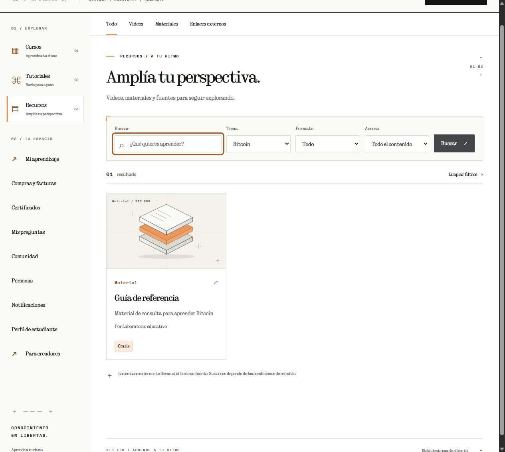

# Registro, identidad y clasificación

## Comportamiento actual

La primera entrega de mejoras integrales cierra tres inconsistencias reproducidas en el análisis: pérdida del destino al crear cuenta, diferencias del nombre público del creador y clasificación de recursos publicada desde su borrador. Desarrollo sobre `main`, base Git `4000ed5`, conservando los cambios locales previos de perfiles, comunidad y catálogo. Documentación en `business/teorica`. No se hizo commit ni push por esta entrega.

El estudiante llega desde una oferta, lección, exploración o perfil. El login, el enlace para crear cuenta, el formulario de registro y sus errores conservan el destino y sus filtros. Tras crear la cuenta, vuelve allí. El acceso alternativo desde la cabecera o desde el formulario también conserva el destino. Sin destino válido, se abre Mi aprendizaje.

`accounts.destinations.student_destination` valida host, esquema y rutas relativas conocidas. Destinos externos, administración y estudio de creadores no se aceptan. Los POST tienen precedencia sobre el parámetro de consulta. El registro de creador continúa en la solicitud y no concede aprobación por indicar un destino al estudio.

Los creadores con perfil aprobado se presentan mediante `CreatorProfile.display_name` en catálogo, selector, fichas de curso y recurso y perfil público. `content.identity.public_creator_name` centraliza esa elección. Un perfil existente suspendido o pendiente se presenta como Creador de BTC.EDU, sin sustituirlo por su nombre privado. Se conserva la compatibilidad de créditos anteriores de publicaciones sin perfil editorial. Las páginas de contenido muestran la identidad pública vigente; `CourseVersion.creator_name` y las credenciales emitidas conservan su atribución histórica y su huella.

`ResourceVersion.topic` conserva el tema del video o material enviado a revisión. Catálogo, opciones de tema, filtros, agrupación y ficha usan ese dato cuando existe una revisión publicada. Cambiar `Video.topic` o `Material.topic` en el borrador no altera esa clasificación. Aprobar una revisión posterior activa el nuevo tema. Un tema nulo publicado permanece nulo aunque se añada un tema al borrador. Las revisiones históricas y sus referencias comerciales conservan sus datos.

## Migración

La migración `content.0005_resourceversion_topic` añade una relación opcional protegida a Topic. Conserva la clasificación observada de las revisiones que los videos o materiales referencian al migrar. No existe evidencia para reconstruir el tema de las revisiones anteriores sin esa referencia; permanecen sin tema. La clasificación capturada no se presenta como una reconstrucción de su publicación original.

Se aplicó el 12 de octubre de 2026 a la base local con un respaldo SQLite mediante su API de backup. Respaldo: `src/.local/platform-before-coherence-20261012-195223-886867.sqlite3`. Se compararon todos los campos que ya existían en cada tabla: las 496 filas anteriores conservaron sus valores, con cero errores de claves externas. Solo se incorporó el nuevo registro de migración y el campo. No se añadieron ejemplos, cuentas o compras a la base principal.

La comprobación quedó en `.local/coherence-migration-verification.json`. [Resumen de evidencia](../../strategy/evidencias/2026-10-12-migracion-coherencia.json). El respaldo local conserva los datos privados y queda fuera de Git.

## Verificación

Las 11 pruebas nuevas cubren el recorrido login → registro → oferta, filtros y fragmento conservados tras errores, retorno alternativo, destinos externos y otros roles rechazados, aprobación de creador, identidad pública sin nombre privado, certificado con atribución histórica, clasificación congelada durante revisión, publicación posterior, tema nulo y migración sin pérdida de campos anteriores.

`scripts/check-platform.ps1` pasó con 238 pruebas Django en 138,915 segundos, migraciones consistentes, Ruff y cuatro comprobaciones de concurrencia: compras/progreso, evaluaciones, certificados/preguntas y comunidad/seguimiento. [Salida completa](../../strategy/evidencias/2026-10-12-pruebas-coherencia.txt). La advertencia auth.W004 corresponde al correo no único por sí solo; se mantienen el backend y la restricción por correo y tipo de cuenta.

El navegador integrado recorrió login, enlace a registro, retorno al login y acceso a la oferta conservada con una cuenta sintética. No se creó una cuenta desde el navegador: ese POST se verificó en las pruebas automatizadas. En Recursos se comprobó que el tema aprobado Bitcoin seguía en los filtros mientras el borrador tenía Lightning, y que el autor se mostraba como Laboratorio educativo. Se usó una base y archivos temporales en localhost:8026, separados de la base principal.

## Límites y continuidad

Esta entrega no amplía el contenido de la colección, crea guardados gratuitos, añade rutas educativas o resuelve la atención institucional. No repite pagos contra LNbits, la validación con participantes o una auditoría completa de móvil y accesibilidad. Conserva precios, autorizaciones, compras, progreso y certificados históricos.

Las siguientes entregas se organizan en [Mejoras integrales](../../strategy/21-mejoras-integrales-btc-edu.md): exploración de todos los formatos, continuación consistente, biblioteca gratuita y adquirida, calidad por formato, ayuda y participación, evaluación, métricas y operación. Cada cierre debe aportar comportamiento, pruebas y límites propios.
