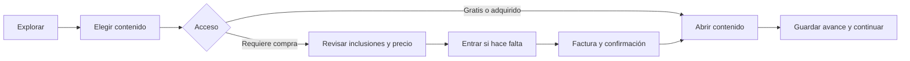
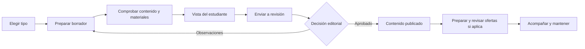

# Interfaz e identidad visual

Diagnóstico y cambios de la interfaz, navegación, catálogos, criterios de aceptación e identidad visual.

## Revisión de interfaz y experiencia

### Diagnóstico inicial

La revisión del 14 de octubre de 2026 parte de `main`, commit `687a773`, sin cambios pendientes al iniciar. Se consultaron los originales de CUBO+, las plantillas, rutas, reglas de navegación, formularios y estilos actuales. Se observaron en navegador la portada, catálogo, ficha, acceso y retorno al curso, Mi aprendizaje, lector y menú móvil, portal de educadores, estudio, editor y configuración de certificado. Se usaron `preview-learning.py` y `preview-creators.py`, con cuentas y bases temporales; los demás recorridos se analizaron en código.

La interfaz revisada ya tenía flujos de publicación, compra y aprendizaje. Su debilidad principal era que estaban repartidos entre espacios cuyos menús y nombres cambiaban. Para una persona nueva resultaba necesario aprender la organización interna antes de completar una tarea. La revisión identificó esa fragmentación; su frecuencia, gravedad para distintos públicos y efecto sobre abandono siguen pendientes de medición con participantes. No se ejecutaron entrevistas, sesiones externas ni una auditoría completa de accesibilidad.

El objetivo es que cada pantalla permita reconocer dónde estoy, qué puedo hacer y cuál es mi siguiente paso. El alcance cubre visitantes, estudiantes y educadores, en móvil y escritorio, manteniendo la identidad aprobada. El diagnóstico y plan precedieron la autorización del desarrollo. A continuación se distinguen sus hallazgos de los cambios implementados en la entrega local del 14 de octubre de 2026, sobre `main` y `687a773`, todavía con cambios sin consolidar en un commit.

La [primera propuesta visual](../src/design/btc-edu-ui-ux-propuesta-2026-10-14-v2.png) muestra Mi aprendizaje, Mi estudio y su adaptación móvil: navegación estable, continuación prioritaria, pendientes del educador y separación entre publicación actual y borrador. Se generó con ImageGen antes del desarrollo y se usó como referencia de composición. Los datos son ilustrativos; la imagen no representa actividad real ni constituye una validación de usabilidad.

### Lo que conservamos

- El nombre, el logotipo de puntos, los bordes finos, la retícula y las ilustraciones industriales. Desde el 24 de octubre la paleta es monocroma con un único acento naranja y las fuentes son Doto, Inter Tight y Space Mono ([lenguaje monocromo](#lenguaje-monocromo-2026-10-24)). La [referencia aprobada](../src/design/btc-edu-concepto-aprobado.png) se conserva como antecedente de composición.
- Los modos claro y oscuro, el temario, la continuación compartida entre curso y biblioteca, la lectura enfocada y los estados de progreso.
- La lectura gratuita sin cuenta, la conservación del destino al entrar y la inscripción que acompaña una compra de contenido de curso.
- Las publicaciones, compras y avances por versión; la revisión editorial; la separación entre preguntas privadas y conversaciones del curso; la compartición voluntaria de perfiles y certificados.
- Los precios como cantidad y sats. La comprobación automática del pago permanece silenciosa; el estado de la factura es visible y los mensajes de error indican una acción útil.

### Imágenes de contenido

Las alturas fijas y los ajustes distintos entre vistas podían comprimir o recortar las mismas ilustraciones. El componente compartido `_content_image.html` y `content-images.css` establecen el formato; los estilos de cada página conservan su composición sin imponer otra altura a la imagen.

| Uso | Proporción | Dimensiones de referencia |
|---|---|---|
| Portada de catálogo, ficha, comparación y biblioteca | 16:9 | 1600 × 900 px |
| Miniatura de continuación, estudio y carrito | 1:1 | 320 × 320 px |

El ancho se adapta al espacio disponible y la altura deriva de la proporción. Uso `object-fit: contain` centrado: si el original es vertical, cuadrado o más ancho que el marco, se muestra completo con espacio de fondo. Los SVG actuales de 480 × 300 siguen siendo válidos y no se modificaron. El icono tipográfico de las filas de tutorial mantiene también 1:1. La visibilidad de la portada en la ficha móvil conserva el comportamiento anterior.

Desde el 6 de noviembre de 2026 el educador puede cargar una portada propia en Información del curso o tutorial. Se acepta JPG, PNG o WebP de al menos 800 × 450 px y hasta 8 MB; el servidor la recorta al centro a 16:9, la guarda como WebP de 1600 × 900 sin metadatos y la congela con la versión enviada a revisión. Es privada hasta que se publica esa versión; después se sirve con caché pública. Sin portada propia se mantienen las ilustraciones por tipo y tema. Todavía no hay ajuste manual del encuadre ni variante 1:1: las miniaturas reutilizan la misma imagen con ajuste centrado. La portada general del sitio, los avatares y los QR mantienen sus reglas independientes.

### Hallazgos anteriores al desarrollo

Alta significa que podía desorientar una tarea central o una decisión de acceso; media, que dificultaba comprensión, atención o recuperación. Son prioridades del diagnóstico, pendientes de contraste con personas. Las referencias de archivo y línea de esta tabla corresponden a la interfaz revisada antes del overhaul; no describen por sí solas el estado actual.

| ID / prioridad | Evidencia del diagnóstico | Mejora acordada |
|---|---|---|
| UI-01 / Alta | El menú se reemplaza según catálogo, curso, aprendizaje, compras, comunidad o estudio; pasar a preguntas del educador elimina los enlaces de contenido. `src/core/navigation.py:5`, `:44`, `:77`. | Navegación principal estable por tipo de cuenta, con un segundo nivel para curso o herramienta. |
| UI-02 / Alta | Compras queda al final de Mi aprendizaje; notificaciones está dentro de Comunidad aunque recibe avisos de otras áreas. `src/templates/core/workspace.html:16`; `src/core/navigation.py:7`, `:9`. | Compras como destino permanente; avisos en cabecera con contador y enlace a su origen. |
| UI-03 / Media | Inicio, Explorar, Cursos y Selector presentan entradas distintas al descubrimiento. El selector elige inicialmente el primer curso, sin recomendación personalizada. `src/templates/core/home.html:7`; `src/core/views.py:55`; `src/templates/core/_course_tabs.html:1`. | Un destino Explorar, con tipos de contenido; comparación como herramienta secundaria y sin promesa de ruta personalizada. |
| UI-04 / Alta | En la ficha, objetivos y requisitos preceden a la acción de empezar en el orden de lectura; en móvil se apilan. Mi aprendizaje comienza con título y cifras antes de Continuar. `src/templates/content/course.html:16`, `:21`; `src/templates/core/workspace.html:4`. | Resumen y acción antes del detalle; Continuar como prioridad del inicio personal. Reducir altura de encabezados operativos. |
| UI-05 / Alta | Una lección bloqueada recibe todas las ofertas de la versión, sin priorizar las que abren esa lección. `src/content/version_views.py:126`; `src/templates/commerce/_offers.html:1`. | Mostrar primero opciones pertinentes, indicando lección, capítulo o curso e inclusiones; ofrecer las alternativas elegibles cuando ya hay compras parciales. |
| UI-06 / Alta | El destino posterior al pago de curso, capítulo o lección es la ficha del curso. `src/commerce/views.py:45`; `src/templates/commerce/invoice.html:23`. | Conservar la intención desde el contenido hasta la confirmación y ofrecer Abrir lección o Abrir recurso, comprobando acceso y retorno seguro. |
| UI-07 / Alta | El certificado pendiente muestra cantidades, sin enlaces a cada requisito faltante. Aprobar evaluación y completar lección son acciones separadas. `src/templates/learning/certificate_request.html:4`; `src/templates/learning/attempt.html:10`. | Lista de pendientes con estado y acción; resultado de evaluación que lleve a volver y completar la lección, conservando la finalización explícita. |
| UI-08 / Media | Mi aprendizaje reúne cursos, guardados, recursos adquiridos, facturas y salida en una página extensa. Mi aprendizaje cambia a Mi espacio en móvil. `src/templates/core/workspace.html:10`, `:16`; `src/templates/academy.html:6`. | Secciones claras de cursos, recursos, guardados y certificados; nombres consistentes entre tamaños de pantalla. |
| UI-09 / Media | Crear una pregunta usa `question-create`, pero el clasificador reconoce `student-question*`; el formulario recibe el contexto de catálogo. Las dudas privadas y compartidas aparecen en lugares próximos del lector. `src/learning/urls.py:25`; `src/core/navigation.py:39`; `src/templates/content/lesson.html:31`. | Conservar curso/lección al preguntar; agrupar la ayuda y explicar quién puede leer cada conversación antes de escribir. |
| UI-10 / Alta | Configurar certificado o evaluación se ubica en Tus alumnos y activa Estadísticas. Revisar y publicar mezcla certificado, resultados, envío e historial. `src/core/navigation.py:45`; `src/templates/creators/course.html:6`. | Configuración dentro del contenido; resultados en acompañamiento; Publicación con requisitos, observaciones y siguiente acción propios. |
| UI-11 / Alta | La lección presenta campos pedagógicos, texto, acceso, posición y recursos en un formulario genérico; cargar archivos exige ir a otra pantalla y regresar. `src/creators/forms.py:52`; `src/templates/creators/_form.html:4`; `src/creators/views.py:186`. | Editor por grupos de tareas, temario visual y selección/carga de material conservando el lugar de trabajo y el estado de revisión. |
| UI-12 / Alta | El contenido publicado y sus cambios pendientes no se resumen juntos. Ofertas usa otro selector y depende de publicaciones y ofertas individuales aprobadas. `src/templates/creators/dashboard.html:4`; `src/commerce/forms.py:6`; `src/commerce/offers.py:57`. | Mostrar Publicación actual y Cambios en preparación; integrar Acceso y precio al contenido y enlazar dependencias pendientes. |
| UI-13 / Alta | El inicio cuenta preguntas sin ninguna respuesta histórica del educador, mientras la bandeja considera el último mensaje del estudiante. `src/creators/views.py:104`; `src/learning/essential_views.py:221`. | Una definición compartida de Pendiente de responder; contador y bandeja deben coincidir cuando el estudiante vuelve a escribir. |
| UI-14 / Media | Preguntas carece de filtros; resultados se distribuyen por intento; la vista previa del borrador no incluye evaluaciones. `src/templates/learning/_questions.html:1`; `src/templates/learning/quiz_results.html:5`; `src/templates/creators/preview.html:1`. | Acompañamiento por curso y estado; agrupación de resultados; vista del estudiante que permita comprobar el recorrido antes del envío. |
| UI-15 / Media | Comunidad vacía aconseja inscribirse también al educador. La entrada Para creadores ofrece registro/acceso aun con una cuenta aprobada. `src/templates/learning/_community_spaces.html:2`; `src/templates/core/creators.html`. | Mensajes según rol y estado; acceso directo a Mi estudio para la cuenta activa. La guía inicial debe servir también a quien crea videos o materiales. |
| UI-16 / Media | Métricas y certificados muestran detalles técnicos junto a acciones frecuentes; la protección de cambios pendientes varía entre formularios. `src/templates/core/_analytics.html:3`; `src/templates/learning/_credential.html:1`; `src/static/js/creators.js:1`. | Detalles de cálculo/verificación desplegables; guardado, errores y salida coherentes en contenido, evaluaciones y ofertas. |

### Cambios implementados

La actualización separa navegación principal y contexto, prioriza la siguiente acción y conecta compra, aprendizaje y autoría. Cada hallazgo UI-01–UI-16 tiene cambios concretos en la implementación; que una persona nueva los entienda sin ayuda sigue siendo una pregunta de investigación. Las pruebas y capturas de la entrega se consolidan en la [bitácora](../src/docs/operacion-y-bitacora.md#overhaul-ui-ux-2026-10-14).

| Hallazgo | Cobertura de la entrega |
|---|---|
| UI-01 | Menú estable por cuenta, contexto junto al contenido y ubicación de las evaluaciones y certificados de autoría dentro de Contenido. Se mantienen los permisos de cuentas pendientes y suspendidas. |
| UI-02 | Compras permanece en el menú del estudiante; avisos y cuenta se encuentran en la cabecera, con contador y acceso al origen permitido. |
| UI-03 | Cursos, Tutoriales y Recursos tienen accesos directos y páginas propias. La comparación permanece dentro de Cursos; no se anuncia una recomendación personalizada. La separación sustituye la agrupación inicial bajo Explorar a petición posterior del usuario. |
| UI-04 | La ficha prioriza resumen y acción de acceso; Mi aprendizaje coloca Continuar antes del inventario. Se reducen encabezados y cifras que desplazaban la tarea. |
| UI-05 | El bloqueo muestra ofertas que incluyen la lección o el recurso elegido, con alcance e inclusiones. Las compras parciales mantienen sus restricciones y las alternativas elegibles. |
| UI-06 | La intención de abrir una lección se conserva hasta la factura y la confirmación, con retorno seguro y comprobación de derechos. Las facturas pendientes se recuperan desde Compras. |
| UI-07 | El certificado pendiente enlaza las lecciones y evaluaciones faltantes. Aprobar conduce a volver y completar la lección; su finalización continúa siendo explícita. |
| UI-08 | Mi aprendizaje separa Cursos, Recursos, Guardados y Certificados, con búsqueda y el mismo nombre en escritorio y móvil. Compras tiene su propia pantalla. |
| UI-09 | Preguntar conserva curso y lección; el lector reúne la ayuda y distingue conversación privada de participación compartida. |
| UI-10 | Información, Temario, Evaluaciones, Certificado, Publicación y Acceso y precio organizan el editor. Resultados pertenece a Alumnos; Publicación reúne requisitos, observaciones y envío. |
| UI-11 | Campos agrupados por tarea, temario visual y botones para subir o bajar elementos. Videos y materiales admiten cargar archivos desde su editor; la biblioteca y la creación contextual conservan un retorno seguro. |
| UI-12 | Las tarjetas muestran publicación actual, cambios del borrador y envío vigente. Acceso y precio enlaza las ofertas del curso o recurso publicado y sus dependencias editoriales. |
| UI-13 | Estudio y bandeja usan la misma definición de pendiente, basada en el autor del último mensaje. Una aclaración del estudiante vuelve a incluir la conversación. |
| UI-14 | Preguntas filtra por curso y estado; resultados, por curso, versión y estado, agrupados por inscripción. La vista del estudiante permite revisar el borrador, comprobar acceso y probar evaluaciones sin crear actividad. |
| UI-15 | Enseñar y los estados vacíos se adaptan a la cuenta y su estado. Una cuenta aprobada accede a Mi estudio; la guía permite empezar por curso, tutorial, video o material. |
| UI-16 | Cálculo de métricas y verificación de certificados quedan desplegables. Los formularios de autoría comparten estado de guardado, protección de salida y errores recuperables, incluida la autorización de intentos. |

Las lecciones continúan adjuntando revisiones aprobadas: cargar un archivo o guardar un recurso no lo publica ni omite su revisión. La vista del estudiante del borrador reutiliza la presentación de lectura y ficha educativa, permite comprobar contenido incluido o sin compras y aplica la regla de retroalimentación al probar una evaluación. No registra progreso, intentos, compras ni actividad de alumnos. Los errores de guardado mantienen el trabajo en el formulario abierto; esto no introduce guardado automático ni recuperación después de cerrar el navegador.

Se conservan la composición de publicaciones, las compras y avances históricos, la aprobación editorial y la independencia de las cuentas. La actualización no añade descuentos al completar conjuntos, liquidaciones, acreditación educativa ni validación comercial. Las pruebas automatizadas y la revisión visual deben distinguirse de sesiones con participantes y de una auditoría WCAG completa.

### Organización implementada

El menú principal mantiene orden, tamaño y ubicación durante el recorrido. La navegación de un curso se sitúa junto al contenido. En lectura enfocada se puede reducir el marco, conservando una salida clara, el acceso al temario y la apertura del menú. Notificaciones y cuenta permanecen localizables desde ambos espacios.

| Espacio | Navegación principal | Organización interior |
|---|---|---|
| Público | Cursos · Tutoriales · Recursos · Enseñar | Inicio y Entrar en la cabecera pública. Cada catálogo mantiene búsqueda y filtros pertinentes al tipo elegido. |
| Estudiante | Cursos · Tutoriales · Recursos · Mi aprendizaje · Compras · Comunidad | Mi aprendizaje: Continuar, Cursos, Recursos adquiridos, Guardados, Certificados y Mis preguntas. Compras: historial y facturas pendientes. Comunidad: cursos y Personas como apartado secundario. |
| Educador aprobado | Mi estudio · Contenido · Alumnos · Comunidad · Ventas | Cursos, Tutoriales y Recursos como accesos públicos separados de las herramientas. Contenido: publicaciones y biblioteca de archivos. Alumnos: preguntas privadas y resultados disponibles por curso. Ventas: ofertas, transacciones confirmadas y métricas propias. |
| Cuenta y avisos | Accesos persistentes en cabecera | Perfil, acceso y seguridad, privacidad, cambio de espacio, ayuda y salida; avisos con su origen y estado de lectura. Mostrar únicamente preferencias realmente disponibles. |
| Educador pendiente o suspendido | Estado de mi cuenta | El pendiente conserva los tres catálogos; el suspendido ve únicamente destinos permitidos de estado, cuenta, ayuda y avisos. No se habilitan herramientas de autoría sin aprobación. |

### Estandarización de la barra lateral

Después de la etapa comercial, el usuario señaló que la barra cambiaba de tamaño entre páginas y duplicaba Mi cuenta y Ayuda. La revisión previa midió 572 px de alto en Explorar y 393 px en Notificaciones en un mismo tamaño de pantalla móvil; también detectó que abrir Menú durante la lectura enfocada dejaba visible el fondo superpuesto y mantenía oculta la barra. Son hallazgos técnicos de la interfaz anterior, sin mediciones con participantes.

La implementación unifica el marco de academia y estudio y aplica el mapa anterior. La barra conserva ancho y altura disponible bajo la cabecera para cada tamaño de pantalla, con enlaces que mantienen su tamaño y un desplazamiento interior cuando es necesario. Reúne únicamente destinos principales; cuenta y ayuda se consultan desde el avatar, mientras avisos y carrito conservan sus accesos de cabecera. El avatar está disponible también en móvil. Los accesos a Cursos, Tutoriales y Recursos quedan separados de las herramientas del educador.

Cursos, Tutoriales y Recursos son destinos principales con páginas y filtros propios. La petición posterior de separarlos sustituye la agrupación inicial bajo Explorar; se retira la fila que repetía esas categorías y Comparar cursos permanece en Cursos. Los enlaces antiguos de Explorar conservan sus búsquedas y el catálogo seleccionado. Las fichas públicas distinguen curso, tutorial y recurso; el contenido inscrito permanece en Mi aprendizaje. Los apartados de Mi aprendizaje, filtros de Alumnos, pestañas del editor y opciones de cuenta se colocan junto al contenido. Mis preguntas tiene un acceso local visible desde Mi aprendizaje. Curso, temario, comunidad y regreso al contenido mantienen su contexto y versión sin sustituir el menú general.

El ajuste de separación pasó 41 pruebas focalizadas de navegación, descubrimiento y continuidad, y 445 controles de navegador sobre 48 cargas, con ambos temas y adaptación móvil. Se verificaron los tres catálogos, sus filtros, selección y retorno desde contenido, además del desplazamiento del menú en poca altura y la restricción existente de cuentas suspendidas. Las capturas y resultados están en el [registro de separación del catálogo](../src/docs/operacion-y-bitacora.md#catalogos-separados-2026-10-14). Las sesiones con participantes siguen pendientes.

En móvil, el menú funciona como panel modal: botón de cierre, fondo, Escape, foco inicial dentro del panel, recorrido de teclado contenido, fondo no interactivo y regreso del foco al control que lo abrió. También abre desde la lectura enfocada. Portada y acceso usan una cabecera simplificada; entrada, registro y recuperación de estudiante y educador comparten estructura sin barra lateral. Las páginas interiores comparten el marco lateral.

La revisión de navegador completó 1.882 comprobaciones sin fallos sobre 184 cargas de páginas, con visitante, estudiante y educadores aprobado, pendiente y suspendido, cuatro tamaños de pantalla y ambos temas. Verificó geometría, enlaces de 48 px, ausencia de duplicados y desbordamiento, avatar móvil y comportamiento modal con teclado y cambio de tamaño. A 1440 × 900 px, la barra midió 224 × 822 px bajo la cabecera de 78 px; a 390 × 844 px, 320 × 776 px bajo la cabecera de 68 px, conservando esas medidas entre páginas. Otra revisión pasó nueve comprobaciones de apertura, Escape y retorno del foco durante lectura enfocada en escritorio y móvil. La revisión adicional de acceso y altura pasó 181 controles sobre 33 cargas, incluidos formularios de ambos espacios, pantalla de 390 × 360 px, anclas y desplazamiento independiente de contenido y menú; el control final de poca altura pasó 13 comprobaciones, incluida visibilidad del foco al recorrer el menú. Pasó una batería de 441 pruebas Django; después del ajuste final de retorno del educador pasaron 75 de cuentas y 24 de navegación, registradas por separado sin sumarlas a aquella batería. Las evidencias y el alcance de cada ejecución se conservan en la [bitácora de navegación](../src/docs/operacion-y-bitacora.md#barra-lateral-2026-10-14).

Falta contrastar retomar una lección, recuperar una compra, localizar Mis preguntas y Ayuda y volver del editor con estudiantes y educadores nuevos. Las comprobaciones técnicas no acreditan conformidad WCAG completa ni comprensión humana; la revisión con tecnologías de asistencia y las sesiones de usabilidad siguen pendientes.

La interfaz usa Estudiante y Educador como vocabulario visible; Enseñar para la entrada pública y Mi estudio para trabajar. Esto no cambia el tipo técnico `creator`. Mi aprendizaje mantiene el mismo nombre en móvil. Recurso designa videos y materiales cuando convenga agruparlos, con su tipo explícito en la tarjeta. Guardado, adquirido, inscrito y completado conservan significados distintos.

Las cuentas de estudiante y educador siguen siendo independientes. Entrar en otro espacio debe identificar la cuenta y advertir de formularios pendientes cuando corresponda. No presentar un cambio de rol instantáneo. Ventas muestra actividad registrada: no es un saldo, una liquidación ni un ingreso acreditado. Una lista nominal de inscritos, nuevas preferencias o solicitudes estructuradas de intentos requerirían especificación adicional; no se incluyen como capacidades ya disponibles.

### Categorías del catálogo

La organización vigente tiene dos niveles: categoría y subcategoría. Desde el 24 de octubre hay seis categorías, todas del área tecnológica. Las áreas que antes reunía Tecnología pasaron a ser categorías propias, porque una sola tarjeta agrupaba nueve áreas distintas y no permitía mostrar cursos de cada modalidad por área. Bitcoin y Lightning conserva los temas del catálogo anterior; Diseño y creación digital conserva las áreas de Creación. Cursos e Inicio muestran tarjetas con nombre, ilustración local y cantidad total de cursos publicados. Las categorías se muestran incluso con cero publicaciones y explican que aún no hay contenido. Dentro de una categoría, la navegación ofrece las subcategorías con publicaciones; después de elegir una se despliega desde «Cambiar subcategoría». Una categoría completamente vacía conserva todas sus subcategorías configuradas bajo «Ver subcategorías», con su cantidad. Los conteos corresponden únicamente a Cursos, Tutoriales o Recursos según la sección, se calculan antes de paginar y usan el tema de la versión o revisión publicada; los cambios del borrador no alteran ese resultado. El contenido sin tema se encuentra en «Por descubrir».

| Categoría | Subcategorías |
|---|---|
| Bitcoin y Lightning | Fundamentos de Bitcoin, Lightning, Seguridad y autocustodia, Desarrollo Lightning, Nodos y minería |
| Desarrollo de software | Programación, Desarrollo web, Desarrollo móvil, APIs y backend, Git y colaboración, Pruebas y calidad |
| Datos e inteligencia artificial | Bases de datos, Análisis de datos, Aprendizaje automático, Inteligencia artificial |
| Ciberseguridad | Fundamentos de ciberseguridad, Seguridad de aplicaciones, Hacking ético, Respuesta a incidentes |
| Infraestructura y nube | Hardware de PC, Redes, Linux y sistemas, Computación en la nube, DevOps y contenedores |
| Diseño y creación digital | Diseño UI/UX, Adobe Photoshop, Adobe Lightroom, Adobe Premiere Pro, Fotografía, Creación de contenido, Modelado y animación 3D |

Desde el 25 de octubre, cada sección se recorre según lo que busca quien entra, porque las tres compartían el índice de categorías ilustradas y solo se diferenciaban después de elegir una. Cursos conserva ese índice, adecuado para un compromiso largo que se decide por área, nivel y modalidad. Tutoriales muestra directamente una lista de tareas: la duración estimada encabeza cada fila, seguida de los pasos y el acceso, y la categoría se elige con accesos directos que solo incluyen categorías con tutoriales. Recursos funciona como biblioteca por formato: pestañas Todo, Videos, Materiales y Enlaces externos con su cantidad; los videos se presentan como miniaturas, los materiales como archivos y los enlaces con el dominio de su fuente. La referencia de Plan B Academy ya mostraba tutoriales por categoría con búsqueda y una biblioteca de recursos por tipo. Una sección sin publicaciones muestra su estado vacío sin categorías en cero ni barra de búsqueda. Falta observar con participantes si esta distinción ayuda a elegir entre curso, tutorial y recurso.

Las subcategorías anteriores conservan su identificador, de modo que los enlaces por `tema` siguen funcionando. La migración `content.0009_technology_categories` solo reemplaza nombres y descripciones que seguían con su valor inicial y retira Tecnología cuando ya no le quedan subcategorías. Las cuatro categorías nuevas tienen ilustración propia. Desde el 25 de octubre cada categoría tiene un curso de pago, uno freemium y uno de membresía; el inventario está en [cursos por categoría y modalidad](09-catalogo.md#cursos-por-modalidad).

El filtro `categoria` reúne las publicaciones de sus subcategorías y `tema` acota una de ellas. Los enlaces anteriores que solo incluyen `tema` conservan su destino. La búsqueda, los demás filtros y el retorno desde una ficha mantienen la selección; no se mezclan publicaciones de otra sección. El educador elige la subcategoría en un selector agrupado por categoría. La administración conserva descripciones e ilustraciones integradas, con imagen por defecto cuando corresponde; la carga de imágenes personalizadas sigue pendiente.

La elección de categoría conduce a una lista con búsqueda contextual y filtros disponibles según las publicaciones. «Ver todos» y la búsqueda directa evitan imponer ese paso a quien ya sabe qué quiere encontrar. Esta decisión adapta las [guías de Nielsen Norman Group sobre páginas de categoría](https://www.nngroup.com/articles/category-pages/), que recomiendan imágenes representativas y acceso directo a resultados cuando se busca. Cada tarjeta usa un único enlace con texto visible; la ilustración lleva alternativa vacía para evitar repetir su nombre, siguiendo el [criterio de W3C para imágenes dentro de enlaces con texto](https://www.w3.org/WAI/tutorials/images/functional/).

La ampliación del 15 de octubre pasó 73 pruebas focalizadas de catálogo, jerarquía, publicación, navegación y autoría, además de Ruff y consistencia de migraciones, y una prueba adicional de compatibilidad del importador. La migración local dejó tres categorías y veinte subcategorías, con respaldo previo y conservación de los conteos de contenido y de los identificadores anteriores. La revisión de escritorio en modo oscuro comprobó los conteos reales, las nueve subcategorías de Tecnología, Hardware de PC vacío y la coordinación entre filtros; no incluyó una nueva revisión móvil. El [registro de ampliación](../src/docs/operacion-y-bitacora.md#categorias-2026-10-15) conserva el comando y los límites. Las 72 pruebas y la [captura del 14 de octubre](../src/docs/operacion-y-bitacora.md#categorias-2026-10-14) corresponden a la organización anterior de un nivel. La colección publicada sigue centrada en Bitcoin y Lightning; publicar las nuevas áreas requiere contenido, derechos y revisión propios. Falta observar con participantes si los nombres, la jerarquía y las imágenes ayudan a elegir; las pruebas técnicas no acreditan esa comprensión ni validan la demanda.

### Búsqueda y filtros

Cursos, Tutoriales, Recursos, Explorar y Comparar cursos comparten una barra que prioriza la búsqueda. El texto indica su alcance, por ejemplo «Buscar tutoriales en Bitcoin». La categoría y subcategoría elegidas se conservan al enviar la búsqueda sin repetirlas como selectores. La barra también está disponible en el índice de categorías; el escaparate público del educador conserva su barra propia.

«Filtros» aparece solo cuando hay opciones útiles para acotar el contenido y comienza cerrado, con un contador de selecciones activas. Las opciones de categoría, subcategoría, nivel, formato y acceso se obtienen de los metadatos publicados dentro del catálogo, categoría, subcategoría y búsqueda actuales, antes de aplicar los refinamientos de nivel, formato o acceso. Así se evitan controles sin alternativas y los filtros no desaparecen por su propia selección. Un valor activo que ya no tiene resultados sigue disponible para poder retirarlo. La búsqueda y los refinamientos se pueden quitar individualmente; «Limpiar filtros» conserva la categoría y subcategoría del recorrido y, en Recursos, el formato elegido. Tutoriales no repite la categoría en el panel, porque ya la ofrecen sus accesos directos, y Recursos no repite el formato de sus pestañas.

El formulario funciona con envío normal y el desplegable nativo admite teclado. Cuando la lista se actualiza sin recargar la página, se conserva el panel abierto y el foco. El ajuste pasó 69 pruebas focalizadas y dos pruebas adicionales ejecutadas por separado, además de Ruff y consistencia de migraciones; la revisión de escritorio y móvil comprobó búsqueda, acceso, conservación del contexto y adaptación de la barra. El [registro de filtros](../src/docs/operacion-y-bitacora.md#filtros-catalogo-2026-10-15) conserva el comando y el alcance real. Falta contrastar la facilidad de uso con participantes y completar la revisión de accesibilidad con tecnologías de asistencia.

El panel distribuye los campos con anchos flexibles y sitúa «Aplicar filtros» junto a ellos cuando hay espacio. Una sola opción ocupa un ancho acotado; varias comparten la fila y en móvil los campos usan todo el ancho. La presentación es transparente y mantiene únicamente un separador superior fino. El foco conserva el borde habitual del control y se indica con un fondo suave y el subrayado de su etiqueta o texto. La [corrección de distribución](../src/docs/operacion-y-bitacora.md#panel-filtros-2026-10-15) conserva evidencia separada de las comprobaciones anteriores.

La búsqueda, los filtros, el cierre de selecciones y los desplegables comparten cuatro SVG de [Font Awesome Free 7.3.1](https://github.com/FortAwesome/Font-Awesome/releases/tag/7.3.1), incluidos en el HTML mediante un componente local. La [integración oficial con SVG](https://docs.fontawesome.com/web/add-icons/svg-bare) permite controlar tamaño y alineación con los estilos de la aplicación. La flecha ocupa un espacio fijo, gira al abrir y respeta la preferencia de movimiento reducido; el botón reserva espacio suficiente para su texto. Los originales conservan sus avisos y la [licencia incluida](../src/static/vendor/fontawesome-LICENSE.txt). El [registro de iconos](../src/docs/operacion-y-bitacora.md#iconos-filtros-2026-10-15) separa esta corrección de las comprobaciones anteriores de la barra.

### Recorridos conectados

**Primera visita.** Inicio explica qué se puede aprender y ofrece Explorar. El catálogo conduce a una ficha que muestra resultado, nivel, requisitos, duración, muestra, inclusiones y siguiente acción. El contenido gratuito abre sin registro; la cuenta se ofrece al guardar avance o al necesitar una compra. La persona regresa a la tarea elegida después del acceso.

**Compra y recuperación.** Desde una lección se ofrecen primero las compras que la incluyen. La factura conserva contenido objetivo, importe, estado y vencimiento; permite copiar la solicitud o abrir el medio de pago disponible en el entorno. Tras la confirmación ofrece abrir ese contenido y consultar Compras. Ante vencimiento o fallo mantiene contexto y propone el reintento elegible; ante una comprobación interrumpida consulta la factura existente. Una compra parcial sigue mostrando los faltantes según las reglas actuales, sin introducir descuentos automáticos.

**Aprendizaje.** Mi aprendizaje prioriza Continuar. La lectura mantiene un solo temario contextual y deja visibles título, posición y acción de finalización. El panel de finalización tiene tres estados: pendiente, con «Completar y continuar →» (un solo clic guarda y abre la siguiente lección); bloqueado por una evaluación obligatoria, que enlaza la evaluación en el mismo panel; y completado, con marca ✓, «Continuar →» y «Desmarcar» como enlace secundario. La acción para avanzar queda alineada a la derecha, en la dirección de lectura, y «Desmarcar» a la izquierda. Guardar no muestra mensajes en pantalla; solo los errores, con reintento o recarga. Resultado y requisitos de la unidad se resumen; muestra, acompañamiento y otros detalles se despliegan cuando resulten útiles. Al aprobar una evaluación se facilita volver a completar la lección. Si faltan intentos se ofrece contacto privado contextual. El certificado enlaza cada lección y evaluación pendiente, permite confirmar nombre y prioriza PDF y compartición; los datos técnicos quedan en Detalles de verificación.

**Dudas y comunidad.** Ayuda con esta lección distingue Preguntar al educador — privado y Compartir con el curso — visible para participantes con acceso. Los avisos llevan a la respuesta concreta. Personas y perfiles son complementarios al aprendizaje; no desplazan continuar o recuperar contenido. Las restricciones de escritura y acciones de moderación explican el motivo y el siguiente paso disponible.

**Primera publicación.** El educador elige Curso, Tutorial, Video o Material. La guía acompaña información mínima, contenido y materiales, evaluación y finalización cuando apliquen, vista del estudiante y envío. Cada dependencia pendiente conduce a la herramienta necesaria y permite regresar al punto anterior.

El editor de curso presenta Información, Temario, Evaluaciones, Certificado, Publicación y Acceso y precio. Estas secciones permanecen localizables, aunque algunas tengan dependencias. La oferta se prepara sobre una publicación aprobada; el sistema explica los componentes individuales necesarios para un conjunto. El educador envía a revisión y la administración decide la publicación. Guardar un borrador, enviar una copia y actualizar una publicación son estados diferentes y visibles.

**Mantenimiento.** Mi estudio muestra tareas pendientes reales y borradores recientes. Contenido distingue publicación actual, borrador, envío en revisión y observaciones. Alumnos permite atender preguntas y resultados por curso; Comunidad facilita llegar a actividad y reportes. Preparar una actualización mantiene referencias históricas y deja claro qué cambia para futuras publicaciones.

### Objetivos por pantalla

Estos objetivos del plan guiaron la implementación y sirven para revisar las variantes que todavía necesitan comprobación integral. La tabla de cobertura anterior describe los cambios entregados.

| Pantalla o grupo | Jerarquía y comportamiento buscados |
|---|---|
| Inicio y entrada Enseñar | Promesa concreta, una acción dominante según la visita, orientación breve y acceso al espacio de la cuenta activa. Conservar la composición industrial de la portada. |
| Explorar y comparación | Búsqueda visible, filtros activos y Limpiar; tarjetas comparables con resultado, tipo, nivel, duración y acceso. Estado sin coincidencias con recuperación. Comparar es opcional. |
| Ficha y recurso | Resumen y acción antes del detalle; qué incluye y qué se compra aparte; muestra reconocible; temario con estados; perfil del educador secundario. Para recursos, formato y acción Abrir o Descargar. |
| Acceso y recuperación | Identificar tipo de cuenta, conservar destino y valores permitidos, errores junto al campo y resumen enlazado; retorno después de recuperar/verificar cuenta cuando corresponda. |
| Mi aprendizaje y Compras | Continuar primero; secciones para inventario creciente; facturas pendientes recuperables; compras enlazadas a contenido accesible. Evitar que adquirido implique curso completo. |
| Lector y video | Contenido principal con ancho legible, temario plegable móvil, materiales asociados y siguiente paso según estado. Conservación de posición y avance; controles accesibles y transcripción/subtítulos cuando existan. |
| Evaluación, resultado y certificado | Reglas e intentos antes de comenzar, guardado reconocible, revisión previa a entrega, recuperación ante fallo y salida al siguiente paso. Pendientes del certificado con enlaces concretos. |
| Preguntas, avisos, comunidad y Personas | Audiencia explícita, estado y actividad reciente; filtros útiles y retorno al curso. Avisos globales; vacíos y restricciones adaptados a rol y permisos. |
| Mi estudio y Contenido | Crear contenido con elección de tipo; pendientes accionables; filtros por tipo y estado; publicación actual y cambios visibles en la misma fila. |
| Editor, archivos y publicación | Grupos de campos según tarea; añadir/reordenar con controles accesibles, sin exigir arrastrar; materiales y su estado dentro del trabajo; lista de requisitos enlazada y observaciones junto al elemento afectado. |
| Vista del estudiante y Acceso y precio | Reutilizar presentación de ficha, lector y evaluación; comprobar gratis, bloqueado e incluido sin registrar actividad real ni conceder permisos. Preparar oferta desde el contenido e indicar dependencias. |
| Alumnos, Ventas y cuenta | Bandejas por curso/estado, contadores coherentes, resultados agrupados y métricas con detalle de cálculo opcional. Privacidad, seguridad y ayuda con acciones claras. |

La revisión conserva como objetivos las variantes de vacío, carga, éxito, error, acceso insuficiente y datos extensos de cada grupo. Los estados de borrador, revisión, observaciones y publicación se comprueban donde apliquen. Una pantalla agradable en su estado ideal no cierra por sí sola el recorrido.

### Estética, móvil y accesibilidad

La implementación comparte variables para superficies, texto, botones y estados. Usa negro, blanco y grises neutros; el naranja marca la acción principal, el paso actual o un estado vivo, con menor peso decorativo en lectura y edición. Inter Tight se usa para texto operativo y títulos, Space Mono para etiquetas y Doto para la marca, cifras y precios. Se redujeron microetiquetas decorativas y se priorizaron tamaños cómodos para acciones, errores y precios. Estos ajustes buscan legibilidad y fidelidad a la propuesta aprobada; no demuestran por sí solos una mejora observada de usabilidad.

En móvil, una columna principal, el mismo vocabulario y un menú con el mismo orden. Temario y filtros pueden plegarse con rótulo y estado visibles. Las acciones cercanas al pulgar pueden probarse en ficha o editor, siempre que no oculten contenido, foco o controles del dispositivo. Las tablas se adaptan conservando etiquetas. No añadir barras y submenús fijos simultáneos que resten espacio al aprendizaje.

Adoptar [WCAG 2.2 AA](https://www.w3.org/TR/WCAG22/) como objetivo de verificación: teclado, foco visible y no totalmente oculto, navegación consistente, contraste de texto normal de 4.5:1, contraste aplicable de controles, mensajes de estado accesibles, errores identificables y reflujo a 320 px CSS salvo excepciones. El mínimo AA de tamaño de objetivo es 24 × 24 px CSS con excepciones; proponemos 44 × 44 para controles principales. Probar también zoom, lector de pantalla, ambos temas y alternativas al arrastre. La revisión actual no acredita conformidad.

### Plan acordado y avance

El plan organizó recorridos completos sobre Django, plantillas, HTMX y componentes existentes. El desarrollo integró la navegación y los cambios de descubrimiento, compra, aprendizaje y autoría de las fases 2–5, usando la referencia visual y el mapa de destinos de la fase 1. La medición de una línea base con personas no se ejecutó. La fase 6 completó la integración técnica y la revisión visual registrada en la bitácora; las sesiones con participantes y la auditoría completa de accesibilidad siguen pendientes.

| Fase | Trabajo y dependencias | Entrega comprobable |
|---|---|---|
| 1. Estructura y prototipo | Resolver UI-01–03 y vocabulario. Inventariar rutas actuales, mapearlas a destinos y dibujar escritorio/móvil dentro de la estética aprobada. | Mapa de navegación y prototipo de Explorar → ficha → lección/compra, Mi aprendizaje → continuación y Mi estudio → editor → revisión. Registrar la línea base con tareas neutrales antes de comparar mejoras. |
| 2. Navegación compartida | Implementar menú estable, cabecera, avisos, Compras, subnavegación y estados por rol. Corregir ubicación de preguntas, certificado y evaluación. Depende del mapa de fase 1. | Destinos permanentes en escritorio/móvil; rutas antiguas siguen llegando al lugar correcto; sin ampliación de permisos. Revisar cuenta pendiente/suspendida y regreso al estudio. |
| 3. Descubrir, comprar y retomar | Reorganizar catálogo/ficha; ofertas pertinentes; retorno tras acceso y pago; biblioteca y facturas. Depende del marco común. | Ensayar gratis, adquirido, bloqueado, compra individual/conjunto, compra parcial, pago pendiente/confirmado/vencido/fallido y recuperación en otra sesión. |
| 4. Aprender y pedir ayuda | Lector, materiales, evaluaciones, requisitos enlazados de certificado, preguntas, comunidad y perfiles. Depende de continuación y acceso de fase 3. | Un recorrido continuo desde lección hasta evaluación, finalización, certificado y respuesta; errores de guardado y límites de intentos recuperables. |
| 5. Enseñar y mantener | Editor por tareas, archivos contextualizados, estados de revisión, vista del estudiante, ofertas y bandejas. Reutiliza componentes de fases 2–4. Corregir UI-13 antes de priorizar tareas por contador. | Crear cada tipo de contenido, corregir observaciones, publicar mediante administración, preparar ofertas elegibles y actualizar conservando compras/avances; datos de acompañamiento coherentes. |
| 6. Comprobar el conjunto | Recorridos con participantes, accesibilidad, temas, móvil, teclado, enlaces directos, estados extensos y recuperación. Integrar hallazgos en las fases correspondientes. | Evidencia por tarea y versión; corregir bloqueos antes de la demostración y consolidar los tres documentos con lo efectivamente entregado. |

La entrega implementa el marco estable y conecta los recorridos de estudiante y educador. El contador de preguntas se corrigió antes de usarlo para priorizar tareas, y la compra conserva su objetivo sin cambiar reglas de acceso o precios. La tabla mantiene los compromisos iniciales; la cobertura implementada y sus límites se describen arriba. Las comprobaciones pendientes de la fase 6 deben registrarse por tarea y versión, sin dar por ejecutadas las sesiones previstas.

### Criterios de aceptación

1. En una cuenta activa, Cursos/Tutoriales/Recursos/Mi aprendizaje/Compras/Comunidad o Mi estudio/Contenido/Alumnos/Comunidad/Ventas conservan orden y ubicación; el educador tiene además los tres accesos públicos separados. El estado activo corresponde a la tarea. La navegación local no sustituye la global.
2. Cada pantalla tiene una acción dominante coherente con su estado y un regreso claro. Los nombres no cambian por tamaño de pantalla.
3. Elegir una lección de pago permite comprender qué compra la abre; entrar y confirmar el pago conserva ese objetivo. El servidor comprueba destino y derechos antes de ofrecer apertura.
4. Lo gratuito abre sin compra; inscripción, compra, guardado y finalización se distinguen. Las compras parciales y versiones históricas mantienen las reglas vigentes.
5. Mi aprendizaje permite retomar; Compras permite recuperar facturas. Guardado o avance solo aparece confirmado después de respuesta válida del servidor.
6. La evaluación y el certificado conducen a pendientes concretos. Agotar intentos ofrece un contacto útil; completar una lección sigue siendo explícito.
7. Pregunta privada y conversación compartida identifican quién puede leer antes de enviar. Los avisos llevan al origen permitido; un enlace nunca amplía acceso.
8. El educador reconoce qué está publicado, qué prepara y qué se revisa. Los requisitos pendientes enlazan al campo o contenido; el envío congela la copia y la administración conserva la decisión editorial.
9. Materiales, ofertas y resultados tienen estados, filtros y retorno contextual. El contador de preguntas coincide con la bandeja cuando una conversación vuelve a requerir respuesta.
10. Formularios conservan trabajo recuperable ante fallos y explican guardado/salida. Navegación, controles y acciones principales se revisan con teclado, móvil, zoom y ambos temas contra los criterios de accesibilidad seleccionados.

Se incorporaron pruebas de navegación según rol y estado, intención de compra, retorno seguro, permisos por versión, contadores, publicación y recuperación ante errores. Los resultados de la batería integrada, los ajustes finales y las evidencias de navegador están consolidados en la [bitácora de esta entrega](../src/docs/operacion-y-bitacora.md#overhaul-ui-ux-2026-10-14). La comprobación visual revisa jerarquía, lectura y estados, pero no sustituye esas pruebas ni demuestra comprensión humana.

### Validación y referencias

Proponer rondas separadas de estudiantes y educadores, con 4–8 participantes por ronda como orientación cualitativa de [GOV.UK](https://www.gov.uk/service-manual/user-research/plan-user-research-for-your-service). Incluir personas nuevas, distintas edades adultas, menor confianza digital, distinta familiaridad con Bitcoin y necesidades de accesibilidad. Priorizar el contexto de El Salvador. La muestra permite detectar problemas; no representa a todo el público.

Reutilizar U01–U07 y C01–C05 de [validación con usuarios](10-metricas-y-validacion.md#16-validacion-con-usuarios), añadiendo encontrar una respuesta, retomar una lección, identificar pendientes del certificado y atender una conversación reabierta. Presentar metas, sin nombrar botones o revelar caminos. Comparar la interfaz anterior y la versión implementada con tareas equivalentes cuando sea posible; alternar el orden o usar participantes distintos para limitar el efecto de aprendizaje. Las capturas anteriores son una referencia visual: no contienen una línea base medida de tiempos, errores o resultados de uso.

Registrar por tarea y versión: primer clic, resultado sin ayuda/con ayuda/no completada, desvíos, tiempo, errores, intervenciones y explicación de lo que incluye/accede/publica. Definir umbrales numéricos después de medir la línea base. Una compra equivocada, pérdida de trabajo o bloqueo de una tarea central requiere corrección antes de dar por terminado el recorrido. Los resultados siguen pendientes y se incorporarán con evidencia real.

| Referencia consultada el 14 de octubre de 2026 | Aplicación al plan |
|---|---|
| [NN/g: heurísticas de usabilidad](https://www.nngroup.com/articles/ten-usability-heuristics/) | Consistencia, reconocimiento de acciones, prevención de errores y ayuda contextual para ordenar navegación y estados. |
| [Moodle: Dashboard](https://docs.moodle.org/500/en/Dashboard) | Inicio personal orientado a progreso y próximos pasos; Continuar tiene prioridad sobre cifras decorativas. |
| [edX: elegir un curso](https://support.edx.org/hc/en-us/articles/115000954168-Can-you-help-me-choose-a-course) | Descubrimiento con búsqueda y filtros pertinentes; adoptar solo los que ayudan al catálogo actual. |
| [Teachable: preparar un curso](https://support.teachable.com/en/articles/11682451-create-and-set-up-your-course) | Organización de autoría por tareas, contenido estructurado y preparación antes de visibilidad; adaptar a la revisión editorial propia. |
| [GOV.UK: prueba moderada](https://www.gov.uk/service-manual/user-research/using-moderated-usability-testing) | Tareas neutrales, observación y registro de ayuda para comparar recorridos. |

Estas fuentes apoyan decisiones de organización, interacción y verificación. No sustituyen la identidad de BTC.EDU ni prueban aceptación comercial o aprendizaje. WCAG y planificación de investigación se enlazan junto a los criterios que sustentan.

Las [capturas del diagnóstico](../src/docs/operacion-y-bitacora.md#revision-ui-ux-2026-10-14) conservan la interfaz anterior y la [entrega del overhaul](../src/docs/operacion-y-bitacora.md#overhaul-ui-ux-2026-10-14) reúne la implementación, comprobaciones y capturas posteriores. Los datos de las vistas temporales son sintéticos. No representan sesiones educativas, ventas con fondos reales ni resultados de participantes.

### Evaluaciones del estudiante

El 24 de octubre de 2026 rediseñamos el resumen, el intento y el resultado de las evaluaciones. Comparamos con la documentación de [Moodle Quiz](https://docs.moodle.org/en/Using_quiz), que describe navegación por preguntas, marcas para revisar, autoguardado cada dos minutos por defecto, resumen con preguntas sin responder antes de entregar y revisión con retroalimentación por pregunta. Las guías de accesibilidad de [Canvas](https://kb.wisc.edu/accessibility/page.php?id=138873) señalan que arrastrar, relacionar y menús desplegables cuestan con lectores de pantalla y teclado; por eso mantenemos selección única y múltiple con controles nativos. Otras plataformas eligen qué intento cuenta (el mejor, el último o un promedio), según [D2L Brightspace](https://community.d2l.com/brightspace/discussion/comment/13762).

| Función | Estado | Decisión |
|---|---|---|
| Resumen con preguntas, nota mínima, intentos y mejor nota | Implementada | Cifras en Doto; la acción para empezar usa el acento naranja |
| Navegación por preguntas y progreso | Implementada | Mapa numerado y barra con un segmento por pregunta |
| Marcar para revisar | Implementada | Se guarda en el navegador; no cambia la nota ni llega al servidor |
| Autoguardado | Implementado | Guarda cada respuesta al elegirla y avisa solo si falla; sin JavaScript, guardar y entregar siguen disponibles |
| Atajos de teclado | Implementados | 1–6 para opciones, flechas para navegar y M para marcar; las flechas no interfieren con los controles nativos |
| Resumen antes de entregar | Implementado | Respondidas, sin responder y marcadas, con acceso a cada pregunta |
| Resultado comparado | Implementado | Nota, barra con la marca de la nota mínima, cambio respecto al intento anterior y mejor nota |
| Revisión por pregunta | Implementada | Todas las opciones, tu respuesta, la correcta y la explicación cuando las reglas lo permiten, con filtro de preguntas por repasar |
| Tiempo límite | Pendiente | Necesita un campo en las reglas, cierre en el servidor y ajustes de accesibilidad para quien necesita más tiempo |
| Orden aleatorio de preguntas u opciones | Pendiente | Requiere guardar el orden por intento para que la corrección y la revisión coincidan |
| Otros tipos de pregunta y crédito parcial | Pendiente | Verdadero/falso cabe en selección única; respuesta corta, numérica o de orden requieren nuevo modelo y nueva corrección |
| Banco de preguntas y pistas | Pendiente | Cambian la autoría y la comparación de intentos entre versiones |

La nota de cada intento se conserva y la aprobación cuenta si cualquier intento aprueba. No cambiamos esa regla: elegir qué intento cuenta es una decisión del educador que necesitaría una opción nueva.

## Identidad visual de BTC.EDU

Registro conservado; sus fechas, cifras y pendientes corresponden a la entrega o propuesta descrita.

### Definido por el usuario

Nombre: BTC.EDU. Referencias: Nothing Tech, Plan B Academy y diseño industrial. Colores: blancos, negros y tonos leves de naranja. El nombre no implica que el dominio esté registrado ni que la plataforma tenga acreditación educativa.

Esta dirección sustituye el uso de Micropayments como nombre visible del producto. Los documentos originales del assignment conservan su título. Durante la propuesta inicial la implementación visual estuvo pausada; la aprobación del 1 de octubre permitió construir la base actual.

**Actualización del 2 de octubre:** la pausa anterior corresponde a la propuesta inicial y ya fue superada por la aprobación registrada al final de este documento. La base visual está implementada. La [arquitectura y experiencia vigente](05-arquitectura-de-producto.md#10-arquitectura-y-experiencia-btc-edu) define la organización de las nuevas pantallas; los valores efectivamente usados y fuentes están en [componentes visuales](../src/docs/operacion-y-bitacora.md#componentes-visuales). Las propuestas de los apartados siguientes se conservan como antecedente, no como un segundo sistema de estilos.

### Propuesta para revisar

Una interfaz clara, de apariencia industrial, con fondo blanco cálido, texto negro, líneas finas, bloques ordenados y naranja reservado a detalles. Los siguientes valores son propuestas, no decisiones aprobadas:

| Uso | Color |
|---|---|
| Fondo principal | #FAFAF7 |
| Superficies | #FFFFFF |
| Texto y botones principales | #171717 |
| Texto secundario | #626262 |
| Bordes | #D8D8D2 |
| Detalle naranja | #E99555 |
| Fondo naranja suave | #FBEBDD |

Texto de botones naranja claro siempre oscuro; no usar naranja suave para texto pequeño sobre blanco. Verificar contraste en los diseños concretos antes de implementar.

Tipografía propuesta: sans serif legible para lectura y títulos; monoespaciada para precios, duraciones y etiquetas pequeñas. Una tipografía de puntos puede explorarse solo para el nombre o detalles de marca, nunca para párrafos ni instrucciones. Fuentes concretas y logotipo pendientes.

Componentes: botones sólidos negros, acciones secundarias con borde, tarjetas con poco redondeo, estados de selección discretos, formularios claros y foco visible. Iconos sencillos y consistentes. Evitar decoración que dificulte leer cursos o usar el reproductor.

### Qué tomamos de las referencias

- Nothing: explorar lettering de puntos, composición contenida y detalles visuales de producto. La inspección inicial mostró la identidad del encabezado y el aviso de cookies; falta revisar el resto de la página sin ese aviso antes de definir composiciones inspiradas en ella.
- Plan B Academy: se observó navegación lateral, filtros de tema/nivel/tipo/precio, tarjetas de curso y acentos naranja. Tomar esa claridad para organizar aprendizaje; definir un estilo propio para BTC.EDU.
- Diseño industrial: propuesta de retícula, líneas, numeración y etiquetas de apariencia técnica. El usuario todavía debe precisar cuánto protagonismo quiere darles.

Referencias consultadas el 1 de octubre de 2026: https://intl.nothing.tech/ y https://planb.academy/en/learn-anytime. No reutilizar sus logos, ilustraciones o fotografías sin permiso.

### Orden de trabajo

La aprobación visual no acredita usabilidad. El [plan de pruebas](10-metricas-y-validacion.md#16-validacion-con-usuarios) observará precios/inclusiones, estados, navegación y recuperación. Los hallazgos pueden ajustar texto, jerarquía y controles dentro de la identidad acordada. No hay sesiones externas ni cambio de identidad derivados de esta investigación.

1. Revisar esta dirección visual, tipografía y tratamiento del nombre.
2. Preparar una lámina de estilo con colores, nombre, botones y tarjetas de ejemplo sin cursos reales.
3. Revisar la portada y la estructura vacía del catálogo en escritorio y móvil.
4. Implementar la base visual aprobada y documentar sus componentes en src.

No se cargan cursos, capítulos ni recursos durante esta etapa. No se ha creado todavía un logo ni una pantalla aprobada.

### Concepto aprobado el 1 de octubre de 2026

El usuario aprobó la imagen conceptual y autorizó comenzar la base técnica y visual en un nuevo chat. Referencia guardada en src/design/btc-edu-concepto-aprobado.png. Usar su composición, nombre de puntos, fondos claros, tipografía legible, tarjetas y objetos industriales con acentos naranja como guía. Los títulos y precios en la imagen son ejemplos; no cargar cursos todavía. La aprobación corresponde a la dirección visual, no a todas las funciones o textos de ejemplo.

### Lenguaje monocromo del 24 de octubre de 2026

El usuario pidió rehacer el lenguaje visual con prioridad en estética y experiencia: blanco y negro con naranja como acento, en una línea industrial y tecnológica inspirada en Nothing. Esta dirección sustituye la paleta cálida anterior.

| Uso | Valor |
|---|---|
| Fondo / texto, modo claro | #FFFFFF / #000000 |
| Fondo / superficie / texto, modo oscuro | #000000 / #111111 / #FFFFFF |
| Texto secundario claro / oscuro | #6B6B6B (5,3 : 1) / #8C8C8C (6,2 : 1) |
| Líneas claro / oscuro | #E6E6E6 / #262626 |
| Acento | #FF6A13: 7,3 : 1 sobre negro y con texto negro encima; 2,9 : 1 sobre blanco |

- El acento aparece una vez por vista: la acción principal, el paso actual o un estado vivo, además del punto de la marca. Sobre blanco nunca es texto.
- Tipografía: Doto, de matriz de puntos, para la marca, cifras, precios y números de paso; Inter Tight para títulos, interfaz y lectura; Space Mono en mayúsculas para etiquetas y estados. Doto e Inter Tight son OFL y se sirven localmente; sustituyen a Ndot77 y NType82, cuya licencia web estaba pendiente.
- Forma: retícula de 8 px, líneas de 1 px y radios de 12 px en campos, 20 px en tarjetas y píldoras en botones y etiquetas. La trama de puntos se reserva para estados vacíos y portadas.
- Precios como cantidad y «sats», sin «Pago único». El estado pendiente muestra un punto que parpadea en silencio; solo se informa un error cuando pide una acción.

La lámina de diseño con la hoja del sistema, inicio, curso, pago y lección móvil es un lienzo de diseño privado, fuera del repositorio. La agrupación de miles en los precios («3 000 sats») forma parte de la propuesta, pero todavía no está implementada. La aplicación del lenguaje es técnica; no demuestra por sí sola una mejora de usabilidad observada con participantes.
