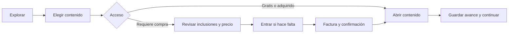
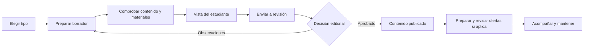
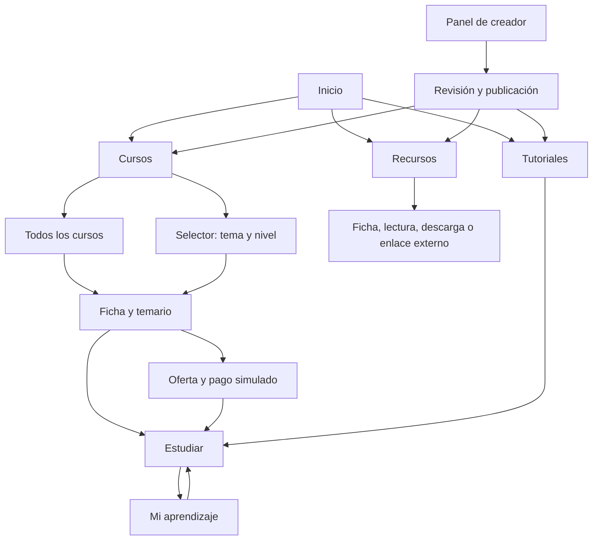

# Investigación y requisitos

El [informe principal](19-recomendacion-y-entrega-final.md) describe el producto vigente. Este archivo reúne fuentes, costos, instrumentos, requisitos y decisiones que lo respaldan. Las referencias comerciales conservan sus fechas de consulta; deben verificarse antes de contratar. Las entrevistas y sesiones externas siguen pendientes.

## Cómo mantener esta documentación

La documentación principal queda en tres Markdown: el informe de BTC.EDU, este archivo y la [operación y bitácora técnica](../src/docs/operacion-y-bitacora.md). La exportación de texto existente se conserva como antecedente y no requiere actualización. En `src/docs/evidence` quedan capturas seleccionadas y resúmenes breves; los dos documentos de CUBO+ permanecen en `docs`. No guardar ni versionar volcados completos, matrices repetidas o registros extensos de pruebas. Los verificadores muestran resultados en consola y cualquier resumen opcional se guarda en `src/.local/`, ignorado por Git.

Actualizar las secciones correspondientes dentro de estos archivos en cada entrega. El informe mantiene el estado actual; los registros fechados conservan el historial y sus límites. No crear documentos nuevos por cada función. No registrar preparación de instrumentos como sesiones ejecutadas.

## Posicionamiento y validación

Revisión del 13 de octubre de 2026, en `main` sobre `2d318f6`, con cambios locales preexistentes. Se revisaron el informe, los requisitos, la bitácora, los dos originales de CUBO+ y las reglas de contenido y comercio. La investigación externa usa documentación oficial; no incluye pruebas de cuentas externas, entrevistas ni compras. Esta sección mantiene la orientación actual y las recomendaciones; los antecedentes posteriores conservan sus fechas.

### Orientación confirmada

El usuario prioriza educación de distintas áreas desde el inicio. A los seis cursos iniciales de Bitcoin y Lightning se añadieron el 15 de octubre cuatro cursos originales completos de Creación y Tecnología. La publicación acredita contenido disponible en otras áreas; la revisión experta y su utilidad con alumnos siguen pendientes. [Contenido, fuentes y alcance](#cursos-completos-creacion-tecnologia).

Definimos el público por necesidad: estudiantes, personas que trabajan y autodidactas que quieren aplicar un conocimiento a una tarea delimitada. Priorizamos investigación en El Salvador, sin asumir disponibilidad de wallet, familiaridad con sats o preferencia por pagar. El creador inicial por investigar es alguien con material propio y una audiencia o contexto de enseñanza identificable, dispuesto a preparar unidades útiles y mantenerlas.

La promesa propuesta es aprender algo aplicable, elegir la unidad que sirve y conservar acceso a lo adquirido. Bitcoin aporta al mecanismo de micropagos y al caso CUBO+; la disciplina del contenido puede ser otra. Debemos comprobar que el nombre BTC.EDU comunica esa amplitud y que el pago no impide el acceso del público elegido.

### Comparación documental

Separamos plataformas de cursos, tiendas de contenido, herramientas para creadores y alternativas gratuitas. Las siguientes diferencias son oportunidades por demostrar, no carencias atribuidas a competidores. Esta consulta no permite afirmar exclusividad de una función ni que ninguna plataforma acepte Bitcoin.

| Alternativa | Hecho documentado y fuente | Implicación para BTC.EDU |
|---|---|---|
| Udemy | Compra individual de cursos y acceso duradero condicionado a cuenta y licencia. [Acceso](https://support.udemy.com/hc/en-us/articles/229603708-Lifetime-access) | La compra sin suscripción y el acceso duradero no bastan como diferencia. Probar utilidad de unidades menores |
| Domestika | Cursos comprados con proyectos, recursos y comunidad; Plus añade acceso a catálogo y créditos. [Cursos](https://support.domestika.org/hc/en-us/articles/360003052778-About-Domestika-s-courses), [Plus](https://support.domestika.org/hc/en-us/articles/4417296958353-Benefits-of-Domestika-Plus) | La práctica y la comunidad también son ofertas existentes. Evaluar calidad y conveniencia de nuestra unidad |
| Coursera Plus | Suscripción para un conjunto de cursos y programas, con exclusiones. [Oferta](https://www.coursera.org/courseraplus/) | Comparar una necesidad puntual con el valor de estudiar varios programas; no atribuir el mismo modelo a toda Coursera |
| Gumroad | Venta de cursos, descargas y membresías. [Productos](https://gumroad.com/features) | Vender un archivo o tutorial individual ya tiene alternativas. Probar valor de aprendizaje y acompañamiento integrados |
| Patreon | Compra de productos, publicaciones y colecciones sin membresía recurrente. [Compras](https://support.patreon.com/hc/en-us/articles/204606215-Can-I-make-a-one-time-payment) | No presentar la compra individual como innovación exclusiva |
| Teachable | Descargas vendidas solas o junto con cursos y otros productos. [Descargas](https://www.teachable.com/digital-downloads) | El creador debe obtener una razón concreta para elegir BTC.EDU frente a su propia tienda educativa |
| Thinkific | Cursos, comunidades, descargas, coaching y membresías. [Productos educativos](https://support.thinkific.com/hc/en-us/articles/9942695724695-An-Introduction-to-Selling-Thinkific-Learning-Products) | Progreso, comunidad y formatos múltiples son capacidades de referencia, no una ventaja exclusiva |
| PlebDevs y Mi Primer Bitcoin | PlebDevs presenta su contenido como gratuito; Mi Primer Bitcoin publica currículo y recursos abiertos. [PlebDevs](https://www.plebdevs.com/), [Currículo](https://github.com/MyFirstBitcoin) | En Bitcoin, contrastar utilidad frente a recursos gratuitos. Pueden ser referencias o posibles colaboradores, sin acuerdo existente |

En otras áreas debemos incorporar las alternativas concretas que aparezcan en entrevistas: tutoriales gratuitos, documentación, clases y asistentes de IA. Preguntaremos cuándo ayudan, cuándo fallan y qué tiempo o esfuerzo requiere llegar al resultado. No presumimos que su calidad sea inferior.

Como evidencia del peso de los límites comerciales, Patreon publica un mínimo de USD 3 para los productos y colecciones descritos en su guía; Gumroad publica cargos de plataforma con un componente fijo para ventas directas. Estas condiciones ilustran por qué conviene estudiar importes pequeños, sin probar que Lightning sea gratuito o que nuestro modelo resulte sostenible. [Patreon: venta](https://support.patreon.com/hc/en-us/articles/16303719836813-Selling-one-time-purchases-on-Patreon), [Gumroad: tarifas](https://gumroad.com/pricing).

El cálculo histórico de Patreon sobre USD 1, conservado en la investigación del 5 de octubre, es una ilustración aritmética del cargo fijo. No debe usarse como una compra actualmente disponible bajo el mínimo publicado en la guía consultada en esta revisión. Esta ampliación no actualiza todas las tarifas históricas ni verifica disponibilidad de cobro o liquidación para El Salvador.

### Diferencias y brechas

| Elemento de la propuesta | Base actual | Qué falta demostrar o desarrollar |
|---|---|---|
| Unidad con resultado propio | Texto, ejemplos, prácticas y soluciones en el catálogo | Revisión experta; utilidad sin exigir compras adicionales; material de otras áreas |
| Compra granular | Ofertas por curso, capítulo, lección y recurso | Comprensión del alcance y preferencia frente a gratuito, conjunto o ninguna compra |
| Compra agrupada | Carrito, compra directa y pedido con varias líneas y una factura total; ventas atribuidas por educador | Validar comprensión con participantes y definir remuneración; [experiencia comercial](#experiencia-comercial) |
| Continuidad por versión | Derechos, publicaciones y progreso históricos | Recuperación observada por usuarios, condiciones de acceso y costo de conservar versiones |
| Pago en sats | Facturas LNbits y evidencias de entornos controlados | Recorrido integrado estable y comodidad para personas con distinta experiencia; no hay cobros reales acreditados |
| Acompañamiento | Preguntas privadas y comunidad junto al contenido | Capacidad de respuesta, utilidad de aclaraciones y costo de atención |
| Evidencia de aprendizaje | Evaluaciones y certificados por versión | Prácticas y criterios suficientes; la pregunta actual por curso no demuestra dominio |
| Crecimiento hacia un conjunto | Crédito por compras previas dentro del paquete | Probar si el crédito se entiende y cambia la decisión de completar |

El 13 de octubre comprobamos por lectura de código que una compra parcial bloqueaba el paquete: con tres lecciones de 50 sats y un curso de 120, quien compraba una lección solo podía adquirir las otras dos por 100. Desde el 23 de octubre completa el curso por 70 con el crédito descrito en [evitar compras duplicadas](#evitar-compras-duplicadas). Su efecto en la decisión de empezar por una unidad debe observarse con personas.

La ventaja sostenible que buscamos construir es un catálogo útil y mantenido por creadores con criterio educativo, respaldado por evidencia de resultados. No contamos todavía con red de creadores, demanda o resultados educativos que constituyan esa ventaja. Comunidad, certificados y estética ayudan a entregar el producto; ninguna acredita superioridad por sí sola.

### Catálogo y captación

Proponemos varias áreas con colecciones pequeñas y una misma exigencia de publicación. Bitcoin y Lightning se conserva; programación y herramientas de estudio o trabajo son candidatas para las siguientes colecciones iniciales. Son recomendaciones por validar, sin creación de contenido ni compromisos con instructores en esta revisión.

Cada unidad debe explicar qué tarea resuelve, para quién sirve, qué requiere, qué incluye, qué práctica propone y cómo se revisará la respuesta. Una unidad puede necesitar contexto gratuito previo; debe explicarlo sin vender un fragmento que obligue a adquirir otros para cumplir su promesa. Los cursos mantienen recorridos amplios y los recursos independientes conservan su lugar.

Los textos ligeros, ejemplos y prácticas permiten empezar sin asumir producción audiovisual extensa. El formato se elegirá según la tarea; no fijamos duración universal. Recomendamos organizar descubrimiento por necesidad y nivel, además de tema. La búsqueda por resultados, las rutas entre recursos y la entrega evaluada de proyectos requieren diseño; no se presentan como implementaciones.

La captación inicial puede probarse con uno o pocos creadores por colección, materiales propios y una audiencia identificable. Esto ayuda a investigar oferta y distribución a la vez. Registrar origen de las visitas, esfuerzo de captación y compras efectivas cuando exista operación autorizada. No hay alianzas, contactos enviados ni costo de adquisición estimado.

### Sostenibilidad

Mantener gratuito y muestras junto con compra por unidades y conjuntos como modelo inicial. Evaluar una comisión sobre ventas para remunerar la plataforma y un reparto explícito al creador; porcentaje, liquidación y disponibilidad de servicios están pendientes. El MVP no calcula esa comisión ni distribuye ingresos. Una membresía puede evaluarse después si aparece uso recurrente y suficiente valor continuo.

Para cada oferta, estimar en la misma moneda: ingreso por venta menos remuneración del creador, costos de pago, entrega esperada durante el acceso, revisión y soporte atribuibles. Para el conjunto de la plataforma, descontar también consumo gratuito, captación, infraestructura fija, mantenimiento y producción editorial propia. Evitar contabilizar dos veces remuneración y producción. El resultado debe soportar escenarios de ventas menores, uso repetido y más incidencias; un margen por venta no demuestra cubrir costos fijos.

Los 50 y 120 sats son precios de prueba. Estimar primero el costo y el beneficio educativo de una unidad; luego investigar precio y modo de compra. No asumir que micropago significa el importe mínimo posible, ni que una comisión porcentual muy pequeña financiará revisión y soporte. Los sats deben seguir presentándose con claridad, y la comprensión de su valor se investigará antes de cambiar la interfaz.

Conservar acceso por versión describe una regla del producto actual. Antes de operación pública hay que definir condiciones y recursos para sostenerlo; no convertirlo en una promesa ilimitada de servicio sin presupuesto. Revisar cómo atender dudas sobre materiales históricos y cómo separar actualización, corrección y nueva oferta.

### Pruebas y decisiones

Adaptar la ronda exploratoria ya propuesta de seis a diez alumnos y tres a cinco creadores a dos o tres áreas, documentando participantes por área y experiencia de pago. Esta distribución pequeña no permite comparar mercados ni estimar demanda. Reclutar por tareas recientes y alternativas utilizadas; no solo por afinidad con Bitcoin.

| Pregunta | Prueba propuesta | Evidencia para decidir |
|---|---|---|
| ¿La unidad resuelve una necesidad real? | Relato reciente, elección entre alternativas y práctica delimitada | Resultado obtenido, errores y contenido adicional necesario; registrar casos donde no aporta |
| ¿Se entiende qué se compra? | Explicar muestra, inclusiones, requisitos y precio antes del pago | Interpretación correcta y ayudas requeridas |
| ¿El pago facilita o dificulta? | Recorrido con factura simulada, separando participantes por experiencia con wallets | Obstáculos, tiempo y ayudas; no confundir pago ficticio con disposición real a pagar |
| ¿Se puede ampliar sin confusión? | Comparar regla actual con un prototipo de reconocimiento de compra previa | Comprensión del precio restante y del acceso, identificando el prototipo |
| ¿El creador puede sostenerlo? | Preparar una unidad propia y estimar mantenimiento y atención | Tiempo real, derechos, costos y condiciones de remuneración esperadas |
| ¿El nombre comunica amplitud? | Mostrar nombre y descripción sin explicar previamente el enfoque | Qué contenidos espera y si entiende que puede estudiar otras áreas |

Registrar tareas de aplicación antes y después cuando corresponda, con criterios de corrección definidos por un especialista. No atribuir una mejora a la plataforma sin considerar contenido, dificultad y efecto de practicar. Si el material gratuito resuelve igual la tarea, investigar qué valor adicional justificaría la compra; permitir elegir ninguna oferta.

Indicador educativo propuesto: tareas resueltas sin ayuda entre intentos válidos de la práctica definida, con cantidades, versión y nivel inicial. Complementarlo con explicación de la solución y necesidad de apoyo. No está instrumentado como indicador general y no equivale a acreditación. Para continuidad, proponer un seguimiento a 14 días sobre recuperación y reutilización; no es un resultado existente. Mantener los indicadores actuales de compra y biblioteca, sin convertir aperturas o certificados en prueba de aprendizaje.

### Orden recomendado

1. Estabilizar y ensayar el recorrido integrado de publicación, compra y acceso; las pruebas históricas no aprueban automáticamente el estado actual.
2. Preparar colecciones pequeñas en varias áreas con revisión experta y prácticas suficientes.
3. Ejecutar entrevistas y tareas observadas; contrastar alternativas, valor de la unidad y fricción del pago.
4. Diseñar y probar la transición de unidad a conjunto y un presupuesto con remuneración y soporte.
5. Ampliar catálogo y funciones según hallazgos. Dejar membresías, eventos y nuevas capas de certificación para necesidades demostradas.

### Primer ciclo de mejora

Proponemos empezar con tres unidades piloto en áreas distintas, usando el mismo criterio educativo y comercial. El público inicial por investigar es una persona que ya tiene una tarea de estudio o trabajo identificable y busca aplicarla. Esto concreta el uso inicial dentro de una plataforma abierta a distintas disciplinas; no limita el catálogo a un solo tema.

Una unidad estará lista para probar cuando explique: necesidad y público; resultado esperado; requisitos y contexto disponible; muestra e inclusiones; práctica y criterio de corrección; precio y alcance de atención. Si depende de otros contenidos para cumplir su promesa, debe identificarlos y aclarar su acceso. Evaluar utilidad independiente no exige eliminar todos los requisitos previos.

La lectura del catálogo editorial permite identificar estas candidatas actuales, sin afirmar que ya funcionen con alumnos:

| Unidad actual | Resultado que propone | Revisión necesaria antes del piloto |
|---|---|---|
| Facturas Lightning: Proyecto de estados del recorrido | Diagrama textual con acciones ante pendiente, confirmación, vencimiento, indisponibilidad y pago tardío | Explicar los conceptos previos y revisar el razonamiento ante casos distintos del ejemplo |
| Contenido con micropagos: Protección desde el servidor | Matriz de acceso por usuario y recurso | Definir criterios completos de corrección; distinguir diseñar permisos de implementarlos |
| LNbits: Una prueba reproducible | Guion de prueba y caso sin proveedor | Presentar el resultado como diseño; para prometer ejecución hace falta una guía de entorno y evidencia observada |

La primera candidata permite comenzar la revisión editorial del piloto existente. Para las otras áreas proponemos una unidad de programación, como resolver un conflicto sencillo de Git, y una de herramientas de trabajo, como resumir gastos por categoría en una hoja de cálculo. Son ejemplos por seleccionar con participantes y especialistas; no se ha producido ese material ni confirmado su demanda.

Separar en los objetivos comprender, diseñar y ejecutar. Un esquema correcto puede demostrar comprensión o diseño; un laboratorio ejecutado requiere procedimiento, resultado y evidencia. El catálogo actual incluye ejercicios y soluciones, pero sus proyectos permiten entregas de diseño y no acreditan ejecución técnica del alumno. La única pregunta final por curso debe conservar su alcance introductorio, sin presentarse como evaluación de todo el resultado práctico.

| Paso | Entrega concreta | Condición para avanzar |
|---|---|---|
| 1. Delimitar | Tres fichas de unidad con los criterios anteriores | Resultado y requisitos entendibles; cada área tiene revisión asignada |
| 2. Revisar | Muestras, prácticas y criterios comprobados por especialistas | La promesa coincide con la actividad; las dependencias y derechos están claros |
| 3. Ensayar | Recorrido estable de muestra, compra simulada, práctica y recuperación | Errores técnicos resueltos y versión identificada antes de observar usuarios |
| 4. Observar | Sesiones de la ronda exploratoria propuesta, con alternativas y elección de ninguna compra | Registrar comprensión, resultados, ayudas y objeciones; corregir y volver a observar lo necesario |
| 5. Decidir | Mantener, reformular o retirar cada unidad; priorizar cambios y estimar costos | Decisiones ligadas a evidencia; no usar intención o pago ficticio como ventas |

Para alumnos, revisar tarea resuelta y recuperación del recurso; para creadores, tiempo de preparación, esfuerzo de atención y condiciones para mantenerlo. La fricción del pago se registra por separado del valor del contenido. Si alguien entiende la unidad pero no puede completar el pago, investigar el acceso a la wallet; si paga y no resuelve la tarea, revisar contenido, requisitos y práctica.

La ampliación comercial implementada reúne carrito, checkout y continuidad después de comprar, según el [plan comercial](#experiencia-comercial). Reconocer compras previas al completar un conjunto conserva su prioridad de diseño; requiere probar comprensión y definir reglas de precio y concurrencia antes de ofrecerlo. La búsqueda por tarea puede ensayarse con títulos y fichas claros; un sistema nuevo de recomendaciones necesita evidencia de que el descubrimiento actual dificulta encontrar contenido pertinente.

Antes de ampliar una función, identificar la dificultad observada, a quién afecta, el cambio mínimo y cómo se comprobará. Para decidir sobre una nueva colección, añadir responsable editorial, necesidad y costo de mantenimiento. Membresías, eventos y más capas de certificación permanecen detrás de este primer ciclo. Este orden es una recomendación de trabajo, sin fechas comprometidas ni actividades externas ejecutadas.

### Desarrollo técnico del enfoque

La primera entrega incorpora fichas educativas en lecciones, videos y materiales: resultado, requisitos, actividad, muestra pública y acompañamiento. Los formularios permiten guardar borradores incompletos; el envío y la publicación exigen completar la ficha, incluidos los recursos adjuntos. La revisión y las páginas de alumno utilizan los datos conservados en `ResourceVersion`, separados del texto y las soluciones protegidas.

| Entrega | Estado y alcance |
|---|---|
| Fichas por unidad | Implementadas en editor, vista previa, revisión, lector, recursos y contenido incluido en ofertas |
| Prácticas con entrega | Implementadas: soluciones privadas con adjuntos, criterios y plazos versionados, revisión del educador, correcciones e historial; pendiente validar atención y resultados con participantes |
| Descubrimiento | Pendiente: búsqueda por resultado |
| Completar conjuntos | Pendiente: cotización con compras elegibles, contenido faltante y tratamiento de pagos concurrentes |

La migración `content.0006_educational_units` es aditiva. Se aplicó con respaldo y comparación de los valores de 616 filas anteriores en 64 tablas. Los nuevos campos históricos quedaron vacíos; los futuros envíos deben completarlos. El cargador editorial prepara las fichas para cursos nuevos y conserva los existentes. No se cambiaron catálogo publicado, precios, derechos o reglas de compra.

Pasaron 319 pruebas, revisión estática, consistencia de migraciones y cinco controles de concurrencia. Después de los últimos ajustes se repitieron 32 pruebas de fichas y creadores. Se comprobaron congelación, cambios posteriores al envío, muestras escapadas, protección de cuerpos y transcripciones, borradores incompletos y conservación de datos. La advertencia `auth.W004` mantiene el motivo documentado. Revisión, [migración](../src/docs/evidence/fichas-unidad-migracion-2026-10-13.txt).

En navegador y con datos temporales se comprobó guardar, bloquear un envío incompleto, completar la ficha y enviar a revisión; la oferta publicada conservó sus requisitos. Se revisó la muestra en [escritorio](../src/docs/evidence/ficha-unidad-escritorio-2026-10-13.png) y [móvil](../src/docs/evidence/ficha-unidad-movil-2026-10-13.png), sin desbordamiento horizontal. No se repitió el pago desde ZEUS ni se realizaron sesiones educativas. Sigue pendiente revisar y publicar las fichas del catálogo existente y preparar unidades de otras áreas.

Los originales de CUBO+ exigen el recorrido completo de micropagos y comparación de modelos; permiten pagos simulados y contenido educativo sin restringirlo a Bitcoin. La evaluación pide utilidad para el ecosistema de El Salvador. Comprar educación de otras áreas mediante Bitcoin es una aplicación propuesta de ese valor, cuya utilidad local debe comprobarse. Esta revisión no resuelve los pendientes de equipo, fechas oficiales, operación pública o validación externa.

## Revisión de interfaz y experiencia

### Diagnóstico inicial

La revisión del 14 de octubre de 2026 parte de `main`, commit `687a773`, sin cambios pendientes al iniciar. Se consultaron los originales de CUBO+, las plantillas, rutas, reglas de navegación, formularios y estilos actuales. Se observaron en navegador la portada, catálogo, ficha, acceso y retorno al curso, Mi aprendizaje, lector y menú móvil, portal de educadores, estudio, editor y configuración de certificado. Se usaron `preview-learning.py` y `preview-creators.py`, con cuentas y bases temporales; los demás recorridos se analizaron en código.

La interfaz revisada ya tenía flujos de publicación, compra y aprendizaje. Su debilidad principal era que estaban repartidos entre espacios cuyos menús y nombres cambiaban. Para una persona nueva resultaba necesario aprender la organización interna antes de completar una tarea. La revisión identificó esa fragmentación; su frecuencia, gravedad para distintos públicos y efecto sobre abandono siguen pendientes de medición con participantes. No se ejecutaron entrevistas, sesiones externas ni una auditoría completa de accesibilidad.

El objetivo es que cada pantalla permita reconocer dónde estoy, qué puedo hacer y cuál es mi siguiente paso. El alcance cubre visitantes, estudiantes y educadores, en móvil y escritorio, manteniendo la identidad aprobada. El diagnóstico y plan precedieron la autorización del desarrollo. A continuación se distinguen sus hallazgos de los cambios implementados en la entrega local del 14 de octubre de 2026, sobre `main` y `687a773`, todavía con cambios sin consolidar en un commit.

La [primera propuesta visual](../src/design/btc-edu-ui-ux-propuesta-2026-10-14-v2.png) muestra Mi aprendizaje, Mi estudio y su adaptación móvil: navegación estable, continuación prioritaria, pendientes del educador y separación entre publicación actual y borrador. Se generó con ImageGen antes del desarrollo y se usó como referencia de composición. Los datos son ilustrativos; la imagen no representa actividad real ni constituye una validación de usabilidad.

### Lo que conservamos

- El nombre, el logotipo de puntos, los bordes finos, la retícula y las ilustraciones industriales. Desde el 24 de octubre la paleta es monocroma con un único acento naranja y las fuentes son Doto, Inter Tight y Space Mono ([lenguaje monocromo](#lenguaje-monocromo-2026-10-24)). La [referencia aprobada](../src/design/btc-edu-concepto-aprobado.png) se conserva como antecedente de composición.
- Los modos claro y oscuro, el temario, la continuación compartida entre curso y biblioteca, la lectura enfocada y los estados de progreso.
- La lectura gratuita sin cuenta, la conservación del destino al entrar y la inscripción que acompaña una compra de contenido de curso.
- Las publicaciones, compras y avances por versión; la revisión editorial; la separación entre preguntas privadas y conversaciones del curso; la compartición voluntaria de perfiles y certificados.
- Los precios como cantidad y sats. La comprobación automática del pago permanece silenciosa; el estado de la factura es visible y los mensajes de error indican una acción útil.

### Imágenes de contenido

Las alturas fijas y los ajustes distintos entre vistas podían comprimir o recortar las mismas ilustraciones. El componente compartido `_content_image.html` y `content-images.css` establecen el formato; los estilos de cada página conservan su composición sin imponer otra altura a la imagen.

| Uso | Proporción | Dimensiones de referencia |
|---|---|---|
| Portada de catálogo, ficha, comparación y biblioteca | 16:9 | 1600 × 900 px |
| Miniatura de continuación, estudio y carrito | 1:1 | 320 × 320 px |

El ancho se adapta al espacio disponible y la altura deriva de la proporción. Uso `object-fit: contain` centrado: si el original es vertical, cuadrado o más ancho que el marco, se muestra completo con espacio de fondo. Los SVG actuales de 480 × 300 siguen siendo válidos y no se modificaron. El icono tipográfico de las filas de tutorial mantiene también 1:1. La visibilidad de la portada en la ficha móvil conserva el comportamiento anterior.

Las dimensiones son una referencia de preparación, no una validación de archivos implementada. Actualmente se usan ilustraciones integradas por tipo y tema; no hay carga de portada propia por curso. Al incorporar esa carga habrá que validar el archivo, generar las variantes, permitir revisar su encuadre y conservarlo con la versión publicada. La portada general del sitio, los avatares y los QR mantienen sus reglas independientes.

### Hallazgos anteriores al desarrollo

Alta significa que podía desorientar una tarea central o una decisión de acceso; media, que dificultaba comprensión, atención o recuperación. Son prioridades del diagnóstico, pendientes de contraste con personas. Las referencias de archivo y línea de esta tabla corresponden a la interfaz revisada antes del overhaul; no describen por sí solas el estado actual.

| ID / prioridad | Evidencia del diagnóstico | Mejora acordada |
|---|---|---|
| UI-01 / Alta | El menú se reemplaza según catálogo, curso, aprendizaje, compras, comunidad o estudio; pasar a preguntas del educador elimina los enlaces de contenido. `src/core/navigation.py:5`, `:44`, `:77`. | Navegación principal estable por tipo de cuenta, con un segundo nivel para curso o herramienta. |
| UI-02 / Alta | Compras queda al final de Mi aprendizaje; notificaciones está dentro de Comunidad aunque recibe avisos de otras áreas. `src/templates/core/workspace.html:16`; `src/core/navigation.py:7`, `:9`. | Compras como destino permanente; avisos en cabecera con contador y enlace a su origen. |
| UI-03 / Media | Inicio, Explorar, Cursos y Selector presentan entradas distintas al descubrimiento. El selector elige inicialmente el primer curso, sin recomendación personalizada. `src/templates/core/home.html:7`; `src/core/views.py:55`; `src/templates/core/_course_tabs.html:1`. | Un destino Explorar, con tipos de contenido; comparación como herramienta secundaria y sin promesa de ruta personalizada. |
| UI-04 / Alta | En la ficha, objetivos y requisitos preceden a la acción de empezar en el orden de lectura; en móvil se apilan. Mi aprendizaje comienza con título y cifras antes de Continuar. `src/templates/content/course.html:16`, `:21`; `src/templates/core/workspace.html:4`. | Resumen y acción antes del detalle; Continuar como prioridad del inicio personal. Reducir altura de encabezados operativos. |
| UI-05 / Alta | Una lección bloqueada recibe todas las ofertas de la versión, sin priorizar las que abren esa lección. `src/content/version_views.py:126`; `src/templates/commerce/_offers.html:1`. | Mostrar primero opciones pertinentes, indicando lección, capítulo o curso e inclusiones; ofrecer las alternativas elegibles cuando ya hay compras parciales. |
| UI-06 / Alta | El destino posterior al pago de curso, capítulo o lección es la ficha del curso. `src/commerce/views.py:45`; `src/templates/commerce/invoice.html:23`. | Conservar la intención desde el contenido hasta la confirmación y ofrecer Abrir lección o Abrir recurso, comprobando acceso y retorno seguro. |
| UI-07 / Alta | El certificado pendiente muestra cantidades, sin enlaces a cada requisito faltante. Aprobar evaluación y completar lección son acciones separadas. `src/templates/learning/certificate_request.html:4`; `src/templates/learning/attempt.html:10`. | Lista de pendientes con estado y acción; resultado de evaluación que lleve a volver y completar la lección, conservando la finalización explícita. |
| UI-08 / Media | Mi aprendizaje reúne cursos, guardados, recursos adquiridos, facturas y salida en una página extensa. Mi aprendizaje cambia a Mi espacio en móvil. `src/templates/core/workspace.html:10`, `:16`; `src/templates/academy.html:6`. | Secciones claras de cursos, recursos, guardados y certificados; nombres consistentes entre tamaños de pantalla. |
| UI-09 / Media | Crear una pregunta usa `question-create`, pero el clasificador reconoce `student-question*`; el formulario recibe el contexto de catálogo. Las dudas privadas y compartidas aparecen en lugares próximos del lector. `src/learning/urls.py:25`; `src/core/navigation.py:39`; `src/templates/content/lesson.html:31`. | Conservar curso/lección al preguntar; agrupar la ayuda y explicar quién puede leer cada conversación antes de escribir. |
| UI-10 / Alta | Configurar certificado o evaluación se ubica en Tus alumnos y activa Estadísticas. Revisar y publicar mezcla certificado, resultados, envío e historial. `src/core/navigation.py:45`; `src/templates/creators/course.html:6`. | Configuración dentro del contenido; resultados en acompañamiento; Publicación con requisitos, observaciones y siguiente acción propios. |
| UI-11 / Alta | La lección presenta campos pedagógicos, texto, acceso, posición y recursos en un formulario genérico; cargar archivos exige ir a otra pantalla y regresar. `src/creators/forms.py:52`; `src/templates/creators/_form.html:4`; `src/creators/views.py:186`. | Editor por grupos de tareas, temario visual y selección/carga de material conservando el lugar de trabajo y el estado de revisión. |
| UI-12 / Alta | El contenido publicado y sus cambios pendientes no se resumen juntos. Ofertas usa otro selector y depende de publicaciones y ofertas individuales aprobadas. `src/templates/creators/dashboard.html:4`; `src/commerce/forms.py:6`; `src/commerce/offers.py:57`. | Mostrar Publicación actual y Cambios en preparación; integrar Acceso y precio al contenido y enlazar dependencias pendientes. |
| UI-13 / Alta | El inicio cuenta preguntas sin ninguna respuesta histórica del educador, mientras la bandeja considera el último mensaje del estudiante. `src/creators/views.py:104`; `src/learning/essential_views.py:221`. | Una definición compartida de Pendiente de responder; contador y bandeja deben coincidir cuando el estudiante vuelve a escribir. |
| UI-14 / Media | Preguntas carece de filtros; resultados se distribuyen por intento; la vista previa del borrador no incluye evaluaciones. `src/templates/learning/_questions.html:1`; `src/templates/learning/quiz_results.html:5`; `src/templates/creators/preview.html:1`. | Acompañamiento por curso y estado; agrupación de resultados; vista del estudiante que permita comprobar el recorrido antes del envío. |
| UI-15 / Media | Comunidad vacía aconseja inscribirse también al educador. La entrada Para creadores ofrece registro/acceso aun con una cuenta aprobada. `src/templates/learning/_community_spaces.html:2`; `src/templates/core/creators.html`. | Mensajes según rol y estado; acceso directo a Mi estudio para la cuenta activa. La guía inicial debe servir también a quien crea videos o materiales. |
| UI-16 / Media | Métricas y certificados muestran detalles técnicos junto a acciones frecuentes; la protección de cambios pendientes varía entre formularios. `src/templates/core/_analytics.html:3`; `src/templates/learning/_credential.html:1`; `src/static/js/creators.js:1`. | Detalles de cálculo/verificación desplegables; guardado, errores y salida coherentes en contenido, evaluaciones y ofertas. |

### Cambios implementados

La actualización separa navegación principal y contexto, prioriza la siguiente acción y conecta compra, aprendizaje y autoría. Cada hallazgo UI-01–UI-16 tiene cambios concretos en la implementación; que una persona nueva los entienda sin ayuda sigue siendo una pregunta de investigación. Las pruebas y capturas de la entrega se consolidan en la [bitácora](../src/docs/operacion-y-bitacora.md#overhaul-ui-ux-2026-10-14).

| Hallazgo | Cobertura de la entrega |
|---|---|
| UI-01 | Menú estable por cuenta, contexto junto al contenido y ubicación de las evaluaciones y certificados de autoría dentro de Contenido. Se mantienen los permisos de cuentas pendientes y suspendidas. |
| UI-02 | Compras permanece en el menú del estudiante; avisos y cuenta se encuentran en la cabecera, con contador y acceso al origen permitido. |
| UI-03 | Cursos, Tutoriales y Recursos tienen accesos directos y páginas propias. La comparación permanece dentro de Cursos; no se anuncia una recomendación personalizada. La separación sustituye la agrupación inicial bajo Explorar a petición posterior del usuario. |
| UI-04 | La ficha prioriza resumen y acción de acceso; Mi aprendizaje coloca Continuar antes del inventario. Se reducen encabezados y cifras que desplazaban la tarea. |
| UI-05 | El bloqueo muestra ofertas que incluyen la lección o el recurso elegido, con alcance e inclusiones. Las compras parciales mantienen sus restricciones y las alternativas elegibles. |
| UI-06 | La intención de abrir una lección se conserva hasta la factura y la confirmación, con retorno seguro y comprobación de derechos. Las facturas pendientes se recuperan desde Compras. |
| UI-07 | El certificado pendiente enlaza las lecciones y evaluaciones faltantes. Aprobar conduce a volver y completar la lección; su finalización continúa siendo explícita. |
| UI-08 | Mi aprendizaje separa Cursos, Recursos, Guardados y Certificados, con búsqueda y el mismo nombre en escritorio y móvil. Compras tiene su propia pantalla. |
| UI-09 | Preguntar conserva curso y lección; el lector reúne la ayuda y distingue conversación privada de participación compartida. |
| UI-10 | Información, Temario, Evaluaciones, Certificado, Publicación y Acceso y precio organizan el editor. Resultados pertenece a Alumnos; Publicación reúne requisitos, observaciones y envío. |
| UI-11 | Campos agrupados por tarea, temario visual y botones para subir o bajar elementos. Videos y materiales admiten cargar archivos desde su editor; la biblioteca y la creación contextual conservan un retorno seguro. |
| UI-12 | Las tarjetas muestran publicación actual, cambios del borrador y envío vigente. Acceso y precio enlaza las ofertas del curso o recurso publicado y sus dependencias editoriales. |
| UI-13 | Estudio y bandeja usan la misma definición de pendiente, basada en el autor del último mensaje. Una aclaración del estudiante vuelve a incluir la conversación. |
| UI-14 | Preguntas filtra por curso y estado; resultados, por curso, versión y estado, agrupados por inscripción. La vista del estudiante permite revisar el borrador, comprobar acceso y probar evaluaciones sin crear actividad. |
| UI-15 | Enseñar y los estados vacíos se adaptan a la cuenta y su estado. Una cuenta aprobada accede a Mi estudio; la guía permite empezar por curso, tutorial, video o material. |
| UI-16 | Cálculo de métricas y verificación de certificados quedan desplegables. Los formularios de autoría comparten estado de guardado, protección de salida y errores recuperables, incluida la autorización de intentos. |

Las lecciones continúan adjuntando revisiones aprobadas: cargar un archivo o guardar un recurso no lo publica ni omite su revisión. La vista del estudiante del borrador reutiliza la presentación de lectura y ficha educativa, permite comprobar contenido incluido o sin compras y aplica la regla de retroalimentación al probar una evaluación. No registra progreso, intentos, compras ni actividad de alumnos. Los errores de guardado mantienen el trabajo en el formulario abierto; esto no introduce guardado automático ni recuperación después de cerrar el navegador.

Se conservan la composición de publicaciones, las compras y avances históricos, la aprobación editorial y la independencia de las cuentas. La actualización no añade descuentos al completar conjuntos, liquidaciones, acreditación educativa ni validación comercial. Las pruebas automatizadas y la revisión visual deben distinguirse de sesiones con participantes y de una auditoría WCAG completa.

### Organización implementada

El menú principal mantiene orden, tamaño y ubicación durante el recorrido. La navegación de un curso se sitúa junto al contenido. En lectura enfocada se puede reducir el marco, conservando una salida clara, el acceso al temario y la apertura del menú. Notificaciones y cuenta permanecen localizables desde ambos espacios.

| Espacio | Navegación principal | Organización interior |
|---|---|---|
| Público | Cursos · Tutoriales · Recursos · Enseñar | Inicio y Entrar en la cabecera pública. Cada catálogo mantiene búsqueda y filtros pertinentes al tipo elegido. |
| Estudiante | Cursos · Tutoriales · Recursos · Mi aprendizaje · Compras · Comunidad | Mi aprendizaje: Continuar, Cursos, Recursos adquiridos, Guardados, Certificados y Mis preguntas. Compras: historial y facturas pendientes. Comunidad: cursos y Personas como apartado secundario. |
| Educador aprobado | Mi estudio · Contenido · Alumnos · Comunidad · Ventas | Cursos, Tutoriales y Recursos como accesos públicos separados de las herramientas. Contenido: publicaciones y biblioteca de archivos. Alumnos: preguntas privadas y resultados disponibles por curso. Ventas: ofertas, transacciones confirmadas y métricas propias. |
| Cuenta y avisos | Accesos persistentes en cabecera | Perfil, acceso y seguridad, privacidad, cambio de espacio, ayuda y salida; avisos con su origen y estado de lectura. Mostrar únicamente preferencias realmente disponibles. |
| Educador pendiente o suspendido | Estado de mi cuenta | El pendiente conserva los tres catálogos; el suspendido ve únicamente destinos permitidos de estado, cuenta, ayuda y avisos. No se habilitan herramientas de autoría sin aprobación. |

### Estandarización de la barra lateral

Después de la etapa comercial, el usuario señaló que la barra cambiaba de tamaño entre páginas y duplicaba Mi cuenta y Ayuda. La revisión previa midió 572 px de alto en Explorar y 393 px en Notificaciones en un mismo tamaño de pantalla móvil; también detectó que abrir Menú durante la lectura enfocada dejaba visible el fondo superpuesto y mantenía oculta la barra. Son hallazgos técnicos de la interfaz anterior, sin mediciones con participantes.

La implementación unifica el marco de academia y estudio y aplica el mapa anterior. La barra conserva ancho y altura disponible bajo la cabecera para cada tamaño de pantalla, con enlaces que mantienen su tamaño y un desplazamiento interior cuando es necesario. Reúne únicamente destinos principales; cuenta y ayuda se consultan desde el avatar, mientras avisos y carrito conservan sus accesos de cabecera. El avatar está disponible también en móvil. Los accesos a Cursos, Tutoriales y Recursos quedan separados de las herramientas del educador.

Cursos, Tutoriales y Recursos son destinos principales con páginas y filtros propios. La petición posterior de separarlos sustituye la agrupación inicial bajo Explorar; se retira la fila que repetía esas categorías y Comparar cursos permanece en Cursos. Los enlaces antiguos de Explorar conservan sus búsquedas y el catálogo seleccionado. Las fichas públicas distinguen curso, tutorial y recurso; el contenido inscrito permanece en Mi aprendizaje. Los apartados de Mi aprendizaje, filtros de Alumnos, pestañas del editor y opciones de cuenta se colocan junto al contenido. Mis preguntas tiene un acceso local visible desde Mi aprendizaje. Curso, temario, comunidad y regreso al contenido mantienen su contexto y versión sin sustituir el menú general.

El ajuste de separación pasó 41 pruebas focalizadas de navegación, descubrimiento y continuidad, y 445 controles de navegador sobre 48 cargas, con ambos temas y adaptación móvil. Se verificaron los tres catálogos, sus filtros, selección y retorno desde contenido, además del desplazamiento del menú en poca altura y la restricción existente de cuentas suspendidas. Las capturas y resultados están en el [registro de separación del catálogo](../src/docs/operacion-y-bitacora.md#catalogos-separados-2026-10-14). Las sesiones con participantes siguen pendientes.

En móvil, el menú funciona como panel modal: botón de cierre, fondo, Escape, foco inicial dentro del panel, recorrido de teclado contenido, fondo no interactivo y regreso del foco al control que lo abrió. También abre desde la lectura enfocada. Portada y acceso usan una cabecera simplificada; entrada, registro y recuperación de estudiante y educador comparten estructura sin barra lateral. Las páginas interiores comparten el marco lateral.

La revisión de navegador completó 1.882 comprobaciones sin fallos sobre 184 cargas de páginas, con visitante, estudiante y educadores aprobado, pendiente y suspendido, cuatro tamaños de pantalla y ambos temas. Verificó geometría, enlaces de 48 px, ausencia de duplicados y desbordamiento, avatar móvil y comportamiento modal con teclado y cambio de tamaño. A 1440 × 900 px, la barra midió 224 × 822 px bajo la cabecera de 78 px; a 390 × 844 px, 320 × 776 px bajo la cabecera de 68 px, conservando esas medidas entre páginas. Otra revisión pasó nueve comprobaciones de apertura, Escape y retorno del foco durante lectura enfocada en escritorio y móvil. La revisión adicional de acceso y altura pasó 181 controles sobre 33 cargas, incluidos formularios de ambos espacios, pantalla de 390 × 360 px, anclas y desplazamiento independiente de contenido y menú; el control final de poca altura pasó 13 comprobaciones, incluida visibilidad del foco al recorrer el menú. Pasó una batería de 441 pruebas Django; después del ajuste final de retorno del educador pasaron 75 de cuentas y 24 de navegación, registradas por separado sin sumarlas a aquella batería. Las evidencias y el alcance de cada ejecución se conservan en la [bitácora de navegación](../src/docs/operacion-y-bitacora.md#barra-lateral-2026-10-14).

Falta contrastar retomar una lección, recuperar una compra, localizar Mis preguntas y Ayuda y volver del editor con estudiantes y educadores nuevos. Las comprobaciones técnicas no acreditan conformidad WCAG completa ni comprensión humana; la revisión con tecnologías de asistencia y las sesiones de usabilidad siguen pendientes.

La interfaz usa Estudiante y Educador como vocabulario visible; Enseñar para la entrada pública y Mi estudio para trabajar. Esto no cambia el tipo técnico `creator`. Mi aprendizaje mantiene el mismo nombre en móvil. Recurso designa videos y materiales cuando convenga agruparlos, con su tipo explícito en la tarjeta. Guardado, adquirido, inscrito y completado conservan significados distintos.

Las cuentas de estudiante y educador siguen siendo independientes. Entrar en otro espacio debe identificar la cuenta y advertir de formularios pendientes cuando corresponda. No presentar un cambio de rol instantáneo. Ventas muestra actividad registrada: no es un saldo, una liquidación ni un ingreso acreditado. Una lista nominal de inscritos, nuevas preferencias o solicitudes estructuradas de intentos requerirían especificación adicional; no se incluyen como capacidades ya disponibles.

### Categorías del catálogo

La organización vigente tiene dos niveles: categoría y subcategoría. Bitcoin agrupa los temas del catálogo anterior; Tecnología y Creación amplían las áreas disponibles para publicar sin añadir cursos de ejemplo. Cada sección muestra tarjetas con nombre, ilustración local y cantidad total de contenidos publicados; Inicio también presenta las categorías de cursos. Las categorías se muestran incluso con cero publicaciones y explican que aún no hay contenido. Dentro de una categoría, la navegación ofrece las subcategorías con publicaciones; después de elegir una se despliega desde «Cambiar subcategoría». Una categoría completamente vacía conserva todas sus subcategorías configuradas bajo «Ver subcategorías», con su cantidad. Los conteos corresponden únicamente a Cursos, Tutoriales o Recursos según la sección, se calculan antes de paginar y usan el tema de la versión o revisión publicada; los cambios del borrador no alteran ese resultado. El contenido sin tema se encuentra en «Por descubrir».

| Categoría | Subcategorías iniciales |
|---|---|
| Bitcoin | Fundamentos de Bitcoin, Lightning, Seguridad y autocustodia, Desarrollo Lightning |
| Tecnología | Hardware de PC, Redes, Desarrollo web, Desarrollo móvil, Programación, Bases de datos, Linux y sistemas, Ciberseguridad, Inteligencia artificial |
| Creación | Adobe Premiere Pro, Adobe Photoshop, Adobe Lightroom, Fotografía, Creación de contenido, Diseño UI/UX, Modelado y animación 3D |

El filtro `categoria` reúne las publicaciones de sus subcategorías y `tema` acota una de ellas. Los enlaces anteriores que solo incluyen `tema` conservan su destino. La búsqueda, los demás filtros y el retorno desde una ficha mantienen la selección; no se mezclan publicaciones de otra sección. El educador elige la subcategoría en un selector agrupado por categoría. La administración conserva descripciones e ilustraciones integradas, con imagen por defecto cuando corresponde; la carga de imágenes personalizadas sigue pendiente.

La elección de categoría conduce a una lista con búsqueda contextual y filtros disponibles según las publicaciones. «Ver todos» y la búsqueda directa evitan imponer ese paso a quien ya sabe qué quiere encontrar. Esta decisión adapta las [guías de Nielsen Norman Group sobre páginas de categoría](https://www.nngroup.com/articles/category-pages/), que recomiendan imágenes representativas y acceso directo a resultados cuando se busca. Cada tarjeta usa un único enlace con texto visible; la ilustración lleva alternativa vacía para evitar repetir su nombre, siguiendo el [criterio de W3C para imágenes dentro de enlaces con texto](https://www.w3.org/WAI/tutorials/images/functional/).

La ampliación del 15 de octubre pasó 73 pruebas focalizadas de catálogo, jerarquía, publicación, navegación y autoría, además de Ruff y consistencia de migraciones, y una prueba adicional de compatibilidad del importador. La migración local dejó tres categorías y veinte subcategorías, con respaldo previo y conservación de los conteos de contenido y de los identificadores anteriores. La revisión de escritorio en modo oscuro comprobó los conteos reales, las nueve subcategorías de Tecnología, Hardware de PC vacío y la coordinación entre filtros; no incluyó una nueva revisión móvil. El [registro de ampliación](../src/docs/operacion-y-bitacora.md#categorias-2026-10-15) conserva el comando y los límites. Las 72 pruebas y la [captura del 14 de octubre](../src/docs/operacion-y-bitacora.md#categorias-2026-10-14) corresponden a la organización anterior de un nivel. La colección publicada sigue centrada en Bitcoin y Lightning; publicar las nuevas áreas requiere contenido, derechos y revisión propios. Falta observar con participantes si los nombres, la jerarquía y las imágenes ayudan a elegir; las pruebas técnicas no acreditan esa comprensión ni validan la demanda.

### Búsqueda y filtros

Cursos, Tutoriales, Recursos, Explorar y Comparar cursos comparten una barra que prioriza la búsqueda. El texto indica su alcance, por ejemplo «Buscar tutoriales en Bitcoin». La categoría y subcategoría elegidas se conservan al enviar la búsqueda sin repetirlas como selectores. La barra también está disponible en el índice de categorías; el escaparate público del educador conserva su barra propia.

«Filtros» aparece solo cuando hay opciones útiles para acotar el contenido y comienza cerrado, con un contador de selecciones activas. Las opciones de categoría, subcategoría, nivel, formato y acceso se obtienen de los metadatos publicados dentro del catálogo, categoría, subcategoría y búsqueda actuales, antes de aplicar los refinamientos de nivel, formato o acceso. Así se evitan controles sin alternativas y los filtros no desaparecen por su propia selección. Un valor activo que ya no tiene resultados sigue disponible para poder retirarlo. La búsqueda y los refinamientos se pueden quitar individualmente; «Limpiar filtros» conserva la categoría y subcategoría del recorrido.

El formulario funciona con envío normal y el desplegable nativo admite teclado. Cuando la lista se actualiza sin recargar la página, se conserva el panel abierto y el foco. El ajuste pasó 69 pruebas focalizadas y dos pruebas adicionales ejecutadas por separado, además de Ruff y consistencia de migraciones; la revisión de escritorio y móvil comprobó búsqueda, acceso, conservación del contexto y adaptación de la barra. El [registro de filtros](../src/docs/operacion-y-bitacora.md#filtros-catalogo-2026-10-15) conserva el comando y el alcance real. Falta contrastar la facilidad de uso con participantes y completar la revisión de accesibilidad con tecnologías de asistencia.

El panel distribuye los campos con anchos flexibles y sitúa «Aplicar filtros» junto a ellos cuando hay espacio. Una sola opción ocupa un ancho acotado; varias comparten la fila y en móvil los campos usan todo el ancho. La presentación es transparente y mantiene únicamente un separador superior fino. El foco conserva el borde habitual del control y se indica con un fondo suave y el subrayado de su etiqueta o texto. La [corrección de distribución](../src/docs/operacion-y-bitacora.md#panel-filtros-2026-10-15) conserva evidencia separada de las comprobaciones anteriores.

La búsqueda, los filtros, el cierre de selecciones y los desplegables comparten cuatro SVG de [Font Awesome Free 7.3.1](https://github.com/FortAwesome/Font-Awesome/releases/tag/7.3.1), incluidos en el HTML mediante un componente local. La [integración oficial con SVG](https://docs.fontawesome.com/web/add-icons/svg-bare) permite controlar tamaño y alineación con los estilos de la aplicación. La flecha ocupa un espacio fijo, gira al abrir y respeta la preferencia de movimiento reducido; el botón reserva espacio suficiente para su texto. Los originales conservan sus avisos y la [licencia incluida](../src/static/vendor/fontawesome-LICENSE.txt). El [registro de iconos](../src/docs/operacion-y-bitacora.md#iconos-filtros-2026-10-15) separa esta corrección de las comprobaciones anteriores de la barra.

### Recorridos conectados

**Primera visita.** Inicio explica qué se puede aprender y ofrece Explorar. El catálogo conduce a una ficha que muestra resultado, nivel, requisitos, duración, muestra, inclusiones y siguiente acción. El contenido gratuito abre sin registro; la cuenta se ofrece al guardar avance o al necesitar una compra. La persona regresa a la tarea elegida después del acceso.

**Compra y recuperación.** Desde una lección se ofrecen primero las compras que la incluyen. La factura conserva contenido objetivo, importe, estado y vencimiento; permite copiar la solicitud o abrir el medio de pago disponible en el entorno. Tras la confirmación ofrece abrir ese contenido y consultar Compras. Ante vencimiento o fallo mantiene contexto y propone el reintento elegible; ante una comprobación interrumpida consulta la factura existente. Una compra parcial sigue mostrando los faltantes según las reglas actuales, sin introducir descuentos automáticos.

**Aprendizaje.** Mi aprendizaje prioriza Continuar. La lectura mantiene un solo temario contextual y deja visibles título, posición y acción de finalización. Resultado y requisitos de la unidad se resumen; muestra, acompañamiento y otros detalles se despliegan cuando resulten útiles. Al aprobar una evaluación se facilita volver a completar la lección. Si faltan intentos se ofrece contacto privado contextual. El certificado enlaza cada lección y evaluación pendiente, permite confirmar nombre y prioriza PDF y compartición; los datos técnicos quedan en Detalles de verificación.

**Dudas y comunidad.** Ayuda con esta lección distingue Preguntar al educador — privado y Compartir con el curso — visible para participantes con acceso. Los avisos llevan a la respuesta concreta. Personas y perfiles son complementarios al aprendizaje; no desplazan continuar o recuperar contenido. Las restricciones de escritura y acciones de moderación explican el motivo y el siguiente paso disponible.

**Primera publicación.** El educador elige Curso, Tutorial, Video o Material. La guía acompaña información mínima, contenido y materiales, evaluación y finalización cuando apliquen, vista del estudiante y envío. Cada dependencia pendiente conduce a la herramienta necesaria y permite regresar al punto anterior.

El editor de curso presenta Información, Temario, Evaluaciones, Certificado, Publicación y Acceso y precio. Estas secciones permanecen localizables, aunque algunas tengan dependencias. La oferta se prepara sobre una publicación aprobada; el sistema explica los componentes individuales necesarios para un conjunto. El educador envía a revisión y la administración decide la publicación. Guardar un borrador, enviar una copia y actualizar una publicación son estados diferentes y visibles.

**Mantenimiento.** Mi estudio muestra tareas pendientes reales y borradores recientes. Contenido distingue publicación actual, borrador, envío en revisión y observaciones. Alumnos permite atender preguntas y resultados por curso; Comunidad facilita llegar a actividad y reportes. Preparar una actualización mantiene referencias históricas y deja claro qué cambia para futuras publicaciones.

### Objetivos por pantalla

Estos objetivos del plan guiaron la implementación y sirven para revisar las variantes que todavía necesitan comprobación integral. La tabla de cobertura anterior describe los cambios entregados.

| Pantalla o grupo | Jerarquía y comportamiento buscados |
|---|---|
| Inicio y entrada Enseñar | Promesa concreta, una acción dominante según la visita, orientación breve y acceso al espacio de la cuenta activa. Conservar la composición industrial de la portada. |
| Explorar y comparación | Búsqueda visible, filtros activos y Limpiar; tarjetas comparables con resultado, tipo, nivel, duración y acceso. Estado sin coincidencias con recuperación. Comparar es opcional. |
| Ficha y recurso | Resumen y acción antes del detalle; qué incluye y qué se compra aparte; muestra reconocible; temario con estados; perfil del educador secundario. Para recursos, formato y acción Abrir o Descargar. |
| Acceso y recuperación | Identificar tipo de cuenta, conservar destino y valores permitidos, errores junto al campo y resumen enlazado; retorno después de recuperar/verificar cuenta cuando corresponda. |
| Mi aprendizaje y Compras | Continuar primero; secciones para inventario creciente; facturas pendientes recuperables; compras enlazadas a contenido accesible. Evitar que adquirido implique curso completo. |
| Lector y video | Contenido principal con ancho legible, temario plegable móvil, materiales asociados y siguiente paso según estado. Conservación de posición y avance; controles accesibles y transcripción/subtítulos cuando existan. |
| Evaluación, resultado y certificado | Reglas e intentos antes de comenzar, guardado reconocible, revisión previa a entrega, recuperación ante fallo y salida al siguiente paso. Pendientes del certificado con enlaces concretos. |
| Preguntas, avisos, comunidad y Personas | Audiencia explícita, estado y actividad reciente; filtros útiles y retorno al curso. Avisos globales; vacíos y restricciones adaptados a rol y permisos. |
| Mi estudio y Contenido | Crear contenido con elección de tipo; pendientes accionables; filtros por tipo y estado; publicación actual y cambios visibles en la misma fila. |
| Editor, archivos y publicación | Grupos de campos según tarea; añadir/reordenar con controles accesibles, sin exigir arrastrar; materiales y su estado dentro del trabajo; lista de requisitos enlazada y observaciones junto al elemento afectado. |
| Vista del estudiante y Acceso y precio | Reutilizar presentación de ficha, lector y evaluación; comprobar gratis, bloqueado e incluido sin registrar actividad real ni conceder permisos. Preparar oferta desde el contenido e indicar dependencias. |
| Alumnos, Ventas y cuenta | Bandejas por curso/estado, contadores coherentes, resultados agrupados y métricas con detalle de cálculo opcional. Privacidad, seguridad y ayuda con acciones claras. |

La revisión conserva como objetivos las variantes de vacío, carga, éxito, error, acceso insuficiente y datos extensos de cada grupo. Los estados de borrador, revisión, observaciones y publicación se comprueban donde apliquen. Una pantalla agradable en su estado ideal no cierra por sí sola el recorrido.

### Estética, móvil y accesibilidad

La implementación comparte variables para superficies, texto, botones y estados. Usa negro, blanco y grises neutros; el naranja marca la acción principal, el paso actual o un estado vivo, con menor peso decorativo en lectura y edición. Inter Tight se usa para texto operativo y títulos, Space Mono para etiquetas y Doto para la marca, cifras y precios. Se redujeron microetiquetas decorativas y se priorizaron tamaños cómodos para acciones, errores y precios. Estos ajustes buscan legibilidad y fidelidad a la propuesta aprobada; no demuestran por sí solos una mejora observada de usabilidad.

En móvil, una columna principal, el mismo vocabulario y un menú con el mismo orden. Temario y filtros pueden plegarse con rótulo y estado visibles. Las acciones cercanas al pulgar pueden probarse en ficha o editor, siempre que no oculten contenido, foco o controles del dispositivo. Las tablas se adaptan conservando etiquetas. No añadir barras y submenús fijos simultáneos que resten espacio al aprendizaje.

Adoptar [WCAG 2.2 AA](https://www.w3.org/TR/WCAG22/) como objetivo de verificación: teclado, foco visible y no totalmente oculto, navegación consistente, contraste de texto normal de 4.5:1, contraste aplicable de controles, mensajes de estado accesibles, errores identificables y reflujo a 320 px CSS salvo excepciones. El mínimo AA de tamaño de objetivo es 24 × 24 px CSS con excepciones; proponemos 44 × 44 para controles principales. Probar también zoom, lector de pantalla, ambos temas y alternativas al arrastre. La revisión actual no acredita conformidad.

### Plan acordado y avance

El plan organizó recorridos completos sobre Django, plantillas, HTMX y componentes existentes. El desarrollo integró la navegación y los cambios de descubrimiento, compra, aprendizaje y autoría de las fases 2–5, usando la referencia visual y el mapa de destinos de la fase 1. La medición de una línea base con personas no se ejecutó. La fase 6 completó la integración técnica y la revisión visual registrada en la bitácora; las sesiones con participantes y la auditoría completa de accesibilidad siguen pendientes.

| Fase | Trabajo y dependencias | Entrega comprobable |
|---|---|---|
| 1. Estructura y prototipo | Resolver UI-01–03 y vocabulario. Inventariar rutas actuales, mapearlas a destinos y dibujar escritorio/móvil dentro de la estética aprobada. | Mapa de navegación y prototipo de Explorar → ficha → lección/compra, Mi aprendizaje → continuación y Mi estudio → editor → revisión. Registrar la línea base con tareas neutrales antes de comparar mejoras. |
| 2. Navegación compartida | Implementar menú estable, cabecera, avisos, Compras, subnavegación y estados por rol. Corregir ubicación de preguntas, certificado y evaluación. Depende del mapa de fase 1. | Destinos permanentes en escritorio/móvil; rutas antiguas siguen llegando al lugar correcto; sin ampliación de permisos. Revisar cuenta pendiente/suspendida y regreso al estudio. |
| 3. Descubrir, comprar y retomar | Reorganizar catálogo/ficha; ofertas pertinentes; retorno tras acceso y pago; biblioteca y facturas. Depende del marco común. | Ensayar gratis, adquirido, bloqueado, compra individual/conjunto, compra parcial, pago pendiente/confirmado/vencido/fallido y recuperación en otra sesión. |
| 4. Aprender y pedir ayuda | Lector, materiales, evaluaciones, requisitos enlazados de certificado, preguntas, comunidad y perfiles. Depende de continuación y acceso de fase 3. | Un recorrido continuo desde lección hasta evaluación, finalización, certificado y respuesta; errores de guardado y límites de intentos recuperables. |
| 5. Enseñar y mantener | Editor por tareas, archivos contextualizados, estados de revisión, vista del estudiante, ofertas y bandejas. Reutiliza componentes de fases 2–4. Corregir UI-13 antes de priorizar tareas por contador. | Crear cada tipo de contenido, corregir observaciones, publicar mediante administración, preparar ofertas elegibles y actualizar conservando compras/avances; datos de acompañamiento coherentes. |
| 6. Comprobar el conjunto | Recorridos con participantes, accesibilidad, temas, móvil, teclado, enlaces directos, estados extensos y recuperación. Integrar hallazgos en las fases correspondientes. | Evidencia por tarea y versión; corregir bloqueos antes de la demostración y consolidar los tres documentos con lo efectivamente entregado. |

La entrega implementa el marco estable y conecta los recorridos de estudiante y educador. El contador de preguntas se corrigió antes de usarlo para priorizar tareas, y la compra conserva su objetivo sin cambiar reglas de acceso o precios. La tabla mantiene los compromisos iniciales; la cobertura implementada y sus límites se describen arriba. Las comprobaciones pendientes de la fase 6 deben registrarse por tarea y versión, sin dar por ejecutadas las sesiones previstas.

### Criterios de aceptación

1. En una cuenta activa, Cursos/Tutoriales/Recursos/Mi aprendizaje/Compras/Comunidad o Mi estudio/Contenido/Alumnos/Comunidad/Ventas conservan orden y ubicación; el educador tiene además los tres accesos públicos separados. El estado activo corresponde a la tarea. La navegación local no sustituye la global.
2. Cada pantalla tiene una acción dominante coherente con su estado y un regreso claro. Los nombres no cambian por tamaño de pantalla.
3. Elegir una lección de pago permite comprender qué compra la abre; entrar y confirmar el pago conserva ese objetivo. El servidor comprueba destino y derechos antes de ofrecer apertura.
4. Lo gratuito abre sin compra; inscripción, compra, guardado y finalización se distinguen. Las compras parciales y versiones históricas mantienen las reglas vigentes.
5. Mi aprendizaje permite retomar; Compras permite recuperar facturas. Guardado o avance solo aparece confirmado después de respuesta válida del servidor.
6. La evaluación y el certificado conducen a pendientes concretos. Agotar intentos ofrece un contacto útil; completar una lección sigue siendo explícito.
7. Pregunta privada y conversación compartida identifican quién puede leer antes de enviar. Los avisos llevan al origen permitido; un enlace nunca amplía acceso.
8. El educador reconoce qué está publicado, qué prepara y qué se revisa. Los requisitos pendientes enlazan al campo o contenido; el envío congela la copia y la administración conserva la decisión editorial.
9. Materiales, ofertas y resultados tienen estados, filtros y retorno contextual. El contador de preguntas coincide con la bandeja cuando una conversación vuelve a requerir respuesta.
10. Formularios conservan trabajo recuperable ante fallos y explican guardado/salida. Navegación, controles y acciones principales se revisan con teclado, móvil, zoom y ambos temas contra los criterios de accesibilidad seleccionados.

Se incorporaron pruebas de navegación según rol y estado, intención de compra, retorno seguro, permisos por versión, contadores, publicación y recuperación ante errores. Los resultados de la batería integrada, los ajustes finales y las evidencias de navegador están consolidados en la [bitácora de esta entrega](../src/docs/operacion-y-bitacora.md#overhaul-ui-ux-2026-10-14). La comprobación visual revisa jerarquía, lectura y estados, pero no sustituye esas pruebas ni demuestra comprensión humana.

### Validación y referencias

Proponer rondas separadas de estudiantes y educadores, con 4–8 participantes por ronda como orientación cualitativa de [GOV.UK](https://www.gov.uk/service-manual/user-research/plan-user-research-for-your-service). Incluir personas nuevas, distintas edades adultas, menor confianza digital, distinta familiaridad con Bitcoin y necesidades de accesibilidad. Priorizar el contexto de El Salvador. La muestra permite detectar problemas; no representa a todo el público.

Reutilizar U01–U07 y C01–C05 de [validación con usuarios](#16-validacion-con-usuarios), añadiendo encontrar una respuesta, retomar una lección, identificar pendientes del certificado y atender una conversación reabierta. Presentar metas, sin nombrar botones o revelar caminos. Comparar la interfaz anterior y la versión implementada con tareas equivalentes cuando sea posible; alternar el orden o usar participantes distintos para limitar el efecto de aprendizaje. Las capturas anteriores son una referencia visual: no contienen una línea base medida de tiempos, errores o resultados de uso.

Registrar por tarea y versión: primer clic, resultado sin ayuda/con ayuda/no completada, desvíos, tiempo, errores, intervenciones y explicación de lo que incluye/accede/publica. Definir umbrales numéricos después de medir la línea base. Una compra equivocada, pérdida de trabajo o bloqueo de una tarea central requiere corrección antes de dar por terminado el recorrido. Los resultados siguen pendientes y se incorporarán con evidencia real.

| Referencia consultada el 14 de octubre de 2026 | Aplicación al plan |
|---|---|
| [NN/g: heurísticas de usabilidad](https://www.nngroup.com/articles/ten-usability-heuristics/) | Consistencia, reconocimiento de acciones, prevención de errores y ayuda contextual para ordenar navegación y estados. |
| [Moodle: Dashboard](https://docs.moodle.org/500/en/Dashboard) | Inicio personal orientado a progreso y próximos pasos; Continuar tiene prioridad sobre cifras decorativas. |
| [edX: elegir un curso](https://support.edx.org/hc/en-us/articles/115000954168-Can-you-help-me-choose-a-course) | Descubrimiento con búsqueda y filtros pertinentes; adoptar solo los que ayudan al catálogo actual. |
| [Teachable: preparar un curso](https://support.teachable.com/en/articles/11682451-create-and-set-up-your-course) | Organización de autoría por tareas, contenido estructurado y preparación antes de visibilidad; adaptar a la revisión editorial propia. |
| [GOV.UK: prueba moderada](https://www.gov.uk/service-manual/user-research/using-moderated-usability-testing) | Tareas neutrales, observación y registro de ayuda para comparar recorridos. |

Estas fuentes apoyan decisiones de organización, interacción y verificación. No sustituyen la identidad de BTC.EDU ni prueban aceptación comercial o aprendizaje. WCAG y planificación de investigación se enlazan junto a los criterios que sustentan.

Las [capturas del diagnóstico](../src/docs/operacion-y-bitacora.md#revision-ui-ux-2026-10-14) conservan la interfaz anterior y la [entrega del overhaul](../src/docs/operacion-y-bitacora.md#overhaul-ui-ux-2026-10-14) reúne la implementación, comprobaciones y capturas posteriores. Los datos de las vistas temporales son sintéticos. No representan sesiones educativas, ventas con fondos reales ni resultados de participantes.

### Evaluaciones del estudiante

El 24 de octubre de 2026 rediseñamos el resumen, el intento y el resultado de las evaluaciones. Comparamos con la documentación de [Moodle Quiz](https://docs.moodle.org/en/Using_quiz), que describe navegación por preguntas, marcas para revisar, autoguardado cada dos minutos por defecto, resumen con preguntas sin responder antes de entregar y revisión con retroalimentación por pregunta. Las guías de accesibilidad de [Canvas](https://kb.wisc.edu/accessibility/page.php?id=138873) señalan que arrastrar, relacionar y menús desplegables cuestan con lectores de pantalla y teclado; por eso mantenemos selección única y múltiple con controles nativos. Otras plataformas eligen qué intento cuenta (el mejor, el último o un promedio), según [D2L Brightspace](https://community.d2l.com/brightspace/discussion/comment/13762).

| Función | Estado | Decisión |
|---|---|---|
| Resumen con preguntas, nota mínima, intentos y mejor nota | Implementada | Cifras en Doto; la acción para empezar usa el acento naranja |
| Navegación por preguntas y progreso | Implementada | Mapa numerado y barra con un segmento por pregunta |
| Marcar para revisar | Implementada | Se guarda en el navegador; no cambia la nota ni llega al servidor |
| Autoguardado | Implementado | Guarda cada respuesta al elegirla y avisa solo si falla; sin JavaScript, guardar y entregar siguen disponibles |
| Atajos de teclado | Implementados | 1–6 para opciones, flechas para navegar y M para marcar; las flechas no interfieren con los controles nativos |
| Resumen antes de entregar | Implementado | Respondidas, sin responder y marcadas, con acceso a cada pregunta |
| Resultado comparado | Implementado | Nota, barra con la marca de la nota mínima, cambio respecto al intento anterior y mejor nota |
| Revisión por pregunta | Implementada | Todas las opciones, tu respuesta, la correcta y la explicación cuando las reglas lo permiten, con filtro de preguntas por repasar |
| Tiempo límite | Pendiente | Necesita un campo en las reglas, cierre en el servidor y ajustes de accesibilidad para quien necesita más tiempo |
| Orden aleatorio de preguntas u opciones | Pendiente | Requiere guardar el orden por intento para que la corrección y la revisión coincidan |
| Otros tipos de pregunta y crédito parcial | Pendiente | Verdadero/falso cabe en selección única; respuesta corta, numérica o de orden requieren nuevo modelo y nueva corrección |
| Banco de preguntas y pistas | Pendiente | Cambian la autoría y la comparación de intentos entre versiones |

La nota de cada intento se conserva y la aprobación cuenta si cualquier intento aprueba. No cambiamos esa regla: elegir qué intento cuenta es una decisión del educador que necesitaría una opción nueva.

## Compra y experiencia comercial

### Punto de partida

El 14 de octubre de 2026, después del overhaul, el usuario pidió analizar un carrito para cursos, tutoriales y recursos, un checkout y otras comodidades de negocio. Tras autorizar el desarrollo, implementamos el recorrido en `main`, base `687a773`, conservando los cambios locales de la entrega anterior. Esta sección describe la entrega actual y distingue las ampliaciones pendientes; el análisis original permanece en la bitácora.

La plataforma vende ofertas individuales y conjuntos, muestra inclusiones y precio y conserva acceso por versión. El visitante prepara una selección sin cuenta y la incorpora al entrar como estudiante. La cuenta conserva su carrito, y cada pedido guarda líneas de distintos educadores con una sola factura por el total. Las facturas anteriores mantienen su oferta y sus derechos. Guardados admite cursos, tutoriales, recursos y referencias; las fichas y compras enlazan al perfil público permitido del educador. La ayuda de plataforma conserva el contexto comprobado del pedido o recurso adquirido; las dudas educativas de una lección mantienen su recorrido propio. No hay liquidación al educador.

El objetivo propuesto es ayudar a elegir una compra educativa, pagarla con claridad y recuperar su utilidad. El carrito sirve para reunir varias unidades; comprar una sola debe seguir siendo sencillo. Udemy documenta ambas entradas, carrito y Comprar ahora. [Referencia](https://support.udemy.com/hc/en-us/articles/229233487-Shopping-cart-FAQ).

### Carrito y checkout

| Momento | Comportamiento implementado |
|---|---|
| Elegir | En la ficha, Añadir al carrito y Comprar ahora sobre una opción de acceso explícita. Cuando haya curso, capítulo, lección y material, explicar qué incluye cada opción. Gratis lleva a Empezar; adquirido lleva a Abrir o Continuar. |
| Añadir | Confirmación breve que permita seguir explorando y abrir el carrito; contador accesible en cabecera. Una unidad de acceso personal por producto, sin controles de cantidad. Los enlaces externos y contenidos gratuitos no generan cargos. |
| Revisar | Mostrar título, educador, tipo, alcance, versión, inclusiones, precio por línea y total en sats. Permitir quitar con recuperación y mover a Guardados. El número de productos no equivale al número de lecciones o permisos incluidos. |
| Entrar | El visitante puede preparar el carrito. Al continuar al pago entra o crea su cuenta, con selección y destino conservados. El carrito de la cuenta persiste entre sesiones; el traslado desde visitante debe revisarse sin mezclar identidades de un dispositivo compartido. Para la primera entrega no se propone pago anónimo. |
| Confirmar | Checkout con resumen editable y la cuenta que recibirá el acceso. Pedir únicamente los datos necesarios; contenido digital no requiere dirección de envío. Cualquier cargo propio debe conocerse antes de confirmar. Revalidar precio y disponibilidad; si algo cambió, pedir revisar la nueva selección. |
| Pagar | Un pedido, una solicitud de pago por el total y confirmación del servidor para todos los artículos. Se conservan QR, copia de solicitud y apertura de wallet en el modo correspondiente. El plazo de 15 minutos comienza al reservar la factura después de Preparar pago; explorar, añadir y revisar no inicia ese plazo. |
| Recuperar | Volver a la misma compra pendiente después de cerrar, entrar o perder conexión. Un resultado desconocido requiere consultar el pago original antes de generar otro. Vencimiento, indisponibilidad y pago observado con incidencia deben tener acciones distintas. |
| Aprender | Confirmación con referencia del pedido, líneas adquiridas y enlaces para abrirlas. Comprar ahora conserva la lección elegida; una compra múltiple ofrece cada contenido y Mi aprendizaje. Compras mantiene pendientes, historial, detalle y ayuda contextual. |

El recorrido visual mantiene la identidad actual y las etapas Revisar → Pagar → Aprender. En escritorio, lista y resumen; en móvil, una columna con total y acción localizables, conservando foco, lectura y espacio útil. Añadir al carrito no debe interrumpir la exploración con una página o ventana obligatoria.

Baymard respalda costes claros, selección persistente, recuperación de errores y menor esfuerzo de formulario; también señala que reducir campos importa más que reducir el número de pasos. Su evidencia corresponde a comercio electrónico externo, no a conversiones de BTC.EDU. La propuesta adapta esos principios al acceso educativo ligado a cuenta. Shopify documenta productos digitales sin envío. [Auditoría de checkout](https://baymard.com/blog/audit-checkout-flow-hidden-friction), [campos de formulario](https://baymard.com/research-articles/checkout-flow-average-form-fields), [productos digitales](https://help.shopify.com/en/manual/products/digital-service-product/selling-services-or-digital-products). Fuentes consultadas el 14 de octubre de 2026.

### Evitar compras duplicadas

La compra se valida por contenido y revisión adquiridos, además del identificador de oferta. Añadir dos veces conserva una línea. Lo adquirido ofrece abrir y se excluye del subtotal elegible, con explicación; cualquier conflicto bloquea la confirmación hasta corregir la selección. Si un curso incluye un material ya añadido o dos conjuntos se solapan, se identifican las líneas y el estudiante elige cuál quitar. No se cambia su selección automáticamente ni se inventa un descuento. Las alternativas de contenido faltante y las ofertas reemplazadas se presentan para revisión explícita.

Desde el 23 de octubre de 2026, una compra previa de parte de un capítulo o curso se reconoce como crédito al completarlo. La política implementada es provisional:

- Cuenta lo pagado en compras propias confirmadas cuyo contenido de pago pertenece por completo al paquete, que es una versión concreta. Las líneas de un pedido cuentan por separado y aportan su importe ya descontado.
- Excluye regalos y compras reembolsadas. Un paquete completo no deja crédito pendiente, por lo que el crédito se usa una sola vez.
- El paquete cobra el precio de lista menos el crédito, nunca menos de 1 sat, e incluye solo los componentes que faltan.
- La línea guarda el crédito en la huella del pedido; una compra intermedia del mismo contenido cambia la huella y obliga a revisar antes de pagar.

Si no hay crédito aplicable, por ejemplo cuando lo adquirido llegó como regalo, se mantiene el bloqueo con las alternativas individuales. Si nada necesita pago, se ofrece abrir/continuar; no se emite una factura de cero sats. Con el catálogo de ejemplo, quien compró una lección de 50 sats completa el curso de 120 por 70.

El carrito muestra una selección vigente y puede cambiar; el pedido confirmado congela sus precios e inclusiones. Modificar el carrito después de emitir un pago no cambia esa solicitud. Las líneas nuevas o retiradas permanecen correctamente identificadas después de completar el pedido anterior; no se vacía trabajo posterior del usuario.

### Base del pedido

El pedido conserva líneas por oferta, educador, precio, versión y composición, con una factura por el total y derechos referidos a esa compra. La revisión firmada vincula cuenta, selección, revisión del carrito y precios; un cambio requiere revisar nuevamente antes de reservar. La clave de solicitud reutiliza el mismo pedido ante envíos repetidos, incluso después de editar el carrito. Las facturas antiguas conservan su vínculo con una oferta; las nuevas vinculan un pedido, con exclusión mutua entre ambos destinos.

La implementación usa el receptor de pago de plataforma ya configurado, con registro del importe de cada línea. Esto no distribuye fondos automáticamente ni constituye saldo disponible del educador. Comisión, reparto, liquidaciones, devoluciones y responsabilidad de atención requieren decisiones comerciales antes de operación con fondos reales. Cada educador consulta únicamente sus líneas e importes; el estudiante recibe un resumen común. La ampliación a otros tipos de producto necesita reglas propias.

La confirmación concede todos los derechos del pedido de forma atómica y única, e inscribe las versiones de curso pertinentes sin convertir una compra de archivo en inscripción a todos los cursos que lo adjunten. La reserva compartida de revisiones pagadas impide solapamientos entre pedidos y facturas individuales anteriores. La limpieza del carrito usa los identificadores de las líneas compradas: conserva artículos añadidos, retirados y vueltos a crear mientras se pagaba. Los reintentos de emisión y confirmación reutilizan la operación original y conservan su evidencia.

La revisión de `settle` identificó una limitación: `ProviderStatus` no incluye una hora fiable de pago. Un pago observado después del vencimiento conserva evidencia y queda en revisión, sin conceder derechos ni proponer otro cobro. Los pedidos nuevos registran `payment_time_unknown`; las facturas anteriores conservan su identificador histórico `late_payment`. Emisión desconocida, pago observado e inventario inconsistente mantienen la reserva y ofrecen consultar la misma factura o pedir ayuda. Una respuesta negativa comprobada o un fallo de emisión definitivo permiten revisar una nueva solicitud. Resolver automáticamente pagos tardíos exige evidencia fiable adicional del proveedor; no se promete devolución automática.

La fuente local de LNbits confirma que `Payment.time` nace al crear el registro y `updated_at` cambia con actualizaciones; el estado expuesto por el adaptador LndRest no aporta una fecha fiable de cobro. Estas fechas no resuelven la distinción anterior. La revisión fue de código, sin un nuevo ensayo de pago. Referencias: `src/commerce/services.py`, `src/commerce/gateway.py` y los modelos, CRUD y adaptador de pagos de la instalación local fijada de LNbits.

### Otras comodidades

| Prioridad | Mejora | Propósito y límite |
|---|---|---|
| Con la compra | Ficha educativa y autor enlazado | Reutilizar resultado, requisitos, muestra y materiales; explicar extras y acompañamiento. Abrir el perfil existente del educador. Una cuenta aprobada no acredita credenciales ni revisión pedagógica externa. |
| Con la compra | Historial y ayuda por pedido/recurso | Recuperar acceso, referencia y estado; separar incidencias de pago/acceso de dudas educativas. Mostrar canales y alcance reales, sin prometer atención inmediata. |
| Implementada | Guardados para todos los formatos propios | Cursos y tutoriales por versión se integran con recursos y referencias. Guardar para después no compra ni inscribe. |
| Implementada | Completar conjuntos | Crédito por compras propias dentro del paquete, con las reglas de [evitar compras duplicadas](#evitar-compras-duplicadas). Su comprensión sigue por observar. |
| Próxima ampliación | Descubrimiento por necesidad | Mejorar búsqueda y filtros por tarea, nivel, formato, duración y acceso; indicar su alcance de precio. Probarlos con el catálogo disponible antes de aumentar opciones. |
| Implementada | Escaparate del educador | El perfil existente reúne sus publicaciones con búsqueda, filtros y fichas. Ventas distingue transacciones e importes de sus líneas. Compradores, inscritos y alumnos con evaluación siguen siendo grupos distintos. |
| Implementada | Reseñas verificadas y rutas | Solo opinan quienes compraron o completaron el curso; se muestran base, versión, alias y respuesta del educador, con ocultación administrativa. Las rutas editoriales ordenan cursos. Las recomendaciones personalizadas siguen pendientes; no se generan estrellas, testimonios ni ventas ficticios. |
| Implementada | Cupones y regalos | Cupones del educador con vencimiento, límite de usos y alcance; regalos con enlace de canje de un solo uso. Su necesidad y sostenibilidad siguen por observar. |
| Posterior | Recuperación por correo | Los recordatorios deben respetar preferencias y entrega de correo comprobada. Membresías, otros pagos y cuenta unificada para aprender/enseñar necesitan diseño propio. |

### Avance y verificación

1. Implementado: alcance de productos, solapamientos, reservas y excepciones de pago; carrito, checkout, confirmación e historial dentro de la estética actual. Completar conjuntos usa crédito por compras anteriores desde el 23 de octubre.
2. Implementado: carrito persistente, compra directa, pedido con varias líneas y un pago total, confirmación atómica, recuperación, acceso posterior y ayuda esencial. La compra de varios educadores registra sus propias líneas e importes sin liquidación.
3. Implementado: Guardados ampliado y escaparates con búsqueda y filtros. Pendiente: descubrimiento por tarea, según reglas y pruebas propias.
4. Implementado el 23 de octubre: reseñas verificadas, cupones, regalos, propinas y reembolsos. Pendiente: evaluar su necesidad, operación y sostenibilidad con participantes; los recordatorios dependen del correo.

Ensayar compra única y múltiple, cursos/tutoriales/recursos de varios educadores, gratuito/adquirido, inclusión duplicada, solapamiento parcial, cambio de precio/versión, oferta retirada, cambio de cuenta y traslado de carrito. Comprobar también sesión vencida, doble envío, dos pestañas, pago cercano al vencimiento, respuesta perdida, reintento, confirmación repetida y edición del carrito durante el pago. Conservar compras y progreso históricos. Revisar móvil, teclado, ambos temas, estados vacíos y datos extensos.

Instrumentar incorporación aceptada al carrito, inicio de checkout, pedido/factura creados, confirmación y apertura posterior. Contar pedidos únicos como transacciones; las líneas atribuyen importes al educador, y los permisos registran contenido accesible. Dos líneas del mismo pedido no son dos compras repetidas. Definir denominadores y cohortes; un carrito abandonado no demuestra por sí solo una falla de UX. Observar con participantes elección, comprensión de inclusiones/total, recuperación y acceso; las pruebas técnicas y el pago ficticio no demuestran ingresos ni preferencia comercial.

### Alcance de esta entrega

El carrito admite hasta 20 artículos de acceso personal. Si al entrar la suma supera ese límite, el excedente permanece en la sesión privada de esa cuenta y se incorpora mediante selección explícita; cerrar esa sesión puede perder esa selección excedente. El carrito principal de la cuenta sí persiste entre sesiones. No se realizan compras anónimas ni se añaden cantidades, direcciones de envío o cargos nuevos; las reseñas y promociones llegaron en la ampliación siguiente.

Los eventos internos registran incorporación aceptada, revisión de checkout y creación de factura por línea; los paneles mantienen las definiciones existentes y cuentan pedidos únicos. Estas trazas permiten investigar el recorrido, pero no representan todavía un embudo validado ni tasas de conversión comerciales. Las comprobaciones y el respaldo de la entrega se conservan en la [bitácora comercial](../src/docs/operacion-y-bitacora.md#etapa-comercial-2026-10-14).

### Ampliación por comparación con otras plataformas

El 23 de octubre de 2026 el usuario compartió una comparación de BTC.EDU con Udemy, Coursera, Platzi, Domestika, Saylor y Mi Primer Bitcoin, y pidió implementar todas las funciones posibles. Las cifras de esas plataformas proceden de ese documento y de sus fuentes secundarias; no las verificamos de nuevo.

| Función | Estado | Decisión principal |
|---|---|---|
| Crédito por compras anteriores | Implementada | Diferencia sobre el precio de lista, mínimo 1 sat, solo con lo que falta |
| Propinas al educador | Implementada | Factura propia de 10 a 100 000 sats; no concede acceso ni se reembolsa |
| Sello OpenTimestamps | Implementada, desactivada por defecto | Prueba `.ots` de la huella; se envía al emitir o con `stamp_certificates` |
| Reembolso por Lightning | Implementada | Siete días, sin certificado ni crédito posterior; aprobación administrativa y pago a una factura por el importe exacto |
| Regalar | Implementada en Comprar ahora | Enlace de canje de un solo uso; el comprador no recibe acceso |
| Reseñas verificadas | Implementada | Compra de pago o curso completado; una por curso, editable, con respuesta del educador |
| Cupones | Implementada | Del educador, por porcentaje o sats, con vencimiento, límite y alcance |
| Galería de proyectos | Implementada | Prácticas aprobadas con permiso explícito; adjuntos privados |
| Rutas de varios cursos | Implementada | Editoriales desde administración; credencial con huella SHA-256 |
| Aplicación instalable y lectura sin conexión | Implementada | Solo lecciones guardadas por el estudiante; se borran al cambiar de cuenta |
| Entrar con Lightning (LNURL-auth) | Pendiente | La wallet debe alcanzar un dominio público con HTTPS; no es demostrable en local |
| Pago por minuto | Pendiente | Necesita medición de reproducción y pagos recurrentes |
| Pagos a educadores | Pendiente | Requiere comisión, reparto y liquidación definidos |
| Asistente de IA e idiomas | Pendiente | Costo, proveedor y traducción completa de la interfaz por decidir |
| Pase con créditos | Hipótesis | Contradice la tesis de micropagos del reto |

Los reembolsos revocan solo el acceso que concedía la compra reembolsada: un derecho con otra fuente vigente se conserva y una compra nueva lo restablece. Un pago de reembolso con resultado incierto queda por conciliar sin retirar el acceso. Las propinas aceptan un pago observado tarde porque no conceden acceso. La galería y las reseñas muestran el alias público. Estas decisiones son técnicas y provisionales; plazo de reembolso, uso de cupones y utilidad de reseñas, rutas y lectura sin conexión deben observarse con participantes. [Comprobaciones](../src/docs/operacion-y-bitacora.md#23-de-octubre-de-2026).

## Consulta por tema

- [Posicionamiento y validación](#posicionamiento-y-validacion)
- [Revisión de interfaz y experiencia](#revision-ui-ux)
- [Compra y experiencia comercial](#experiencia-comercial)
- [Ampliación por comparación con otras plataformas](#ampliacion-comparativa)
- [13-monetizacion-precios-y-muestras](#13-monetizacion-precios-y-muestras)
- [16-validacion-con-usuarios](#16-validacion-con-usuarios)
- [14-trazabilidad-y-backlog](#14-trazabilidad-y-backlog)
- [03-especificacion-funcional](#03-especificacion-funcional)
- [05-metricas-y-validacion](#05-metricas-y-validacion)
- [15-especificaciones-modulos-pendientes](#15-especificaciones-modulos-pendientes)
- [20-comunidad-en-lecciones](#20-comunidad-en-lecciones)
- [07-investigacion-y-necesidades](#07-investigacion-y-necesidades)
- [10-arquitectura-y-experiencia-btc-edu](#10-arquitectura-y-experiencia-btc-edu)
- [11-enfoque-creadores](#11-enfoque-creadores)
- [08-aprendizaje-creadores-y-membresias](#08-aprendizaje-creadores-y-membresias)
- [09-identidad-visual](#09-identidad-visual)
- [04-pantallas-y-recorrido](#04-pantallas-y-recorrido)
- [01-producto-y-negocio](#01-producto-y-negocio)
- [02-catalogo-de-prueba](#02-catalogo-de-prueba)
- [06-plan-y-decisiones](#06-plan-y-decisiones)
- [12-plan-documentacion-business-a-desarrollo](#12-plan-documentacion-business-a-desarrollo)
- [README](#readme)

## Antecedentes y detalle

Las secciones siguientes conservan los documentos de origen para mantener criterios AC/UX, fuentes, cálculos y decisiones. Sus descripciones de estado son históricas; ante una diferencia, consultar el informe principal y la entrega técnica fechada correspondiente. Los ejemplos iniciales de programación son antecedentes; el catálogo local vigente reúne Bitcoin y Lightning, Creación y Tecnología.

## Monetización, precios y muestras

Origen: `strategy/13-monetizacion-precios-y-muestras.md`. Registro conservado; sus fechas, cifras y pendientes corresponden a la entrega o propuesta descrita.

Investigación documental del 5 de octubre de 2026, incorporada con autorización del usuario. Los precios externos son referencias de las páginas consultadas, no cotizaciones para El Salvador ni precios elegidos para BTC.EDU. Las interpretaciones y propuestas se identifican como tales. No se realizaron compras de prueba en esas plataformas ni entrevistas externas.

### Modelos

Los modelos no son excluyentes. Freemium describe la combinación de acceso gratuito y pagado; micropagos describe compras de importes pequeños. Pueden convivir con suscripciones. Patreon permite compras únicas y membresías; Teachable contempla planes gratuitos, compra única y pagos recurrentes. Esta coexistencia documenta alternativas, no demanda por nuestra solución. [Patreon](https://www.patreon.com/policy/legal), [Teachable](https://support.teachable.com/en/articles/15627279-price-your-products).

La siguiente comparación es una interpretación para BTC.EDU:

| Modelo | Forma de acceso | Conveniencia por comprobar | Costos y límites |
|---|---|---|---|
| Suscripción | Acceso durante un periodo pagado | Uso frecuente de varios recursos | Oferta suficiente, renovación, vencimiento, soporte y consumo continuo |
| Publicidad | El anunciante financia parte del acceso | Contenido gratuito | Rendimiento dependiente de actividad publicitaria; evaluar efectos sobre aprendizaje y experiencia |
| Freemium | Contenido gratuito y ampliaciones pagadas | Explorar antes de comprar | El acceso gratuito también consume recursos; explicar qué es gratis y qué requiere pago |
| Micropagos | Compra de una unidad concreta por importe pequeño | Necesidad puntual sin adquirir un conjunto mayor | Decisión y operación por compra; procesamiento, entrega y soporte pueden pesar sobre el precio |

Coursera Plus muestra USD 59 mensuales para el conjunto incluido, con exclusiones. Es una referencia del precio al alumno, no un costo de alojamiento del creador ni una tarifa garantizada localmente. [Coursera Plus](https://www.coursera.org/courseraplus).

Codecademy ofrece Basic gratuito y planes pagados. Documenta freemium en programación, sin validar nuestra combinación o precios. [Codecademy](https://www.codecademy.com/pricing).

AdSense define RPM como ingresos estimados por mil vistas o impresiones. No garantiza una tarifa para BTC.EDU. Nuestra interpretación es no asumir publicidad como fuente principal sin audiencia y rendimiento propios. [Google AdSense](https://support.google.com/adsense/answer/190515?hl=en).

### Referencias de costos

Separar precio al alumno, suscripción del creador, comisión de plataforma, procesamiento e infraestructura. Los importes pueden cambiar y no incluyen necesariamente impuestos ni todos los cargos. No acreditan disponibilidad de liquidación para nuestro equipo.

| Plataforma / plan | Facturación mensual observada | Comisión de plataforma observada |
|---|---:|---|
| Teachable Starter | USD 39/mes | 7.5 % |
| Teachable Builder | USD 89/mes | 0 % bajo las condiciones de sus pasarelas aplicables; procesamiento aparte |
| Thinkific Basic | USD 54/mes | Consultar procesamiento y condiciones; no se presume ausencia de cargos |
| Thinkific Start | USD 109/mes | Consultar procesamiento; incluye membresías y suscripciones |

Fuentes: [Teachable](https://www.teachable.com/pricing), [Thinkific](https://www.thinkific.com/pricing/). No trasladar estos importes como precio de nuestros cursos.

#### Compras pequeñas

Patreon documenta 10 % de comisión de plataforma para su plan estándar y, con tarjeta y liquidación en USD, procesamiento de 2.9 % + USD 0.30. [Tarifas](https://support.patreon.com/hc/en-us/articles/11111747095181-Creator-fees-overview).

Cálculo propio con esas condiciones: `cargos = 0.10 × precio + 0.029 × precio + 0.30`.

| Precio | Cargos ilustrativos | Proporción |
|---|---:|---:|
| USD 1 | USD 0.429 | 42.9 % |
| USD 5 | USD 0.945 | 18.9 % |

Excluye impuestos, retiros y otros cargos. Muestra el peso del componente fijo; no representa BTC.EDU ni Lightning. En Lightning existen comisiones base/proporcionales y necesidades de liquidez. Evaluar proveedor, recepción, liquidez y operación antes de afirmar costos de micropagos reales. [Comisiones](https://docs.lightning.engineering/the-lightning-network/pathfinding/channel-fees), [Liquidez](https://docs.lightning.engineering/the-lightning-network/liquidity/manage-liquidity).

#### Video y acceso permanente

Cloudflare Stream publica USD 5 mensuales por cada bloque de mil minutos de capacidad almacenada y USD 1 por mil minutos entregados. Es referencia, no elección de proveedor. [Precios](https://developers.cloudflare.com/stream/pricing/).

Escenario propio: mil minutos almacenados y seis mil entregados al mes → USD 11. Con doce mil entregados → USD 17. Excluye aplicación, otros archivos, correo, producción, soporte y respaldos. Reproducciones repetidas y gratuitas también tienen costo.

Mantener acceso permanente por versión exige estimar consumo posterior, conservación de archivos históricos y mantenimiento. No cambia la regla vigente de compras; añade una obligación para la estimación operativa. Faltan escenarios de uso, costos humanos y sostenibilidad completa.

### Muestras

Coursera documenta muestra gratuita del primer módulo de la mayoría de los cursos. Es una referencia, no la regla ni una medida óptima para BTC.EDU. [Descripción del modelo](https://blog.coursera.org/introducing-courseras-new-course-preview-experience/).

| Formato | Propuesta de muestra | Pregunta de validación |
|---|---|---|
| Curso | Lección útil, objetivos y temario | ¿Comprende nivel, alcance y extras? |
| Capítulo | Explicación o actividad representativa | ¿Reconoce su utilidad por separado? |
| Video | Fragmento representativo y resultado esperado | ¿Puede evaluar contenido y claridad? |
| Material | Extracto, formato y lista de lo incluido | ¿Entiende qué descargará? |

No fijar un porcentaje o duración universal sin comparar variantes. Mantener muestra pública separada del contenido protegido. Pedir al participante que explique qué obtiene, qué queda fuera y por qué le sirve. Instrumentos en [validación](investigacion-y-requisitos.md#16-validacion-con-usuarios).

### Precios por validar

Los valores de 02 siguen siendo ficticios. No se modifican las ofertas ni se proponen precios de mercado a partir de estas referencias.

Van Westendorp explora percepciones de precio demasiado bajo, económico, caro y demasiado caro. Gabor-Granger consulta aceptación de distintos precios para una oferta definida. Son instrumentos para investigación, no pruebas de compra. [Qualtrics](https://www.qualtrics.com/en-au/articles/strategy-research/pricing-survey-questions/).

El metaanálisis de Schmidt y Bijmolt documenta diferencias entre disposición declarada y real. No convertir respuestas favorables en ventas previstas ni aplicar un ajuste universal a nuestra muestra. [Estudio](https://link.springer.com/article/10.1007/s11747-019-00666-6).

Primera etapa propuesta: necesidad y gasto anterior → misma descripción/muestra → rangos y razones → elección entre recurso/conjunto/ninguno → comprensión de sats → contraste con costos. Si se necesita, probar equivalencia informativa en USD con referencia y fecha explícitas; no es una función implementada ni un cambio de moneda autorizado por esta investigación. Una encuesta más amplia requiere diseño de muestra propio. Con entrevistas pequeñas no declarar precio óptimo ni demanda representativa.

### Recomendación provisional

Conservar contenido gratuito y muestras junto con compras individuales como hipótesis principal. Evaluar membresía para consumo frecuente. Diferenciar BTC.EDU por utilidad de las unidades educativas, claridad y continuidad del acceso; no afirmar que las compras individuales son una innovación inexistente en otras plataformas.

Compras repetidas: probar biblioteca/continuación y descubrimiento pertinente, sin recompras. La regla provisional de compra conjunta parcialmente adquirida sigue vigente y debe observarse en sesiones. No introduce descuentos, fondos reales, publicidad, comisiones o cobros automáticos.

Pendientes: participantes, aceptación de precios, producción autorizada de catálogo, disponibilidad de servicios y presupuesto operativo. Estas condiciones impiden una recomendación comercial definitiva.

## Validación con usuarios

Origen: `strategy/16-validacion-con-usuarios.md`. Registro conservado; sus fechas, cifras y pendientes corresponden a la entrega o propuesta descrita.

Instrumentos preparados el 5 de octubre de 2026. **No hay participantes reclutados, entrevistas realizadas ni resultados externos registrados.** Las cantidades, tiempos y criterios siguientes son propuestas del equipo; no estimaciones representativas ni estándares impuestos por CUBO+.

### Preguntas

| Hipótesis | Evidencia que buscaremos | Qué podría cuestionarla |
|---|---|---|
| Comprar una unidad responde a una necesidad concreta | Experiencias recientes y elección ante alternativas | Lo gratuito o el curso completo resuelve mejor la necesidad |
| La oferta explica lo que se adquiere | Explicación correcta de precio, inclusiones y extras antes de pagar | Compra bajo una interpretación equivocada |
| El pago simulado y la biblioteca son comprensibles | Tareas sin ayuda y recuperación en otra sesión | Confusión de estados o acceso perdido |
| El creador puede preparar una oferta sostenible | Material existente, costos, mantenimiento y uso del editor | No puede ofrecerlo por separado o su costo supera el beneficio previsto |

La documentación de plataformas sustenta posibilidades de diseño, no estas hipótesis. Entrevistas exploran experiencias; tareas observan interacción; precios recogen percepción; ninguno por sí solo acredita demanda. [Monetización y muestras](investigacion-y-requisitos.md#13-monetizacion-precios-y-muestras).

### Participantes

Primera ronda propuesta: seis a diez alumnos, incluyendo compradores y usuarios de alternativas gratuitas, y tres a cinco creadores con materiales ya preparados o publicados. Priorizar el público relacionado con El Salvador y aprendizaje de tecnología/programación. Incluir diversidad de dispositivo, experiencia y familiaridad con pagos digitales. No reclutar solo compañeros del equipo o personas que ya conocen la interfaz.

Registrar criterios de inclusión y cómo se contactó/reclutó, sin publicar contactos. Las sesiones externas se distinguen de pilotos con colegas. Se puede dividir la ronda en grupos pequeños, corregir problemas y registrar la versión usada por cada participante. No sumar resultados de versiones distintas como si fueran una misma condición.

Propuesta: entrevista de 30–45 minutos o prueba de 30–60 minutos. Cuando se combinen, reducir tareas; no intentar todo en una sesión. No contactar participantes ni enviar invitaciones por esta preparación documental.

### Consentimiento

Antes de empezar, explicar propósito, responsable/contacto, actividades, voluntariedad, observadores, datos recogidos, uso/compartición, grabación opcional y duración de conservación acordada. Registrar consentimiento y cómo solicitar retiro. Evitar contraseñas, saldos reales y documentos financieros; usar cuentas temporales. No publicar grabaciones, citas identificables ni datos personales sin el permiso correspondiente. [Guía metodológica de GOV.UK](https://www.gov.uk/service-manual/user-research/getting-users-consent-for-research).

La duración de conservación y la persona responsable deben fijarse antes del reclutamiento. El consentimiento para participar no equivale a consentimiento para publicar una grabación. Esta guía metodológica no constituye una evaluación de obligaciones legales locales.

### Entrevistas

Preparar y pilotar el guion antes de usarlo. Investigar experiencias recientes antes de explicar BTC.EDU; evitar preguntas que sugieran que el participante necesita nuestra solución. La memoria y las intenciones tienen límites: contrastar cuando sea posible con comportamientos observados. [GOV.UK](https://www.gov.uk/service-manual/user-research/using-in-depth-interviews), [NN/G](https://www.nngroup.com/articles/why-user-interviews-fail/).

#### Alumnos

1. Cuéntame la última vez que buscaste aprender algo para resolver una tarea.
2. ¿Qué necesitabas conseguir y qué recursos consultaste?
3. ¿Cómo decidiste cuál utilizar?
4. Si pagaste, ¿qué compraste y qué información revisaste antes?
5. Si elegiste algo gratuito, ¿qué influyó en esa decisión?
6. ¿Hubo contenido que compraste y no utilizaste?
7. ¿Cómo recuperaste el material cuando lo necesitaste de nuevo?
8. ¿Qué dificultades encontraste, si hubo alguna?
9. ¿Qué medios de pago utilizas y cómo ha sido tu experiencia?

Repreguntas según el relato: qué alternativa consideró, qué ocurrió después, si la situación se repite y cómo retoma. No exigir recibos ni capturas con información privada. Presentar el concepto al final; registrar reacción como opinión, no compra.

#### Creadores

1. Cuéntame cómo preparaste y publicaste tu último material.
2. ¿A quién iba dirigido?
3. ¿Cómo decidiste qué sería gratuito y qué tendría precio?
4. ¿Cómo calculaste ese precio?
5. ¿Qué parte podría utilizarse de manera independiente, si alguna?
6. ¿Qué costos y tareas de mantenimiento tienes?
7. ¿Cómo atiendes dudas y problemas de acceso?
8. ¿Qué ocurre cuando actualizas contenido que alguien ya compró?
9. ¿Qué información utilizas para decidir qué mejorar?

Explorar autoría/derechos y frecuencia de actualización sin asumir que todos venden contenido. Registrar plataforma y condiciones mencionadas como experiencia del participante, no como tarifa externa verificada.

### Usabilidad

Presentar metas creíbles sin decir botones o caminos. Observar y pedir que explique lo que está pensando; no corregir inmediatamente. Anotar cada ayuda. Las pruebas moderadas permiten detectar comprensión y problemas de interacción. [GOV.UK](https://www.gov.uk/service-manual/user-research/using-moderated-usability-testing).

Solo ejecutar tareas correspondientes a módulos disponibles. Preguntas y evaluaciones están implementadas; las membresías u otras funciones pendientes podrán probarse en un prototipo identificado, sin describirlas como implementación. Usar facturas simuladas y datos temporales, sin modificar la base principal.

| ID | Tarea de alumno | Evidencia buscada |
|---|---|---|
| U01 | Encontrar un recurso para una necesidad dada | Búsqueda, filtros y elección pertinente |
| U02 | Explicar una oferta antes de comprar | Precio, muestra, inclusiones y extras correctos |
| U03 | Adquirir un recurso individual | No presupone comprar todo el curso |
| U04 | Completar un pago simulado | Comprende importe, estado y acceso obtenido |
| U05 | Resolver una factura vencida | Entiende que no concedió derechos y cómo reintentar |
| U06 | Recuperar contenido desde otra sesión | Cuenta, biblioteca y acceso persistente |
| U07 | Obtener contenido faltante de un curso parcialmente adquirido | Comprende bloqueo conjunto y alternativas |

| ID | Tarea de creador | Evidencia buscada |
|---|---|---|
| C01 | Preparar una lección y vincular un material | Claridad del editor y archivos |
| C02 | Organizar capítulos y lecciones | Estructura educativa comprensible |
| C03 | Definir una oferta | Muestra, precio e inclusión sin ambigüedad |
| C04 | Enviar a revisión y resolver observaciones | Entiende publicación y reenvío |
| C05 | Preparar una actualización | Entiende efectos sobre versiones y compras |

Registrar resultado: sin ayuda / con ayuda / no completada / no intentada. Medir tiempo, errores, dudas y explicación final. Una tarea no intentada no cuenta como éxito o fracaso. Ejemplo de métrica: éxito sin ayuda / intentos válidos de esa tarea, con cantidades y versión. No combinar perfiles ni transformar la pequeña muestra en una tasa de mercado.

Para contrastar la barra estandarizada, pedir que recupere una compra, encuentre una respuesta privada y solicite ayuda; en móvil, que salga de una lección enfocada hacia otra sección y regrese al curso. Con el educador, pedir que consulte una pregunta, revise su contenido y abra la academia. Registrar primer destino elegido, desvíos, ayuda y retorno al punto de origen, sin nombrar controles. Son tareas preparadas el 14 de octubre de 2026, todavía sin sesiones ejecutadas.

### Precios

Primero definir un recurso concreto con muestra, resultado e inclusiones. Investigar gasto anterior antes de mostrar precios del catálogo. Conservar la misma oferta durante la comparación; incluir elección de no comprar.

Preguntas exploratorias adaptadas de Van Westendorp: ¿qué precio te haría dudar de la calidad por ser muy bajo?, ¿cuál considerarías económico?, ¿cuál caro pero aún considerarías?, ¿cuál descartaría la compra? Gabor-Granger permite explorar aceptación de importes definidos cuando existe un rango previo. No aplicar análisis estadístico representativo a unas pocas entrevistas. [Qualtrics](https://www.qualtrics.com/en-au/articles/strategy-research/pricing-survey-questions/).

Probar comprensión de sats y, si hace falta, equivalencia informativa en USD con referencia explícita. Registrar si las condiciones de presentación cambian. Definir rango después de entrevistas y costos, no copiar 50/100/300 sats como precio validado.

Comparar recurso individual, conjunto y ninguna compra. Evitar ordenar siempre desde el precio más bajo, que puede anclar respuestas. Registrar razones. Las respuestas siguen siendo declaraciones y una compra simulada sigue siendo una tarea de usabilidad. El sesgo entre disposición declarada y real está documentado por [Schmidt y Bijmolt](https://link.springer.com/article/10.1007/s11747-019-00666-6).

### Registro y análisis

| Campo | Contenido |
|---|---|
| Sesión | ID, fecha, responsable, versión/commit y perfil pertinente |
| Actividad | Pregunta/tarea e instrucciones dadas |
| Evidencia | Acción observada o declaración autorizada; distinguir ambas |
| Resultado | Finalización, ayuda, error, tiempo o abandono |
| Interpretación | Explicación propuesta y posibles alternativas |
| Acción | Cambio, prioridad, responsable o nueva pregunta |
| Comprobación | Nueva evidencia después del cambio, si existe |

Separar observación → interpretación → decisión. Revisar patrones y casos contrarios; no eliminar evidencia porque contradiga nuestra idea. Compartir un resumen anonimizado y conservar notas según consentimiento. [Análisis de sesiones](https://www.gov.uk/service-manual/user-research/analyse-a-research-session).

Clasificar problemas como bloqueo de tarea, error de compra/acceso, dificultad recuperable o detalle menor. Priorizar consecuencias, repetición y alcance, sin inventar una puntuación científica. Reprobar cambios relevantes con la versión actualizada.

### Resultados

Pendientes. No existe evidencia externa que permita afirmar comprensión, disposición a pagar, preferencias de compra o usabilidad del creador. La primera ejecución deberá registrar participantes, versión, tareas, cantidades, hallazgos, cambios y limitaciones. Actualizar 01/04/05/07/13 y el documento principal con los resultados que realmente se obtengan.

### Tareas de perfiles y comunidad

Instrumentos añadidos el 12 de octubre de 2026; sesiones con participantes todavía pendientes. Pedir al estudiante que elija un alias, prepare una presentación y explique qué información aparecerá al compartirla. Después, pedirle que oculte el perfil y compruebe la diferencia entre el alias de los mensajes y el acceso a la ficha. Registrar confusiones sobre privacidad sin sugerir la respuesta.

Pedir a un participante inscrito que encuentre una conversación sin respuesta, busque un término presente en una respuesta visible, siga una conversación ajena y localice el aviso interno. Pedir al creador que abra una ficha desde la comunidad y vuelva a su estudio. Registrar éxito, dificultades y comprensión de los límites de acceso. Estas tareas deben ejecutarse sobre una versión identificada y con consentimiento; la revisión técnica con cuentas sintéticas no cuenta como una sesión educativa o comercial.

### Tareas de continuidad y lectura

Instrumentos preparados el 12 de octubre de 2026; ejecución con participantes pendiente. Pedir que retome un curso tras estudiar una lección, explique su progreso y encuentre una pendiente. Comprobar que distingue abrir, completar y aprobar evaluación. Pedir que complete una muestra gratuita y explique qué puede estudiar después sin comprar. Registrar errores, ayudas, comprensión y versión, sin sugerir botones.

Pedir que encuentre el temario en móvil, intente una práctica antes de consultar la solución y use la lectura enfocada. Pedir que busque un curso en su biblioteca y encuentre los completados. Comparar la comprensión del certificado con la finalización de todas las lecciones. La revisión en navegador con cuentas sintéticas es evidencia técnica y no cuenta como ejecución de estas sesiones. [Diseño y límites de la entrega](../src/docs/operacion-y-bitacora.md#experiencia-aprendizaje-2026-10-12).

### Tareas de conversación en lecciones

Instrumentos preparados el 12 de octubre de 2026; ejecución con participantes pendiente. Pedir al estudiante que comente al terminar una lección, explique quién puede leer su mensaje, responda a un compañero y siga una conversación. Pedirle que distinga ese recorrido de la pregunta privada al creador y que encuentre el mismo comentario desde Comunidad. Observar si entiende la inscripción y el acceso cuando una lección está bloqueada.

Pedir al creador que encuentre un comentario nuevo mediante su aviso, responda y vuelva a la lección. Registrar claridad del contexto, dificultades, ayuda necesaria y expectativas de atención. Una respuesta recibida no prueba que la duda esté resuelta. Las pruebas técnicas y las cuentas ficticias de esta entrega no son sesiones con usuarios.

### Tareas de evaluaciones

Instrumentos actualizados el 12 de octubre de 2026; ejecución externa pendiente. Pedir al alumno que explique las condiciones antes de empezar, responda parcialmente, salga y retome. Observar si distingue preguntas respondidas de respuestas correctas, si confía en el guardado automático y si usa la marca para revisar. Pedir que revise una respuesta, encuentre una pendiente, entregue y explique la nota y el siguiente paso. Con creadores, observar configuración de reglas, edición de una pregunta plegada, incorporación de otra y autorización adicional con motivo. Registrar ayudas, errores, dudas y versión, incluyendo móvil y teclado. Las comprobaciones técnicas registradas en la entrega de UI no cuentan como sesiones con participantes.

## Trazabilidad y trabajo pendiente

Origen: `strategy/14-trazabilidad-y-backlog.md`. Registro conservado; sus fechas, cifras y pendientes corresponden a la entrega o propuesta descrita.

### Base de esta revisión

Matriz inicial preparada el 7 de octubre de 2026. Se consultaron los dos originales de CUBO+ en `docs`, los criterios de 03/08/10 y los registros técnicos. La base documental está integrada en `main` mediante `d0bb7e4`; esta revisión continúa en `business/teorica`. No se reejecutaron pruebas ni se realizaron sesiones con personas.

«Registrado» significa que existe evidencia técnica anterior relacionada; no certifica que cada criterio se haya auditado individualmente. «Parcial» identifica una diferencia o cobertura incompleta. «Pendiente» indica diseño sin entrega acreditada. D04 permanece abierto hasta vincular pruebas específicas, comprobar recorridos y revisar toda la cobertura contra la versión final.

### Requisitos de los originales

| ID | Exigencia | Regla o documento | Evidencia disponible | Brecha y tarea |
|---|---|---|---|---|
| O-01 | Usuario, oportunidad e impacto local | 01, 07, 19 | Hipótesis y análisis documental | D02/D08: contrastar con alumnos y creadores de El Salvador |
| O-02 | Comparar suscripción, publicidad, freemium y micropagos | 13 | Comparación y fuentes del 5 de octubre | D03: contrastar recomendación con usuarios y costos |
| O-03 | Muestras, precios y contenido | 02, 13 | Catálogo ficticio y muestras propuestas | D03/D10: probar comprensión y documentar derechos de activos |
| O-04 | Descubrimiento, pago y desbloqueo con estados completos | 03, 04, AC-01…20 | Registros de comercio y experiencia de compra del 4 de octubre | D05/D08: tareas observadas y estados alternativos |
| O-05 | Persistencia, recompra y datos mínimos de usuario | 03, 08, 13 | Cuentas separadas, biblioteca y derechos por versión | D08: comprobar recuperación y comprensión de compra parcial |
| O-06 | KPIs de conversión, consumo, pago y retención | 05, 19 | Paneles y consultas probados en core/test_analytics.py; entrega del 10 de octubre | D07: extender reproducción/muestras y retención cuando se definan; no reconstruir visitas históricas |
| O-07 | Wireframes/prototipo y prueba de concepto funcional | 04, 10, 11 | Aplicación y capturas en src/docs/evidence | D05: enlazar tareas y aceptación; identificar contribuciones de Business |
| O-08 | Recursos gratuitos/protegidos y control en servidor | 03, AC-01…06 | Registros de versiones/archivos y comercio | D04: enlazar pruebas específicas de entrega directa y permisos |
| O-09 | Facturas simuladas, confirmación y base de acceso | 03, AC-08…17 | Comercio, FakeWallet y concurrencia registrados | D04/D12: verificar recuperación tras reinicio; documentar supervisión |
| O-10 | Administración de transacciones y actividad; eventos del embudo | 03, 05 | Panel administrativo, ActivityEvent y compras; permisos, cohortes y HTTP verificados el 10 de octubre | Implementado el panel esencial; mantener límites de eventos y probar capacidad antes de operación pública |
| O-11 | Diseño adaptable | AC-19, UX-08 | Capturas y recorridos escritorio/móvil | D05: auditoría de teclado y dispositivos; no inferirla de capturas |
| O-12 | API, arquitectura, pruebas, límites y futuro Bitcoin/Lightning | src/README.md, src/docs | Documentación y resultados fechados | D04/D12: revisar correspondencia con versión demostrada |
| O-13 | Operación, mantenimiento y recursos | 12, 13 | Referencias de costos y límites operativos | D09: presupuesto completo, responsables y procedimientos |
| O-14 | Evolución diaria y colaboración; Google Doc con historial | 06 | Commits existentes y bitácora local | D01/D11: confirmar equipo; usuario incorpora texto y comparte enlace; no reconstruir historial |
| O-15 | Manuales y reportes claros | 06, src/docs | Reportes técnicos | D12: manuales probados por otra persona |
| O-16 | PDF estratégico, TXT de repositorio público y demo de 10 minutos | 19, original de evaluación | Informe progresivo y exportación copiable | D13: PDF/anexos, acceso público y ensayo; confirmar plazo contradictorio 3/8 de noviembre |

### Responsabilidad actual

Caleb asume todas las tareas de Business y Dev por confirmación del 7 de octubre. Las funciones de la tabla describen el tipo de trabajo, no integrantes adicionales. La capacidad semanal está por definir y el requisito oficial de cuatro personas requiere aclaración con CUBO+.

### Orden de trabajo

| Tarea | Prioridad | Resultado de cierre | Función propuesta |
|---|---|---|---|
| T-01 | P0 | Horas disponibles y alcance de mentoría confirmados; condición de equipo aclarada | Caleb (Business + Dev) |
| T-02 | P0 | AC/UX enlazados a pruebas o a una brecha explícita, con versión | Business + Dev |
| T-03 | P0 | Contrato de eventos y cobertura del panel administrativo, con consultas verificables | Dev + Business |
| T-04 | P0 | Políticas de evaluaciones/certificados y preguntas listas para estimación | Business + Dev |
| T-05 | P1 | Consentimiento, reclutamiento y sesiones reales; hallazgos separados de hipótesis | Business |
| T-06 | P1 | Escenarios de costos, catálogo con derechos y procedimientos operativos | Business + Dev |
| T-07 | P1 | Manuales y recorrido de mentoría comprobados contra la versión disponible | Business + Dev |
| T-08 | P2 | Informe consolidado, PDF revisado, enlaces accesibles y demo ensayada | Equipo |

La analítica administrativa pertenece al núcleo oficial. Evaluaciones, certificados, comunidad y membresías son ampliaciones del equipo; su prioridad debe considerar las brechas oficiales antes de comprometer nuevas fechas.

### Criterios de producto y experiencia

Cada fila conserva el escenario y aceptación originales. La columna final indica el registro relacionado y la comprobación que falta; no constituye una nueva ejecución.

| ID | Escenario | Aceptación | Estado documental y siguiente comprobación |
|---|---|---|---|
| AC-01 | Explorar un curso gratis | Todas sus lecciones gratuitas abren sin cuenta | Registrado: comercio/aprendizaje y experiencia de compra del 4 de octubre. T-02: enlazar prueba específica y recorrido. |
| AC-02 | Curso gratis con capítulo de pago | Lo gratuito sigue disponible; el capítulo se compra y abre por separado | Registrado: comercio/aprendizaje y experiencia de compra del 4 de octubre. T-02: enlazar prueba específica y recorrido. |
| AC-03 | Material de pago de un curso gratis | Se compra el archivo sin exigir comprar el curso | Registrado: comercio/aprendizaje y experiencia de compra del 4 de octubre. T-02: enlazar prueba específica y recorrido. |
| AC-04 | Comprar video individual | Se abre el video completo sin comprar otros contenidos | Registrado: comercio/aprendizaje y experiencia de compra del 4 de octubre. T-02: enlazar prueba específica y recorrido. |
| AC-05 | Comprar curso completo | Se conceden todos los recursos enumerados y ningún extra excluido | Registrado: comercio/aprendizaje y experiencia de compra del 4 de octubre. T-02: enlazar prueba específica y recorrido. |
| AC-06 | Pedir texto, video o archivo de pago sin compra | El servidor deniega entrega, incluso por URL directa | Registrado: comercio/aprendizaje y experiencia de compra del 4 de octubre. T-02: enlazar prueba específica y recorrido. |
| AC-07 | Comprar sin iniciar sesión | Se solicita cuenta y se conserva el destino | Registrado: comercio/aprendizaje y experiencia de compra del 4 de octubre. T-02: enlazar prueba específica y recorrido. |
| AC-08 | Confirmar factura válida | Paid y acceso automático a los recursos correctos | Registrado: comercio/aprendizaje y experiencia de compra del 4 de octubre. T-02: enlazar prueba específica y recorrido. |
| AC-09 | Fallo, pendiente o vencimiento | No hay permisos nuevos; reintento según elegibilidad | Registrado: comercio/aprendizaje y experiencia de compra del 4 de octubre. T-02: enlazar prueba específica y recorrido. |
| AC-10 | Repetir confirmación | Una sola compra, permisos sin duplicados y un evento de pago | Registrado: comercio/aprendizaje y experiencia de compra del 4 de octubre. T-02: enlazar prueba específica y recorrido. |
| AC-11 | Reiniciar y volver a iniciar sesión | Compras y permisos permanecen; pendientes se concilian sin conceder acceso indebidamente | Parcial: persistencia y comando de conciliación registrados; no se probó reinicio de LNbits durante transacción. T-02/T-07: verificar reinicio y supervisión. |
| AC-12 | Entrar desde otro navegador | Se recuperan cursos y compras | Registrado: comercio/aprendizaje y experiencia de compra del 4 de octubre. T-02: enlazar prueba específica y recorrido. |
| AC-13 | Consultar facturas de otra cuenta | Acceso denegado | Registrado: comercio/aprendizaje y experiencia de compra del 4 de octubre. T-02: enlazar prueba específica y recorrido. |
| AC-14 | Tener parte de un curso de pago | Se bloquea compra conjunta y se ofrecen capítulos faltantes | Registrado: comercio/aprendizaje y experiencia de compra del 4 de octubre. T-02: enlazar prueba específica y recorrido. |
| AC-15 | Confirmaciones concurrentes con solapamiento | Solo la primera elegible concede permisos; la otra falla | Registrado: comercio/aprendizaje y experiencia de compra del 4 de octubre. T-02: enlazar prueba específica y recorrido. |
| AC-16 | Confirmar después del plazo | Expired, sin permisos nuevos | Registrado: comercio/aprendizaje y experiencia de compra del 4 de octubre. T-02: enlazar prueba específica y recorrido. |
| AC-17 | Cambiar precio después de facturar | Se conserva el importe facturado | Registrado: comercio/aprendizaje y experiencia de compra del 4 de octubre. T-02: enlazar prueba específica y recorrido. |
| AC-18 | Entrar a administración como comprador | Acceso denegado | Registrado: comercio/aprendizaje y experiencia de compra del 4 de octubre. T-02: enlazar prueba específica y recorrido. |
| AC-19 | Usar móvil y escritorio | Catálogo, lecciones, video, compras y biblioteca funcionan | Registrado: comercio/aprendizaje y experiencia de compra del 4 de octubre. T-02: enlazar prueba específica y recorrido. |
| AC-20 | Ocultar contenido comprado | Sigue disponible para su comprador | Registrado: comercio/aprendizaje y experiencia de compra del 4 de octubre. T-02: enlazar prueba específica y recorrido. |
| AC-21 | Retomar en otro dispositivo | Misma posición guardada y lecciones completadas | Parcial: completadas y continuación por lección; segundos de video no implementados. T-02/T-04: separar aceptación y tarea restante. |
| AC-22 | Abrir curso gratuito | Inscripción sin compra; extras de pago siguen identificados | Registrado: comercio/aprendizaje y experiencia de compra del 4 de octubre. T-02: enlazar prueba específica y recorrido. |
| AC-23 | Enviar evaluación | Nota calculada en servidor; intento registrado y límite aplicado | Implementado: evaluaciones por versión, corrección, límites e historia. learning/tests.py y learning/test_essential.py; entrega del 7 de octubre y regresión del 10. |
| AC-24 | Comprar curso sin terminarlo | No se emite certificado | Implementado: comprar/inscribirse no basta. test_certificate_requires_completion_and_approval_not_only_enrollment; entrega del 10 de octubre. |
| AC-25 | Completar requisitos y repetir solicitud | Un certificado verificable por alumno y versión | Implementado: credencial única, PDF y verificación voluntaria. Pruebas de reintento/privacidad y verify-essential-concurrency.py; recorrido HTTP del 10 de octubre. |
| AC-26 | Creador modifica curso ajeno | Acceso denegado | Registrado: estudio de creadores del 3 de octubre. T-02: enlazar permisos y revisión congelada. |
| AC-27 | Enviar borrador a revisión | No es público hasta aprobación; observaciones visibles al autor | Registrado: estudio de creadores del 3 de octubre. T-02: enlazar permisos y revisión congelada. |
| AC-28 | Reportar comentario | Moderación autorizada con registro; terceros no leen espacio restringido | Implementado: comunidad por versión, reportes, ocultación/cierre y suspensión reversible con motivo e historial. learning/test_community.py y verify-community-concurrency.py; entrega del 10 de octubre. |
| AC-29 | Activar membresía mediante pago | Acceso temporal solo al contenido incluido | Pendiente: diseño en 08/11. T-04: especificar módulo; después implementar y verificar. |
| AC-30 | Cancelar renovación | Acceso hasta fin del periodo; no se crea renovación posterior | Pendiente: diseño en 08/11. T-04: especificar módulo; después implementar y verificar. |
| AC-31 | Vencer membresía con compra individual | Compra, progreso y certificado permanecen | Pendiente: diseño en 08/11. T-04: especificar módulo; después implementar y verificar. |
| AC-32 | Repetir confirmación de renovación | Un solo periodo añadido | Pendiente: diseño en 08/11. T-04: especificar módulo; después implementar y verificar. |
| AC-33 | Cambiar temario después de certificado | Certificado conserva su versión y requisitos cumplidos | Implementado: requisitos y evidencia congelados por versión. test_certificate_name_and_course_version_remain_after_edits y prueba de edición de políticas; entrega del 10 de octubre. |
| AC-34 | Recuperar contraseña | Token vence y no se reutiliza; no se revelan claves | Registrado: cuentas independientes del 3 de octubre; correo público pendiente. T-02/T-06: enlazar tokens y verificar entrega antes de operación pública. |
| AC-35 | Pregunta y respuesta por lección | Alumno ve respuesta y aviso; creador ve su bandeja | Implementado: preguntas privadas, bandeja del creador y avisos. Pruebas de acceso/reintentos/lectura/CSRF y formularios HTTP; entrega del 10 de octubre. |
| UX-01 | Filtrar por tema/nivel, abrir y regresar | Contexto conservado y resultados coherentes | Parcial: interfaz/archivos del 2 de octubre y comercio del 4. T-02/T-07: comprobar este escenario completo. |
| UX-02 | Elegir desde el selector | Misma ficha, precio y acceso que el catálogo | Parcial: interfaz/archivos del 2 de octubre y comercio del 4. T-02/T-07: comprobar este escenario completo. |
| UX-03 | Buscar tutorial y finalizarlo | Resultado práctico claro, progreso guardado con cuenta | Parcial: interfaz/archivos del 2 de octubre y comercio del 4. T-02/T-07: comprobar este escenario completo. |
| UX-04 | Abrir referencia externa y recurso propio | Origen/acción diferenciados; protección solo donde corresponde | Parcial: interfaz/archivos del 2 de octubre y comercio del 4. T-02/T-07: comprobar este escenario completo. |
| UX-05 | Encontrar curso mixto en filtro gratis | Se entiende qué está gratis y qué se compra | Parcial: interfaz/archivos del 2 de octubre y comercio del 4. T-02/T-07: comprobar este escenario completo. |
| UX-06 | Comprar video reutilizado en una lección | Un permiso abre el mismo recurso; no exige nueva compra | Parcial: interfaz/archivos del 2 de octubre y comercio del 4. T-02/T-07: comprobar este escenario completo. |
| UX-07 | Retirar un curso adquirido del catálogo | Sigue accesible en la versión comprada; borradores ajenos siguen ocultos | Parcial: interfaz/archivos del 2 de octubre y comercio del 4. T-02/T-07: comprobar este escenario completo. |
| UX-08 | Usar selector, pago y temario con teclado y móvil | Sin controles inaccesibles ni pérdida de selección | Parcial: interfaz/archivos del 2 de octubre y comercio del 4. T-02/T-07: comprobar este escenario completo. |
| UX-09 | Perder conexión o sesión al guardar avance | Aviso recuperable; no se anuncia éxito inexistente | Parcial: interfaz/archivos del 2 de octubre y comercio del 4. T-02/T-07: comprobar este escenario completo. |
| UX-10 | Actualizar temario/nota mínima | Inscripción y certificado anteriores conservan versión | Implementado para inscripción, evaluaciones y certificado: versiones y reglas históricas inmutables. Pruebas de edición y evidencia en esenciales-2026-10-10.md. |
| UX-11 | Navegar sin resultados o con archivo ausente | Mensaje y siguiente acción útil, sin botones engañosos | Parcial: interfaz/archivos del 2 de octubre y comercio del 4. T-02/T-07: comprobar este escenario completo. |
| UX-12 | Recibir evidencia tardía o solapada de pago de prueba | Incidencia conservada, sin permiso indebido ni compra duplicada | Parcial: interfaz/archivos del 2 de octubre y comercio del 4. T-02/T-07: comprobar este escenario completo. |

### Auditoría de la entrega esencial

Al 10 de octubre, O-06/O-10 y T-03 disponen de paneles de creador/administración, fuentes ORM, ActivityEvent y pruebas específicas en core/test_analytics.py. No se cierra cobertura completa de eventos: reproducción/muestras y retención automática siguen pendientes. T-04 queda cubierto para evaluaciones/certificados/preguntas mediante 15; comunidad y membresías conservan diseño pendiente. 179 pruebas pasan, con concurrencia y evidencia HTTP de formularios y permisos. [Registro y capturas](../src/docs/operacion-y-bitacora.md#esenciales-2026-10-10). El resto de criterios parciales conserva sus brechas: esta entrega no acredita auditoría completa de teclado, reinicio transaccional de LNbits ni usuarios externos.

### Huellas de certificados

Cada credencial conserva una huella SHA-256 de sus datos y evidencia histórica. El PDF y la página de verificación muestran esa huella; quien recibe el certificado puede compararla con el registro y descargar los datos para recalcularla. La comprobación detecta diferencias y mantiene visible cualquier revocación. La huella verifica integridad frente a la referencia de BTC.EDU; la autenticidad del emisor depende de consultar su página legítima. No constituye una firma digital ni un registro en Bitcoin.

Implementado y verificado el 10 de octubre. [Contrato, privacidad, migración y pruebas](../src/docs/operacion-y-bitacora.md#certificados-sha256-2026-10-10). La exportación permite recalcular exactamente los bytes JSON; no representa el hash de todo el PDF.

Desde el 23 de octubre de 2026, la huella puede sellarse con OpenTimestamps cuando `CERTIFICATE_TIMESTAMPS=true`. La prueba `.ots` corresponde al archivo de datos, cuyo SHA-256 es la huella, y se descarga desde el certificado y su verificación pública. Prueba la existencia de esos datos en una fecha anclada en Bitcoin; no firma la emisión ni refleja revocaciones posteriores. No se ensayó contra los calendarios reales. [Ampliación](#ampliacion-comparativa).

### Perfiles y comunidad

Entrega del 12 de octubre de 2026 sobre `main`, base `4000ed5`, con cambios locales. Estudiantes con alias, presentación e intereses, perfil privado por defecto y compartición reversible. Creadores con ficha y catálogo existentes integrados en Personas y conversaciones. Comunidad por versión con búsqueda que respeta ocultación, filtros y seguimiento con avisos internos. Cubre ampliación de AC-28 sin abrir espacios a terceros ni publicar información académica privada. 227 pruebas, Ruff, migraciones y cuatro controles de concurrencia; 35 pruebas específicas repetidas tras ajustes. [Contrato y evidencia](../src/docs/operacion-y-bitacora.md#perfiles-y-comunidad-2026-10-12). Verificación de correo, preferencias de avisos, soluciones, apelaciones y operación pública siguen pendientes. Este registro no convierte preparación de instrumentos en sesiones con usuarios.

### Conversaciones en lecciones

Entrega del 12 de octubre de 2026 en `main`, base `4000ed5`, cambios locales. Amplía AC-28 y el acompañamiento de AC-35 con comentarios compartidos ligados a una lección y versión; conserva las preguntas privadas. Incluye respuestas, seguimiento, avisos al creador y permisos de lección en lectura, búsqueda, reportes, respuestas y notificaciones. [Diseño y criterios](investigacion-y-requisitos.md#20-comunidad-en-lecciones) y [verificación técnica](../src/docs/operacion-y-bitacora.md#comunidad-en-lecciones-2026-10-12). Marcar soluciones, destacar respuestas y evaluar utilidad con participantes siguen pendientes.

### Evidencia del recorrido de aprendizaje

Entrega del 12 de octubre de 2026: continuidad compartida entre ficha y biblioteca, inscripción para empezar, estados del temario, práctica/solución, lectura enfocada, filtros y precios por unidad. Se verificaron 39 pruebas enfocadas, la recuperación del cliente y cuatro controles de concurrencia. Las capturas usan cuentas temporales; las sesiones externas siguen pendientes. El chequeo general de esta tarea registró seis incidencias en cambios concurrentes de cuentas/creadores, por lo que no acredita verificación global. [Comportamiento, respaldo, resultados y límites](../src/docs/operacion-y-bitacora.md#experiencia-aprendizaje-2026-10-12).

## Especificación funcional

Origen: `strategy/03-especificacion-funcional.md`. Registro conservado; sus fechas, cifras y pendientes corresponden a la entrega o propuesta descrita.

**Referencia vigente de estructura, 2 de octubre de 2026:** [arquitectura y experiencia](investigacion-y-requisitos.md#10-arquitectura-y-experiencia-btc-edu). Incorpora tutoriales y biblioteca de referencias/recursos, selector por tema/nivel, versiones y reglas de disponibilidad. Se conservan AC-01…35. Archivar para descubrimiento no equivale a convertir en borrador ni retirar acceso adquirido; evidencia de pago tardío o solapado se conserva para conciliación aunque no conceda permisos. El diseño no demuestra implementación.

### Plataforma y cuentas

La investigación del 5 de octubre se incorpora en [13](investigacion-y-requisitos.md#13-monetizacion-precios-y-muestras) y [16](investigacion-y-requisitos.md#16-validacion-con-usuarios). Mantiene AC-01…35 y reglas vigentes. Publicidad, tarifas externas o equivalencia USD son investigación/propuestas de prueba, sin introducir funciones ni cambiar ofertas, acceso permanente o proveedor. Auditar cobertura analítica antes de informar resultados del embudo.

El sitio incluye catálogo de cursos y contenidos, páginas de cursos con capítulos y lecciones ordenados, reproductor de video, materiales descargables, cuenta, pago, Mis cursos y compras, y administración. Permite filtrar por formato, tema y contenido gratuito o de pago.

El visitante explora cursos, abre contenidos gratuitos y ve muestras sin cuenta. Para comprar se registra con correo y contraseña. Al iniciar sesión desde otro dispositivo recupera sus compras. La recuperación de contraseña se implementa con un token de un solo uso y correo configurable según el documento 08. La verificación de correo para publicación pública se definirá al configurar el despliegue; las pruebas usan cuentas ficticias.

Los creadores aprobados tienen perfil y panel para crear y gestionar su propio contenido. El administrador revisa las publicaciones. El comprador no puede consultar compras o facturas ajenas ni acceder al panel. Ser administrador no equivale a tener una compra.

### Cursos y compras

Un curso organiza capítulos, lecciones, videos y materiales. Cada recurso tiene formato y condición gratuita o de pago. Los capítulos pueden agrupar varias lecciones y videos. Un video puede venderse individualmente. El usuario no debe comprar un curso para comprar un video individual o un material que se ofrece por separado.

Las ofertas de curso completo o capítulo enumeran los recursos incluidos. Los materiales adicionales pueden quedar fuera y venderse aparte. Las relaciones del catálogo se distinguen de los permisos: estar asociado a un curso no concede acceso por sí mismo.

Cada compra concede permisos permanentes a los recursos incluidos. Una oferta completamente adquirida muestra enlaces para abrir su contenido. Si una oferta de curso o capítulo está parcialmente adquirida, su compra conjunta queda bloqueada y se ofrecen los contenidos faltantes que tengan oferta individual. El catálogo de prueba garantiza esas ofertas. No hay descuentos personalizados.

Los permisos, compras y fechas se conservan en la base de datos. Las versiones publicadas conservan su composición para compras existentes; nuevas versiones y sus condiciones se gestionan según el documento 08.

### Facturas y LNbits

LNbits con FakeWallet genera y verifica pagos internos de prueba. No se transfieren fondos reales. Las claves se usan únicamente en el servidor de la plataforma.

La factura pertenece a una cuenta y una oferta: curso, capítulo, video o material. Guarda una copia del importe y los recursos incluidos. Cambiar el precio no modifica facturas existentes.

Estados: Pending, Paid, Expired y Failed. Nace Pending, vence en 15 minutos y solo puede pasar a un estado terminal. Una cuenta solo mantiene una factura Pending vigente por oferta; solicitar otra devuelve la existente.

El servidor verifica propietario, plazo y pago. La confirmación válida concede acceso automáticamente, en una operación que no puede duplicar compras, permisos ni eventos. El navegador no concede permisos.

Antes de crear y confirmar una factura se comprueba lo ya adquirido. Ante solapamiento por compras concurrentes, la segunda factura falla sin conceder permisos. Esta regla está diseñada para la simulación; una integración real debe resolver los cobros confirmados antes de aplicar bloqueos comerciales.

La demostración permite confirmar, fallar y expirar mediante controles claramente identificados. El vencimiento también se aplica por tiempo. FakeWallet no resuelve por sí sola todos los estados ni la recuperación de pendientes tras reiniciar: se debe implementar y probar en el servicio de pagos de la plataforma.

Un fallo o vencimiento permite reintentar con una nueva factura si la oferta sigue siendo elegible. Un error de conexión permite consultar la misma factura; no se presume fallo ni se crea otra automáticamente.

### Protección de contenido

El servidor verifica permiso antes de entregar textos, videos completos y descargas de pago. No se incluyen en HTML público, datos iniciales ni archivos estáticos accesibles sin autorización. El reproductor obtiene el video a través de una ruta protegida que permite reproducción y solicitudes parciales. Las muestras públicas usan contenido separado. No se promete impedir que un comprador copie lo que ya puede ver.

### Administración

Crear y editar cursos, orden de capítulos y lecciones, textos, videos, archivos, descripciones, muestras, precios y visibilidad. Validar formato y tamaño de archivos. Los archivos de pago se guardan fuera del almacenamiento público.

Ocultar contenido lo retira del catálogo pero conserva el acceso de quienes lo compraron. No se eliminan recursos adquiridos. El panel muestra facturas, cuenta compradora, oferta, importe, estado y fecha; permite filtrar por estado y consultar actividad y métricas. No muestra contraseñas ni claves de LNbits.

### Criterios de aceptación

| ID | Escenario | Resultado |
|---|---|---|
| AC-01 | Explorar un curso gratis | Todas sus lecciones gratuitas abren sin cuenta |
| AC-02 | Curso gratis con capítulo de pago | Lo gratuito sigue disponible; el capítulo se compra y abre por separado |
| AC-03 | Material de pago de un curso gratis | Se compra el archivo sin exigir comprar el curso |
| AC-04 | Comprar video individual | Se abre el video completo sin comprar otros contenidos |
| AC-05 | Comprar curso completo | Se conceden todos los recursos enumerados y ningún extra excluido |
| AC-06 | Pedir texto, video o archivo de pago sin compra | El servidor deniega entrega, incluso por URL directa |
| AC-07 | Comprar sin iniciar sesión | Se solicita cuenta y se conserva el destino |
| AC-08 | Confirmar factura válida | Paid y acceso automático a los recursos correctos |
| AC-09 | Fallo, pendiente o vencimiento | No hay permisos nuevos; reintento según elegibilidad |
| AC-10 | Repetir confirmación | Una sola compra, permisos sin duplicados y un evento de pago |
| AC-11 | Reiniciar y volver a iniciar sesión | Compras y permisos permanecen; pendientes se concilian sin conceder acceso indebidamente |
| AC-12 | Entrar desde otro navegador | Se recuperan cursos y compras |
| AC-13 | Consultar facturas de otra cuenta | Acceso denegado |
| AC-14 | Tener parte de un curso de pago | Se bloquea compra conjunta y se ofrecen capítulos faltantes |
| AC-15 | Confirmaciones concurrentes con solapamiento | Solo la primera elegible concede permisos; la otra falla |
| AC-16 | Confirmar después del plazo | Expired, sin permisos nuevos |
| AC-17 | Cambiar precio después de facturar | Se conserva el importe facturado |
| AC-18 | Entrar a administración como comprador | Acceso denegado |
| AC-19 | Usar móvil y escritorio | Catálogo, lecciones, video, compras y biblioteca funcionan |
| AC-20 | Ocultar contenido comprado | Sigue disponible para su comprador |

### Fuera de esta primera versión

Bitcoin/Lightning con fondos reales, comisiones y liquidaciones, recomendaciones automáticas, vigilancia de exámenes y descuentos personalizados. Se incluyen creación por usuarios aprobados, progreso, evaluaciones, certificados, comunidad y membresías; ver documento 08. Las renovaciones iniciales se pagan manualmente con facturas simuladas.

### Ampliación de requisitos

El documento [08](investigacion-y-requisitos.md#08-aprendizaje-creadores-y-membresias) forma parte de esta especificación: define progreso, evaluaciones, certificados, roles de creador, publicación, comunidad, membresías y criterios AC-21 a AC-35. El acceso se concede por recurso gratuito, compra permanente o membresía vigente. La inscripción gratuita no concede recursos de pago. Para compras individuales se mantienen los criterios anteriores.

## Métricas y validación

Origen: `strategy/05-metricas-y-validacion.md`. Registro conservado; sus fechas, cifras y pendientes corresponden a la entrega o propuesta descrita.

### Eventos

Al 10 de octubre los paneles esenciales de creador y administración están implementados y verificados. [Fuentes, consultas, reglas, pruebas y límites](../src/docs/operacion-y-bitacora.md#esenciales-2026-10-10). Resultados externos pendientes. La tabla describe el contrato completo: `preview_viewed` y reproducción todavía no se instrumentan; los estados terminales usan el historial comercial existente y Purchase como fuente de confirmación.

| Evento | Disparador | Fuente |
|---|---|---|
| offer_viewed | Se abre un detalle de curso, capítulo, video o material | Servidor, GET autorizado |
| preview_viewed | La muestra se presenta al usuario | Diseño pendiente |
| invoice_created | Se crea una factura nueva, no se reutiliza otra | Servidor |
| payment_paid | Una factura cambia a Paid | Servidor |
| payment_failed | Una factura cambia a Failed | Servidor |
| payment_expired | Una factura cambia a Expired | Servidor |
| purchased_content_opened | El servidor entrega correctamente un contenido comprado a su propietario | Servidor |
| library_viewed | Comprador abre su biblioteca | Servidor, GET autorizado |

Campos según corresponda: ID de evento, fecha UTC, ID de sesión, ID interno de cuenta, oferta, recurso, factura, categoría y tipo de oferta: curso, capítulo, video o material; incluir curso asociado y formato cuando corresponda. No incluir contraseña, cuerpo protegido ni correo en los eventos. Una sesión usa un identificador aleatorio; no se identifica a visitantes entre dispositivos.

La clasificación freemium es una estrategia de catálogo, no un tercer tipo de factura. Cada confirmación terminal se registra una sola vez por factura. Las aperturas repetidas son eventos separados. Se informa de aperturas, no de lectura completa ni aprendizaje.

### Indicadores

Todas las métricas muestran el intervalo de fechas aplicado y su denominador. Cuando es cero, mostrar «Sin datos». Las métricas comerciales usan cuentas compradoras; se excluyen cuentas de administrador.

| Indicador | Definición |
|---|---|
| Conversión a solicitud | Pares sesión-oferta con ambos eventos invoice_created y offer_viewed / pares sesión-oferta con offer_viewed, entre ofertas de pago y eventos dentro del intervalo |
| Finalización de pago | Facturas Paid / facturas creadas durante el intervalo, considerando su estado actual y mostrando cuántas siguen Pending |
| Apertura después de compra | Permisos adquiridos en el intervalo con al menos una apertura posterior / permisos adquiridos en el intervalo |
| Regreso a biblioteca | Compradores con library_viewed después de confirmar compra y en otra sesión / compradores del intervalo con sesión de compra registrada; informar los no observables |
| Compra repetida | Compradores del intervalo con al menos dos facturas Paid al cierre de la consulta / compradores del intervalo |
| Volumen simulado | Suma del importe de facturas Paid; un curso o capítulo se cuenta una vez |

En apertura, cada compra de curso o capítulo aporta tantos permisos como recursos incluidos. En transacciones y volumen aporta una compra. Las métricas de regreso y repetición son exploratorias para muestras pequeñas; no tienen todavía objetivos numéricos validados.

### Plan de investigación

La ronda propuesta es de seis a diez alumnos —compradores y usuarios de alternativas gratuitas— y tres a cinco creadores con material preparado/publicado. Sustituye la propuesta anterior; no hay reclutamiento realizado ni estimación estadística. Priorizar público pertinente de El Salvador y diversidad de dispositivo/pagos. Guiones y consentimiento en [16](investigacion-y-requisitos.md#16-validacion-con-usuarios).

Preguntar por la última necesidad concreta, recursos utilizados, compras anteriores, motivos para pagar o desistir y alternativas gratuitas. Explorar precios después de conocer la necesidad. Evitar presentar aceptación del concepto como compra real.

Para creadores: contenido disponible, derechos de uso, audiencia, esfuerzo de mantenimiento y preferencia entre venta de cursos, capítulos, videos y materiales.

### Pruebas de experiencia

Solicitar encontrar un recurso, explicar lo incluido, comprar con simulación, resolver una factura expirada y regresar a biblioteca. Comparar compra de curso completo, capítulo, video y material adicional, incluido un curso gratuito con compras opcionales y el caso parcialmente adquirido.

Registrar tarea, resultado, dificultad, cita autorizada y cambio propuesto. Obtener consentimiento para notas o grabaciones. Separar pruebas manuales del equipo de sesiones con participantes externos.

Clasificar sin ayuda / con ayuda / no completada / no intentada. Informar cantidades, versión y denominador por tarea, sin sumar versiones distintas. Separar observación, declaración, interpretación y decisión; reprobar cambios relevantes. La compra simulada no demuestra disposición a pagar. Explorar precios según [13](investigacion-y-requisitos.md#13-monetizacion-precios-y-muestras) sin declarar precio óptimo con una muestra pequeña.

### Entregables pendientes

La comparación de modelos/tarifas/costos y métodos de precios está incorporada en 13; guiones y tareas en 16. Pendientes: ejecutar sesiones, analizar resultados, completar prototipos, validar precios, auditar analítica y presupuesto, y cerrar recomendación final. Los datos del simulador no prueban ingresos reales ni voluntad de pago.

### Actividad de cursos y formatos

Registrar también free_content_opened cuando el servidor entrega contenido gratuito, video_started al comenzar la reproducción y material_downloaded cuando el servidor autoriza una descarga. Registrar formato y curso asociado. Empezar un video o descargar un archivo no demuestra terminarlo ni aprender. Los permisos adquiridos son la unidad para medir apertura, incluso si el mismo recurso aparece en varias ofertas.

### Métricas de aprendizaje, creación y membresías

Registrar enrollment_created, lesson_completed, assessment_submitted, assessment_passed, certificate_issued, course_submitted, course_published, question_posted, question_answered, subscription_started, subscription_renewed y subscription_expired. Guardar versión del curso o plan y origen del acceso cuando corresponda. La fuente del resultado de examen, certificado, publicación y periodo es el servidor.

Medir finalización por inscritos en una versión de curso; aprobación por intentos y por alumnos, mostrando ambos denominadores; tiempo hasta primera respuesta; cursos enviados y publicados; renovación por periodos que llegaron a vencimiento; retención por regreso en una sesión posterior. Separar compras individuales, pagos de membresía y volumen simulado. No sumar renovaciones como compradores nuevos. Separar venta individual de resultados educativos; completar una lección no demuestra aprendizaje.

El creador solo ve datos de sus contenidos, preferentemente agregados y con los alumnos pertinentes a su curso. El administrador consulta el conjunto. No publicar datos personales en métricas o páginas de certificados sin la configuración de compartición del alumno.

### Cobertura implementada de los paneles

`ActivityEvent` conserva UUID, fecha UTC, sesión aleatoria y referencias internas a cuenta, creador, versión, recurso, oferta o factura cuando corresponde. No registra IP, correo ni cuerpo de mensajes. Visitas de creadores/administradores no se cuentan; los compradores son cuentas de alumno sin privilegios administrativos. No se reconstruyen eventos históricos ni hay borrado automático de actividad.

El intervalo usa días inclusivos en America/El_Salvador. Facturas e inscripciones son cohortes por creación; sus resultados, apertura de permisos, regreso y repetición reflejan el estado al consultar, incluidos hechos posteriores al intervalo. Aperturas de oferta/contenido se filtran por fecha del evento. Solicitud usa la intersección de pares observados en el periodo. Reutilizar factura no añade evento; redirecciones sin contenido y accesos denegados no cuentan como aperturas.

Una compra confirmada se prueba por Purchase y se suma una vez aunque conceda varios derechos. Apertura se deduplica por alumno/recurso y exige fecha posterior a adquirirlo. Regreso exige sesión distinta y fecha posterior a confirmar; comprador sin sesión observada se excluye del denominador y se informa aparte. Los creadores solo ven sus contenidos y la administración requiere permisos específicos.

Aprendizaje usa Enrollment, LessonProgress y QuizAttempt; certificados usa emisiones, incluidas las después revocadas. Finalización de temario exige todas las lecciones; aprobación por inscripción significa al menos un intento aprobado, no todos los cuestionarios. Preguntas usa la primera respuesta real del creador para calcular promedio entre conversaciones respondidas. Se muestran también pendientes editoriales, compras recientes y filas por versión. Cero denominador devuelve Sin datos. Pruebas en core/test_analytics.py; no equivalen a validación de utilidad con usuarios.

## Reglas de los módulos educativos

Origen: `strategy/15-especificaciones-modulos-pendientes.md`. Registro conservado; sus fechas, cifras y pendientes corresponden a la entrega o propuesta descrita.

### Cobertura actual

Evaluaciones entregadas el 7 de octubre. Certificados, preguntas, notificaciones internas y paneles esenciales entregados el 10 de octubre de 2026. [Implementación, rutas, pruebas y límites](../src/docs/operacion-y-bitacora.md#esenciales-2026-10-10). Esta especificación registra las reglas efectivamente adoptadas; comunidad y moderación se incorporan el 10 de octubre; las membresías y el acceso temporal siguen pendientes.

### Certificados

El creador aprobado configura únicamente sus cursos. Habilitar requiere una o más lecciones incluidas; todos los cuestionarios obligatorios también deben aprobarse. La política se conserva con el envío editorial y la versión publicada. La compra individual, inscripción o pago del conjunto no emiten la credencial.

El alumno confirma su nombre y solicita emisión cuando cumple los requisitos históricos. Una inscripción concede como máximo una credencial, independiente de reintentos y concurrencia. Se conserva nombre, título, creador, fecha, versión y evidencia de lecciones e intentos. No se modifica por ediciones futuras o por cambios posteriores en progreso.

El PDF es privado. La verificación usa UUID y requiere que el titular habilite compartir; puede desactivarlo. La página compartida no divulga correo, notas ni respuestas. La administración revoca con permiso específico y motivo, preservando historial y notificando al alumno. Revocar bloquea nuevas descargas; no borra archivos ya descargados. Corregir o reemplazar nombres después de emitir queda pendiente: se exige confirmación previa y atención administrativa de incidencias.

Aceptación comprobada: requisitos pendientes no permiten emitir; todos los obligatorios se cumplen; una solicitud repetida/concurrente no duplica; borradores ajenos y revisiones antiguas no sobrescriben políticas; versiones anteriores mantienen sus datos; compartir es voluntario; terceros no descargan; revocar conserva evidencia. Pruebas en `learning/test_essential.py` y `scripts/verify-essential-concurrency.py`.

### Preguntas

Crear requiere cuenta activa de alumno, inscripción en la misma versión y acceso a la lección. Leer corresponde al alumno participante y al creador aprobado propietario. Responder requiere esos permisos; el alumno además conserva acceso al contenido. Las conversaciones son privadas, sin foro público ni permiso administrativo general por estas rutas.

Entradas de texto de hasta 2.000 caracteres, paginación, escape HTML y 30 mensajes por cuenta/hora. El historial enviado es inmutable; se corrige mediante una aclaración. La clave del formulario permite recuperar reintentos sin duplicar; otra carga con la misma clave se rechaza. No hay archivos, edición, eliminación, cierre manual ni garantía de atención. La bandeja identifica las conversaciones cuyo último mensaje espera respuesta del creador.

Aceptación comprobada: denegación por cuenta ajena, curso ajeno, falta de acceso/inscripción y suspensión; persistencia y aislamiento; reintentos/concurrencia; escape; límite y CSRF; respuesta asociada a la lección y su versión. Los permisos de lectura conservada no acreditan que existan membresías implementadas.

### Notificaciones

Cada acontecimiento genera como máximo un aviso por clave interna. Destinatario y enlace se determinan en servidor. Los eventos implementados son preguntas/respuestas, decisiones editoriales, intentos adicionales y emisión/revocación. La cuenta consulta su propia bandeja/contador; abrir y marcar leído es POST protegido y repetirlo conserva la primera fecha. Son avisos internos, sin entrega de correo ni notificaciones push.

### Paneles

El creador consulta métricas agregadas de sus contenidos. La administración exige permisos de lectura de facturas, inscripciones y actividad. Fuentes, cohortes, denominadores, periodos y cobertura están en [05](investigacion-y-requisitos.md#05-metricas-y-validacion) y el registro técnico. Se muestran ceros y ausencia de datos sin inventar resultados anteriores. Visitas, marcas manuales, aprobaciones y certificados son hechos técnicos distintos de aprendizaje comprobado.

### Límites de alcance

La entrega esencial solicitada queda implementada y verificada. Mantener separadas las ampliaciones pendientes: membresías de renovación manual de 30 días, correcciones de credenciales, reproducción medida y operación pública. Las pruebas con cuentas temporales no equivalen a sesiones con personas ni a validación de precios o demanda.

### Huellas de certificados

Cada credencial conserva una huella SHA-256 de sus datos y evidencia histórica. El PDF y la página de verificación muestran esa huella; quien recibe el certificado puede compararla con el registro y descargar los datos para recalcularla. La comprobación detecta diferencias y mantiene visible cualquier revocación. La huella verifica integridad frente a la referencia de BTC.EDU; la autenticidad del emisor depende de consultar su página legítima. No constituye una firma digital ni un registro en Bitcoin.

Implementado y verificado el 10 de octubre. [Contrato, privacidad, migración y pruebas](../src/docs/operacion-y-bitacora.md#certificados-sha256-2026-10-10). La exportación permite recalcular exactamente los bytes JSON; no representa el hash de todo el PDF.

### Comunidad y moderación

Se adopta un espacio por versión publicada y sellada, accesible a alumnos activos inscritos en esa versión y al creador aprobado propietario. La inscripción habilita comunidad, sin conceder contenidos de pago. Las versiones históricas conservan su comunidad; no hay espacios públicos ni acceso por membresía en esta entrega. La administración requiere staff y el permiso learning.moderate_community.

Conversaciones con respuestas de un nivel, texto escapado hasta 2000 caracteres, 30 publicaciones por cuenta/hora y paginación de 20. Los mensajes enviados no se editan ni borran; las correcciones son aclaraciones. Reintentos con UUID conservan un solo mensaje. Reportar requiere motivo, con un reporte por cuenta/mensaje y límite de 30 nuevos por hora. No hay archivos ni chat privado.

Ocultar/mostrar, cerrar/reabrir y descartar reportes requieren motivo e historial. Suspender escritura afecta a un alumno inscrito y una versión, preservando lectura, compras y progreso; restablecer requiere otra decisión. Ocultar una raíz impide leer sus respuestas a los alumnos, conservando acceso para moderadores. La suspensión permanece hasta revisión manual. El creador atiende reportes y la administración puede intervenir; no hay plazo garantizado, apelación por formulario ni escalamiento automático. Los avisos internos cubren respuestas al autor, reportes al creador y decisiones al participante afectado.

Aceptación y límites verificables en [registro técnico](../src/docs/operacion-y-bitacora.md#comunidad-2026-10-10), learning/test_community.py y scripts/verify-community-concurrency.py. No equivale a operación pública ni validación con personas.

## Comunidad en las lecciones

Origen: `strategy/20-comunidad-en-lecciones.md`. Registro conservado; sus fechas, cifras y pendientes corresponden a la entrega o propuesta descrita.

### Decisión

El estudiante puede plantear dudas y compartir aportes al terminar una lección, dentro de su contexto de estudio. Comunidad conserva la vista central del curso. Ambas entradas muestran la misma conversación, vinculada a una lección de una versión publicada; no crean copias ni trasladan comentarios cuando se publica una versión nueva.

El patrón se contrastó con documentación oficial de [Teachable](https://support.teachable.com/en/articles/11682464-course-comments) y [Thinkific](https://support.thinkific.com/hc/en-us/articles/360030351434-On-Lesson-Discussions), consultada el 12 de octubre de 2026. Teachable documenta comentarios y respuestas dentro de lecciones; Thinkific describe discusiones habilitadas por lección. Estas referencias respaldan una decisión de diseño, no resultados educativos ni disponibilidad de un plan comercial para BTC.EDU.

### Comportamiento implementado

«Conversación de esta lección» aparece después del contenido y los controles de avance. Permite iniciar comentarios, responder en un solo nivel, seguir conversaciones y reportar mensajes. Las respuestas del creador se identifican con su rol. La pregunta privada conserva un acceso y una explicación separados.

El lector presenta cinco conversaciones por página y hasta tres respuestas recientes por conversación. «Abrir conversación» ofrece el historial paginado completo. Los envíos regresan a la conversación y a su página correspondiente. Las validaciones conservan el texto enviado; no anuncian publicación cuando existe un error. No exige participar para completar la lección.

Comunidad integra los comentarios de lecciones junto a los temas generales. Identifica la lección y permite volver a su contenido. La búsqueda y los recuentos excluyen conversaciones de lecciones sin acceso y actividad oculta para los estudiantes. El creador puede utilizar los filtros existentes para revisar conversaciones sin respuesta; ese filtro significa ausencia de respuestas de cualquier participante, no ausencia de una respuesta del creador ni solución confirmada.

### Permisos y atención

Leer o escribir requiere inscripción en la misma versión y acceso a la lección. Comprar un material adicional no desbloquea automáticamente el texto de la lección. Los visitantes y estudiantes no inscritos reciben una invitación, sin ver mensajes. El creador aprobado participa en sus cursos y la administración conserva su permiso específico de moderación.

El creador recibe un aviso interno por un nuevo comentario de lección. El autor de la conversación y sus seguidores reciben avisos por respuestas de otras personas, comprobando nuevamente los permisos de acceso. Los reintentos idénticos no duplican mensajes ni avisos. Se conservan límites de publicación, protección CSRF, escape de texto y decisiones de moderación con motivo e historial.

Ocultar, cerrar o suspender escritura mantiene las reglas de la comunidad existente. Suspender escritura permite continuar leyendo, siguiendo conversaciones y estudiando. Los temas generales anteriores conservan su contenido y no se asignan retrospectivamente a una lección.

### Evaluación pendiente

La hipótesis es que conversar junto al contenido facilitará expresar dudas y aprovechar aclaraciones previas. Falta observar con usuarios si encuentran el espacio, entienden quién lee sus mensajes y distinguen comentarios compartidos de preguntas privadas. También debe evaluarse si el creador puede atender el volumen de consultas.

Marcar soluciones, destacar aclaraciones, avisos por correo y plazos de respuesta quedan fuera de esta entrega. Una prueba técnica o una revisión con cuentas ficticias no demuestra demanda, satisfacción ni aprendizaje. La verificación y sus límites se registran en [la entrega técnica](../src/docs/operacion-y-bitacora.md#comunidad-en-lecciones-2026-10-12).

## Investigación de plataformas y necesidades

Origen: `strategy/07-investigacion-y-necesidades.md`. Registro conservado; sus fechas, cifras y pendientes corresponden a la entrega o propuesta descrita.

La comparación funcional conserva la consulta del 1 de octubre de 2026. El 5 de octubre se amplió con [modelos, tarifas, muestras y costos](investigacion-y-requisitos.md#13-monetizacion-precios-y-muestras), y [guiones/pruebas](investigacion-y-requisitos.md#16-validacion-con-usuarios). La ausencia de comparación de precios correspondía a la consulta inicial. No se usaron cuentas externas ni se realizaron entrevistas. Las necesidades siguen siendo propuestas por validar.

### Ampliación

Las fuentes documentan coexistencia de compras y membresías, freemium y muestras por módulo. No permiten presentar la compra individual como una modalidad inexistente en el mercado. La recomendación provisional mantiene gratuito + compras individuales, validando utilidad y claridad.

Los costos distinguen suscripción del creador, precio al alumno, comisión, procesamiento y video. Un cargo fijo pesa sobre compras pequeñas; el acceso permanente requiere estimar consumo posterior y archivos históricos. No se eligió proveedor ni se fijaron precios de mercado.

Los instrumentos no producen resultados hasta ejecutarse. Fuentes comerciales y metodológicas con fecha en 13 y 16; síntesis integrada en el [documento principal](19-recomendacion-y-entrega-final.md).

### Plataformas de referencia

| Referencia | Comportamiento documentado | Aplicación propuesta |
|---|---|---|
| Udemy | Panel del instructor con organización del contenido, preparación para publicar y gestión del curso [S1] | Editor de cursos, orden de capítulos y revisión antes de publicar |
| Teachable | Finalización de lecciones, seguimiento de video y cuestionarios con nota mínima e intentos [S2] | Progreso guardado y evaluaciones configurables |
| Thinkific | Membresías que agrupan productos educativos y beneficios como comunidad [S3] | Planes con alcance y duración definidos, además de compras individuales |
| Patreon | Membresías y compras únicas de videos y otros productos [S4] | Ofrecer compra individual aunque exista una membresía |
| Udemy | Subtítulos de video mediante archivos VTT [S5] | Soportar subtítulos cargados por el creador |
| Udemy | Panel de preguntas y respuestas para instructores [S6] | Bandeja de preguntas asociadas a cursos y lecciones |
| Thinkific | Comunidades con publicaciones, comentarios y moderadores [S7, S8] | Espacios por curso o creador, con reportes y moderación |
| Teachable | Informes de lecciones completadas, videos y resultados de cuestionarios [S9] | Métricas educativas por curso y creador |
| Thinkific | Certificado disponible después de completar el curso [S10] | Certificado condicionado a requisitos de finalización |
| Patreon | Cancelar la membresía puede conservar acceso hasta terminar el periodo pagado [S11] | Separar cancelación de renovación de vencimiento del acceso |

No copiamos todas las reglas comerciales de esas plataformas. Por ejemplo, el precio de una compra de curso después de adquirir capítulos necesita una decisión propia. Las fuentes no establecen nuestra política de descuentos ni nuestros precios.

### Lado del alumno o comprador

| Momento | Necesidad propuesta | Cómo la atenderemos | Evidencia y validación pendiente |
|---|---|---|---|
| Elegir | Entender qué aprenderá, requisitos y qué incluye el precio | Objetivos, temario, muestra, formato y lista de extras | Organización del curso [S1]; probar si puede explicar lo incluido |
| Comprar | Elegir curso, capítulo, video o material sin obligación de suscribirse | Ofertas independientes, precio y acceso visible | Compras únicas y membresías coexisten [S4]; validar preferencias |
| Estudiar | Retomar una lección y un video | Continuar aprendiendo, última posición y lecciones completadas | Seguimiento educativo [S2, S9]; probar cambio de dispositivo |
| Acceder | Usar video con subtítulos y controles accesibles | VTT, teclado, velocidad y diseño móvil | Subtítulos [S5]; realizar pruebas de accesibilidad |
| Practicar | Saber qué comprende y qué necesita repasar | Cuestionarios, resultado, explicación y reglas de reintento | Evaluaciones [S2]; validar utilidad de preguntas |
| Preguntar | Resolver dudas en el contexto correcto | Preguntas por lección y respuestas del creador | Panel de preguntas [S6]; validar carga de soporte |
| Finalizar | Obtener evidencia de haber terminado | Certificado verificable según requisitos | Finalización [S10]; validar interés, sin prometer acreditación |
| Participar | Conversar con otros alumnos sin perder el contexto | Comunidad por curso o creador, búsqueda y reportes | Comunidad y moderadores [S7, S8]; validar participación |
| Administrar acceso | Entender lo comprado y cuándo vence una membresía | Biblioteca, historial, fecha de vigencia y cancelar renovación | Periodo pagado [S11]; probar comprensión de cancelación |
| Volver | Recuperar cuenta y ver novedades relevantes | Recuperación de contraseña y notificaciones internas | Propuesta propia; probar recuperación y evitar avisos excesivos |

### Lado del creador

| Necesidad propuesta | Cómo la atenderemos | Evidencia y validación pendiente |
|---|---|---|
| Presentarse | Perfil con descripción, temas y cursos publicados | Perfil de instructor y publicación [S1]; validar información necesaria |
| Preparar contenido | Borradores, capítulos ordenados, carga de video, texto, archivos y subtítulos | Organización [S1] y VTT [S5]; observar a un creador usando el editor |
| Revisar antes de publicar | Vista como alumno, lista de faltantes, envío a revisión y motivos de rechazo | Preparación de publicación [S1]; definir controles propios |
| Vender con claridad | Definir qué es gratis, qué se compra y qué incluye una membresía | Combinación de formas de venta [S3, S4]; revisar ofertas ambiguas |
| Evaluar | Crear preguntas, nota mínima, intentos y requisitos de certificado | Evaluaciones [S2, S10]; medir tiempo de preparación |
| Acompañar | Bandeja de preguntas, comentarios y notificaciones internas | Preguntas [S6]; validar disponibilidad para responder |
| Mejorar cursos | Ver avance, abandono, resultados y preguntas frecuentes | Informes [S9]; evitar confundir aperturas con aprendizaje |
| Administrar comunidad | Moderar sus espacios, reportar problemas y delegar según permiso | Moderadores [S8]; validar responsabilidades |
| Entender resultados comerciales | Facturas, compras y volumen simulado de sus ofertas | Propuesta propia apoyada en venta [S4]; sin presentar saldo ficticio como ingreso |
| Actualizar sin perjudicar compras | Versiones publicadas y conservación de lo comprado | Propuesta propia; probar cambios de temario y contenidos |

Un creador puede también ser alumno. El acceso al panel de creador no concede permisos sobre cursos de otros creadores. Solo verá datos educativos y comerciales de sus contenidos; no contraseñas ni claves de pago.

### Lo que falta comprobar con personas

Entrevistar alumnos sobre su última compra o curso real, cómo retoman, cuándo compran solo un video, dificultades al pagar, utilidad de evaluaciones y certificados y preferencia entre membresía y compra individual. Entrevistar creadores sobre publicación actual, estructura de materiales, respuesta a preguntas, derechos de contenido, actualización y métricas utilizadas.

Probar tareas en un prototipo: distinguir gratuito y comprado; comprar un video; entender extras del curso; retomar en otro dispositivo; consultar una duda; completar evaluación; cancelar membresía sin perder compras. Con creadores: preparar un curso, añadir material, configurar oferta, enviar a revisión y responder una pregunta. Registrar hallazgos reales y cambios derivados; no inventar resultados.

### Fuentes oficiales

- S1: [Udemy — panel de gestión de cursos](https://support.udemy.com/hc/en-us/articles/230048607-How-to-Navigate-the-Course-Management-Dashboard)
- S2: [Teachable — requisitos de finalización](https://support.teachable.com/en/articles/11682463-course-compliance)
- S3: [Thinkific — crear una membresía](https://support.thinkific.com/hc/en-us/articles/360052568634-Create-a-Membership)
- S4: [Patreon — membresías y compras únicas](https://support.patreon.com/hc/en-us/articles/16263061573645-Get-started-on-Patreon)
- S5: [Udemy — subtítulos para videos](https://support.udemy.com/hc/en-us/articles/229605428-Adding-Captions-to-Your-Videos)
- S6: [Udemy — panel de preguntas y respuestas](https://support.udemy.com/hc/en-us/articles/229606328-Instructor-Q-A-Dashboard)
- S7: [Thinkific — comunidades](https://support.thinkific.com/hc/en-us/articles/7265849758999-Get-Started-with-Thinkific-Communities)
- S8: [Thinkific — moderador de comunidad](https://support.thinkific.com/hc/en-us/articles/7897629454871-Community-Moderator-Role)
- S9: [Teachable — informes educativos](https://support.teachable.com/en/articles/11682570-course-reporting-tools)
- S10: [Thinkific — probar certificados](https://support.thinkific.com/hc/en-us/articles/360060666253-How-can-I-create-a-test-certificate)
- S11: [Patreon — cancelar membresía](https://support.patreon.com/hc/en-gb/articles/360005502572-Cancelling-a-paid-membership)

## BTC.EDU — arquitectura de producto y experiencia

Origen: `strategy/10-arquitectura-y-experiencia-btc-edu.md`. Registro conservado; sus fechas, cifras y pendientes corresponden a la entrega o propuesta descrita.

La organización actual de navegación y los cambios del 14 de octubre están en la [revisión de interfaz](#revision-ui-ux). Esta arquitectura conserva las decisiones iniciales y las reglas educativas y comerciales; sus menús y pendientes fechados se interpretan como antecedentes.

Definición de trabajo del **2 de octubre de 2026**, El Salvador. Orienta las siguientes implementaciones; no acredita que las funciones descritas ya existan. El usuario confirmó cursos, tutoriales y recursos en la primera versión, y eventos después. Las reglas anteriores de compras simuladas, acceso permanente, revisión por administrador y membresías manuales se conservan. Las decisiones nuevas de organización y comportamiento son la base propuesta para desarrollar y validar, no resultados de entrevistas.

**Estado de implementación al 4 de octubre:** cuentas independientes, aprobación/perfil, estudio/editor/archivos, revisión, versiones, ofertas y compras simuladas, biblioteca, inscripción y progreso básico ya funcionan. 129 pruebas pasan. [Entrega y límites verificados](../src/docs/operacion-y-bitacora.md#comercio-y-aprendizaje-2026-10-04). Evaluaciones, certificados, preguntas, comunidad, membresías y métricas completas permanecen pendientes; las secciones siguientes definen el horizonte del producto.

### 1. Producto y referencia

La investigación incorporada el 5 de octubre en [13](investigacion-y-requisitos.md#13-monetizacion-precios-y-muestras) conserva gratuito + compras individuales como hipótesis principal. Los [instrumentos](investigacion-y-requisitos.md#16-validacion-con-usuarios) probarán inclusiones, unidades, pago, recuperación y compra parcial. No alteran reglas de arquitectura ni acreditan demanda. Presupuestar consumo gratuito, acceso permanente y archivos históricos antes de operación pública.

BTC.EDU será una academia donde una persona puede encontrar contenido adecuado, entender qué aprenderá y qué incluye el acceso, estudiar a su ritmo y retomar su avance. Los micropagos permiten adquirir capítulos, videos o materiales sin obligar a comprar un curso entero. Coexisten cursos gratuitos, muestras gratuitas, compras permanentes y, en una fase posterior, membresías temporales.

Las cuatro capturas suministradas muestran: catálogo por temas con tarjetas y filtros; selector tema → nivel → curso con resumen; tutoriales por categoría con búsqueda; biblioteca de recursos por tipo. También muestran navegación lateral persistente y pestañas propias de cada sección. Son evidencia de esas pantallas de escritorio. No permiten afirmar cómo funcionan progreso, pagos, administración, certificados ni móvil en Plan B Academy.

Tomamos de la referencia la organización, jerarquía y continuidad de navegación. Conservamos la dirección visual de BTC.EDU: blanco, negro, un único acento naranja, tipografía legible e identidad industrial. No se copian marcas ni ilustraciones de la referencia.

El nombre BTC.EDU no cambia automáticamente el público o los temas ya propuestos en el documento 01. La temática editorial definitiva debe validarse; la organización vigente distingue Bitcoin, Tecnología y Creación como categorías y conserva sus subcategorías como datos del catálogo. Se inicia en español. La traducción completa es posterior y requiere traducir también los contenidos, no solo añadir un selector de idioma.

### 2. Alcance y orden

| Entrega | Funciones | Condición de cierre |
|---|---|---|
| Primera academia funcional | Cursos, selector, tutoriales, recursos, registro/recuperación, texto/video/archivos, ofertas y compra simulada, biblioteca, inscripción y progreso básico, administración | Encontrar → abrir o comprar → estudiar → retomar en otra sesión; sin pérdida de permisos |
| Operación por creadores | Perfil, solicitud/aprobación, editor, cargas, revisión, versiones y métricas propias | Un creador prepara contenido y un administrador lo publica sin alterar compras previas |
| Aprendizaje ampliado | Evaluaciones, certificados, preguntas y notificaciones | Intentos y requisitos verificables; respuestas contextualizadas |
| Relación continua | Comunidad, moderación y membresías de 30 días con renovación manual | Acceso temporal, compras y progreso conviven correctamente |
| Ampliaciones posteriores | Eventos, reseñas, rutas editoriales más avanzadas e idiomas | Datos, responsable operativo y validación para cada función |

Progreso, evaluaciones, certificados, comunidad y membresías siguen dentro del alcance completo del documento 08; escalonarlos no los elimina. Eventos y reseñas amplían el horizonte, sin convertirse en requisito de la primera entrega. No se promete una fecha para toda la lista antes de revisar capacidad. Los eventos de actividad del assignment son registros del sistema y siguen en la primera entrega; son distintos del futuro calendario de eventos educativos.

No se incluyen fondos reales, liquidaciones a creadores, descuentos personalizados, chat privado, vigilancia de exámenes ni recomendaciones mediante IA en esta etapa.

### 3. Navegación y superficies

La portada pública explica la propuesta y conduce a aprender. El interior de la academia usa una estructura común: encabezado compacto, navegación lateral en escritorio, área principal y navegación local de la sección. La lectura prioriza el contenido y permite plegar la navegación global para dejar espacio al temario.

| Área | Navegación local | Visibilidad |
|---|---|---|
| Cursos | Todos / Selector | Pública |
| Tutoriales | Todos / categorías disponibles | Pública |
| Recursos | Todos / tipos disponibles | Pública |
| Mi aprendizaje | Continuar / cursos / tutoriales / recursos guardados | Cuenta |
| Compras y acceso | Compras / facturas / membresías cuando existan | Cuenta |
| Cuenta | Perfil / contraseña / preferencias de privacidad | Cuenta |
| Crear | Contenidos / revisión / preguntas / métricas según fase | Creador aprobado |
| Administración | Publicación / cuentas / facturas / moderación | Personal autorizado |

Certificados se agregan a Mi aprendizaje cuando la función esté lista. Comunidad y eventos aparecen al disponer de la función y contenido operable. La navegación no ofrece enlaces que solo conducen a promesas.

En móvil: menú global plegable con foco controlado, encabezado breve, tarjetas en una o dos columnas según espacio, filtros desplegables y temario accesible desde la lección. Las pestañas pueden desplazarse horizontalmente; la página no debe exigir desplazamiento horizontal. El selector pasa de tres columnas a pasos tema → nivel/curso → resumen, conservando selección y regreso.

### 4. Qué es cada contenido

| Concepto | Uso y relación |
|---|---|
| Tema | Clasificación principal configurable; puede tener subtemas. Un curso tiene un tema principal y etiquetas complementarias |
| Nivel | Principiante, intermedio o avanzado; es un requisito editorial, no una medida de progreso del alumno |
| Curso | Recorrido amplio con objetivos, requisitos, capítulos y lecciones; puede combinar gratis y pago |
| Tutorial | Guía breve orientada a una tarea concreta; reutiliza capítulos/lecciones, lectura y progreso; tiene catálogo propio |
| Capítulo | Agrupación ordenada de lecciones; puede tener una oferta que enumera lo incluido |
| Lección | Unidad de aprendizaje con texto, video, materiales relacionados y posteriormente evaluación |
| Recurso propio | Video independiente, guía, ejercicio o archivo alojado; puede estar vinculado a varios contenidos sin duplicar el archivo |
| Referencia externa | Libro, proyecto, podcast, canal, artículo u otro enlace curado; no es un archivo vendido ni protegido por BTC.EDU |
| Archivo | Video, documento, imagen, subtítulo o muestra; su ubicación técnica no determina el precio ni el permiso |
| Oferta | Condiciones de compra e inventario exacto de recursos incluidos; no es el temario |
| Inscripción | Relación del alumno con una versión de curso o tutorial para conservar aprendizaje |
| Permiso | Derecho de abrir un recurso por compra permanente o acceso temporal |

El tutorial se implementará como variante del recorrido educativo existente, no como un segundo motor de aprendizaje. Un video vendido individualmente y mostrado en una lección apunta al mismo recurso protegido: comprarlo una vez concede acceso a ese mismo video donde aparezca.

Los enlaces externos indican origen y que se sale de BTC.EDU; no se bloquean ni se venden como si fueran archivos propios. Una descarga propia asociada a un curso indica si es gratis, incluida en la compra o extra. Un recurso guardado no equivale a un recurso comprado.

### 5. Descubrir y elegir

#### Catálogo de cursos

Tarjeta: portada original o autorizada, título, resumen breve, creador, nivel, duración estimada y acceso/precio. El distintivo “Empieza aquí” es una selección editorial explícita. No se inventan duraciones, estrellas, alumnos o resultados. La duración puede sumar minutos de video y lectura estimada; se etiqueta como estimación, diferenciando tiempo de video.

Vista inicial: grupos por tema con una selección editorial y enlace “Ver todos”. Cada grupo usa una retícula o fila navegable con controles accesibles, sin reproducción automática. La vista de un tema o búsqueda usa resultados paginados; en la primera implementación preferimos retícula para que el descubrimiento no dependa de un carrusel.

Filtros combinables: tema, nivel, formato de lecciones, acceso y búsqueda. Orden inicial editorial en la portada del catálogo; resultados por relevancia sencilla o título y opción de recientes. Los filtros y la página quedan en la URL, se pueden compartir, y volver desde una ficha conserva el contexto. “Limpiar filtros” y número de coincidencias visibles.

Acceso describe tres situaciones: “Todo gratis”, “Gratis con extras” y “De pago · muestra gratis” si existe muestra. Una etiqueta “Desde X sats de prueba” solo aparece cuando existe una oferta activa que la justifica; junto a ella se aclara si es precio del curso, capítulo o extra. El filtro gratis no debe hacer pasar un curso mixto por totalmente gratuito.

#### Selector de cursos

Otra presentación del mismo catálogo: tema, cursos agrupados por nivel y resumen del curso seleccionado. Resumen: portada, título, objetivo breve, creador, nivel, duración, acceso/precio y enlace a la ficha. No duplica ofertas ni contenido ni requiere un recomendador automático.

Estado seleccionado representado en URL. Al cambiar tema se limpia una selección incompatible. Si no hay cursos en un nivel no se muestra una opción vacía como recomendación. Carga y errores conservan contexto. Teclado y móvil permiten realizar la selección completa.

#### Tutoriales

Categorías por tarea o tema, búsqueda y filas con icono/portada, título, resumen, nivel, duración y acceso. La ficha explica el resultado práctico, requisitos, herramientas, fecha de revisión y pasos. Puede ser una sola lección o varias. Un tutorial sin cuenta se abre cuando es gratuito; con cuenta puede guardarse y retomarse.

#### Biblioteca de recursos

Índice por tipo, búsqueda y filtros por tema, formato/idioma cuando haya datos. Tipos configurables; no se añaden once categorías vacías solo por reproducir la captura. Ficha con autor/origen, descripción, idioma, tipo, fecha de revisión, relación con cursos y acción adecuada: leer, reproducir, descargar, adquirir o visitar fuente.

Los recursos externos requieren revisión editorial de enlaces y procedencia. Los propios requieren archivo disponible y permiso correcto. Una ficha informativa sin archivo no presenta un botón de descarga funcional.

### 6. Curso, aprendizaje y continuidad

La ficha debe responder: qué aprenderé, para quién es, qué necesito, quién enseña, cuánto tiempo requiere, qué contiene, cuánto cuesta y qué obtengo. Incluye portada/muestra, objetivos, requisitos, temario plegable, formatos y duración por lección, extras e información de certificado si aplica.

La acción principal depende de la situación: “Empezar gratis”, “Inscribirme gratis”, “Comprar curso”, “Continuar” o “Abrir contenido comprado”. Nunca depende solo de la etiqueta visual. En cursos mixtos las acciones gratuitas y las ofertas opcionales están separadas.

La pantalla de estudio contiene título y contexto, lector/reproductor, temario con lección actual, navegación anterior/siguiente, materiales y progreso. Posteriormente incorpora evaluación y preguntas. Una lección bloqueada muestra el motivo y la oferta aplicable sin recibir el cuerpo, URL de archivo ni subtítulos protegidos. No se avanza automáticamente hacia una compra.

Video: controles de reproducción, teclado, velocidad, pantalla completa, subtítulos y transcripción cuando exista. Guarda posición con frecuencia limitada y al pausar/salir; muestra confirmación de guardado o aviso de error. Un salto al final no demuestra video observado. En la primera versión el usuario puede marcar lecciones como completadas manualmente; requisitos de visionado o evaluación se añaden cuando se implementen sus comprobaciones.

Progreso por alumno y versión: última lección, posición y completadas. “Continuar” lleva a la última lección accesible; si está temporalmente bloqueada, explica cómo recuperar acceso y permite elegir una lección disponible. No borra el progreso. El porcentaje usa las lecciones requeridas de esa versión; extras opcionales no penalizan la finalización. Completar texto no equivale a demostrar dominio.

Mi aprendizaje muestra primero Continuar, después inscritos y completados. Permite filtrar cursos/tutoriales, ver porcentaje y estado de acceso, recursos guardados y certificados cuando existan. Compras y facturas están separadas del progreso. Compras individuales aparecen como recursos y dentro de su curso relacionado, sin afirmar que se posee el curso completo.

El visitante puede consumir contenido gratuito sin cuenta. Se ofrece registro para guardar avance. Para comprar, evaluar o participar se exige sesión conservando el destino. No se guarda progreso personal de invitados como si perteneciera a una cuenta.

### 7. Reglas de compra y acceso

La oferta identifica versión, importe entero en sats de prueba, recursos incluidos y extras excluidos. Compra de curso o capítulo concede los recursos enumerados, no todos los objetos relacionados. La inscripción, un rol de creador, un marcador y una tarjeta de biblioteca no conceden pago.

Se mantiene la regla vigente de compra parcial: si ya se posee parte permanente del paquete, no se vende otra vez el paquete completo; se muestran las ofertas individuales faltantes y sus precios. Cada componente pagado incluido debe tener una alternativa comprable por separado antes de publicar el paquete. No se calcula un descuento nuevo a partir del precio del paquete. Esta regla añade fricción y deberá probarse; un futuro precio por diferencia requiere una decisión comercial propia.

Una membresía vigente no equivale a propiedad permanente: permite estudiar y muestra “Incluido hasta…”, pero deja comprar acceso permanente si el usuario elige hacerlo con explicación visible. Renovación de 30 días manual; cancelar significa dejar de ofrecer/recordar renovación, no retirar el periodo pagado. No hay mandato de cobro automático.

Factura: propia de una cuenta, precio y composición congelados, vigencia de 15 minutos. Se reutiliza la pendiente de la misma oferta; un error de conexión no se interpreta como impago. Pago confirmado válido → compra y permisos persistentes. Pendiente, vencida o fallida → sin permisos nuevos. Confirmaciones repetidas no duplican acceso ni periodos.

La interfaz de prueba identifica claramente la simulación y permite comprobar estados. No muestra QR ni instrucciones para enviar fondos reales. Las claves LNbits permanecen en el servidor. Evidencia de pago recibida después de vencimiento o con solapamiento comercial se conserva como incidencia de conciliación; no se hace pasar por una compra completada ni se descarta la evidencia. El detalle técnico está en src/docs/diseno-plataforma.md.

Se separan publicación y disponibilidad: borradores invisibles a terceros; retirado del catálogo conserva acceso de compradores a su versión; bloqueo excepcional por problema de contenido se registra y explica. Archivar una oferta no elimina compras. Los requisitos de certificados, recursos comprados y planes tienen versión; actualizar el catálogo no los reemplaza silenciosamente.

### 8. Cuentas, creación y administración

Registro, login, cierre de sesión y recuperación con destino conservado dentro de cada espacio. Perfil con nombre visible; correo no publicado en tarjetas. Mensajes de recuperación no revelan si un correo existe. Token de recuperación con vencimiento; la entrega por correo debe probarse antes de abrir el sitio al público. Decisión del 3 de octubre: creador y estudiante tienen cuentas independientes, accesos y perfiles separados. Una persona puede tener ambos usando incluso el mismo correo; contraseña, permisos y datos pertenecen a la identidad de cada espacio. La administración tiene acceso propio. El estudio usa navegación de creación, separada de la navegación de aprendizaje.

Creador aprobado: perfil, cursos/tutoriales/recursos propios, editor ordenado, archivos/subtítulos/muestras, metadatos, ofertas, vista como alumno, lista de faltantes y envío a revisión. Los formularios conservan cambios ante error y avisan antes de salir con cambios sin guardar. Cargas muestran progreso, validación y reintento.

Publicación: borrador → revisión → publicado o cambios solicitados. El administrador verifica metadatos, derechos, archivos, acceso, ofertas y coherencia del temario. Editar una composición publicada prepara una versión nueva. La publicación nueva no modifica permisos ni certificados históricos.

Administrador: cuentas y aprobación de creadores, revisión editorial, ofertas, facturas e incidencias, moderación y actividad. Un permiso de administración no equivale a una compra; las vistas de inspección se autorizan expresamente y registran. El creador no ve facturas o aprendizaje de otros creadores. Las métricas comerciales se identifican como simuladas.

Evaluaciones: selección única/múltiple, nota e intentos configurables, corrección en servidor. Certificado por requisitos cumplidos y versión, una emisión verificable, sin acreditación oficial. Preguntas ligadas a lección y comunidad con permisos propios, reportes y moderación. Reseñas futuras: una valoración por alumno y versión/curso según política a definir, moderación y agregados reales; no se agregan estrellas decorativas ahora.

Eventos futuros requieren fecha/zona horaria, modalidad, ubicación/enlace, organizador, estado y responsabilidad de actualización. Inscripciones/cupos o venta de entradas necesitarían reglas nuevas; no reutilizar facturas de cursos sin definirlas.

### 9. Nivel de interfaz que buscamos

La referencia depende de consistencia y contenido editorial además del diseño. BTC.EDU necesita un sistema de componentes y estados común:

| Grupo | Componentes y comportamiento |
|---|---|
| Estructura | Encabezado, menú lateral/plegable, pestañas, breadcrumbs, ancho de lectura y retícula |
| Descubrimiento | Tarjeta con portada, fila de tutorial, ficha de recurso, filtros, selector, paginación y limpiar filtros |
| Estudio | Temario plegable, reproductor/lector, progreso, materiales, bloqueo, evaluación y preguntas por fase |
| Acceso | Etiquetas gratis/mixto/comprado/temporal, oferta e incluidos, factura, biblioteca y confirmación |
| Operación | Formularios, editor, carga de archivos, vista previa, observaciones y tablas de gestión |
| Estados | Cargando, vacío inicial, sin resultados, error recuperable, sesión vencida, sin permiso, archivo ausente y acción completada |

Tipografía: marca de puntos solo para BTC.EDU, títulos y lectura legibles, monoespaciada en datos breves. Tokens de color, espaciado, tamaños, bordes y foco compartidos. Ilustraciones propias con encuadre consistente; no colocar una imagen enorme decorativa dentro de la pantalla de lectura.

Definimos como objetivo WCAG 2.2 AA para las funciones entregadas: teclado, foco visible y no oculto, contraste, etiquetas y mensajes asociados, controles táctiles, subtítulos para video pregrabado y reflujo. La conformidad requiere pruebas, no se infiere de usar Bootstrap. Referencia: [W3C, guía WCAG 2.2](https://www.w3.org/WAI/WCAG22/quickref/).

En toda pantalla: una acción principal clara, retorno a contexto, estados honestos y recuperación. Una actualización HTMX anuncia resultados sin robar foco y funciona con navegación normal. Sesión vencida durante guardado no borra el texto ni aparenta éxito. Las validaciones indican campo y solución.

Presupuesto inicial de experiencia: primera fila de imágenes ligera y con dimensiones reservadas; carga diferida fuera de vista; ninguna consulta por tarjeta que crezca con el catálogo; videos cargados al pedir reproducción. La fuente de marca actual de unos 14.9 MB necesita reducción autorizada o sustitución y revisión de licencia antes de publicación. Medir carga, desplazamientos de diseño y respuesta de filtros en móvil real; fijar objetivos cuantitativos con el primer prototipo medido.

### 10. Brecha desde el código actual

| Área | Existe | Falta |
|---|---|---|
| Datos de catálogo | Título, descripción, creador, objetivos, requisitos | Tema, nivel, portada, duración, etiquetas, tipo curso/tutorial y datos editoriales |
| Navegación | Portada y enlaces superiores | Estructura de academia, vistas propias, pestañas y menú móvil |
| Descubrimiento | Búsqueda y filtros formato/acceso | Agrupación por tema, selector, paginación, búsqueda contextual y precios reales de prueba |
| Curso y lectura | Temario, texto, anterior/siguiente | Video, subtítulos, adjuntos, versiones y acciones por estado de alumno |
| Recursos | Fichas Video/Material | Archivos propios, referencias externas, categorías y relación reutilizable con lecciones |
| Cuenta | Login, sesión y administración | Registro, recuperación expuesta, roles aprobados y límites de abuso |
| Biblioteca | Pantalla vacía | Inscripción, recursos guardados, compras, progreso y continuar |
| Comercio | LNbits independiente | Ofertas, facturas integradas, compras, permisos y conciliación |
| Creación | Administración básica | Panel propio, revisión, archivos y versionado |
| Aprendizaje ampliado | Documentación | Evaluación, certificados, preguntas, comunidad y membresías |
| Calidad | 24 pruebas de la base actual | Pruebas de nuevas funciones, usabilidad, accesibilidad, rendimiento y operación |

Riesgos concretos del código: el catálogo carga temarios y filtra parte en memoria; falta paginar y consultar metadatos/conteos eficientemente. Curso elimina en cascada capítulos/lecciones: antes de compras se deben proteger las versiones adquiridas. La regla de acceso actual rechaza todo ancestro no publicado: debe distinguir borrador de archivado comprado. Video/Material aún no modelan entrega. No existe autorización por propiedad para un panel de creador público. Estos son trabajos pendientes, no fallos demostrados de funciones ya implementadas.

### 11. Orden de construcción y comprobación

1. **Modelo y contratos:** temas/nivel/portadas, curso/tutorial, recurso/archivo, versión publicada, ofertas y reglas de acceso. Migraciones incrementales que preserven cuentas y datos; datos de demostración solo en entornos temporales o con autorización.
2. **Estructura visual y descubrimiento:** plantilla de academia, catálogo, selector, tutoriales y recursos sobre los mismos datos. Revisar escritorio/móvil con registros temporales representativos, sin falsear métricas.
3. **Recorrido completo:** registro y recuperación, archivos protegidos, compra simulada, inscripción y progreso, Mi aprendizaje. Estas piezas cierran la primera academia; se pueden demostrar por entregas pequeñas.
4. **Operación:** creador, editor, revisión y publicación apoyados en el versionado anterior. El administrador ya puede publicar durante el desarrollo del panel.
5. **Ampliaciones:** evaluaciones/certificados, preguntas, comunidad y membresías. Cada fase debe integrar permisos y navegación antes de abrir la siguiente.
6. **Entrega pública:** correo, servidor, HTTPS, respaldos y restauración, almacenamiento, conciliación periódica, logs, accesibilidad, rendimiento y evidencia. Configuración y pruebas antes de anunciar disponibilidad.

Escenarios obligatorios adicionales a AC-01…35:

| ID | Tarea | Resultado verificable |
|---|---|---|
| UX-01 | Filtrar por tema/nivel, abrir y regresar | Contexto conservado y resultados coherentes |
| UX-02 | Elegir desde el selector | Misma ficha, precio y acceso que el catálogo |
| UX-03 | Buscar tutorial y finalizarlo | Resultado práctico claro, progreso guardado con cuenta |
| UX-04 | Abrir referencia externa y recurso propio | Origen/acción diferenciados; protección solo donde corresponde |
| UX-05 | Encontrar curso mixto en filtro gratis | Se entiende qué está gratis y qué se compra |
| UX-06 | Comprar video reutilizado en una lección | Un permiso abre el mismo recurso; no exige nueva compra |
| UX-07 | Retirar un curso adquirido del catálogo | Sigue accesible en la versión comprada; borradores ajenos siguen ocultos |
| UX-08 | Usar selector, pago y temario con teclado y móvil | Sin controles inaccesibles ni pérdida de selección |
| UX-09 | Perder conexión o sesión al guardar avance | Aviso recuperable; no se anuncia éxito inexistente |
| UX-10 | Actualizar temario/nota mínima | Inscripción y certificado anteriores conservan versión |
| UX-11 | Navegar sin resultados o con archivo ausente | Mensaje y siguiente acción útil, sin botones engañosos |
| UX-12 | Recibir evidencia tardía o solapada de pago de prueba | Incidencia conservada, sin permiso indebido ni compra duplicada |

Probar tareas con alumnos y creadores: localizar un curso apropiado, explicar lo incluido, comprar un componente, retomar y publicar. Registrar éxito, errores y dudas reales. Las métricas son tiempo hasta empezar, errores de filtro, comprensión de acceso y reanudación correcta; no prometer aprendizaje a partir de aperturas.

### 12. Límites y decisiones pendientes

La arquitectura y los recorridos anteriores permiten empezar a implementar. Siguen pendientes como trabajo editorial/operativo: público y temática definitiva, contenido y derechos, precios de prueba, moderación y soporte, producción de subtítulos, capacidad y calendario, dominio/alojamiento y proveedor de correo. Ninguno se resuelve copiando la pantalla de una academia.

Revisar específicamente la regla de compra parcial con usuarios antes de cambiarla. Los certificados son de finalización; no se promete acreditación. No hay compromiso de paridad con todas las funciones de Plan B Academy: el objetivo es alcanzar una experiencia clara y consistente en los recorridos definidos.

Este documento es la referencia vigente de estructura y experiencia; el [diseño técnico](../src/docs/operacion-y-bitacora.md#diseno-plataforma) define su implementación prevista. Los documentos 03 y 08 conservan las reglas comerciales y AC-01…35 salvo aclaraciones explícitas aquí. Las capturas no sustituyen validación ni los originales del assignment.

## Enfoque integral para creadores

Origen: `strategy/11-enfoque-creadores.md`. Registro conservado; sus fechas, cifras y pendientes corresponden a la entrega o propuesta descrita.

Definición del 3 de octubre de 2026. El proyecto se aborda como una plataforma completa. Este documento amplía el recorrido de creación de los documentos 08 y 10; define producto y orden de construcción, no funciones ya implementadas ni una fecha de entrega comprometida.

**Registro de implementación al 4 de octubre:** cuentas independientes, aprobación/perfil, estudio/editor/archivos, revisión, versiones, ofertas y compras simuladas, biblioteca, inscripción y progreso básico ya funcionan. 129 pruebas pasan. [Entrega y límites verificados](../src/docs/operacion-y-bitacora.md#comercio-y-aprendizaje-2026-10-04). Evaluaciones, certificados, preguntas, comunidad, membresías y métricas completas permanecen pendientes; las secciones siguientes definen el horizonte del producto.

**Actualización del 7 de octubre:** el creador configura evaluaciones por lección, las envía como parte del curso y consulta resultados privados por versión. Puede autorizar un intento adicional con motivo, conservando notas y espera. Selección exacta, corrección, completado obligatorio y permisos comprobados; 148 pruebas aprobadas. [Entrega y límites](../src/docs/operacion-y-bitacora.md#evaluaciones-2026-10-07). Certificados, preguntas, comunidad, membresías y métricas completas siguen pendientes.

### Cobertura vigente

Entrega del 10 de octubre: configuración de certificados por versión, bandeja de preguntas, notificaciones internas y panel de actividad agregado por creador, además del panel administrativo con permisos. 179 pruebas y recorridos HTTP de escritorio/móvil verificados. [Reglas y evidencia](../src/docs/operacion-y-bitacora.md#esenciales-2026-10-10). Comunidad y moderación por versión se incorporan el 10 de octubre. Membresías, reproducción medida y operación pública siguen pendientes. Los registros fechados anteriores conservan el estado de sus entregas; el horizonte siguiente no acredita funciones adicionales.

### Propósito

El creador es un docente y responsable de su oferta educativa. BTC.EDU debe permitirle preparar, publicar, mantener y comercializar contenido, acompañar a sus alumnos y mejorar a partir de resultados. El panel será su espacio de trabajo cotidiano, con identidad visual compartida con la academia y navegación propia.

Decisión confirmada el 3 de octubre: estudiante y creador tienen cuentas independientes, perfiles propios y entradas separadas. Una persona puede usar ambos espacios registrando una cuenta para cada uno; puede reutilizar correo, pero cada identidad conserva contraseña, permisos y datos propios. El registro de creador no transforma una cuenta de estudiante. La aprobación del perfil habilita herramientas; cada operación comprueba además propiedad y permiso en el servidor. La administración tiene su propio acceso.

### Recorrido completo

Solicitud y aprobación → configurar perfil → preparar contenidos y archivos → definir oferta y requisitos educativos → previsualizar y enviar a revisión → resolver observaciones → publicar → atender alumnos y comunidad → consultar resultados → preparar una nueva versión.

La incorporación explica responsabilidades, derechos de los materiales y proceso editorial. El perfil público presenta biografía, especialidad, enlaces y contenido publicado; el correo de la cuenta permanece privado. La solicitud muestra estado y observaciones.

### Espacio de trabajo

| Área | Responsabilidad |
|---|---|
| Inicio | Priorizar observaciones de revisión, preguntas pendientes, incidencias y contenido por terminar; resumen de actividad real |
| Contenido | Gestionar cursos, tutoriales y recursos; filtrar borradores, revisiones, publicaciones y archivados |
| Biblioteca de archivos | Cargar y reutilizar videos, materiales, subtítulos y transcripciones; mostrar validación, uso y límites de almacenamiento |
| Alumnos | Consultar inscripciones y avance de sus contenidos; revisar intentos y ofrecer acompañamiento con datos personales mínimos |
| Preguntas y comunidad | Responder por lección, gestionar espacios y moderar reportes con motivo e historial |
| Ventas y membresías | Configurar ofertas y planes; consultar compras confirmadas, periodos y volumen en sats de prueba |
| Estadísticas | Consultar alcance, inscripciones, avance, finalización, resultados y conversión con periodos y definiciones explícitas |
| Perfil y notificaciones | Mantener identidad pública y preferencias; recibir avisos de revisión, preguntas e incidencias |

Las áreas se habilitan cuando sus recorridos funcionan. El diseño contempla todas desde el principio; las pantallas entregadas muestran datos reales y acciones operativas.

### Editor educativo

El diseño del curso contempla Información, Temario, Materiales, Acceso y precios, Evaluaciones y certificado, Comunidad, y Revisión y versiones. El creador configura objetivos, público, requisitos, tema, nivel, muestra y duración; ordena capítulos y lecciones; redacta texto y vincula recursos reutilizables. La carga de portadas personalizadas sigue pendiente; las ilustraciones integradas aplican el [estándar de imágenes](#imagenes-de-contenido).

El tutorial usa una variante centrada en resultado práctico y pasos. El recurso independiente tiene su propia ficha, procedencia, archivo o enlace y oferta. Se comparten componentes y revisiones para evitar duplicaciones y mantener consistencia entre publicaciones.

Los formularios conservan trabajo ante errores, muestran estado de guardado y advierten de cambios pendientes. Las cargas muestran progreso, resultado y reintento. La vista previa permite inspeccionar el recorrido de alumno y sus bloqueos mediante permisos expresos, sin generar compras ficticias ni alterar progreso.

El editor de evaluaciones define preguntas, respuestas, explicaciones, nota mínima, intentos y espera. El certificado se configura mediante requisitos explícitos de la versión del curso y es de finalización, sin afirmar acreditación oficial.

### Revisión y mantenimiento

Borrador → En revisión → Publicado o Cambios solicitados. Archivar retira el contenido del descubrimiento sin eliminar el acceso adquirido. El administrador revisa calidad, derechos, archivos, accesibilidad, coherencia educativa y condiciones de acceso; devuelve observaciones vinculadas al contenido y registra sus decisiones.

Enviar a revisión fija la composición a revisar. Las ediciones posteriores preparan un borrador distinto; aprobar publica exactamente la composición revisada. El creador puede retirar un envío pendiente para corregir y reenviar. Una publicación vigente permanece disponible mientras se revisa su sustituta.

Actualizar prepara otra versión. Se muestran diferencias, motivo del cambio y efecto para alumnos existentes antes de publicar. Compras, inscripciones, progreso, evaluaciones y certificados conservan sus referencias históricas. La concesión de una nueva versión a alumnos existentes debe ser explícita y no reemplaza silenciosamente sus registros anteriores.

Una retirada excepcional de acceso por contenido problemático requiere intervención administrativa, motivo, registro y explicación al afectado. Suspender a un creador no elimina automáticamente archivos, compras ni aprendizaje; la administración resuelve la continuidad del contenido.

### Comercio y relación con alumnos

La [comparación de costos](investigacion-y-requisitos.md#13-monetizacion-precios-y-muestras) no define comisiones, liquidaciones ni precios aceptados. Los [guiones](investigacion-y-requisitos.md#16-validacion-con-usuarios) explorarán unidades vendibles, derechos, mantenimiento, atención y actualización; las tareas observarán oferta/revisión/versiones. No se realizaron sesiones ni se compromete un tiempo de atención. Los hallazgos deberán alimentar operación y prioridades del estudio.

El creador define contenido gratuito, muestras, ofertas individuales, paquetes y membresías conforme a las reglas comerciales vigentes. Antes de enviar a revisión ve lo incluido, lo excluido, precio en sats de prueba y duración del acceso. Cambiar precio afecta nuevas facturas; las pendientes conservan sus condiciones.

Las compras individuales son permanentes para la composición adquirida. Las membresías conceden acceso temporal y se renuevan manualmente con facturas simuladas de 30 días. Vencimiento conserva compras, progreso y certificados. El panel distingue ventas confirmadas, pendientes e incidencias; no presenta volumen simulado como ingreso real ni saldo disponible para retirar. Fondos reales y liquidaciones requerirán una definición comercial y operativa propia.

El acompañamiento reúne preguntas por lección, avisos, evaluaciones y comunidad. El creador solo consulta alumnos relacionados con sus contenidos y la información necesaria para acompañarlos. Las estadísticas agregadas separan inscripción, actividad, finalización y aprobación; una apertura o reproducción no demuestra aprendizaje. No se incluyen conversaciones privadas en esta definición.

### Orden de construcción

1. Diseñar navegación, pantallas y contratos para todo el estudio de creador, incluidos estados vacíos, errores, permisos y relación con academia y administración.
2. Implementar solicitud/aprobación, perfil, gestión de contenido, biblioteca de archivos, editor, vista previa y revisión sobre el versionado existente.
3. Integrar ofertas, facturas, permisos adquiridos, inscripciones y progreso para cerrar el recorrido creador → publicación → compra o inscripción → aprendizaje.
4. Integrar evaluaciones, certificados, preguntas, notificaciones, comunidad y moderación.
5. Integrar membresías y métricas completas; preparar operación pública con cuotas, respaldos/restauración, tratamiento de archivos huérfanos, incidencias y soporte.

Cada entrega debe cerrar un recorrido utilizable y verificar sus permisos. Este orden conserva el alcance completo; no reduce el producto a un panel de cargas ni compromete plazos sin revisar capacidad.

### Condiciones de aceptación

- Un creador aprobado prepara y envía contenido desde su espacio, sin depender de la administración de Django para editarlo.
- Ninguna ruta o carga permite consultar o modificar borradores, archivos, alumnos o ventas de otro creador.
- La publicación corresponde a la composición aprobada y las observaciones permiten corregir y reenviar.
- Una actualización no rompe contenido adquirido, progreso o certificados anteriores.
- Un creador puede comprobar qué puede ver un visitante, un inscrito, un comprador y un miembro, sin concederse derechos ajenos.
- Las métricas corresponden a registros verificables y las operaciones simuladas se identifican claramente.
- Los recorridos principales funcionan con teclado y en móvil; fallos de sesión, red y carga permiten recuperar el trabajo.
- La validación con creadores comprueba preparar una lección, organizar un curso, entender su oferta, resolver una revisión y responder a un alumno. Se registran dificultades reales.

### Huellas de certificados

Cada credencial conserva una huella SHA-256 de sus datos y evidencia histórica. El PDF y la página de verificación muestran esa huella; quien recibe el certificado puede compararla con el registro y descargar los datos para recalcularla. La comprobación detecta diferencias y mantiene visible cualquier revocación. La huella verifica integridad frente a la referencia de BTC.EDU; la autenticidad del emisor depende de consultar su página legítima. No constituye una firma digital ni un registro en Bitcoin.

Implementado y verificado el 10 de octubre. [Contrato, privacidad, migración y pruebas](../src/docs/operacion-y-bitacora.md#certificados-sha256-2026-10-10). La exportación permite recalcular exactamente los bytes JSON; no representa el hash de todo el PDF.

### Comunidad implementada

El 10 de octubre se incorpora conversación por versión para alumnos inscritos y creador aprobado; reportes, moderación con motivo e historial, cierre/reapertura, ocultación y suspensión/restablecimiento de escritura. La administración interviene con permiso específico. Conserva lectura, compras y progreso; no habilita membresías ni acceso público. Avisos internos, límites y condiciones en [reglas adoptadas](investigacion-y-requisitos.md#15-especificaciones-modulos-pendientes) y [registro técnico](../src/docs/operacion-y-bitacora.md#comunidad-2026-10-10). Las propuestas anteriores de otros tipos de espacio permanecen como diseño.

## Funciones de aprendizaje y creación

Origen: `strategy/08-aprendizaje-creadores-y-membresias.md`. Registro conservado; sus fechas, cifras y pendientes corresponden a la entrega o propuesta descrita.

Este documento amplía el alcance e invalida exclusiones anteriores. Es diseño sustentado en 07, no requisitos adicionales del assignment. Cuentas, publicación, creadores y progreso básico están registrados como implementados al 4 de octubre; las evaluaciones se entregaron el 7 de octubre; certificados, preguntas, notificaciones y paneles esenciales se entregaron el 10 de octubre. Comunidad y moderación por versión se incorporan el 10 de octubre. Membresías, reproducción medida y operación pública siguen pendientes. Ver [estado](../src/docs/operacion-y-bitacora.md#guia-local-anterior).

La [comparación comercial](investigacion-y-requisitos.md#13-monetizacion-precios-y-muestras) documenta posibilidades, no demanda. Las [sesiones propuestas](investigacion-y-requisitos.md#16-validacion-con-usuarios) deberán evaluar necesidades y comprensión. No cambia renovación manual de 30 días ni derechos históricos. Probar módulos pendientes en prototipos identificados.

La [arquitectura y experiencia del 2 de octubre](investigacion-y-requisitos.md#10-arquitectura-y-experiencia-btc-edu) conserva este alcance completo y escalona las entregas: primero academia con cursos/tutoriales/recursos, compra y progreso básico; luego operación por creadores y módulos ampliados. Las estimaciones de este documento preceden esa definición; deben revisarse, no reutilizarse como compromiso para el alcance nuevo.

### Evaluaciones entregadas

Al 7 de octubre funcionan selección única/múltiple, preguntas con igual peso y coincidencia exacta, límites, espera, guardado/retoma y soluciones al entregar o al aprobar. Iniciar consume un intento; el abierto se retoma sin consumir otro. La evaluación obligatoria exige aprobación antes de completar la lección. Autorizar un intento adicional conserva motivo e historia y no borra notas ni elimina espera. Preguntas y reglas se congelan con la composición enviada a revisión. [Recorrido, pruebas y límites](../src/docs/operacion-y-bitacora.md#evaluaciones-2026-10-07).

### Entrega esencial

Las reglas efectivamente implementadas se conservan en [15](investigacion-y-requisitos.md#15-especificaciones-modulos-pendientes) y [evidencia técnica](../src/docs/operacion-y-bitacora.md#esenciales-2026-10-10). El alumno confirma su nombre antes de emitir; compartir es voluntario y la revocación conserva motivo. Corregir o reemplazar credenciales queda pendiente. Preguntas privadas y avisos internos funcionan; el foro comunitario y correo no forman parte de esta entrega. Las condiciones futuras descritas abajo, como porcentaje observado de video y membresías, siguen siendo diseño.

### Alumno

Puede explorar sin cuenta. Necesita cuenta para conservar progreso, participar, realizar evaluaciones y comprar. Inscribirse en un curso gratuito es gratis y no compra sus extras. La pantalla principal muestra Continuar aprendiendo, cursos inscritos, compras, membresías, preguntas, notificaciones y certificados.

Progreso: guardar la posición del video y el estado de cada lección por cuenta. Marcar una lección como completada no demuestra dominio. Las lecciones sin evaluación pueden completarse manualmente; el creador puede exigir un porcentaje de video observado, indicando la regla. No contar saltar al final como observarlo completo. Las evaluaciones obligatorias requieren aprobar para completar la lección. El aprendizaje se conserva aunque termine el acceso temporal.

Evaluaciones: preguntas de selección única y múltiple, explicaciones y nota mínima entre 0 y 100; número de intentos y espera configurables. Antes de empezar se muestran reglas. Corregir en el servidor, guardar intentos y devolver explicaciones al cerrar el intento según configuración. Los reinicios de intentos por creador se registran con motivo. La primera versión no incluye vigilancia remota ni corrección automática de ensayos.

Certificados: un curso indica si ofrece certificado y cuáles son sus lecciones y evaluaciones obligatorias. Completar el conjunto requerido y aprobar las evaluaciones emite una sola credencial por alumno y versión del curso. Comprar o terminar un video individual no emite el certificado del curso. Descargar PDF y consultar una página de verificación con identificador no predecible. Mostrar nombre del alumno, curso, creador, fecha y condición de finalización; el usuario elige compartir el enlace. No afirmar acreditación oficial.

### Creador y publicación

Una persona registra una cuenta de creador independiente de su cuenta de estudiante y solicita aprobación al administrador. El creador gestiona únicamente sus cursos y materiales: perfil, objetivos, requisitos, temario, videos, textos, archivos, subtítulos, muestras, precios, evaluaciones, certificados y comunidad. Esta separación fue confirmada el 3 de octubre; reutilizar correo no comparte contraseña, perfil ni actividad entre cuentas.

Estados de publicación: Draft, InReview, Published, ChangesRequested y Archived. El creador puede guardar borradores y verlos como alumno sin hacerlos públicos. Envía a revisión cuando contiene los campos, muestras y archivos necesarios. El administrador aprueba o devuelve observaciones. Modificar un curso publicado prepara otra versión; no cambia silenciosamente lo incluido en compras o los requisitos de certificados ya emitidos.

El creador puede archivar una oferta sin eliminar compras previas. Los cambios de precio solo afectan nuevas facturas. Los cambios de composición no alteran compras confirmadas. Para el primer lanzamiento, congelar la composición publicada y permitir correcciones que no retiren recursos; la ampliación de un curso requiere versionar y declarar si se concede a alumnos existentes.

Panel: cursos y borradores, revisión, preguntas por responder, comunidad, alumnos inscritos, progreso agregado, resultados de evaluaciones, compras y volumen simulado. No hay pagos reales a creadores ni liquidaciones todavía.

### Comunidad

Espacios por curso o creador con publicaciones y respuestas; además preguntas vinculadas a una lección. Definir si el espacio es público para leer, requiere inscripción gratuita, compra de curso o membresía activa. Escribir requiere cuenta y el permiso del espacio.

El creador modera sus espacios; el administrador puede intervenir globalmente. Reportar, ocultar, cerrar conversación y suspender escritura, con motivo y registro. Sanear texto, limitar frecuencia y paginar. No incluir chat privado ni archivos en comentarios en la primera versión. Conservar historial de decisiones. La cancelación de membresía conserva progreso y compras, pero puede terminar el permiso de participar en un espacio exclusivo al vencer el periodo.

### Membresías y suscripciones

Un creador ofrece planes con precio, duración y contenidos enumerados. Una membresía concede acceso temporal al conjunto incluido y a los espacios indicados. Puede coexistir con compras individuales permanentes. Un curso gratuito sigue gratis aunque el creador tenga planes.

Implementación inicial: periodos de 30 días con facturas LNbits simuladas; renovación mediante una nueva factura confirmada por el usuario. Cancelar la renovación no quita el periodo ya pagado. Al vencer, deja de abrir contenidos disponibles solo por membresía; conserva compras permanentes, progreso y certificados. No borrar datos educativos por impago.

La primera versión demuestra suscripciones renovables, pero no cobra automáticamente una wallet. Una renovación automática real requiere un mecanismo autorizado y una integración específica que LNbits no proporciona por el mero hecho de crear facturas. No presentar un cobro manual como automático.

Confirmar dos veces la misma factura no extiende dos veces la membresía. Renovar antes de vencer extiende desde la fecha final vigente; renovar después de vencer inicia desde la confirmación. Una compra permanente permite abrir aunque la membresía haya vencido. Cambiar precio o contenidos crea una nueva versión del plan y muestra condiciones antes del siguiente pago.

### Cuentas y soporte

Separar roles y permisos por propiedad. Añadir recuperación de contraseña con token de un solo uso, con vencimiento y correo transaccional configurable. En desarrollo usar una bandeja local de correo; en despliegue se necesita configurar el proveedor y probar entrega. Notificaciones internas por respuesta, revisión, certificado y próxima renovación. No enviar mensajes reales desde esta investigación.

### Compra parcial de curso

Mantener provisionalmente el bloqueo de oferta conjunta si hay propiedad parcial y ofrecer lo faltante. Las referencias consultadas no justifican esa regla como estándar. Probar comprensión y conveniencia frente a cobrar únicamente recursos faltantes; si elegimos el segundo comportamiento, definir cálculo de precio y conflictos antes de implementarlo. No cambiar la regla silenciosamente.

### Criterios adicionales

| ID | Prueba | Resultado esperado |
|---|---|---|
| AC-21 | Retomar en otro dispositivo | Misma posición guardada y lecciones completadas |
| AC-22 | Abrir curso gratuito | Inscripción sin compra; extras de pago siguen identificados |
| AC-23 | Enviar evaluación | Nota calculada en servidor; intento registrado y límite aplicado |
| AC-24 | Comprar curso sin terminarlo | No se emite certificado |
| AC-25 | Completar requisitos y repetir solicitud | Un certificado verificable por alumno y versión |
| AC-26 | Creador modifica curso ajeno | Acceso denegado |
| AC-27 | Enviar borrador a revisión | No es público hasta aprobación; observaciones visibles al autor |
| AC-28 | Reportar comentario | Moderación autorizada con registro; terceros no leen espacio restringido |
| AC-29 | Activar membresía mediante pago | Acceso temporal solo al contenido incluido |
| AC-30 | Cancelar renovación | Acceso hasta fin del periodo; no se crea renovación posterior |
| AC-31 | Vencer membresía con compra individual | Compra, progreso y certificado permanecen |
| AC-32 | Repetir confirmación de renovación | Un solo periodo añadido |
| AC-33 | Cambiar temario después de certificado | Certificado conserva su versión y requisitos cumplidos |
| AC-34 | Recuperar contraseña | Token vence y no se reutiliza; no se revelan claves |
| AC-35 | Pregunta y respuesta por lección | Alumno ve respuesta y aviso; creador ve su bandeja |

### Fases y esfuerzo orientativo

Una jornada significa un día de trabajo técnico concentrado de una persona. Son estimaciones preliminares del equipo, no datos de las plataformas ni una promesa de plazo. No incluyen producir cursos, investigación con participantes ni operación del sitio.

| Fase | Entrega verificable | Jornadas estimadas |
|---|---|---|
| 1 | Cuentas, catálogo, cursos, compra y protección de contenido | 5–7 |
| 2 | Creador, editor, cargas, revisión y versiones básicas | 4–6 |
| 3 | Progreso, evaluaciones y certificados | 4–6 |
| 4 | Preguntas, comunidad y moderación | 3–5 |
| 5 | Membresías, renovación y convivencia con compras | 3–5 |
| 6 | Métricas, accesibilidad, integración, pruebas y documentación | 4–6 |

Total orientativo: 23–35 jornadas técnicas, con trabajo de diseño y pruebas de Business en paralelo. Hasta el 3 de noviembre hay 33 días transcurridos desde el 1 de octubre; eso no equivale a 33 jornadas disponibles. Con un Dev, la capacidad y las dependencias deben comprobarse con las primeras entregas. El cierre del 15 de octubre no es una base realista para comprometer toda esta lista sin estimación adicional. Proponemos usar el sprint completo como planificación de trabajo, sujeto al acuerdo del equipo.

Hito del 13 de octubre: demostrar plataforma navegable, curso gratuito, compra de capítulo o video, acceso protegido y editor de creador en el estado alcanzado. Registrar lo que de verdad esté construido. Después integrar las otras funciones por dependencia y cerrar cambios antes de la entrega confirmada. Revisar las estimaciones al terminar la fase 1; mantener todo en el diseño y declarar honestamente lo implementado en la entrega.

### Huellas de certificados

Cada credencial conserva una huella SHA-256 de sus datos y evidencia histórica. El PDF y la página de verificación muestran esa huella; quien recibe el certificado puede compararla con el registro y descargar los datos para recalcularla. La comprobación detecta diferencias y mantiene visible cualquier revocación. La huella verifica integridad frente a la referencia de BTC.EDU; la autenticidad del emisor depende de consultar su página legítima. No constituye una firma digital ni un registro en Bitcoin.

Implementado y verificado el 10 de octubre. [Contrato, privacidad, migración y pruebas](../src/docs/operacion-y-bitacora.md#certificados-sha256-2026-10-10). La exportación permite recalcular exactamente los bytes JSON; no representa el hash de todo el PDF.

### Comunidad implementada

El 10 de octubre se incorpora conversación por versión para alumnos inscritos y creador aprobado; reportes, moderación con motivo e historial, cierre/reapertura, ocultación y suspensión/restablecimiento de escritura. La administración interviene con permiso específico. Conserva lectura, compras y progreso; no habilita membresías ni acceso público. Avisos internos, límites y condiciones en [reglas adoptadas](investigacion-y-requisitos.md#15-especificaciones-modulos-pendientes) y [registro técnico](../src/docs/operacion-y-bitacora.md#comunidad-2026-10-10). Las propuestas anteriores de otros tipos de espacio permanecen como diseño.

## Identidad visual de BTC.EDU

Origen: `strategy/09-identidad-visual.md`. Registro conservado; sus fechas, cifras y pendientes corresponden a la entrega o propuesta descrita.

### Definido por el usuario

Nombre: BTC.EDU. Referencias: Nothing Tech, Plan B Academy y diseño industrial. Colores: blancos, negros y tonos leves de naranja. El nombre no implica que el dominio esté registrado ni que la plataforma tenga acreditación educativa.

Esta dirección sustituye el uso de Micropayments como nombre visible del producto. Los documentos originales del assignment conservan su título. Durante la propuesta inicial la implementación visual estuvo pausada; la aprobación del 1 de octubre permitió construir la base actual.

**Actualización del 2 de octubre:** la pausa anterior corresponde a la propuesta inicial y ya fue superada por la aprobación registrada al final de este documento. La base visual está implementada. La [arquitectura y experiencia vigente](investigacion-y-requisitos.md#10-arquitectura-y-experiencia-btc-edu) define la organización de las nuevas pantallas; los valores efectivamente usados y fuentes están en [componentes visuales](../src/docs/operacion-y-bitacora.md#componentes-visuales). Las propuestas de los apartados siguientes se conservan como antecedente, no como un segundo sistema de estilos.

### Propuesta para revisar

Una interfaz clara, de apariencia industrial, con fondo blanco cálido, texto negro, líneas finas, bloques ordenados y naranja reservado a detalles. Los siguientes valores son propuestas, no decisiones aprobadas:

| Uso | Color |
|---|---|
| Fondo principal | #FAFAF7 |
| Superficies | #FFFFFF |
| Texto y botones principales | #171717 |
| Texto secundario | #626262 |
| Bordes | #D8D8D2 |
| Detalle naranja | #E99555 |
| Fondo naranja suave | #FBEBDD |

Texto de botones naranja claro siempre oscuro; no usar naranja suave para texto pequeño sobre blanco. Verificar contraste en los diseños concretos antes de implementar.

Tipografía propuesta: sans serif legible para lectura y títulos; monoespaciada para precios, duraciones y etiquetas pequeñas. Una tipografía de puntos puede explorarse solo para el nombre o detalles de marca, nunca para párrafos ni instrucciones. Fuentes concretas y logotipo pendientes.

Componentes: botones sólidos negros, acciones secundarias con borde, tarjetas con poco redondeo, estados de selección discretos, formularios claros y foco visible. Iconos sencillos y consistentes. Evitar decoración que dificulte leer cursos o usar el reproductor.

### Qué tomamos de las referencias

- Nothing: explorar lettering de puntos, composición contenida y detalles visuales de producto. La inspección inicial mostró la identidad del encabezado y el aviso de cookies; falta revisar el resto de la página sin ese aviso antes de definir composiciones inspiradas en ella.
- Plan B Academy: se observó navegación lateral, filtros de tema/nivel/tipo/precio, tarjetas de curso y acentos naranja. Tomar esa claridad para organizar aprendizaje; definir un estilo propio para BTC.EDU.
- Diseño industrial: propuesta de retícula, líneas, numeración y etiquetas de apariencia técnica. El usuario todavía debe precisar cuánto protagonismo quiere darles.

Referencias consultadas el 1 de octubre de 2026: https://intl.nothing.tech/ y https://planb.academy/en/learn-anytime. No reutilizar sus logos, ilustraciones o fotografías sin permiso.

### Orden de trabajo

La aprobación visual no acredita usabilidad. El [plan de pruebas](investigacion-y-requisitos.md#16-validacion-con-usuarios) observará precios/inclusiones, estados, navegación y recuperación. Los hallazgos pueden ajustar texto, jerarquía y controles dentro de la identidad acordada. No hay sesiones externas ni cambio de identidad derivados de esta investigación.

1. Revisar esta dirección visual, tipografía y tratamiento del nombre.
2. Preparar una lámina de estilo con colores, nombre, botones y tarjetas de ejemplo sin cursos reales.
3. Revisar la portada y la estructura vacía del catálogo en escritorio y móvil.
4. Implementar la base visual aprobada y documentar sus componentes en src.

No se cargan cursos, capítulos ni recursos durante esta etapa. No se ha creado todavía un logo ni una pantalla aprobada.

### Concepto aprobado el 1 de octubre de 2026

El usuario aprobó la imagen conceptual y autorizó comenzar la base técnica y visual en un nuevo chat. Referencia guardada en src/design/btc-edu-concepto-aprobado.png. Usar su composición, nombre de puntos, fondos claros, tipografía legible, tarjetas y objetos industriales con acentos naranja como guía. Los títulos y precios en la imagen son ejemplos; no cargar cursos todavía. La aprobación corresponde a la dirección visual, no a todas las funciones o textos de ejemplo.

### Lenguaje monocromo del 24 de octubre de 2026

El usuario pidió rehacer el lenguaje visual con prioridad en estética y experiencia: blanco y negro con naranja como acento, en una línea industrial y tecnológica inspirada en Nothing. Esta dirección sustituye la paleta cálida anterior.

| Uso | Valor |
|---|---|
| Fondo / texto, modo claro | #FFFFFF / #000000 |
| Fondo / superficie / texto, modo oscuro | #000000 / #111111 / #FFFFFF |
| Texto secundario claro / oscuro | #6B6B6B (5,3 : 1) / #8C8C8C (6,2 : 1) |
| Líneas claro / oscuro | #E6E6E6 / #262626 |
| Acento | #FF6A13: 7,3 : 1 sobre negro y con texto negro encima; 2,9 : 1 sobre blanco |

- El acento aparece una vez por vista: la acción principal, el paso actual o un estado vivo, además del punto de la marca. Sobre blanco nunca es texto.
- Tipografía: Doto, de matriz de puntos, para la marca, cifras, precios y números de paso; Inter Tight para títulos, interfaz y lectura; Space Mono en mayúsculas para etiquetas y estados. Doto e Inter Tight son OFL y se sirven localmente; sustituyen a Ndot77 y NType82, cuya licencia web estaba pendiente.
- Forma: retícula de 8 px, líneas de 1 px y radios de 12 px en campos, 20 px en tarjetas y píldoras en botones y etiquetas. La trama de puntos se reserva para estados vacíos y portadas.
- Precios como cantidad y «sats», sin «Pago único». El estado pendiente muestra un punto que parpadea en silencio; solo se informa un error cuando pide una acción.

La lámina de diseño con la hoja del sistema, inicio, curso, pago y lección móvil es un lienzo de diseño privado, fuera del repositorio. La agrupación de miles en los precios («3 000 sats») forma parte de la propuesta, pero todavía no está implementada. La aplicación del lenguaje es técnica; no demuestra por sí sola una mejora de usabilidad observada con participantes.

## Pantallas y recorrido

Origen: `strategy/04-pantallas-y-recorrido.md`. Registro conservado; sus fechas, cifras y pendientes corresponden a la entrega o propuesta descrita.

Este documento conserva los recorridos comerciales originales. La [revisión de interfaz](#revision-ui-ux) describe la navegación y las pantallas implementadas en la actualización del 14 de octubre; la [arquitectura inicial](#10-arquitectura-y-experiencia-btc-edu) mantiene las decisiones de producto y sus antecedentes. La validación con usuarios sigue pendiente.

### Inicio y catálogo

Mostrar cursos, videos y materiales con filtros por tema, formato y gratis o de pago. Cada tarjeta indica título, creador, descripción y precio cuando corresponde. Un curso con lecciones gratuitas y otras de pago muestra esa combinación sin sugerir que todo está incluido gratis. Navegación: Cursos, Videos, Materiales, Mis cursos y compras, y Cuenta.

### Curso

Descripción, objetivo, requisitos, creador y capítulos ordenados. Cada lección indica formato y si es gratuita, comprada o de pago. Los cursos de pago enumeran lo incluido y el precio completo. Los materiales adicionales muestran si están incluidos, son gratis o se compran aparte.

En cursos gratuitos con compras opcionales, abrir las lecciones gratis no exige comprar nada. Un capítulo de pago muestra su precio y contenidos. Un curso parcialmente adquirido ofrece los capítulos faltantes; el totalmente adquirido permite abrirlos.

### Lección, video y material

Lección: texto o reproductor, navegación entre lecciones y materiales asociados. Video individual: descripción, muestra independiente y compra de ese video. Material: descripción, formato, muestra y botón de descarga cuando sea gratis o esté comprado. La compra no exige completar lecciones previas.

Quien ya compró ve Abrir o Descargar. Antes de comprar se muestra exactamente qué recibe y el precio en sats de prueba.

### Cuenta y compras

Registro y acceso con correo y contraseña, conservando el destino elegido. Enlace para recuperar contraseña mediante correo y token de un solo uso. Mis cursos y compras organiza cursos, capítulos, videos y materiales adquiridos, con fecha y enlaces para abrir. Muestra progreso guardado, última lección y posición de video, distinguiendo lo disponible por compra o membresía.

### Pago simulado

Oferta, contenidos incluidos, importe, identificador, estado y tiempo restante. Aviso visible: Pago de prueba. No envíes bitcoin. No mostrar QR ni instrucciones para transferir fondos reales.

Pending: espera y controles de simulación separados. Paid: confirmación y enlaces al contenido. Expired o Failed: motivo y reintento si corresponde. Conflicto por compra previa: llevar a las compras o a la oferta actualizada. Error de conexión: consultar el estado de la misma factura.

### Administración

Gestión de cursos, capítulos, lecciones, videos, materiales, muestras, precios y visibilidad. Tabla de facturas y resumen de actividad. Los importes se identifican como sats simulados.

### Recorridos para demostrar

El [plan de validación](investigacion-y-requisitos.md#16-validacion-con-usuarios) observará elección, inclusiones/extras, compra individual, vencimiento, recuperación y compra parcial, además del editor/revisión/versiones para creadores. Registrar ayudas, errores y versión; no revelar caminos en los enunciados. Probar solo módulos disponibles o prototipos identificados. Las sesiones externas siguen pendientes.

1. Abrir un curso completamente gratuito.
2. Abrir una lección gratis y comprar un capítulo del mismo curso.
3. Comprar material adicional de un curso gratuito.
4. Comprar un video individual sin comprar el curso.
5. Comprar un curso completo y comprobar lo incluido y los extras excluidos.
6. Resolver pago fallido o vencido y recuperar compras en otro navegador.
7. Comprobar que el servidor bloquea videos y archivos de pago sin compra.

### Pantallas de aprendizaje, creadores y membresías

Probar las [variantes de muestra](investigacion-y-requisitos.md#13-monetizacion-precios-y-muestras) antes de fijar proporciones. La estética aprobada no demuestra comprensión. Una equivalencia USD es solo propuesta de investigación para comprensión de sats, no una función entregada ni un cambio de moneda.

Continuar aprendiendo con posición guardada. Evaluación con instrucciones, nota requerida, intentos, envío y resultado. Certificados con requisitos pendientes, descarga y verificación. Preguntas por lección y comunidad con publicaciones, respuestas y reportes. Notificaciones internas y recuperación de contraseña.

Panel de creador con borradores, editor de temario, cargas, muestras, precios, evaluaciones, criterios de certificado, vista como alumno, revisión, respuestas y métricas propias. Panel administrador con revisión de versiones y moderación.

Membresías: comparar planes, contenidos incluidos, duración, pago de prueba, renovación manual, fecha de vencimiento y cancelación. Separar biblioteca comprada de acceso temporal sin borrar progreso.

Añadir pruebas: retomar video en otro dispositivo; aprobar evaluación y emitir certificado; publicar curso mediante revisión; preguntar y moderar; renovar o cancelar membresía conservando compras individuales.

### Recorrido de cursos y lectura vigente

La ficha ofrece empezar, continuar, repasar o revisar acceso según la versión y el avance de la cuenta. El temario muestra finalización, evaluación y acceso. El lector organiza prácticas y soluciones desplegables, permite enfocar la lectura y mantiene la continuación tras el guardado confirmado. Mi aprendizaje presenta resumen, recorrido destacado, búsqueda y estados. En móvil el temario precede al texto. La descripción y sus límites técnicos están en [la entrega de aprendizaje](../src/docs/operacion-y-bitacora.md#experiencia-aprendizaje-2026-10-12); las tareas con participantes permanecen pendientes en el documento 16.

### Colecciones y prácticas con entrega

Guardados incorpora colecciones privadas con varios destinos por contenido, nombres únicos por cuenta, búsqueda combinada y filtro «Sin colección». Se puede renombrar o eliminar una colección sin borrar los contenidos guardados. Los guardados anteriores no se modifican ni se asignan automáticamente a un objetivo.

Las prácticas se configuran en Contenido → curso o tutorial → Evaluaciones. El educador define instrucciones, entre 1 y 12 criterios y un plazo previsto de 1 a 30 días naturales; la publicación conserva ese contrato por versión. Los estudiantes inscritos y con acceso a la lección pueden enviar texto, enlace HTTP(S) y un adjunto de hasta 10 MB. Se admiten PDF, ZIP, TXT en UTF-8, PNG y JPG; el archivo se descarga por una ruta autorizada y no expone su ubicación de almacenamiento.

El estudiante entrega, espera la revisión y recibe un aviso interno. El educador atiende Alumnos → Entregas, con orden de antigüedad, filtros, plazos vencidos y recepción que puede pausar. Registra criterios cumplidos y retroalimentación obligatoria. Aprobar exige todos los criterios; solicitar cambios permite otra entrega completa. Los envíos y revisiones anteriores se conservan; los reintentos no duplican entregas. Completar lecciones y emitir certificados mantiene sus requisitos actuales.

La migración `learning.0013_collections_practice_deliveries` crea tablas nuevas sin reinterpretar el contenido publicado. No habilita prácticas automáticamente en cursos existentes: deben definirse y publicarse mediante revisión. La exportación de cuenta incluye organización, soluciones y retroalimentación. Los adjuntos no se analizan con antivirus ni se ejecutan; falta definir retención, cuotas globales y capacidad de atención para una operación pública. Los plazos son previsiones y no un acuerdo de respuesta ya validado. [Comprobaciones y límites de esta entrega](../src/docs/operacion-y-bitacora.md#colecciones-practicas-2026-10-14).

### Navegación principal y contexto

El mapa vigente mantiene los destinos principales por cuenta y sitúa las opciones de cada tarea junto al contenido. Cursos, Tutoriales y Recursos tienen entradas directas y páginas propias; Mi aprendizaje reúne contenido inscrito o adquirido, guardados, certificados y preguntas; Compras, historial y facturas; Comunidad, conversaciones y personas. Cuenta, ayuda y avisos se encuentran desde la cabecera. La [estandarización de la barra](#barra-lateral-estandarizada) conserva la geometría entre páginas y elimina opciones duplicadas.

Dentro de un curso o tutorial, el regreso al curso, el temario y la comunidad permitida se mantienen junto al lector. El estudio distingue contenido, acompañamiento y ventas, con Explorar academia como salida separada. Las opciones respetan el tipo de cuenta y el estado de aprobación del educador; la navegación no sustituye los permisos de cada página.

### Recorrido vigente de evaluaciones

La preparación distingue reglas y disponibilidad de intentos. El alumno responde una pregunta por pantalla con JavaScript, puede navegar libremente, guardar y retomar, y revisa las respuestas antes de entregar. El avance cuenta preguntas con alguna selección, sin anticipar aciertos. Sin JavaScript conserva un formulario completo. El resultado separa nota y repaso; el editor ofrece preguntas plegables y los resultados del creador conservan autorización adicional con motivo. [Decisiones, evidencia y límites](../src/docs/operacion-y-bitacora.md#experiencia-evaluaciones-2026-10-12).

## Producto y modelo de negocio

Origen: `strategy/01-producto-y-negocio.md`. Registro conservado; sus fechas, cifras y pendientes corresponden a la entrega o propuesta descrita.

### Propuesta

Una plataforma web para explorar cursos, ver lecciones y videos, y obtener materiales adicionales. Combina contenido gratuito con compras de cursos completos, capítulos, videos individuales y materiales. Las compras se pagan con LNbits en un entorno simulado, sin fondos reales.

### Formas de ofrecer contenido

- Curso completamente gratuito: todas sus lecciones son gratuitas.
- Curso gratuito con capítulos de pago: las lecciones gratuitas siguen disponibles y cada capítulo de pago se puede comprar por separado.
- Curso gratuito con materiales de pago: el curso no exige comprar los ejercicios, guías o archivos adicionales.
- Curso completo de pago: la compra incluye las lecciones enumeradas antes de pagar. Puede tener lecciones de muestra gratuitas.
- Video de pago individual: se compra sin exigir la compra del curso al que pertenece.
- Material adicional gratuito o de pago: guías, ejercicios, textos y archivos descargables, con una descripción clara de lo incluido.

Cada oferta debe indicar exactamente qué entrega. Pertenecer a un curso no significa que un material adicional esté incluido en la compra del curso. El acceso comprado es permanente dentro del MVP y se recupera al iniciar sesión desde otro dispositivo.

### Público y validación

El enfoque vigente es educación de distintas áreas desde el inicio, orientada a necesidades prácticas. El catálogo publicado se centra todavía en Bitcoin y Lightning y es la primera colección bajo el perfil editorial BTC.EDU, sin atribuirla a instructores ficticios. Los creadores preparan contenido y la administración revisa su publicación. La ampliación temática, la demanda, los precios y la preferencia entre comprar un curso o contenidos separados todavía deben validarse. [Orientación, comparación y pruebas propuestas](#posicionamiento-y-validacion).

La [comparación de modelos](investigacion-y-requisitos.md#13-monetizacion-precios-y-muestras) está documentada con precios externos, procesamiento y video. La hipótesis principal conserva contenido gratuito/muestras + compras individuales; evaluar membresías para uso frecuente. Los modelos pueden combinarse. No hay demanda ni precios validados.

Los [guiones y tareas](investigacion-y-requisitos.md#16-validacion-con-usuarios) están preparados para una primera ronda propuesta de seis a diez alumnos y tres a cinco creadores. No hay reclutamiento ni sesiones realizadas. Investigar experiencias anteriores y observar comprensión de ofertas, pagos y recuperación de acceso.

### Operación

Business selecciona contenidos y verifica derechos de uso. Dev construye y mantiene la plataforma, almacenamiento, base de datos y conexión con LNbits. Los creadores gestionan sus cursos, capítulos, videos, materiales y comunidad; el administrador revisa publicaciones y atiende reportes. Se incluyen progreso, evaluaciones, certificados y membresías según el documento 08.

El MVP no calcula comisiones ni liquidaciones. Las referencias de 13 no son tarifas propias ni una elección de proveedor. Presupuestar consumo gratuito, reproducciones posteriores a compra permanente, versiones históricas, correo, respaldos, soporte y mantenimiento. La estimación operativa completa y las condiciones de liquidación siguen pendientes.

### Aprendizaje y relación con creadores

La plataforma también incluirá progreso guardado, evaluaciones, certificados de finalización, preguntas, comunidad y un panel de creación. Las membresías ofrecen periodos temporales de acceso, con renovación simulada y manual mediante LNbits, junto a compras individuales permanentes. El detalle está en [funciones completas](investigacion-y-requisitos.md#08-aprendizaje-creadores-y-membresias); las referencias y necesidades propuestas están en [investigación](investigacion-y-requisitos.md#07-investigacion-y-necesidades).

### Comunidad junto al contenido

El lector incorpora conversaciones al final de las lecciones, conectadas con Comunidad y separadas de las preguntas privadas al creador. Los estudiantes inscritos con acceso a la lección pueden comentar y responder; el creador aprobado atiende y modera sus cursos. Esta decisión busca conservar el contexto de las dudas y reunir aclaraciones compartidas. Su utilidad educativa y el esfuerzo operativo siguen como hipótesis por evaluar. [Alcance y evaluación](investigacion-y-requisitos.md#20-comunidad-en-lecciones).

## Catálogo de prueba

Origen: `strategy/02-catalogo-de-prueba.md`. Registro conservado; sus fechas, cifras y pendientes corresponden a la entrega o propuesta descrita.

### Colección vigente de Bitcoin y Lightning

La colección publicada localmente el 12 de octubre de 2026 sustituye los ejemplos de programación siguientes como catálogo inicial. Son seis cursos con cuatro lecciones de texto cada uno, organizadas en dos capítulos. Los textos incluyen explicación, ejemplo, ejercicio y solución, con referencias técnicas. No incluyen videos ni archivos descargables. El perfil público es BTC.EDU y no representa a un instructor ficticio.

Bitcoin desde cero: unidades, red y transacciones; Wallets y autocustodia: claves, respaldo y recepción; y Lightning desde cero: canales, rutas y liquidez son completamente gratuitos. Facturas Lightning: del QR a la confirmación; LNbits: organiza un laboratorio de micropagos; y Contenido con micropagos: compra, acceso y versiones incluyen una primera lección gratuita y tres pagadas.

Cada curso pagado cuesta 120 sats y cada lección pagada se ofrece por 50 sats. Los precios son valores de prueba; no acreditan validación ni ingresos. Cada curso requiere completar sus cuatro lecciones y aprobar una pregunta final para obtener certificado; esa comprobación no demuestra dominio exhaustivo. Las duraciones son estimaciones para leer y realizar ejercicios, no tiempos medidos. Las prácticas no requieren fondos reales.

La carga se realiza con `python manage.py load_editorial_catalog` desde `src`, crea respaldo y conserva cursos existentes. [Reglas, comprobación y límites](../src/docs/operacion-y-bitacora.md#catalogo-editorial-2026-10-12). La revisión educativa externa sigue pendiente.

### Cursos completos de Creación y Tecnología

El 15 de octubre de 2026 añadimos cuatro recorridos originales de autoestudio: fotografía con celular (1800 sats, 360 minutos), edición con Shotcut (2400 sats, 480 minutos), desarrollo web accesible (3000 sats, 600 minutos) y reportes CSV con Python (3000 sats, 600 minutos). Cada curso tiene doce lecciones en cuatro capítulos, dieciséis preguntas y un proyecto con cinco criterios. Los textos enseñan procedimientos, ejemplos resueltos, ejercicios y comprobaciones; los enlaces amplían el contenido, no lo sustituyen. La duración es estimada, sin observación de alumnos.

Todas las lecciones son de pago. La muestra describe el resultado sin exponer el desarrollo ni la solución. Para mantener compras útiles por separado, las lecciones tienen alcance declarado, requisitos y ofertas individuales; los capítulos y cursos agrupan exactamente sus revisiones. Las lecciones cuestan 225, 300 o 375 sats según el curso y los capítulos agrupan tres lecciones a esos importes. El curso completo cuesta menos que la suma de sus capítulos. Son precios editoriales iniciales; no se midió disposición a pagar, demanda ni margen.

El material original no reproduce cursos comerciales. Las referencias primarias consultadas sustentan decisiones técnicas: [cámara del iPhone](https://support.apple.com/en-lamr/guide/iphone/-iph263472f78/ios), [Google Fotos](https://support.google.com/photos/answer/6128850?hl=es), [Nikon](https://www.nikonusa.com/learn-and-explore/c/tips-and-techniques/top-10-photo-tips-for-better-images), [Canon](https://en.canon-cna.com/get-inspired/tips-and-techniques/street-photography-tips/), [tutoriales de Shotcut](https://www.shotcut.org/tutorials/), [MDN](https://developer.mozilla.org/en-US/docs/Learn_web_development), [W3C WAI](https://www.w3.org/WAI/tutorials/), [GitHub Pages](https://docs.github.com/en/pages), [tutorial de Python](https://docs.python.org/3/tutorial/) y [Python en Microsoft Learn](https://learn.microsoft.com/en-us/shows/intro-to-python-development/). Los archivos de contenido conservan las fuentes y videos seleccionados por lección. Los procedimientos del teléfono varían según dispositivo; el curso explica alternativas generales. Los videos se enlazan o se muestran desde su reproductor autorizado, sin descargarlos ni venderlos como archivos propios. Su disponibilidad, idioma y restricciones dependen del proveedor; la lección escrita es autónoma.

Las portadas se integran como ilustraciones del curso con la [licencia Unsplash](https://unsplash.com/license), que permite el uso comercial dentro de un trabajo original. Se conservan localmente para que la ficha no dependa de una petición a terceros. No se venden como fotografías independientes ni se atribuyen a BTC.EDU.

| Portada | Fotógrafo y página de origen |
|---|---|
| Fotografía | [Marek Pospíšil](https://unsplash.com/photos/man-holding-iphone-WLBqJn2I6cQ) |
| Edición de video | [André Eusébio](https://unsplash.com/photos/a-person-edits-video-on-a-computer-25OWIrAtGMM) |
| Desarrollo web | [Emile Perron](https://unsplash.com/photos/macbook-pro-showing-programming-language-xrVDYZRGdw4) |
| Python | [Chris Ried](https://unsplash.com/photos/a-computer-screen-with-a-bunch-of-code-on-it-ieic5Tq8YMk) |

La revisión editorial registra estructura, fuentes y acceso; sigue pendiente la revisión independiente por especialistas y la validación con estudiantes. El certificado requiere doce lecciones y cuatro evaluaciones con nota mínima de 75 %. Los proyectos permiten autoevaluación; no prometemos corrección personal y mantenemos cerrada la recepción hasta asignar un responsable. Aprobar el proyecto no es requisito del certificado actual. La publicación mantiene el entorno de pagos local y no demuestra cobros con fondos reales. [Carga, pruebas y límites](../src/docs/operacion-y-bitacora.md#cursos-completos-2026-10-15).

### Ejemplos históricos de programación

Los títulos, creadores y precios son ficticios. No representan contenido terminado, ventas ni precios validados. Los videos y archivos deben producirse o seleccionarse con permiso de uso antes de la demo.

| ID | Contenido | Organización | Acceso y precio |
|---|---|---|---|
| CUR-001 | Primeros pasos con JavaScript | Curso completamente gratuito | Gratis |
| LES-001 | Variables y operaciones | Lección de CUR-001 | Gratis |
| VID-001 | Ejemplo con variables | Video de CUR-001 | Gratis |
| CUR-002 | Funciones en JavaScript | Curso con lecciones gratis y capítulos de pago | Explorar gratis; compras indicadas abajo |
| LES-002 | Qué es una función | Lección de CUR-002 | Gratis |
| CHP-001 | Parámetros y resultados | Capítulo de CUR-002 con una lección y un video | 100 sats |
| VID-002 | Resolver un ejercicio con funciones | Video de CUR-002 vendido por separado, fuera de CHP-001 | 80 sats |
| MAT-001 | Ejercicios y soluciones | Archivo adicional de CUR-002 | 50 sats; no obligatorio |
| CUR-003 | Construye una API sencilla | Curso completo de pago | 300 sats por CHP-002 y CHP-003 |
| LES-003 | Presentación del proyecto | Lección de muestra de CUR-003 | Gratis |
| CHP-002 | Crear una ruta | Capítulo de CUR-003, con texto y video | 150 sats individualmente |
| CHP-003 | Validar los datos | Capítulo de CUR-003, con texto y video | 200 sats individualmente |
| MAT-002 | Lista de comprobación | Material de CUR-003, fuera de la compra del curso | Gratis |
| MAT-003 | Ejercicios adicionales de API | Material de CUR-003, fuera de la compra del curso | 60 sats |

### Muestras y contenido

La investigación de [13](investigacion-y-requisitos.md#13-monetizacion-precios-y-muestras) no cambia los precios del catálogo. Mantener oferta y muestra constantes al comparar y permitir elegir ninguna compra. Probar lección útil para cursos, actividad para capítulos, fragmento para videos y extracto para materiales. Son variantes propuestas, no proporciones aprobadas. Cada activo necesita autoría/permiso y muestra separada del contenido protegido.

Cada página explica objetivo, requisitos, creador, formato y contenidos incluidos. Las lecciones gratuitas se muestran completas. Los capítulos de pago tienen una descripción y una muestra de texto separada del contenido comprado. Cada video de pago tiene una muestra pública independiente; el archivo completo no se entrega antes de verificar la compra. Los materiales describen formato y contenido y pueden mostrar un extracto público separado.

Ejemplo gratuito LES-001: `const precio = 10; const cantidad = 2;` y explicación de `precio * cantidad`.
Ejemplo de muestra de CHP-001: explicar qué son los parámetros e indicar que la compra incluye explicación completa y un video práctico.
Ejemplo de MAT-001: dos ejercicios con soluciones; la muestra muestra un enunciado y la compra entrega el archivo completo.

CUR-003 incluye únicamente CHP-002 y CHP-003 y sus lecciones y videos. MAT-003 se compra aparte. Su composición queda fija durante el MVP. La compra del curso cuesta 300 sats frente a 350 sats por los capítulos separados. Los recursos que se compran aparte también se enumeran antes de pagar.

Si ya se compró parte de CUR-003, se ofrecen los capítulos faltantes individualmente. Si ya se compró todo, se muestran los enlaces para abrirlo. No se calcula un descuento personalizado en esta versión.

### Datos adicionales para probar el alcance ampliado

Preparar un creador autorizado Aula Demo y otro creador para comprobar aislamiento; una evaluación de prueba con preguntas, nota mínima e intentos; una versión de CUR-003 con requisitos de certificado; un espacio de preguntas por lección y comunidad del curso; y un plan de 30 días con contenidos explícitos y precio ficticio. Los valores concretos de nota, intentos y precio se fijan en los datos de prueba y no representan validación comercial. Probar un alumno con compra individual y membresía que vence; no borrar su compra ni progreso.

## Plan y registro de decisiones

Origen: `strategy/06-plan-y-decisiones.md`. Registro conservado; sus fechas, cifras y pendientes corresponden a la entrega o propuesta descrita.

### Alcance

Plataforma con cursos, capítulos, videos y materiales gratis o de pago, cuentas de alumnos y creadores, progreso, evaluaciones, certificados, preguntas, comunidad y membresías. Las compras individuales son permanentes; las membresías tienen acceso por periodo y renovación manual con pagos simulados de LNbits. Los documentos 07 y 08 sustentan y detallan esta ampliación.

### Calendario propuesto

El objetivo anterior de cerrar desarrollo el 15 de octubre se debe revisar con el equipo ante el alcance solicitado. Proponemos trabajar durante el sprint completo hasta la entrega planificada el 3 de noviembre. No se garantiza que todo esté terminado. Las 23–35 jornadas de 08 son una estimación histórica anterior y no representan el trabajo restante. Desde el 7 de octubre, el usuario confirma que trabaja solo en Business y Dev; las horas disponibles aún no están definidas.

Construir según la [arquitectura vigente](investigacion-y-requisitos.md#10-arquitectura-y-experiencia-btc-edu): primero modelo/versiones, estructura visual y descubrimiento (cursos, selector, tutoriales y recursos); cerrar cuenta, archivos protegidos, compras, inscripción y progreso básico; después panel de creador/revisión, evaluaciones/certificados, preguntas, comunidad y membresías. Accesibilidad y pruebas acompañan cada entrega. Eventos educativos después. Investigación, contenido y validación de Business avanzan en paralelo. El registro diario siguiente determina el avance vigente; el calendario y la disponibilidad todavía requieren revisión.

Mentoría del 13 de octubre: demostrar el curso gratuito, una compra de contenido y protección en el servidor, junto al editor y las demás funciones que estén realmente terminadas. Revisar el plazo al completar la primera fase. Reservar los últimos días antes de la entrega para correcciones y evidencia.

### Estado verificado

**12 de octubre de 2026 — catálogo Bitcoin y Lightning:** seis cursos publicados localmente, 24 lecciones con explicación, ejemplo, práctica y solución. Tres cursos gratuitos y tres con primera lección gratuita, ofertas de 120 sats por curso y 50 sats por lección. Seis preguntas finales y políticas de certificado. Carga con respaldo y sin duplicados; comprobación HTTP en copia temporal de catálogo, selector, fichas y lecciones, incluidos nueve bloqueos del texto pagado. Ruff aprobado para archivos nuevos. Sin nueva prueba de pago, certificado emitido ni validación con usuarios; precios y duraciones son hipótesis. [Entrega y evidencia reproducible](../src/docs/operacion-y-bitacora.md#catalogo-editorial-2026-10-12). Cambios paralelos de perfiles y comunidad fuera de esta entrega.

**10 de octubre de 2026 — conciliación periódica:** `reconcile_payments --watch` consulta lotes sin navegador, reintenta indisponibilidad, rota reservas sin emitir y conserva incidencias tardías sin permisos. 192 pruebas, migraciones, Ruff y los tres controles de concurrencia aprobados. Desarrollado en `main`, sin migración nueva ni cambios en la base principal. [Registro y evidencia](../src/docs/operacion-y-bitacora.md#conciliacion-2026-10-10). Requiere un terminal supervisado; servicio, alertas y prueba adicional de ZEUS siguen pendientes.

**10 de octubre de 2026 — ampliación SHA-256:** huella persistente por certificado, comparación web y exportación reproducible privada o compartida por decisión del titular. 184 pruebas, migraciones, Ruff y concurrencia aprobados; comprobación independiente con Node y formularios HTTP. La migración conservó 258 filas originales en 50 tablas, con respaldo. [Entrega vigente](../src/docs/operacion-y-bitacora.md#certificados-sha256-2026-10-10). El registro anterior conserva el estado del bloque esencial antes de añadir las huellas.

**10 de octubre de 2026:** bloque esencial de certificados, preguntas, notificaciones y paneles implementado. 179 pruebas, migraciones, revisión estática y tres comprobaciones de concurrencia pasan. Navegación y formularios por HTTP, escritorio/móvil y PDF comprobados; migración con respaldo conservó 211 filas originales, sin ejemplos en la base principal. [Entrega vigente y límites](../src/docs/operacion-y-bitacora.md#esenciales-2026-10-10). Comunidad, membresías, operación pública y validación externa siguen pendientes. El usuario comprobará después el pago completo desde ZEUS.

**4 de octubre de 2026:** cuentas independientes, estudio y revisión editorial, ofertas, compra simulada integrada, derechos históricos, biblioteca, inscripción y progreso por versión. 129 pruebas pasan; integración real contra FakeWallet y concurrencia SQLite en archivo verificadas. Próxima fase: evaluaciones/certificados y preguntas; operación supervisada y validación siguen pendientes. Los párrafos fechados anteriores conservan su contexto histórico.

LNbits 1.6.2 funciona localmente con uv y FakeWallet. Se verificó creación de factura, pago interno y consulta por API, también después de mover todo el entorno técnico a src. Al 2 de octubre, el sitio cuenta con cuentas por correo, modelos de contenido, catálogo publicado con búsqueda y filtros, detalle de curso y lectura protegida de lecciones. Los pagos integrados y los módulos educativos adicionales siguen pendientes.

La investigación funcional se conserva en 07. Al 5 de octubre, [13](investigacion-y-requisitos.md#13-monetizacion-precios-y-muestras) incorpora modelos, tarifas y costos con fuentes; [16](investigacion-y-requisitos.md#16-validacion-con-usuarios), métodos y guiones. No hay entrevistas, resultados externos ni precios validados. La publicación por creadores, certificados, comunidad, progreso y membresías conservan su lugar en el alcance.

### Organización actual

El 7 de octubre el usuario confirmó que BTC.EDU continúa como proyecto individual. Caleb asume Business y Dev: investigación, decisiones, desarrollo, verificación y documentación. La disponibilidad semanal no está definida; no se asignan jornadas ni fechas de cierre de módulos sin estimación. Se prioriza cerrar brechas del núcleo oficial y preparar el recorrido de mentoría antes de comprometer ampliaciones. El requisito original de cuatro integrantes sigue pendiente de aclaración con CUBO+; no se presupone una excepción autorizada.

### Trabajo del 7 de octubre

Se revisaron rama, historial, plan, requisitos originales y registros técnicos. La documentación anterior está integrada en main mediante d0bb7e4; se continuó en business/teorica actualizada a esa base. Se creó la matriz inicial 14 con requisitos oficiales, AC-01…35 y UX-01…12, evidencias relacionadas y tareas. La matriz identifica cobertura parcial de progreso de video, recuperación tras reinicio, accesibilidad y analítica administrativa. No se reejecutaron las 129 pruebas ni se realizaron entrevistas. D01 sigue abierto por disponibilidad y aclaración del equipo; D04 por auditoría de pruebas y recorridos específicos. Próximo paso: T-02/T-03, comprobar cobertura por criterio y especificar eventos/panel; preparar demo del núcleo para el 13 de octubre. El informe y la exportación copiable incorporan esta organización. Google Docs permanece a cargo del usuario; no se editó directamente.
### Trabajo diario y requisitos oficiales

**5 de octubre de 2026 — documentación de Business:** por autorización del usuario se incorporó la investigación presentada sobre monetización, tarifas, muestras, video y métodos de validación. Se actualizaron las referencias y pendientes, y se preparó el [documento principal](19-recomendacion-y-entrega-final.md) con títulos sencillos y sin campos de portada añadidos. El usuario copiará el contenido a Google Docs; no se editó allí ni se creó historial retroactivo. Trabajo realizado en `business/teorica`; cambios locales, sin publicación. Evidencias: documentos 13 y 16 con fuentes y cálculos; informe 19 y documentos relacionados. Las 129 pruebas siguen siendo el registro del 4 de octubre. No hay participantes ni validación externa. Próximo paso: responsables, reclutamiento/consentimiento, ejecución y análisis; completar presupuesto y trazabilidad. Esta entrada se actualiza si los cambios se versionan o publican posteriormente.

**4 de octubre de 2026 — experiencia de compra:** el usuario pidió lenguaje realista y preparación como producto. Se entregó resumen → continuar → pagar con importe → confirmación → biblioteca; precios en sats, estados de procesamiento y errores comprensibles. Una indicación común identifica el entorno de desarrollo con saldo de prueba; FakeWallet y sus comprobaciones permanecen activos. 60 pruebas relacionadas, Ruff, consistencia de migraciones, smoke del proveedor y compra en navegador pasan. No hay migraciones ni datos de ejemplo en la base principal. Commit funcional `d36b152`; [registro y evidencia](../src/docs/operacion-y-bitacora.md#experiencia-compra-2026-10-04). Wallet externa, pagos reales y operación pública siguen pendientes.

**4 de octubre de 2026 — comercio y continuidad de aprendizaje:** por autorización del usuario se cerró el recorrido creador → revisión/publicación → oferta → compra simulada → biblioteca → aprendizaje. Precio e inventario se congelan por factura; derechos y progreso permanecen en su versión aunque cambie la publicación. Incluye alternativas individuales, prevención de recompras, evidencia de incidencias, recuperación de emisión incierta y avance sin sobrescritura entre sesiones. 129 pruebas, migraciones, revisión estática y concurrencia con conexiones SQLite separadas pasan. Compra integrada contra LNbits FakeWallet, petición autenticada con CSRF y respuesta perdida verificadas; escritorio/móvil inspeccionados en navegador. Respaldos y migraciones aplicados sin poblar la base principal. Commits funcionales `1e470de` y `aa70fca`; documentación/evidencia en un commit adicional. [Registro y límites](../src/docs/operacion-y-bitacora.md#comercio-y-aprendizaje-2026-10-04). Conciliación disponible como comando, aún sin supervisor periódico. Evaluaciones, certificados, preguntas, comunidad, membresías y métricas conservan el alcance del proyecto completo.

**4 de octubre de 2026 — cierre con commits:** por petición del usuario, cada bloque terminado debe quedar guardado en commits al cerrar el trabajo. El estudio de creadores y las cuentas independientes se versionan juntos por sus dependencias de acceso; documentación y evidencia se guardan en otro commit. Publicar los commits al remoto es un paso separado.

**3 de octubre de 2026 — cuentas independientes:** el usuario confirmó separar las cuentas de estudiante y creador. Se implementaron registro/login, recuperación y perfiles por espacio, autenticación por correo/tipo, menú propio del estudio y administración independiente. La aprobación sigue siendo necesaria para operar como creador. 96 pruebas pasan, incluida migración con datos históricos y recuperación sin afectar la otra identidad. Base local respaldada/migrada sin cuentas ni ejemplos. [Evidencia y límites](../src/docs/operacion-y-bitacora.md#cuentas-independientes-2026-10-03). Esta decisión sustituye las referencias anteriores a una cuenta compartida con roles.

**3 de octubre de 2026 — estudio de creadores:** se definió el enfoque integral y se implementaron solicitud/aprobación, perfil público, panel, edición de cursos/tutoriales/capítulos/lecciones, recursos, cargas privadas, vista previa y revisión editorial con observaciones. Los envíos congelan contenido; aprobar publica la copia revisada y conserva las publicaciones anteriores. 77 pruebas, migraciones y revisión estática pasan; recorrido verificado en navegador con datos temporales. Respaldo y migración aplicados sin añadir cuentas ni contenido a la base real. [Registro y límites](../src/docs/operacion-y-bitacora.md#estudio-creadores-2026-10-03). Próximo bloque: ofertas/compras y derechos históricos, inscripción/progreso; después acompañamiento y módulos ampliados del [enfoque de creadores](investigacion-y-requisitos.md#11-enfoque-creadores).

**2 de octubre de 2026 — versiones y archivos:** se implementaron composiciones publicadas selladas, revisiones reutilizables, carga privada validada en administración, reproducción MP4 con VTT/transcripción y descarga PDF/TXT con autorización por contexto. Se preservan IDs, texto y archivos anteriores; editar no cambia el contenido publicado hasta la siguiente publicación. 54 pruebas, migraciones y revisión estática pasan; reproducción/descarga y vistas móvil/escritorio verificadas con temporales separados. Respaldo antes de migrar y cantidades originales conservadas. [Registro y límites](../src/docs/operacion-y-bitacora.md#contenido-versiones-y-archivos-2026-10-02). Siguiente: comercio simulado y derechos sobre revisiones, incluido acceso adquirido a versiones históricas; después inscripción/progreso. Panel de creador y despliegue siguen pendientes.

**2 de octubre de 2026 — interfaz de academia:** el usuario eligió estética industrial más marcada. Se construyeron cursos, selector, tutoriales y recursos con metadatos configurables y navegación común, fichas/lectura/cuenta integradas, filtros y regreso conservados, temario plegable y estados vacíos. 32 pruebas y revisión estática pasan; revisión en navegador de escritorio/móvil con datos temporales separados. Respaldo/migración preservaron los registros y no se cargó catálogo real. Evidencia: [registro de interfaz](../src/docs/operacion-y-bitacora.md#interfaz-academia-2026-10-02). Archivos, versiones, compras y progreso permanecen pendientes.

**2 de octubre de 2026 — definición de arquitectura:** se revisaron código, documentación y cuatro capturas de referencia. El usuario confirmó cursos, tutoriales y recursos en la primera versión, eventos después. Se documentaron navegación, selector, recursos reutilizables, biblioteca/progreso, versiones, compras y protección, con módulos y criterios UX-01…12. Se aclararon acceso a compras archivadas, integridad SQLite y evidencia de pagos en conflicto. Evidencia: [producto y experiencia](investigacion-y-requisitos.md#10-arquitectura-y-experiencia-btc-edu) y [arquitectura técnica](../src/docs/operacion-y-bitacora.md#arquitectura-btc-edu). Son decisiones de diseño; no se implementaron módulos ni se cargó contenido. Próximo paso: modelo/versionado y prototipo de estructura de academia con datos temporales.

**2 de octubre de 2026 — desarrollo con Codex:** se implementó el recorrido catálogo → curso → lección siguiendo las necesidades propuestas de claridad del acceso, objetivos, requisitos y navegación del documento 07. Evidencia: 24 pruebas, revisión estática y [registro técnico](../src/docs/operacion-y-bitacora.md#recorrido-aprendizaje-2026-10-02). No se cargó contenido en la base del usuario. Próximo paso: ofertas, precios y compras simuladas con permisos persistentes. La validación con personas sigue pendiente.

Registrar fecha, responsable, trabajo real, evidencia, decisiones, bloqueo y próximo paso. No crear actividad retroactiva. El assignment pide avances diarios en GitHub y un Google Doc con historial para Business; el enlace sigue pendiente.

Aclarar equipo de dos integrantes frente a cuatro exigidos, fecha de cierre interna y fecha oficial de entrega: el documento indica tanto 3 como 8 de noviembre. Planificar con el 3 hasta confirmar. Demo prevista el 8 de noviembre.

### Trabajo del 10 de octubre

Commit funcional local: `bb3745c`. La documentación y evidencia se conservan en el commit de cierre de esta entrega. No se publicaron al remoto.

Por petición del usuario se implementaron certificados, preguntas, notificaciones, métricas y paneles para cerrar el desarrollo esencial. Se congelan requisitos con el envío editorial; emisión histórica única, PDF privado, compartir voluntario y revocación auditada. Se añadieron conversaciones privadas, avisos idempotentes y consultas con cohortes/denominadores explícitos. Pruebas y evidencias reales en el registro técnico; base temporal para ejemplos y respaldo de la base principal. Se actualizaron 05/08/11/12/14/15/19 y la exportación de texto. No se ejecutaron entrevistas, pruebas con fondos reales ni despliegue público. El cierre se guarda en commits locales, sin publicar al remoto.

### Ampliación de certificados del 10 de octubre

El usuario solicitó SHA-256 para verificar certificados. Se adoptó una huella de datos históricos guardada al emitir, visible en PDF/web y reproducible con JSON; comparación con el registro de BTC.EDU, conservando privacidad y revocación. Se documenta la diferencia entre hash y firma y no se presenta como registro Bitcoin. Evidencia técnica y pruebas específicas en el registro de certificados SHA-256. Se guardará el bloque en commit local, sin push.

### Comunidad y moderación del 10 de octubre

Por elección del usuario se continúa desarrollo técnico con comunidad por versión, acceso por inscripción, respuestas y reportes, moderación con motivo e historial y suspensión reversible de escritura. Se mantienen compras, progreso y lectura. Se añaden avisos internos y pruebas de permisos, privacidad, reintentos y concurrencia. [Reglas y evidencia](../src/docs/operacion-y-bitacora.md#comunidad-2026-10-10). Implementación en commit local 3a465c3, sobre main; se preservan los archivos de revisión integrada que ya estaban sin seguimiento. Membresías y operación pública siguen pendientes. No se ejecutan sesiones externas ni se publica al remoto.

**12 de octubre de 2026 — cursos, lectura y continuidad:** inspección del recorrido actual y consulta de NN/g, W3C y ayuda oficial de Udemy. Se implementaron continuación compartida entre ficha y biblioteca, estados del temario, prácticas con solución desplegable, lectura enfocada, búsqueda/estados y actualización confirmada del avance. Base Git `4000ed5`, rama `main`, cambios locales anteriores conservados; sin commit propio en esta entrega. [Decisiones, comprobaciones y límites](../src/docs/operacion-y-bitacora.md#experiencia-aprendizaje-2026-10-12). Las sesiones externas y los resultados educativos continúan pendientes.

### Conversación al final de cada lección

El 12 de octubre de 2026 el usuario autorizó implementar la propuesta de comunidad vinculada a lecciones. Se reutiliza la comunidad por versión: una misma conversación puede abrirse en el lector y en Comunidad, sin copias. Los comentarios de lecciones de pago exigen acceso al contenido incluso desde búsqueda o un enlace directo; la inscripción por sí sola no desbloquea ese intercambio. La pregunta privada conserva su función. [Propuesta y alcance](investigacion-y-requisitos.md#20-comunidad-en-lecciones). El registro técnico conserva las pruebas y las limitaciones reales de esta ejecución.

**12 de octubre de 2026 — corrección visual del temario:** una captura del usuario reveló que una regla heredada estiraba el marcador circular. Se corrigió la herencia de flex y se verificaron proporciones 1:1 en curso y lector, incluido móvil. [Causa y evidencia](../src/docs/operacion-y-bitacora.md#experiencia-aprendizaje-2026-10-12). El texto principal mantiene sus secciones, pues no cambia el comportamiento educativo.

**12 de octubre de 2026 — UI/UX de evaluaciones:** se inspeccionó la interfaz actual y se consultaron referencias primarias de LatitudeLearning, GOV.UK y Duolingo. Se implementaron preparación separada, pregunta por pantalla, opciones amplias, avance, revisión previa, resultados de repaso y editor plegable. Rama `main`, cambios locales previos conservados, sin commit propio en esta entrega. Pasaron 29 pruebas enfocadas y se verificó el recorrido por HTTP en una base temporal. [Decisiones, evidencias y límites](../src/docs/operacion-y-bitacora.md#experiencia-evaluaciones-2026-10-12). Validación externa pendiente.

## Plan de documentación: Business → Desarrollo

Origen: `strategy/12-plan-documentacion-business-a-desarrollo.md`. Registro conservado; sus fechas, cifras y pendientes corresponden a la entrega o propuesta descrita.

Fecha: 5 de octubre de 2026 (El Salvador). Rama de trabajo: `business/teorica`, creada desde `main` en `c0ac528`. El plan se actualiza con la investigación documental incorporada en 13, los instrumentos de 16 y el informe de 19. No acredita sesiones externas ni nuevas funciones.

### Objetivo y punto de partida

Preparar un paquete de decisiones, especificaciones y evidencias que permita continuar el desarrollo sin ambigüedades y cumplir los entregables estratégicos del assignment. El desarrollo ya comenzó: la documentación registra cuentas separadas, publicación versionada, compras simuladas, biblioteca y progreso. Las 129 pruebas son un resultado registrado al 4 de octubre, no una ejecución nueva de esta revisión.

Las fuentes de alcance son los originales de `docs/Micropayments for Content.docx` y `docs/assignment final evaluation.docx`, los documentos 01–11 de esta carpeta y los registros de `src/docs`. La documentación existente debe completarse y armonizarse antes de duplicarla.

El assignment exige investigación de modelos de monetización, usuarios, precios, muestras, recorrido de pago, prototipo, métricas y recomendación; además, oportunidad/impacto, operación/recursos y Google Doc con historial. Evaluaciones, certificados, comunidad y membresías son ampliaciones del equipo: se conservan en el alcance, con entregas separadas del núcleo exigido.

### Documento principal del proyecto exigido para la entrega

La evaluación exige entregar un **PDF que detalle la solución estratégica del caso de estudio**, junto con un archivo `.txt` que contenga el enlace al repositorio público. El documento principal del proyecto será ese informe integrado: explicará BTC.EDU a un evaluador que no conoce el repositorio y remitirá a evidencias concretas. Su preparación empieza ahora y se actualiza durante el trabajo; la exportación final depende de los resultados disponibles. D13 incluye este informe además de la recomendación y preparación de entrega.

El PDF, los documentos de trabajo de `/strategy` y el Google Doc con historial cumplen funciones distintas. El informe presenta la solución y sus resultados; los documentos de trabajo permiten construirla y verificarla; el Google Doc acredita evolución diaria real. La evaluación también exige especificaciones claras y una prueba de concepto funcional: describirlas en el informe debe ir acompañado de evidencia accesible.

#### Índice propuesto del informe

Este índice es una propuesta del equipo alineada con los originales; CUBO+ no fija un índice, extensión ni plantilla en los archivos recibidos.

La estructura acordada posteriormente con el usuario sustituye la propuesta inicial: Introducción; La idea; El problema; Cómo consolidamos la idea; Investigación; Objetivos; Enfoque; Desarrollo; A dónde queremos llegar; Qué demostramos; Logros; Próximos pasos; Conclusiones; Referencias. El [informe](19-recomendacion-y-entrega-final.md) desarrolla esta estructura investigativa.

Usar títulos naturales y omitir campos de país, caso, fecha de actualización, estado, equipo y repositorio en la portada; el usuario los añadirá si corresponde. Mantener fechas/versiones en bitácora y evidencias. Los criterios de evaluación siguen cubiertos por el contenido y anexos: oportunidad, monetización, prototipo/especificaciones, métricas, operación, colaboración y recomendación. No se eliminan requisitos del assignment por esta preferencia editorial.

#### Relación con los pilares de evaluación

| Pilar del original de evaluación | Cómo lo cubrirá el informe | Evidencia acompañante |
|---|---|---|
| Transparencia y evolución | Avances y decisiones fechados, con límites explícitos | Commits publicados y Google Doc con historial accesible |
| Ejecución técnica | Explicación de funcionamiento y verificación | Código organizado, README técnico, pruebas y demo funcional |
| Colaboración real | Contribuciones de Business y Dev al mismo problema y decisiones compartidas | Trabajo por integrante, especificaciones, validación y prueba de concepto |
| Documentación | Informe comprensible y recorridos reproducibles | Reportes de avance y manuales de usuario |
| Propuesta de valor | Utilidad e innovación justificadas para el ecosistema Bitcoin en El Salvador | Investigación, hallazgos, comparación de alternativas y resultados |

No se asignan pesos ni puntuaciones: los originales proporcionados no los especifican. Antes de exportar, comprobar que cada afirmación de resultado tiene evidencia, que los enlaces son accesibles al jurado y que el contenido coincide con la versión demostrada.

### Inventario y brechas

| Área | Base existente | Brecha para desarrollo o entrega |
|---|---|---|
| Producto y oportunidad | 01, 07 | Problema respaldado por usuarios; segmento prioritario; impacto práctico para el ecosistema de Bitcoin en El Salvador |
| Mercado y monetización | 07 funcional; 13 modelos/tarifas/costos | Contrastar con usuarios y presupuesto; recomendación comercial final |
| Catálogo y precios | 02, precios ficticios | Justificación, límites de muestra, inventario editorial y derechos de cada archivo |
| Requisitos y reglas | 03, 08, 10, 11 | Matriz única de trazabilidad, decisiones abiertas y detalle de los módulos pendientes |
| Experiencia | 04, 09, 10 y pantallas implementadas | Prototipo navegable de nuevas vistas, estados alternativos y resultados de pruebas con personas |
| Métricas | 05 | Contrato de eventos, cobertura implementada, consultas verificables y especificación del panel administrativo |
| Operación | Referencias en 13, 01/11 y documentos técnicos | Presupuesto completo, escenarios de consumo, sostenibilidad y responsabilidades |
| Plan y evidencia | 06 y registros técnicos | Capacidad real, responsables, riesgos, enlace a Google Doc e historial diario auditable |
| Entrega | README técnico y evidencias fechadas | Recomendación final, manuales, PDF estratégico y guion de demostración |

### Paquetes de trabajo

P0 prepara la próxima entrega de desarrollo; P1 completa la validación y preparación de entrega; P2 consolida resultados finales. Los responsables son funciones propuestas, pendientes de asignar a personas. Business redacta las decisiones de producto; Dev revisa viabilidad y documenta contratos técnicos; ambos verifican aceptación.

| ID / prioridad | Documento y ubicación propuesta | Contenido que debe producirse | Criterio para darlo por terminado | Dependencia / responsable |
|---|---|---|---|---|
| D01 / P0 | Actualizar 06: alcance, decisiones y capacidad | Núcleo del assignment, ampliaciones por entrega, disponibilidad, responsables, riesgos y decisiones abiertas con fecha | Cada entrega tiene alcance, responsable, dependencia y condición de cierre; fechas inciertas visibles | Ninguna / Business + Dev |
| D02 / P0 | Actualizar 01 y 07: oportunidad y usuarios | Segmento inicial, problema concreto, alternativas actuales, hipótesis e impacto local; guion y reclutamiento | Cada afirmación se identifica como fuente, hipótesis o hallazgo; no se inventan entrevistas | D01 / Business |
| D03 / P0 | `13-monetizacion-precios-y-muestras.md` | Comparación de cuatro modelos, precios de referencias, propuesta, compras repetidas, muestras por formato y preguntas de validación | Matriz con fuentes/fechas; precio e inclusión de cada oferta justificados como hipótesis o evidencia; acceso permanente/temporal claro | D02 / Business; revisión Dev |
| D04 / P0 | `14-trazabilidad-y-backlog.md`; armonizar 03/08/10/11 | Requisito oficial o ampliación → regla → historia → aceptación → pantalla → evidencia → estado | Todos los requisitos oficiales y AC-01…35/UX vigentes están vinculados; cada brecha tiene una tarea y prioridad | D01 y D03 / Business + Dev |
| D05 / P0 | Actualizar 04; prototipos en `strategy/prototipos/` | Recorridos de alumno, creador y administrador; estados vacíos, errores, permisos, móvil y teclado | Prototipo ejecutable/navegable y enlace o instrucciones; cada tarea se puede recorrer y cada pantalla tiene aceptación | D04 / Business; revisión Dev |
| D06 / P0 por módulo | `15-especificaciones-modulos-pendientes.md`; detalle técnico en `src/docs/` | Evaluaciones/certificados, preguntas/avisos, comunidad/moderación y membresías; matriz de roles y estados | Para cada módulo: entradas, reglas, transiciones, datos históricos, errores y escenarios aceptados; Dev puede estimarlo sin decidir políticas de producto | D04/D05 / Business + Dev |
| D07 / P0 | Actualizar 05; contrato técnico en `src/docs/` | Eventos del embudo, propiedades, deduplicación, permisos, retención propuesta, denominadores y panel básico | Cada KPI tiene evento/fuente/consulta, ejemplo calculable y manejo de cero; cobertura real distinguida de diseño | D04 / Business + Dev |
| D08 / P1 | `16-validacion-con-usuarios.md` | Consentimiento, guiones, tareas, notas, resultados y cambios priorizados | Sesiones reales fechadas; muestra y limitaciones explícitas; hallazgo → decisión → cambio → nueva comprobación cuando corresponda | D02/D03/D05 / Business |
| D09 / P1 | `17-modelo-operativo-y-recursos.md` | Recursos humanos, alojamiento, video/archivos, correo, soporte, moderación, mantenimiento, costos y sostenibilidad | Escenarios de uso y costos con supuestos/fuentes; responsable y frecuencia de cada operación; separación entre volumen simulado e ingresos | D01/D03/D06 / Business + Dev |
| D10 / P1 | Completar 02; `18-politica-editorial-y-contenido.md` | Catálogo de demostración, procedencia/licencias, muestras, subtítulos, revisión y continuidad de acceso | Cada activo tiene permiso, autor, versión, formato y estado; ofertas coherentes; datos de demo aislados de la base principal | D03/D05 / Business; revisión Dev |
| D11 / P0–P1 | Actualizar 06 y crear registro de trabajo en Google Docs | Bitácora real por fecha: persona, cambio, evidencia, decisión y siguiente paso | Enlace accesible y permisos comprobados; historial de edición continuo desde su creación; vínculo a commits/evidencias reales | Iniciar desde ahora / Business + equipo |
| D12 / P1 | Manuales en `strategy/manuales/`; operación técnica en `src/docs/` | Alumno: compra/recuperación/biblioteca; creador: revisión/publicación; administrador: incidencias; instalación, respaldo/restauración y límites | Otra persona puede completar las tareas documentadas; capturas coinciden con la entrega; pasos técnicos verificados por Dev | Entrega funcional correspondiente / Business + Dev |
| D13 / P0 → P2 | Informe principal en `19-recomendacion-y-entrega-final.md` y PDF estratégico | Redacción progresiva del documento del proyecto según el índice de este plan; caso estratégico, evidencia, recomendación, resultados y anexos; guion de demo de 10 minutos | Cobertura de los cinco pilares; recomendación sustentada en D03/D08/D09; PDF revisado; archivo .txt del repositorio público y enlaces comprobados | Iniciar con fuentes existentes; cierre con D08–D12 / equipo |

Estado del 5 de octubre: D03 tiene comparación y recomendación provisional en 13, pendiente de validar precios y sostenibilidad; D08 tiene instrumentos en 16, pendiente de ejecución/resultados; D13 tiene informe integrado en 19, pendiente de resultados finales, PDF y anexos. D02 sigue pendiente de evidencia con usuarios y D09 del presupuesto completo. Los otros archivos propuestos no se crean como encabezados vacíos. Este avance no cierra los criterios de aceptación de paquetes todavía incompletos.

### Decisiones que deben cerrarse antes de programar cada módulo

| Tema | Decisión/documentación necesaria |
|---|---|
| Evaluaciones | Puntuación de selección múltiple, redondeo, intentos interrumpidos, momento de mostrar respuestas, espera y reinicio autorizado; mantener corrección en servidor |
| Certificados | Requisitos congelados por versión, nombre mostrado, privacidad de verificación, correcciones/revocación y su evidencia; una credencial por alumno/versión |
| Preguntas y avisos | Quién lee/escribe/responde, acceso tras vencer membresía, estados, edición/eliminación y avisos internos; responsabilidades y tiempo objetivo de atención |
| Comunidad | Alcance del espacio, participación, reportes, escalamiento, suspensión y conservación de historial; permisos propios del creador |
| Membresías | Versión del plan, inicio/fin, zona horaria de presentación, factura pendiente al vencer, cambios de plan, cancelación y acceso histórico; renovación manual de 30 días |
| Analítica | Qué eventos existen realmente, fuente de verdad, visibilidad por creador/administrador y tratamiento de datos; no inferir aprendizaje de aperturas |
| Operación | Conciliación periódica supervisada, correo, cuotas, respaldo/restauración, archivos huérfanos, incidencias y condiciones para operación pública |

No reabrir decisiones confirmadas sin motivo y registro: cuentas independientes, compras permanentes por versión, pagos simulados, conservación de derechos históricos y bloqueo provisional de compras conjuntas parcialmente adquiridas.

### Orden de ejecución y calendario propuesto

1. **5–7 de octubre:** D01/D02 y matriz inicial D04; iniciar D11 y la redacción del informe principal D13 con hechos y fuentes existentes. Armonizar documentos que mezclan diseño y estado actual. Identificar responsables, participantes y capacidad disponible.
2. **8–12 de octubre:** D03, D05, contrato D07 y primeras sesiones D08. Preparar el paquete de la siguiente entrega con D06. Para mentoría, reunir evidencias del núcleo ya construido y declarar pendientes.
3. **13 de octubre:** mentoría: demostrar un recorrido real y explicar oportunidad, reglas de acceso, hipótesis comerciales y evidencia disponible. Registrar observaciones sin simular validación externa.
4. **14–23 de octubre:** completar D06 por orden de desarrollo; iterar D05/D08; cerrar D09/D10. Entregar cada módulo a Dev cuando cumpla sus condiciones, sin esperar a terminar todo Business.
5. **24–30 de octubre:** verificar D04 contra la entrega, probar manuales D12 y consolidar D13. Corregir contradicciones y enlaces.
6. **31 de octubre–3 de noviembre:** revisar/exportar PDF estratégico, archivo .txt del repositorio, permisos e historial; ensayar demostración. Planificar entrega para el 3 de noviembre mientras se confirma la contradicción del original, que también menciona envío el 8. Demo prevista el 8 de noviembre.

Estas ventanas ordenan trabajo, no prometen capacidad. Si falta disponibilidad, mantener el alcance completo documentado y declarar qué entrega se construye y qué queda pendiente. No reutilizar las 23–35 jornadas antiguas como estimación del trabajo restante.

### Condiciones de paso a desarrollo

Una entrega está preparada cuando: tiene objetivo y prioridad; reglas y dudas bloqueantes resueltas; historias con aceptación; pantallas y estados revisados; datos/permisos/versiones definidos; eventos necesarios especificados; dependencias y estimación técnica revisadas; y evidencia de revisión registrada. Una hipótesis aún no validada puede pasar a un experimento identificado, con riesgo y prueba previstos; no se presenta como demanda comprobada.

La rama de desarrollo debe recibir una entrega trazable: versión/commit de los documentos, resumen de decisiones, tareas concretas, prototipo y escenarios de aceptación. El nombre de la rama destino y el mecanismo de integración se acuerdan antes de integrar; no se presume que exista una rama `development`. Este plan no incorpora cambios de código.

### Cierre documental de la entrega final

- Cada exigencia del assignment tiene documento y evidencia localizable en D04, incluidos analítica administrativa, arquitectura/API, pruebas y posibilidades futuras de Bitcoin/Lightning.
- La validación externa, pruebas internas y resultados simulados se distinguen; la recomendación reconoce límites y decisiones pendientes.
- `/strategy` contiene oportunidad/impacto, especificaciones y prototipo funcional, operación/recursos y enlace al Google Doc con historial real.
- `/src` conserva instalación, arquitectura, lógica, pruebas, limitaciones y manuales técnicos actualizados; el historial diario remoto se verifica, no se infiere del historial local.
- La entrega incluye PDF estratégico, enlace público del repositorio en .txt y demo de 10 minutos ensayada.
- Equipo y fecha se confirman: el original exige cuatro personas (2 Dev y 2 Business) y contiene fechas de envío contradictorias. Registrar la respuesta oficial en 06.

### Próxima acción

Ejecutar D01/D04: responsables, capacidad y matriz requisito → evidencia → tarea. Usar 13/16 para reclutar con consentimiento, ejecutar sesiones y analizar hallazgos; estimar presupuesto antes de cerrar precios. Entregar a Dev módulos listos mientras avanza la validación. Cada entrega debe actualizar estado, evidencia y secciones afectadas del informe 19; proporcionar al usuario texto completo para copiar a Google Docs. Conservar historial en 06 y registros técnicos, sin actividad retroactiva.

### Revisión del 7 de octubre

El usuario confirma continuidad individual: Caleb asume Business y Dev, con horas disponibles por definir. D01 registra esta organización en 06; la condición de cuatro integrantes requiere aclaración con CUBO+. D04 tiene una matriz inicial en 14 con los requisitos oficiales y 47 criterios AC/UX; sigue abierto hasta auditar pruebas y recorridos específicos. La siguiente tarea documental es T-02/T-03: precisar cobertura y contrato de analítica administrativa. No se ejecutaron sesiones ni nuevas pruebas. El calendario continúa siendo orientativo y se ajustará a capacidad real.

### Entrega esencial del 10 de octubre

Por prioridad del usuario, certificados, preguntas, notificaciones y paneles quedaron implementados y verificados sobre main, sin cambiar de rama. D06 dispone de reglas adoptadas en 15 y evidencia técnica; mantiene comunidad, membresías y correcciones de credenciales pendientes. D07 dispone de contrato actualizado en 05, consultas, permisos y paneles probados; no declara reproducción, muestras ni actividad histórica inexistente. D04 enlaza los nuevos criterios en 14. D13 refleja la versión disponible en 19 y el texto plano para copia manual. D08 sigue sin sesiones externas y D09 sin presupuesto completo.

La siguiente prioridad esencial es catálogo/derechos, manuales y ensayo de la demostración; posteriormente correo, conciliación supervisada y procedimientos operativos. El usuario conserva la comprobación móvil del pago. La entrega no cierra automáticamente el assignment completo ni las ampliaciones pendientes; resultados y límites en [registro](../src/docs/operacion-y-bitacora.md#esenciales-2026-10-10).

### Avance técnico posterior del 10 de octubre

Por petición del usuario de continuar el desarrollo técnico, se implementó conciliación periódica con `reconcile_payments --watch`. Se verificaron reintentos, rotación de lotes y conservación de reglas de acceso: 192 pruebas, revisión estática, migraciones y tres controles de concurrencia aprobados. [Evidencia y límites](../src/docs/operacion-y-bitacora.md#conciliacion-2026-10-10). La herramienta se ejecuta en un terminal supervisado; instalación como servicio, alertas y comprobación de pago desde ZEUS siguen pendientes. Este avance no acredita validación externa ni cierra D09/D12.

### Comunidad y moderación del 10 de octubre

Por elección del usuario se continúa desarrollo técnico con comunidad por versión, acceso por inscripción, respuestas y reportes, moderación con motivo e historial y suspensión reversible de escritura. Se mantienen compras, progreso y lectura. Se añaden avisos internos y pruebas de permisos, privacidad, reintentos y concurrencia. [Reglas y evidencia](../src/docs/operacion-y-bitacora.md#comunidad-2026-10-10). Trabajo en main; se preservan los archivos de revisión integrada que ya estaban sin seguimiento. Membresías y operación pública siguen pendientes. No se ejecutan sesiones externas ni se publica al remoto.

## Producto y especificaciones

Origen: `strategy/README.md`. Registro conservado; sus fechas, cifras y pendientes corresponden a la entrega o propuesta descrita.

El proyecto es una plataforma web de cursos, videos y materiales, con contenido gratis y de pago. El catálogo local reúne diez cursos y 72 lecciones: seis cursos iniciales de Bitcoin y Lightning y cuatro cursos completos en Creación y Tecnología. De los seis iniciales, tres son gratuitos y tres combinan una lección gratuita y contenido de pago; los cuatro nuevos tienen todas sus lecciones de pago. Los precios nuevos son decisiones editoriales sin validación comercial. La revisión educativa externa sigue pendiente; los ejemplos históricos de programación permanecen documentados por separado.

La [revisión de interfaz](#revision-ui-ux) reúne la organización vigente para estudiantes y educadores. La [arquitectura de producto y experiencia](#10-arquitectura-y-experiencia-btc-edu) conserva la estructura educativa y los antecedentes: cursos, tutoriales y recursos en la primera academia funcional, eventos educativos después. Las entregas fechadas distinguen lo implementado de los siguientes pasos.

### Documentos

- [Documento de BTC.EDU](19-recomendacion-y-entrega-final.md): texto completo para copiar a Google Docs y actualizar con cada entrega.
- [Monetización, precios y muestras](investigacion-y-requisitos.md#13-monetizacion-precios-y-muestras): comparación, fuentes, cálculos y límites.
- [Trazabilidad y trabajo pendiente](investigacion-y-requisitos.md#14-trazabilidad-y-backlog): requisitos oficiales, criterios AC/UX y matriz inicial de evidencias y brechas.
- [Validación con usuarios](investigacion-y-requisitos.md#16-validacion-con-usuarios): guiones, tareas, precios y registro; ejecución pendiente.
- [Plan de documentación Business → Desarrollo (5 de octubre)](investigacion-y-requisitos.md#12-plan-documentacion-business-a-desarrollo): brechas, entregables, dependencias y condiciones de paso.
- [Producto y negocio](investigacion-y-requisitos.md#01-producto-y-negocio)
- [Catálogo de prueba](investigacion-y-requisitos.md#02-catalogo-de-prueba)
- [Reglas y criterios de aceptación](investigacion-y-requisitos.md#03-especificacion-funcional)
- [Pantallas y recorrido](investigacion-y-requisitos.md#04-pantallas-y-recorrido)
- [Métricas y validación](investigacion-y-requisitos.md#05-metricas-y-validacion)
- [Plan y decisiones](investigacion-y-requisitos.md#06-plan-y-decisiones)
- [Investigación y necesidades de alumnos y creadores](investigacion-y-requisitos.md#07-investigacion-y-necesidades)
- [Aprendizaje, creadores, comunidad y membresías](investigacion-y-requisitos.md#08-aprendizaje-creadores-y-membresias)
- [Identidad visual](investigacion-y-requisitos.md#09-identidad-visual)
- [Arquitectura y experiencia de BTC.EDU](investigacion-y-requisitos.md#10-arquitectura-y-experiencia-btc-edu)
- [Enfoque integral para creadores](investigacion-y-requisitos.md#11-enfoque-creadores)

### Qué exige el assignment y qué decidimos

El assignment exige plataforma con contenidos gratis y de pago, facturas simuladas, protección en el servidor, acceso persistente, administración, eventos, diseño adaptable y documentación técnica. Permite lecciones, videos y descargas; no obliga a desarrollar todas las funciones de una plataforma educativa.

El equipo eligió organizar el producto en cursos, capítulos, lecciones, videos y materiales con compras individuales y de cursos completos. El acceso comprado será permanente dentro del MVP, asociado a una cuenta con correo y contraseña. El creador aprobado prepara su contenido y el administrador revisa su publicación. Los contenidos parcialmente adquiridos se ofrecen por separado sin descuentos personalizados.

Al 4 de octubre de 2026, LNbits FakeWallet está integrado: ofertas y revisión, facturas, compra simulada, derechos permanentes sobre revisiones, biblioteca, inscripción y progreso funcionan en desarrollo. No hay fondos reales. Se verificaron vencimientos, pagos en conflicto, recuperación de respuesta perdida y actualizaciones simultáneas. Hay un comando de conciliación; su ejecución periódica supervisada queda pendiente. [Estado, 129 pruebas y evidencia](../src/docs/operacion-y-bitacora.md#comercio-y-aprendizaje-2026-10-04).

Todo el código y la documentación técnica están en [src](../src/docs/operacion-y-bitacora.md#guia-local-anterior). Esta carpeta conserva investigación, requisitos, prototipo y decisiones de Business. Los documentos originales del assignment permanecen en docs sin modificaciones.

### Pendientes

La comparación documental de modelos/tarifas/costos y los instrumentos de entrevistas/usabilidad/precios están preparados al 5 de octubre. Hay una recomendación provisional y un documento principal integrado. Siguen pendientes sesiones externas, precios validados, prototipos nuevos, presupuesto completo, recomendación final y enlace al Google Doc con historial. El usuario incorporará el texto manualmente. Revisar capacidad, equipo y fechas oficiales. No se añadieron funciones ni se modificaron precios por esta actualización.

### Alcance ampliado

Se incluyen progreso, evaluaciones, certificados, preguntas, comunidad, panel de creador y membresías con renovación simulada manual. Los detalles están en el documento 08 y el diseño técnico en src/docs/diseno-plataforma.md. Las funciones observadas en otras plataformas respaldan el diseño, pero todavía deben validarse con usuarios. El estudio de creadores, progreso, evaluaciones, certificados, preguntas y comunidad por versión están implementados. La entrega de perfiles integra Personas, presentación voluntaria, búsqueda y seguimiento de conversaciones; las membresías siguen pendientes. La documentación de diseño no acredita funciones entregadas.

La comunidad también se integra al final de cada lección con comentarios, respuestas del creador, seguimiento y avisos internos, respetando inscripción y acceso al contenido. [Decisión y alcance](investigacion-y-requisitos.md#20-comunidad-en-lecciones) y [entrega técnica](../src/docs/operacion-y-bitacora.md#comunidad-en-lecciones-2026-10-12). La validación con usuarios permanece pendiente.

La experiencia de cursos, lectura y continuidad fue ampliada el 12 de octubre: temario con estados, continuación compartida, prácticas con solución desplegable, lectura enfocada y biblioteca con filtros. [Entrega, fuentes, evidencias y alcance de las pruebas](../src/docs/operacion-y-bitacora.md#experiencia-aprendizaje-2026-10-12). La revisión técnica no equivale a validación educativa o comercial.
